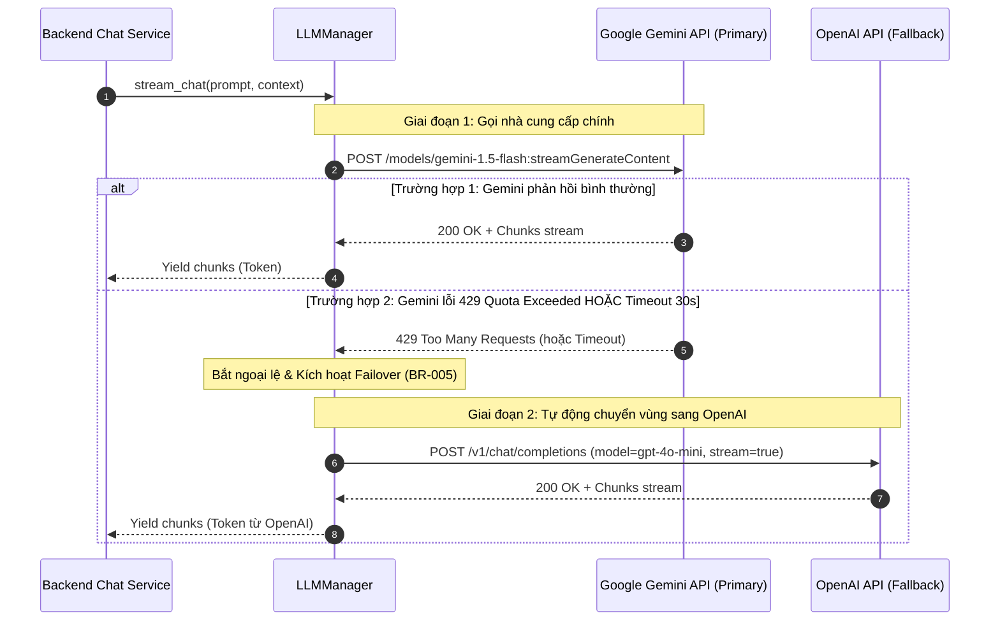

# SƠ ĐỒ ĐIỀU PHỐI AI & TỰ ĐỘNG CHUYỂN VÙNG DỰ PHÒNG (AI FAILOVER FLOW)
## BP-AI-001 [PROC-009] — Multi-Provider LLM Orchestration & Failover

---

## 1. Sơ Đồ Khối Điều Phối AI Đa Nhà Cung Cấp (BPMN / Decision Flowchart)

```mermaid
flowchart TD
    Start([Bắt đầu: Tiếp nhận prompt & context]) --> SelectPrimary[Chọn nhà cung cấp chính: Google Gemini API]
    
    SelectPrimary --> CallGemini[Gửi yêu cầu stream tới Google Gemini API<br/>Kèm Timeout 30 giây]
    
    CallGemini --> MonitorGemini{Gemini phản hồi<br/>thành công trong 30s?}
    
    MonitorGemini -- Có: Trả về Token stream --> StreamGemini[Chuyển tiếp Token stream tới Client]
    StreamGemini --> DoneGemini([Hoàn tất phản hồi từ Gemini])
    
    MonitorGemini -- Không: Lỗi 429 / 5xx / Timeout 30s --> CatchGeminiError[Bắt ngoại lệ lỗi từ Gemini<br/>Ghi log cảnh báo an ninh/vận hành]
    
    CatchGeminiError --> SwitchToOpenAI[Kích hoạt cơ chế Fallback (BR-005):<br/>Chọn nhà cung cấp phụ OpenAI API]
    
    SwitchToOpenAI --> CallOpenAI[Gửi lại prompt & context tới OpenAI API]
    
    CallOpenAI --> MonitorOpenAI{OpenAI phản hồi<br/>thành công?}
    
    MonitorOpenAI -- Có: Trả về Token stream --> StreamOpenAI[Chuyển tiếp Token stream từ OpenAI tới Client]
    StreamOpenAI --> DoneOpenAI([Hoàn tất phản hồi từ OpenAI])
    
    MonitorOpenAI -- Không: Cả 2 đều lỗi --> TotalFail[Bắt ngoại lệ cấp cao nhất<br/>Đóng luồng an toàn]
    TotalFail --> ReturnUserError[Gửi event SSE error: Dịch vụ AI tạm thời quá tải] --> EndFail([Kết thúc lỗi hệ thống thân thiện])

    style Start fill:#2b6cb0,stroke:#2c5282,color:#fff
    style SelectPrimary fill:#3182ce,stroke:#2b6cb0,color:#fff
    style DoneGemini fill:#2f855a,stroke:#276749,color:#fff
    style DoneOpenAI fill:#2f855a,stroke:#276749,color:#fff
    style SwitchToOpenAI fill:#d69e2e,stroke:#b7791f,color:#fff
    style EndFail fill:#c53030,stroke:#9b2c2c,color:#fff
```

---

## 2. Sơ Đồ Tuần Tự Chuyển Vùng Trong Suốt (Failover Sequence Diagram)


