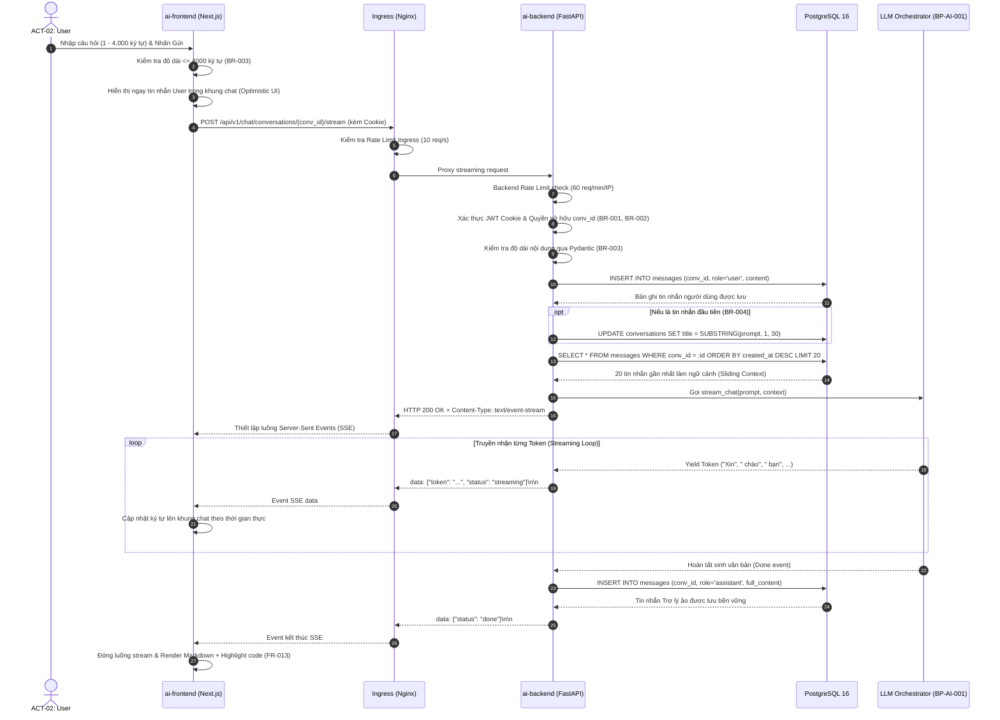
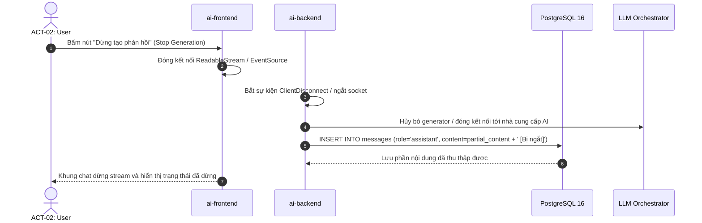

# SƠ ĐỒ QUY TRÌNH GỬI TIN NHẮN & STREAMING CHAT (CHAT FLOW)
## BP-CHAT-001 [PROC-008] — Send Message & SSE Streaming Interaction

---

## 1. Sơ Đồ Phân Làn Trách Nhiệm Toàn Diện (End-to-End Swimlane Sequence)

---

## 2. Sơ Đồ Xử Lý Dừng Sinh Phản Hồi (Client Abort Flow)

