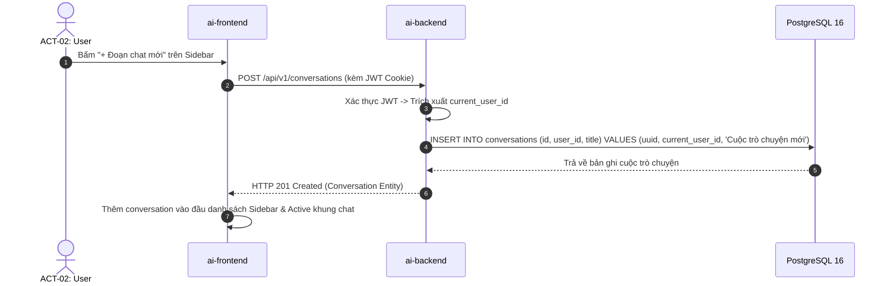
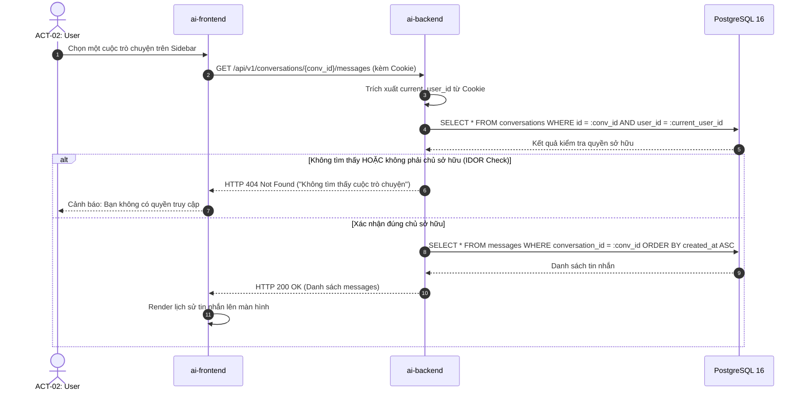
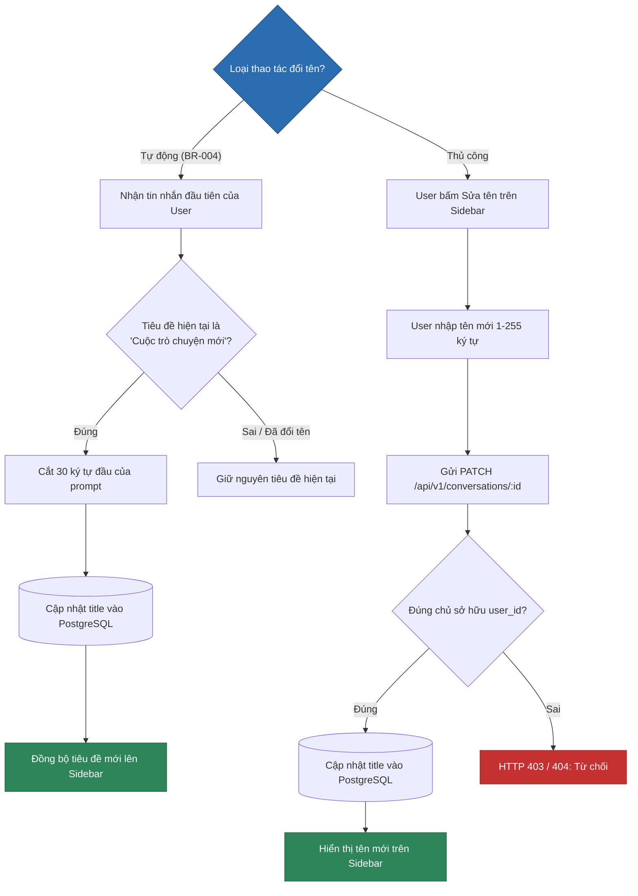

# SƠ ĐỒ QUY TRÌNH QUẢN LÝ CUỘC TRÒ CHUYỆN (CONVERSATION FLOWS)
## BP-CONV-001..004 [PROC-004..007] — Conversation Lifecycle Management

---

## 1. Sơ Đồ Khởi Tạo Cuộc Trò Chuyện Mới (BP-CONV-001 [PROC-004])

---

## 2. Sơ Đồ Nạp Lịch Sử & Kiểm Tra Quyền Sở Hữu (BP-CONV-002 [PROC-005] - Anti-IDOR)

---

## 3. Sơ Đồ Đổi Tên Tự Động & Thủ Công (BP-CONV-003 [PROC-006])

