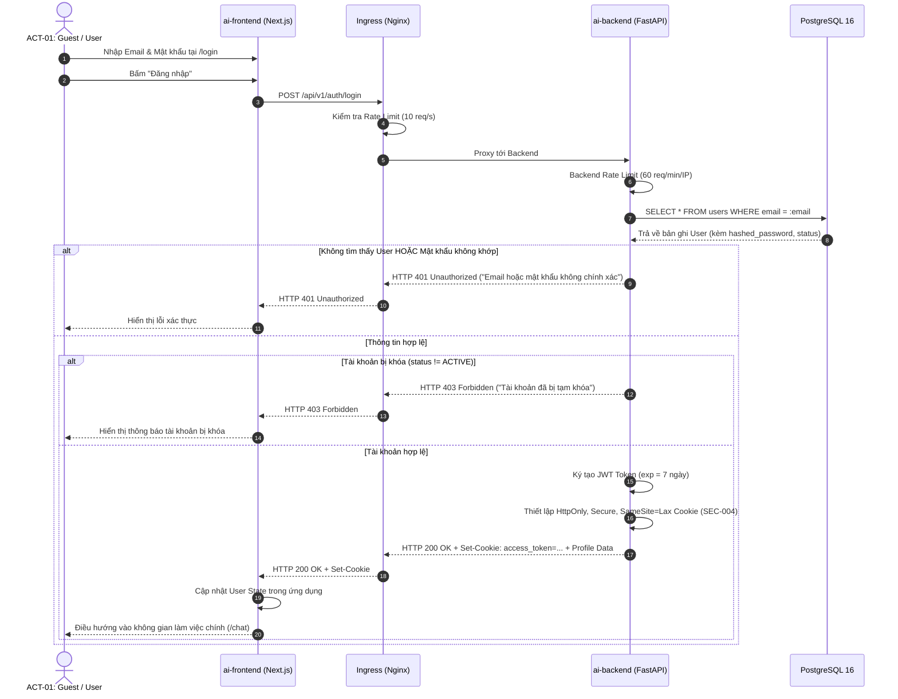
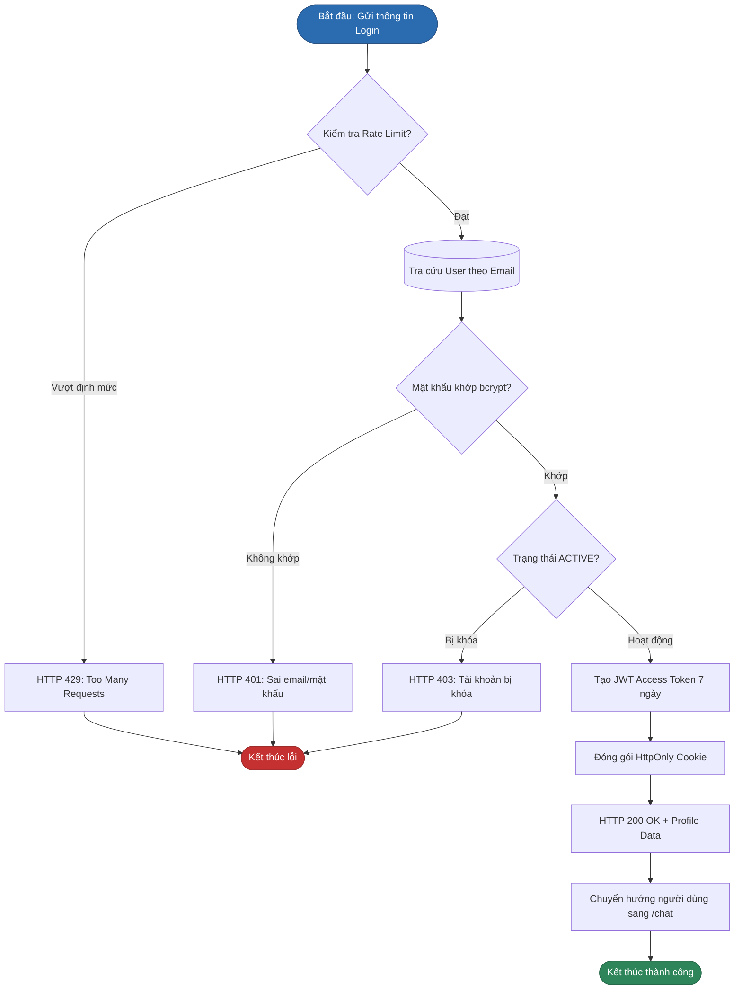

# SƠ ĐỒ QUY TRÌNH ĐĂNG NHẬP & CẤP PHIÊN (LOGIN FLOW)
## BP-AUTH-002 [PROC-002] — User Login & Session Establishment

---

## 1. Sơ Đồ Phân Làn Trách Nhiệm (Swimlane Sequence Diagram)

---

## 2. Sơ Đồ Luồng Logic Nghiệp Vụ (Flowchart)

