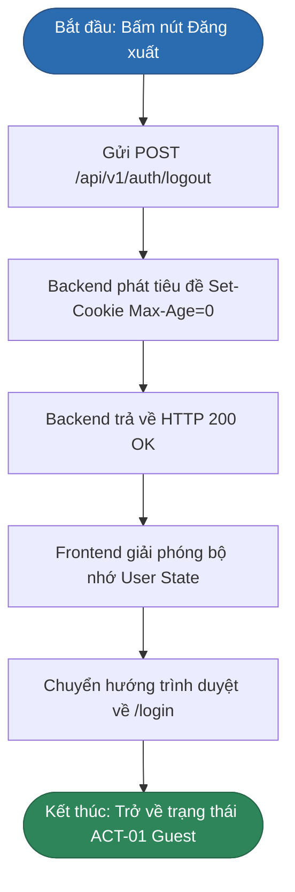

# SƠ ĐỒ QUY TRÌNH ĐĂNG XUẤT & THU HỒI PHIÊN (LOGOUT FLOW)
## BP-AUTH-003 [PROC-003] — User Logout & Session Revocation

---

## 1. Sơ Đồ Phân Làn Trách Nhiệm (Sequence Diagram)

```mermaid
sequenceDiagram
    autonumber
    actor User as ACT-02: Authenticated User
    participant UI as ai-frontend (Next.js)
    participant Gateway as Ingress (Nginx)
    participant API as ai-backend (FastAPI)

    User->>UI: Bấm nút "Đăng xuất" (tại Menu / Sidebar)
    UI->>Gateway: POST /api/v1/auth/logout (kèm Cookie hiện tại)
    Gateway->>API: Proxy yêu cầu tới Backend
    
    API->>API: Thiết lập phản hồi ghi đè Cookie: Set-Cookie: access_token=; Max-Age=0; Path=/; HttpOnly; SameSite=Lax
    API-->>Gateway: HTTP 200 OK ("Đăng xuất thành công")
    Gateway-->>UI: HTTP 200 OK + Clear Cookie Header
    
    UI->>UI: Xóa bỏ dữ liệu phiên trong State ứng dụng
    UI->>UI: Xóa bộ nhớ đệm lịch sử chat phía máy khách
    UI-->>User: Điều hướng tức thời về trang Đăng nhập (/login)
```

---

## 2. Sơ Đồ Luồng Logic (Flowchart)


