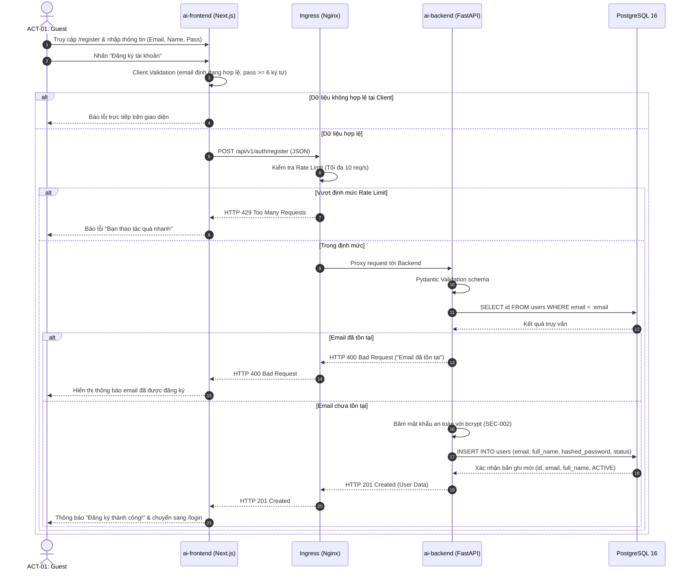
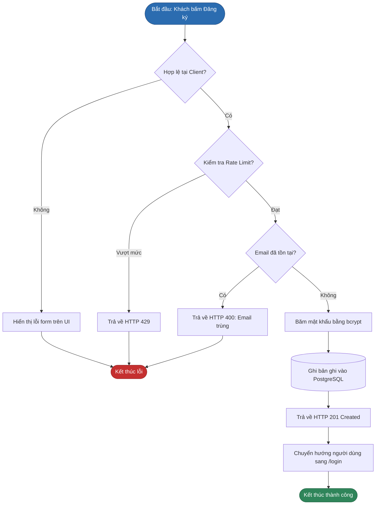

# SƠ ĐỒ QUY TRÌNH ĐĂNG KÝ TÀI KHOẢN (REGISTRATION FLOW)
## BP-AUTH-001 [PROC-001] — User Registration

---

## 1. Sơ Đồ Phân Làn Trách Nhiệm (Swimlane Diagram)

---

## 2. Sơ Đồ Luồng Logic Nghiệp Vụ (BPMN / Flowchart)

