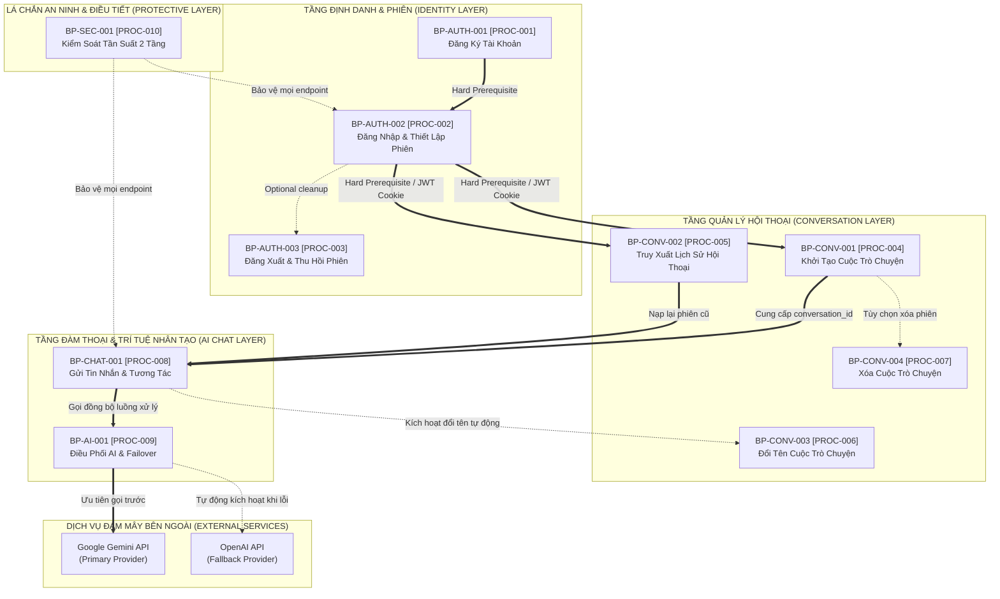

# QUAN HỆ PHỤ THUỘC QUY TRÌNH NGHIỆP VỤ (PROCESS DEPENDENCIES)
## Hệ Thống Website Chatbot Trợ Lý Ảo (AI-Chan Assistant)

---

| Thông Tin Tài Liệu | Chi Tiết |
| :--- | :--- |
| **Dự án** | Website Chatbot Trợ Lý Ảo (`ai-chan`) |
| **Mã tài liệu** | `BP-DEP-001` |
| **Trạng thái Baseline** | **BASELINED** |
| **Mục đích** | Xác định và phân loại các mối quan hệ phụ thuộc giữa các quy trình nghiệp vụ (Phụ thuộc cứng, Phụ thuộc mềm, Phụ thuộc dịch vụ ngoài), làm cơ sở cho kế hoạch phát triển và kiểm thử tích hợp |

---

## 1. Sơ Đồ Quan Hệ Phụ Thuộc Quy Trình (Process Dependency Graph)

---

## 2. Ma Trận Chi Tiết Phụ Thuộc Quy Trình (Dependency Matrix)

| Quy Trình Đích | Quy Trình Tiền Đề | Loại Phụ Thuộc | Cơ Sở Phụ Thuộc & Tác Động Khi Tiền Đề Thất Bại |
| :--- | :--- | :--- | :--- |
| **`BP-AUTH-002`** (Đăng nhập) | `BP-AUTH-001` (Đăng ký) | **Hard Dependency** | Bắt buộc phải có tài khoản tồn tại trong CSDL mới có thể xác thực đăng nhập. Nếu chưa đăng ký -> Hệ thống từ chối đăng nhập. |
| **`BP-AUTH-003`** (Đăng xuất) | `BP-AUTH-002` (Đăng nhập) | **Hard Dependency** | Chỉ người dùng đang mang phiên đăng nhập mới có nhu cầu và quyền thực hiện đăng xuất. |
| **`BP-CONV-001`** (Tạo chat) | `BP-AUTH-002` (Đăng nhập) | **Hard Dependency** | Bắt buộc phải có JWT Cookie xác thực danh tính để gắn `user_id` vào bản ghi cuộc trò chuyện (`BR-001`). Nếu không -> Mã lỗi 401. |
| **`BP-CONV-002`** (Lịch sử) | `BP-AUTH-002` (Đăng nhập) | **Hard Dependency** | Cần danh tính người dùng để lọc chỉ hiển thị các cuộc trò chuyện thuộc sở hữu của chính họ (`BR-002`). |
| **`BP-CONV-003`** (Đổi tên) | `BP-CONV-001` (Tạo chat) | **Hard Dependency** | Cuộc trò chuyện phải tồn tại trước khi có thể đổi tên (dù tự động hay thủ công). |
| **`BP-CONV-004`** (Xóa chat) | `BP-CONV-001` (Tạo chat) | **Hard Dependency** | Phải có cuộc trò chuyện tồn tại thì mới có thể thực hiện thao tác xóa. |
| **`BP-CHAT-001`** (Gửi tin nhắn) | `BP-CONV-001` (Tạo chat) | **Hard Dependency** | Tin nhắn bắt buộc phải thuộc về một `conversation_id` hợp lệ. |
| **`BP-CHAT-001`** (Gửi tin nhắn) | `BP-AUTH-002` (Đăng nhập) | **Hard Dependency** | Người gửi bắt buộc phải là chủ sở hữu đã xác thực của cuộc trò chuyện (`BR-001`, `BR-002`). |
| **`BP-CHAT-001`** (Gửi tin nhắn) | `BP-CONV-003` (Đổi tên) | **Soft Dependency** | Khi gửi tin nhắn đầu tiên, `BP-CHAT-001` kích hoạt `BP-CONV-003` tự động. Nếu đổi tên gặp lỗi, luồng chat chính vẫn tiếp tục hoàn tất bình thường. |
| **`BP-CHAT-001`** (Gửi tin nhắn) | `BP-AI-001` (Điều phối AI) | **Hard Dependency** | Tiến trình chat cần kết quả từ `LLMManager` để stream phản hồi về cho người dùng. |
| **`BP-AI-001`** (Điều phối AI) | Google Gemini API | **External Dependency** | Cần dịch vụ đám mây của Google phản hồi qua Internet. Nếu lỗi -> Chuyển sang OpenAI API. |
| **`BP-AI-001`** (Điều phối AI) | OpenAI API | **External Dependency** | Cần dịch vụ đám mây của OpenAI phản hồi khi Gemini gặp sự cố (`BR-005`). |
| Mọi quy trình | `BP-SEC-001` (Rate Limit) | **Protective Dependency** | Nếu lưu lượng vượt định mức (10 req/s hoặc 60 req/min), yêu cầu bị chặn đứng trước khi đến quy trình nghiệp vụ (`BR-006`). |

---

## 3. Phân Loại Tính Chất Phụ Thuộc (Dependency Classification)

1. **Phụ Thuộc Cứng (Hard Dependency - Khóa Chặn)**:
   - Các quy trình mà nếu tiền đề chưa hoàn thành hoặc thất bại, quy trình phía sau **không thể thực hiện được**.
   - Ví dụ: Không thể gửi tin nhắn nếu chưa đăng nhập hoặc chưa có cuộc trò chuyện.
2. **Phụ Thuộc Mềm (Soft Dependency - Không Khóa Chặn)**:
   - Các quy trình mà sự thất bại của nhánh phụ **không làm gián đoạn** dòng chảy chính.
   - Ví dụ: Việc tự động trích xuất tiêu đề cuộc trò chuyện thất bại không làm ảnh hưởng tới việc AI phản hồi câu hỏi của người dùng.
3. **Phụ Thuộc Bên Ngoài (External Dependency - Rủi Ro Cao)**:
   - Phụ thuộc vào dịch vụ Internet của bên thứ ba ngoài tầm kiểm soát của ứng dụng nội bộ.
   - Bắt buộc phải có cơ chế phòng vệ chuyển vùng dự phòng (Graceful Degradation / Failover) như đã thiết kế trong `BP-AI-001 [PROC-009]`.
