# CƠ CẤU PHÂN CẤP QUY TRÌNH NGHIỆP VỤ (PROCESS HIERARCHY)
## Hệ Thống Website Chatbot Trợ Lý Ảo (AI-Chan Assistant)

---

| Thông Tin Tài Liệu | Chi Tiết |
| :--- | :--- |
| **Dự án** | Website Chatbot Trợ Lý Ảo (`ai-chan`) |
| **Mã tài liệu** | `BP-HIERARCHY-001` |
| **Trạng thái Baseline** | **BASELINED** |
| **Mục đích** | Mô hình hóa mối quan hệ phân cấp từ Miền nghiệp vụ (Domain) -> Lĩnh vực chức năng -> Quy trình nghiệp vụ (Business Process) -> Các bước tác vụ (Process Tasks), phản ánh trung thực kiến trúc vận hành của hệ thống |

---

## 1. Sơ Đồ Cây Phân Cấp Quy Trình (Process Decomposition Tree)

```text
HỆ THỐNG TRỢ LÝ ẢO AI-CHAN
│
├── 1. MIỀN XÁC THỰC & ĐỊNH DANH (IDENTITY & ACCESS MANAGEMENT)
│   ├── 1.1 BP-AUTH-001 [PROC-001]: Đăng Ký Tài Khoản Người Dùng Mới
│   │   ├── Task 1.1.1: Tiếp nhận và xác thực dữ liệu đầu vào (Email, Họ tên, Mật khẩu)
│   │   ├── Task 1.1.2: Kiểm tra tính duy nhất của địa chỉ Email trong cơ sở dữ liệu
│   │   ├── Task 1.1.3: Mã hóa băm mật khẩu bằng thuật toán an toàn bcrypt
│   │   └── Task 1.1.4: Lưu trữ bản ghi người dùng mới và khởi tạo trạng thái ACTIVE
│   │
│   ├── 1.2 BP-AUTH-002 [PROC-002]: Đăng Nhập & Thiết Lập Phiên Làm Việc
│   │   ├── Task 1.2.1: Tiếp nhận thông tin định danh (Email, Password)
│   │   ├── Task 1.2.2: Tra cứu tài khoản và đối chiếu mật khẩu băm
│   │   ├── Task 1.2.3: Tạo lập mã định danh phiên JWT (Access Token thời hạn 7 ngày)
│   │   ├── Task 1.2.4: Đóng gói Token vào HttpOnly Secure Cookie
│   │   └── Task 1.2.5: Trả về thông tin hồ sơ người dùng cơ bản và điều hướng giao diện
│   │
│   └── 1.3 BP-AUTH-003 [PROC-003]: Đăng Xuất & Hủy Bỏ Phiên Làm Việc
│       ├── Task 1.3.1: Tiếp nhận yêu cầu đăng xuất từ người dùng
│       ├── Task 1.3.2: Ghi đè Cookie phiên với Max-Age=0 để xóa Cookie trên trình duyệt
│       └── Task 1.3.3: Giải phóng bộ nhớ trạng thái người dùng tại Client và chuyển hướng về trang Login
│
├── 2. MIỀN QUẢN LÝ PHIÊN HỘI THOẠI (CONVERSATION LIFECYCLE MANAGEMENT)
│   ├── 2.1 BP-CONV-001 [PROC-004]: Khởi Tạo Cuộc Trò Chuyện Mới
│   │   ├── Task 2.1.1: Xác thực quyền hạn người dùng thông qua Cookie phiên
│   │   ├── Task 2.1.2: Tạo bản ghi Conversation mới với tiêu đề mặc định "Cuộc trò chuyện mới"
│   │   └── Task 2.1.3: Cập nhật danh sách Sidebar và mở khung chat mới
│   │
│   ├── 2.2 BP-CONV-002 [PROC-005]: Truy Xuất Danh Sách & Lịch Sử Cuộc Trò Chuyện
│   │   ├── Task 2.2.1: Truy vấn danh mục các cuộc trò chuyện thuộc sở hữu của người dùng hiện tại
│   │   ├── Task 2.2.2: Sắp xếp danh mục theo thứ tự thời gian giảm dần
│   │   └── Task 2.2.3: Tải chi tiết các tin nhắn trong cuộc trò chuyện được chọn
│   │
│   ├── 2.3 BP-CONV-003 [PROC-006]: Đổi Tên Cuộc Trò Chuyện (Tự Động & Thủ Công)
│   │   ├── Task 2.3.1 (Tự động): Trích xuất 30 ký tự đầu từ tin nhắn đầu tiên khi tiêu đề là mặc định
│   │   ├── Task 2.3.2 (Thủ công): Tiếp nhận tiêu đề mới do người dùng chủ động chỉnh sửa
│   │   └── Task 2.3.3: Kiểm tra quyền sở hữu và cập nhật tiêu đề vào cơ sở dữ liệu
│   │
│   └── 2.4 BP-CONV-004 [PROC-007]: Xóa Cuộc Trò Chuyện & Dữ Liệu Liên Quan
│       ├── Task 2.4.1: Kiểm tra quyền sở hữu cuộc trò chuyện (chống IDOR)
│       ├── Task 2.4.2: Xóa cuộc trò chuyện và các tin nhắn con thuộc cuộc trò chuyện đó
│       └── Task 2.4.3: Cập nhật giao diện Sidebar và xóa khung chat tương ứng
│
├── 3. MIỀN TƯƠNG TÁC ĐÀM THOẠI & ĐIỀU PHỐI AI (CHAT & LLM ORCHESTRATION)
│   ├── 3.1 BP-CHAT-001 [PROC-008]: Gửi Tin Nhắn & Tương Tác Đàm Thoại
│   │   ├── Task 3.1.1: Tiếp nhận và xác thực tính hợp lệ của tin nhắn (1 - 4,000 ký tự)
│   │   ├── Task 3.1.2: Xác thực quyền sở hữu cuộc trò chuyện hiện tại
│   │   ├── Task 3.1.3: Lưu trữ tin nhắn của người dùng vào cơ sở dữ liệu (role = user)
│   │   ├── Task 3.1.4: Nạp lịch sử ngữ cảnh gần nhất của cuộc trò chuyện
│   │   ├── Task 3.1.5: Kích hoạt quy trình điều phối AI BP-AI-001 [PROC-009]
│   │   ├── Task 3.1.6: Thiết lập luồng truyền Server-Sent Events (SSE) về trình duyệt
│   │   ├── Task 3.1.7: Tích lũy toàn bộ phản hồi và lưu vào cơ sở dữ liệu (role = assistant)
│   │   └── Task 3.1.8: Render định dạng Markdown và syntax highlighting tại giao diện
│   │
│   └── 3.2 BP-AI-001 [PROC-009]: Điều Phối AI & Tự Động Chuyển Vùng Dự Phòng
│       ├── Task 3.2.1: Đóng gói ngữ cảnh hội thoại và prompt người dùng theo schema chuẩn
│       ├── Task 3.2.2: Gọi mô hình chính Google Gemini API kèm cơ chế kiểm soát timeout 30s
│       ├── Task 3.2.3: Bắt ngoại lệ nếu Gemini phản hồi lỗi (429, 5xx, timeout)
│       ├── Task 3.2.4: Tự động kích hoạt mô hình phụ OpenAI API để tiếp tục phản hồi
│       └── Task 3.2.5: Trả về luồng token liên tục và ghi log điều phối phục vụ giám sát
│
└── 4. MIỀN BẢO VỆ AN NINH & GIỚI HẠN TẢI (PROTECTION & TRAFFIC CONTROL)
    └── 4.1 BP-SEC-001 [PROC-010]: Kiểm Soát Tần Suất Yêu Cầu 2 Tầng
        ├── Task 4.1.1: Kiểm tra ngưỡng tại tầng Ingress Gateway (Tối đa 10 req/s mỗi IP)
        ├── Task 4.1.2: Kiểm tra ngưỡng tại tầng Backend Application (Tối đa 60 req/phút mỗi IP)
        └── Task 4.1.3: Chặn đứng các yêu cầu vượt ngưỡng với mã lỗi HTTP 429 Too Many Requests
```

---

## 2. Sơ Đồ Trực Quan Phân Rã Quy Trình (Decomposition Diagram)

```mermaid
graph TD
    System["HỆ THỐNG AI-CHAN ASSISTANT"]

    Domain1["1. Xác Thực & Định Danh"]
    Domain2["2. Quản Lý Cuộc Trò Chuyện"]
    Domain3["3. Đàm Thoại & Điều Phối AI"]
    Domain4["4. Bảo Vệ & An Ninh"]

    System --> Domain1
    System --> Domain2
    System --> Domain3
    System --> Domain4

    Domain1 --> P1["BP-AUTH-001 [PROC-001]<br/>Đăng Ký Tài Khoản"]
    Domain1 --> P2["BP-AUTH-002 [PROC-002]<br/>Đăng Nhập & Phiên"]
    Domain1 --> P3["BP-AUTH-003 [PROC-003]<br/>Đăng Xuất & Hủy Phiên"]

    Domain2 --> P4["BP-CONV-001 [PROC-004]<br/>Tạo Cuộc Trò Chuyện"]
    Domain2 --> P5["BP-CONV-002 [PROC-005]<br/>Lịch Sử Cuộc Trò Chuyện"]
    Domain2 --> P6["BP-CONV-003 [PROC-006]<br/>Đổi Tên Cuộc Trò Chuyện"]
    Domain2 --> P7["BP-CONV-004 [PROC-007]<br/>Xóa Cuộc Trò Chuyện"]

    Domain3 --> P8["BP-CHAT-001 [PROC-008]<br/>Gửi Tin Nhắn & Chat"]
    Domain3 --> P9["BP-AI-001 [PROC-009]<br/>Điều Phối AI & Failover"]

    Domain4 --> P10["BP-SEC-001 [PROC-010]<br/>Kiểm Soát Tần Suất 2 Tầng"]

    style System fill:#2d3748,stroke:#4a5568,stroke-width:2px,color:#fff
    style Domain1 fill:#3182ce,stroke:#2b6cb0,stroke-width:2px,color:#fff
    style Domain2 fill:#38a169,stroke:#2f855a,stroke-width:2px,color:#fff
    style Domain3 fill:#d69e2e,stroke:#b7791f,stroke-width:2px,color:#fff
    style Domain4 fill:#e53e3e,stroke:#c53030,stroke-width:2px,color:#fff
```


