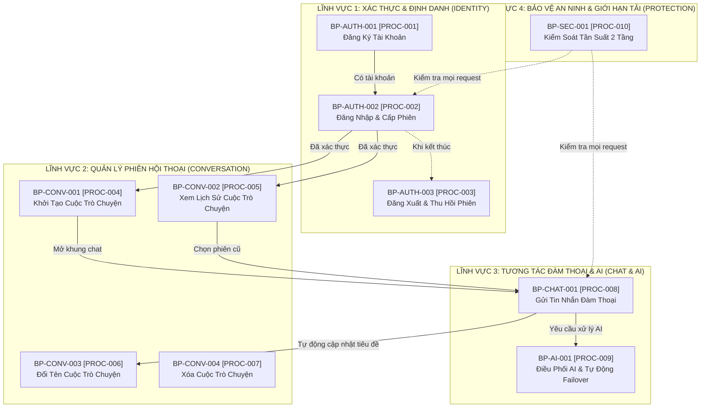

# MÔ HÌNH QUY TRÌNH NGHIỆP VỤ TỔNG THỂ (OVERALL BUSINESS PROCESS MODEL)
## Hệ Thống Website Chatbot Trợ Lý Ảo (AI-Chan Assistant)

---

| Thông Tin Mô Hình | Chi Tiết |
| :--- | :--- |
| **Dự án** | Website Chatbot Trợ Lý Ảo (`ai-chan`) |
| **Mã tài liệu** | `BPM-MODEL-001` |
| **Mục đích** | Cung cấp bức tranh toàn cảnh về kiến trúc quy trình nghiệp vụ (Business Process Architecture), phân loại quy trình và định hình ranh giới hoạt động giữa Người dùng, Hệ thống nội bộ và Dịch vụ AI bên ngoài |
| **Nguyên tắc** | Tách bạch rõ ranh giới trách nhiệm; phản ánh chính xác luồng dữ liệu nghiệp vụ thực tế |

---

## 1. Sơ Đồ Kiến Trúc Quy Trình Nghiệp Vụ Tổng Thể (Process Landscape Map)



---

## 2. Phân Loại Các Nhóm Quy Trình Nghiệp Vụ (Process Classification)

Hệ thống AI-Chan phân rã thành **4 nhóm quy trình nghiệp vụ chính**:

### 2.1 Quy Trình Nghiệp Vụ Cốt Lõi (Core Business Processes)
*Các quy trình trực tiếp tạo ra giá trị nghiệp vụ trọng tâm cho người dùng:*
1. **BP-CHAT-001 [PROC-008] (Gửi Tin Nhắn & Tương Tác Đàm Thoại)**: Cho phép người dùng trao đổi thông tin, gửi prompt, và nhận câu trả lời dạng văn bản/mã nguồn qua giao diện web.
2. **BP-AI-001 [PROC-009] (Điều Phối Mô Hình AI & Tự Động Chuyển Vùng Dự Phòng)**: Phân tích ngữ cảnh, điều hướng gọi Google Gemini API, bắt lỗi và tự động kích hoạt failover sang OpenAI API để bảo toàn tính liên tục của cuộc trò chuyện.
3. **BP-CONV-001 [PROC-004] (Khởi Tạo Cuộc Trò Chuyện Mới)**: Tạo không gian trao đổi độc lập gắn liền với danh tính người dùng.

### 2.2 Quy Trình Phụ Trợ Nghiệp Vụ (Supporting Business Processes)
*Các quy trình thiết lập nền tảng để các quy trình cốt lõi có thể vận hành an toàn:*
1. **BP-AUTH-001 [PROC-001] (Đăng Ký Tài Khoản)**: Tiếp nhận thông tin, kiểm tra tính hợp lệ và lưu trữ tài khoản người dùng mới.
2. **BP-AUTH-002 [PROC-002] (Đăng Nhập & Thiết Lập Phiên)**: Đối chiếu mật khẩu băm, phát hành mã thông báo JWT bảo mật trong Cookie.
3. **BP-AUTH-003 [PROC-003] (Đăng Xuất & Hủy Bỏ Phiên)**: Xóa Cookie xác thực và giải phóng trạng thái phiên.
4. **BP-CONV-002 [PROC-005] (Truy Xuất Lịch Sử Hội Thoại)**: Tải và hiển thị danh sách các cuộc trò chuyện theo thứ tự thời gian.
5. **BP-CONV-003 [PROC-006] (Đổi Tên Cuộc Trò Chuyện)**: Tự động trích xuất tiêu đề sau câu hỏi đầu tiên hoặc cập nhật theo yêu cầu thủ công.
6. **BP-CONV-004 [PROC-007] (Xóa Cuộc Trò Chuyện)**: Ẩn và giải phóng cuộc trò chuyện cùng các tin nhắn con khỏi phạm vi hiển thị.

### 2.3 Quy Trình Tích Hợp Hệ Thống Bên Ngoài (External Integration Processes)
*Các quy trình giao tiếp qua mạng Internet với dịch vụ đám mây:*
1. **Gọi Mô Hình Google Gemini API**: Truyền prompt, nhận dữ liệu stream dạng Server-Sent Events.
2. **Gọi Mô Hình OpenAI API**: Tiếp nhận yêu cầu chuyển vùng dự phòng khi Gemini quá tải/hết quota.

### 2.4 Quy Trình Kiểm Soát An Ninh & Phòng Thủ (Security Control Processes)
*Các quy trình tự động bảo vệ hệ thống trước sự cố và tấn công lạm dụng:*
1. **BP-SEC-001 [PROC-010] (Kiểm Soát Tần Suất & Chống Lạm Dụng)**: Cắt tỉa lưu lượng tại Ingress Gateway (10 r/s) và bộ đếm trượt tại Application Backend (60 r/min/IP).

---

## 3. Ranh Giới Hệ Thống & Các Bên Tham Gia (System Boundaries & Participants)

```text
┌────────────────────────────────────────────────────────────────────────┐
│                              NGƯỜI DÙNG                                │
│                     [ACT-01: Guest] / [ACT-02: User]                   │
└───────────────────────────────────┬────────────────────────────────────┘
                                    │ Tương tác giao diện Web (HTTPS)
                                    ▼
┌────────────────────────────────────────────────────────────────────────┐
│                    RANH GIỚI HỆ THỐNG NỘI BỘ (AI-CHAN)                 │
│                                                                        │
│  ┌───────────────────────┐         ┌────────────────────────────────┐  │
│  │     ai-frontend       │         │           ai-infra             │  │
│  │ (Next.js App Router)  │◄───────►│ (Nginx Gateway: Ingress/SSL)   │  │
│  └───────────┬───────────┘         └────────────────┬───────────────┘  │
│              │ REST API / SSE                       │                  │
│              ▼                                      ▼                  │
│  ┌──────────────────────────────────────────────────────────────────┐  │
│  │                           ai-backend                             │  │
│  │            (FastAPI Core, Security, LLM Orchestrator)            │  │
│  └───────────────────┬──────────────────────────────┬───────────────┘  │
│                      │ SQLAlchemy                   │ Redis Protocol   │
│                      ▼                              ▼                  │
│  ┌──────────────────────────────────────┐  ┌────────────────────────┐  │
│  │             PostgreSQL 16            │  │        Redis 7         │  │
│  │      (Users, Convs, Messages)        │  │     (Rate Limit/Cache) │  │
│  └──────────────────────────────────────┘  └────────────────────────┘  │
└───────────────────────────────────┬────────────────────────────────────┘
                                    │ HTTPS API Call qua Internet
                                    ▼
┌────────────────────────────────────────────────────────────────────────┐
│                 DỊCH VỤ AI BÊN NGOÀI (EXTERNAL SERVICES)                │
│             [Primary: Google Gemini] / [Fallback: OpenAI API]          │
└────────────────────────────────────────────────────────────────────────┘
```
