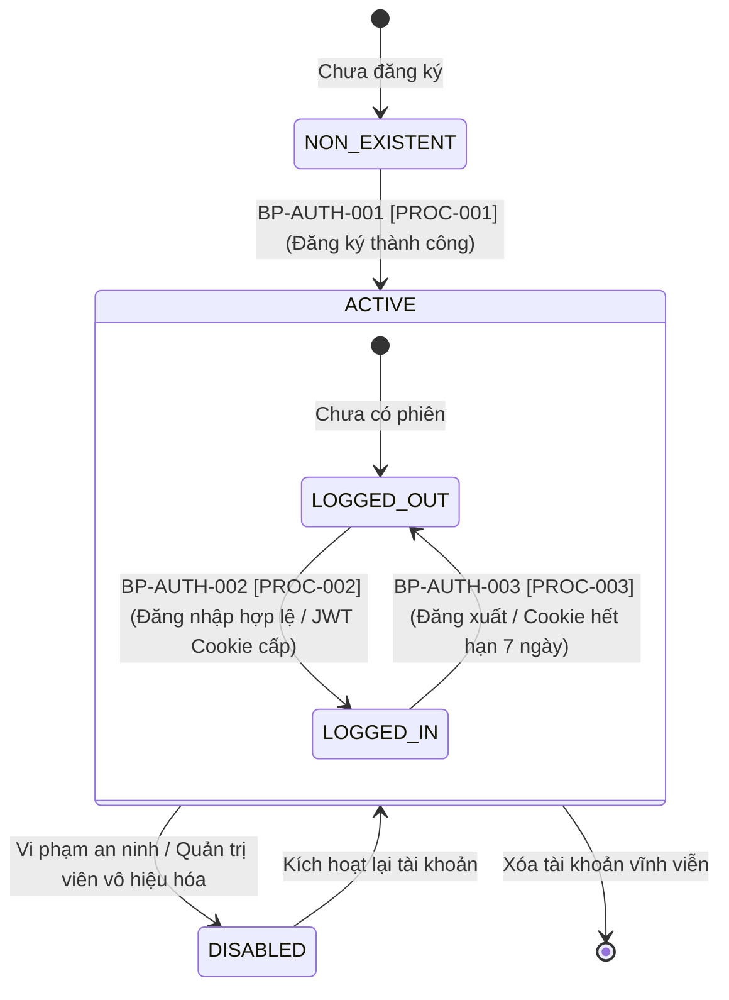
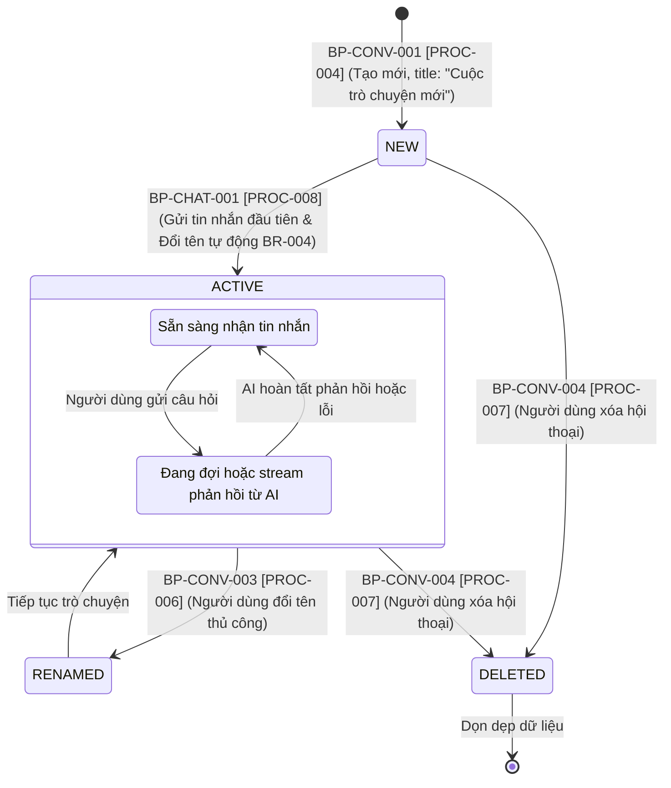
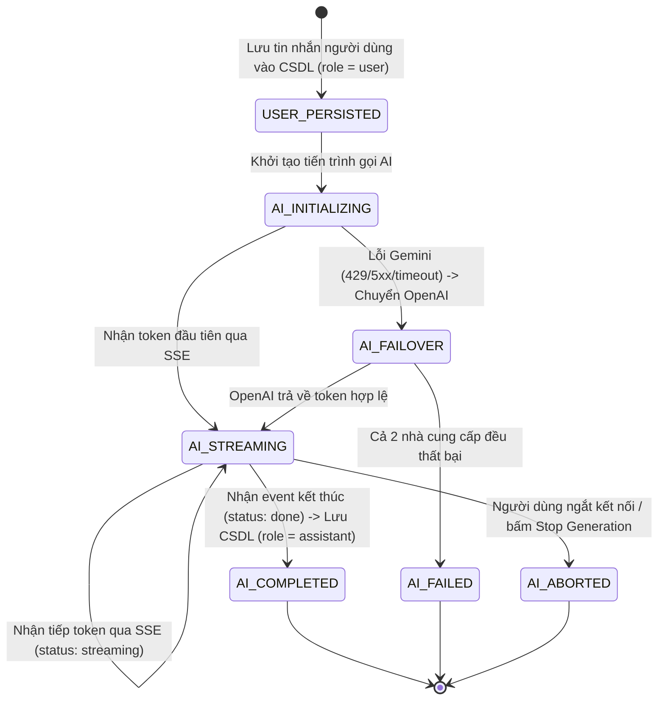
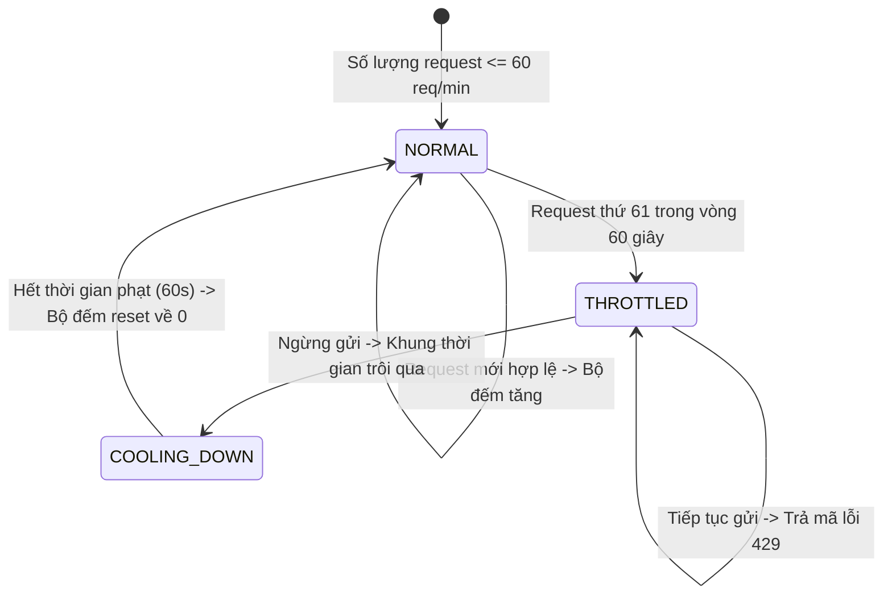

# VÒNG ĐỜI TRẠNG THÁI NGHIỆP VỤ (BUSINESS PROCESS STATES & LIFECYCLES)
## Hệ Thống Website Chatbot Trợ Lý Ảo (AI-Chan Assistant)

---

| Thông Tin Tài Liệu | Chi Tiết |
| :--- | :--- |
| **Dự án** | Website Chatbot Trợ Lý Ảo (`ai-chan`) |
| **Mã tài liệu** | `BP-STATES-001` |
| **Trạng thái Baseline** | **BASELINED** |
| **Mục đích** | Mô hình hóa trạng thái và quy luật chuyển dịch trạng thái (State Transitions) của các thực thể nghiệp vụ cốt lõi trong suốt quá trình thực thi các quy trình hệ thống |

---

## 1. Vòng Đời Trạng Thái Tài Khoản Người Dùng (User Account Lifecycle)

### 1.1 Sơ Đồ Chuyển Dịch Trạng Thái Tài Khoản

### 1.2 Bảng Đặc Tả Trạng Thái Tài Khoản

| Tên Trạng Thái | Ý Nghĩa Nghiệp Vụ | Quyền Hạn Trong Quy Trình |
| :--- | :--- | :--- |
| **`NON_EXISTENT`** | Chưa có thông tin trong CSDL | Chỉ có thể kích hoạt quy trình Đăng ký (`BP-AUTH-001`). |
| **`ACTIVE: LOGGED_OUT`** | Tài khoản hợp lệ nhưng chưa đăng nhập | Có thể Đăng nhập (`BP-AUTH-002`); bị chặn mọi quy trình chat và hội thoại (`BR-001`). |
| **`ACTIVE: LOGGED_IN`** | Đang duy trì phiên làm việc với JWT hợp lệ | Toàn quyền tạo hội thoại (`BP-CONV-001`), gửi tin nhắn (`BP-CHAT-001`), xem lịch sử (`BP-CONV-002`). |
| **`DISABLED`** | Tài khoản bị tạm khóa hoặc vô hiệu hóa | Bị chặn đăng nhập và bị từ chối mọi yêu cầu API với lỗi `HTTP 403 Forbidden`. |

---

## 2. Vòng Đời Trạng Thái Cuộc Trò Chuyện (Conversation Lifecycle)

### 2.1 Sơ Đồ Chuyển Dịch Trạng Thái Hội Thoại

### 2.2 Bảng Đặc Tả Trạng Thái Hội Thoại

| Trạng Thái | Tiêu Đề Hiển Thị | Hành Vi Hệ Thống |
| :--- | :--- | :--- |
| **`NEW`** | `"Cuộc trò chuyện mới"` | Mới khởi tạo, chưa có tin nhắn nào trong bảng `messages`. Sẵn sàng kích hoạt đổi tên tự động khi có tin nhắn đầu tiên (`BR-004`). |
| **`ACTIVE (IDLE)`** | Tiêu đề đã đặt (tự động hoặc thủ công) | Có ít nhất 1 cặp tin nhắn; không có tác vụ streaming nào đang chạy; sẵn sàng nhận câu hỏi tiếp theo. |
| **`ACTIVE (PROCESSING)`**| Tiêu đề hiện tại | Khung chat khóa nút gửi; biểu tượng spinner hoặc hiệu ứng streaming hiển thị; đang nhận token từ AI. |
| **`DELETED`** | Bị loại bỏ | Cuộc trò chuyện bị xóa khỏi CSDL và không còn hiển thị trên Sidebar (`BR-002`). |

---

## 3. Vòng Đời Trạng Thái Tin Nhắn Đàm Thoại (Message Lifecycle)

### 3.1 Sơ Đồ Trạng Thái Tin Nhắn

### 3.2 Bảng Đặc Tả Trạng Thái Tin Nhắn

| Trạng Thái | Vị Trí Lưu Trữ | Hành Vi Giao Diện |
| :--- | :--- | :--- |
| **`USER_PERSISTED`** | Đã lưu vào CSDL (`role = user`) | Tin nhắn người dùng xuất hiện ở góc phải khung chat. |
| **`AI_INITIALIZING`**| Chưa lưu phản hồi | Hiển thị bong bóng chat bot với biểu tượng "Đang suy nghĩ...". |
| **`AI_STREAMING`** | Bộ nhớ đệm Client | Từng ký tự/từ ngữ xuất hiện liên tục kèm con trỏ nhấp nháy. |
| **`AI_COMPLETED`** | Đã lưu đầy đủ vào CSDL (`role = assistant`)| Định dạng Markdown được render hoàn chỉnh kèm nút sao chép mã nguồn (`FR-013`). |
| **`AI_ABORTED`** | Đã lưu phần nội dung dở dang vào CSDL | Dừng stream; hiển thị thông báo "(Đã dừng tạo phản hồi)". |
| **`AI_FAILED`** | Lưu tin nhắn cảnh báo lỗi hệ thống | Hiển thị bong bóng lỗi màu đỏ kèm nút "Thử lại". |

---

## 4. Vòng Đời Trạng Thái Kiểm Soát Tần Suất (Rate Limiting State)

