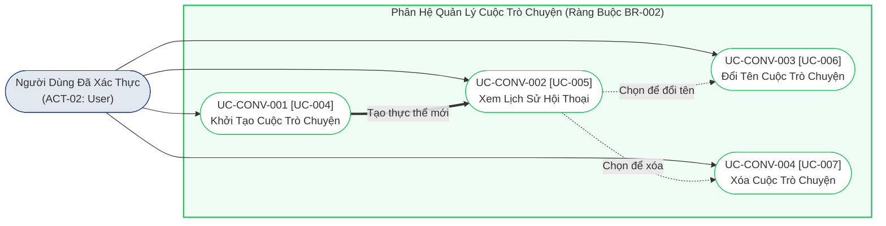

# SƠ ĐỒ CA SỬ DỤNG PHÂN HỆ QUẢN LÝ CUỘC TRÒ CHUYỆN (CONVERSATION USE CASES)
## Hệ Thống Website Chatbot Trợ Lý Ảo (AI-Chan Assistant)

---

## 1. Sơ Đồ Ca Sử Dụng Quản Lý Cuộc Trò Chuyện & Lịch Sử

