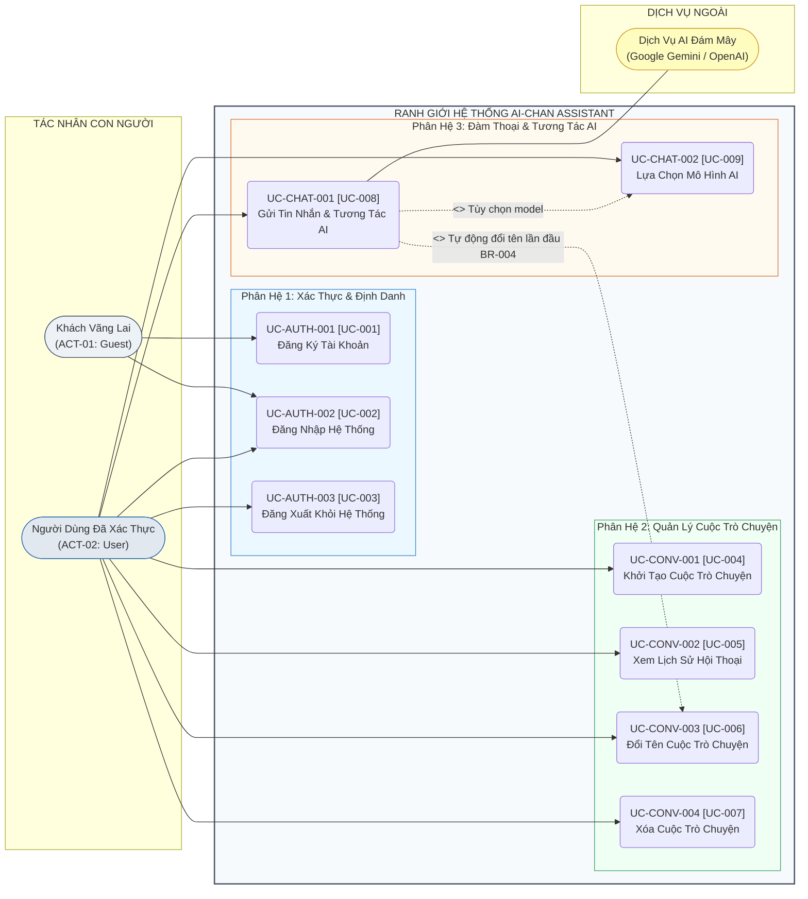

# MÔ HÌNH CA SỬ DỤNG TỔNG THỂ (OVERALL USE CASE MODEL)
## Hệ Thống Website Chatbot Trợ Lý Ảo (AI-Chan Assistant)

---

| Thông Tin Mô Hình | Chi Tiết |
| :--- | :--- |
| **Dự án** | Website Chatbot Trợ Lý Ảo (`ai-chan`) |
| **Mã tài liệu** | `UC-MODEL-001` |
| **Trạng thái Baseline** | **BASELINED** |
| **Mục đích** | Mô hình hóa toàn bộ các Ca sử dụng của hệ thống, phân định ranh giới tương tác giữa Tác nhân người dùng và Hệ thống phần mềm, xác định rõ các mối quan hệ phụ thuộc (`<<include>>`, `<<extend>>`) |

---

## 1. Ranh Giới Hệ Thống & Các Tác Nhân (System Boundary & Actors)

Ranh giới hệ thống phân định rõ:
- **Bên ngoài ranh giới (External)**:
  - `ACT-01: Guest (Khách vãng lai)`: Người dùng duyệt web chưa xác thực.
  - `ACT-02: User (Người dùng đã xác thực)`: Người dùng đã đăng ký và đăng nhập thành công.
  - `EXT-AI: External AI Provider`: Dịch vụ trí tuệ nhân tạo bên thứ ba (Google Gemini API / OpenAI API).
- **Bên trong ranh giới (Internal Boundary - AI-Chan Assistant System)**:
  - Toàn bộ các ca sử dụng cung cấp giá trị cho Actor.

---

## 2. Sơ Đồ Ca Sử Dụng Tổng Thể (Overall Use Case Diagram)

---

## 3. Phân Rã Các Nhóm Ca Sử Dụng Chính (Use Case Grouping)

### 3.1 Phân Hệ Xác Thực & Định Danh (Authentication & Identity)
- **`UC-AUTH-001 [UC-001]` (Đăng Ký Tài Khoản)**: Khách vãng lai cung cấp thông tin để mở tài khoản cá nhân mới trong hệ thống.
- **`UC-AUTH-002 [UC-002]` (Đăng Nhập Hệ Thống)**: Người dùng xác thực thông tin đăng nhập để thiết lập phiên làm việc được bảo vệ bằng HttpOnly Cookie.
- **`UC-AUTH-003 [UC-003]` (Đăng Xuất Khỏi Hệ Thống)**: Người dùng chủ động kết thúc phiên làm việc để bảo mật thông tin trên thiết bị.

### 3.2 Phân Hệ Quản Lý Cuộc Trò Chuyện (Conversation Management)
- **`UC-CONV-001 [UC-004]` (Khởi Tạo Cuộc Trò Chuyện Mới)**: Người dùng tạo một không gian hội thoại độc lập mới với tiêu đề mặc định.
- **`UC-CONV-002 [UC-005]` (Xem Lịch Sử Hội Thoại)**: Người dùng xem danh sách các cuộc trò chuyện và tải chi tiết các tin nhắn trao đổi trong quá khứ.
- **`UC-CONV-003 [UC-006]` (Đổi Tên Cuộc Trò Chuyện)**: Cập nhật tiêu đề cuộc trò chuyện (thủ công bởi người dùng hoặc tự động trích xuất từ câu hỏi đầu tiên).
- **`UC-CONV-004 [UC-007]` (Xóa Cuộc Trò Chuyện)**: Người dùng xóa vĩnh viễn một cuộc trò chuyện và toàn bộ các tin nhắn liên quan.

### 3.3 Phân Hệ Đàm Thoại & Trí Tuệ Nhân Tạo (Chat & AI Interaction)
- **`UC-CHAT-001 [UC-008]` (Gửi Tin Nhắn & Tương Tác AI)**: Người dùng gửi câu hỏi văn bản và nhận câu trả lời dạng luồng dữ liệu thời gian thực (SSE) hiển thị Markdown.
- **`UC-CHAT-002 [UC-009]` (Lựa Chọn Mô Hình AI)**: Người dùng chủ động lựa chọn mô hình AI mong muốn (Gemini Flash/Pro hoặc OpenAI) trước khi gửi tin nhắn.
