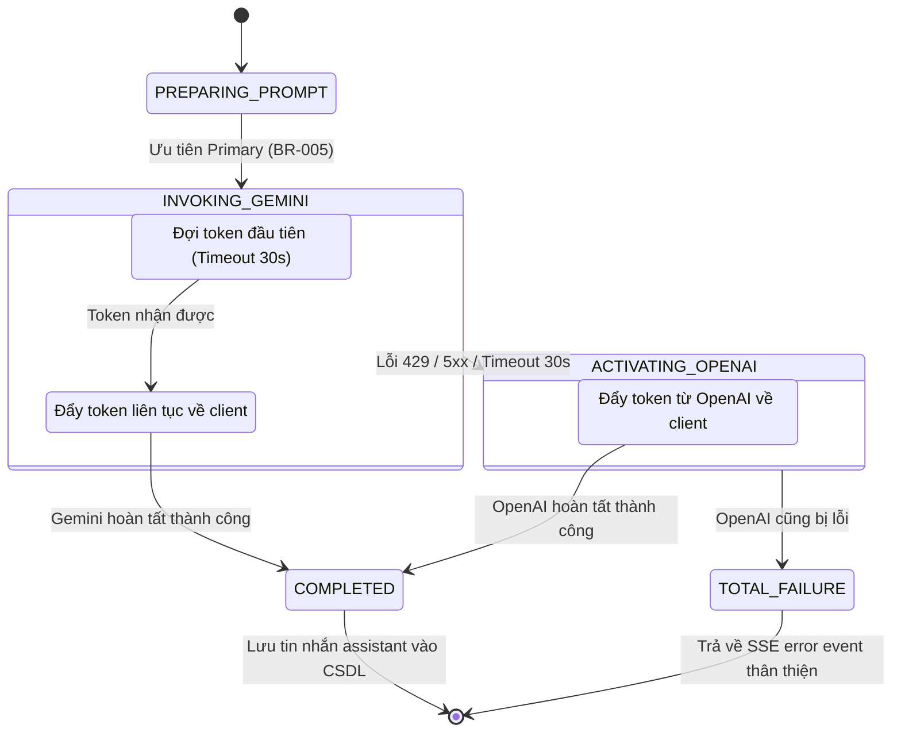

# PHÂN TÍCH HÀNH VI HỆ THỐNG (SYSTEM BEHAVIOR & INTERACTION ANALYSIS)
## Hệ Thống Website Chatbot Trợ Lý Ảo (AI-Chan Assistant)

---

| Thông Tin Tài Liệu | Chi Tiết |
| :--- | :--- |
| **Dự án** | Website Chatbot Trợ Lý Ảo (`ai-chan`) |
| **Mã tài liệu** | `SYS-BEH-001` |
| **Trạng thái Baseline** | **BASELINED** |
| **Mục đích** | Phân tích sâu các cơ chế hành vi kỹ thuật: Luồng truyền nhận dữ liệu thời gian thực (SSE), Quản lý ngữ cảnh đàm thoại trượt (Sliding Window), và Thuật toán điều phối Failover |

---

## 1. Cơ Chế Truyền Luồng Dữ Liệu Thời Gian Thực (Streaming Architecture: SSE vs WebSockets)

### 1.1 Phân Tích Lựa Chọn Giao Thức
Hệ thống AI-Chan lựa chọn **Server-Sent Events (SSE)** làm phương thức truyền phát phản hồi của Trợ lý ảo thay vì WebSocket:
- **Tính Chất Tương Tác**: Luồng sinh câu trả lời của AI là giao tiếp đơn hướng (Unidirectional: Máy chủ đẩy liên tục các ký tự về trình duyệt sau khi người dùng gửi 1 câu hỏi).
- **Tính Tương Thích Hạ Tầng**: SSE chạy trên nền giao thức HTTP/1.1 và HTTP/2 tiêu chuẩn, dễ dàng đi qua Ingress Nginx, Load Balancer và các tường lửa doanh nghiệp mà không cần cấu hình nâng cấp giao thức phức tạp (`Connection: Upgrade`).
- **Tự Động Kết Nối Lại**: Trình duyệt có cơ chế tự phục hồi kết nối chuẩn.

### 1.2 Định Dạng Gói Tin Dữ Liệu (SSE Wire Protocol)
Mỗi gói tin (Event) được đóng gói theo chuẩn text/event-stream:
```text
data: {"token": "Xin", "status": "streaming"}

data: {"token": " chào", "status": "streaming"}

data: {"status": "done"}
```

---

## 2. Quản Lý Ngữ Cảnh Đàm Thoại Trượt (Sliding Window Context Strategy)

Để giải quyết bài toán dung lượng bộ nhớ ngữ cảnh và chi phí token (`GAP-BP-05`):
- Hệ thống áp dụng chiến lược **Cửa Sổ Ngữ Cảnh Trượt (Sliding Window)**:
  - Khi người dùng gửi câu hỏi mới, máy chủ không nạp toàn bộ lịch sử nếu cuộc trò chuyện kéo dài hàng trăm tin nhắn.
  - Máy chủ chỉ truy vấn tối đa **20 tin nhắn gần nhất (10 cặp câu hỏi - câu trả lời)** theo thứ tự thời gian: `ORDER BY created_at DESC LIMIT 20`.
  - Đảo ngược thứ tự lại thành tăng dần để cấu trúc prompt gửi tới AI.
- **Lợi Ích**: Đảm bảo thời gian phản hồi đầu tiên (Time to First Token) luôn đạt dưới 2 giây (`NFR-003`) và chi phí token được kiểm soát trong định mức cho phép.

---

## 3. Thuật Toán Điều Phối Tự Phục Hồi AI (LLM Failover State Machine)


