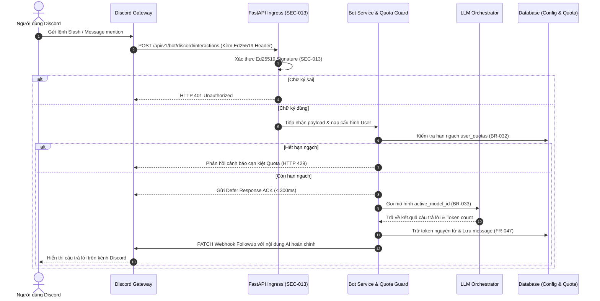

# Bản Ghi Quyết Định Kiến Trúc (Architectural Decision Record)
## ADR-012: Kiến Trúc Quản Lý Discord Bot Đa Phạm Vi, Định Tuyến Mô Hình Động & Dùng Chung Hạn Ngạch Token Hợp Nhất

---

| Thông Tin Quản Trị | Chi Tiết |
| :--- | :--- |
| **Mã Quyết Định** | `ADR-012` |
| **Tiêu Đề** | Multi-Scope Discord Bot Management, Dynamic Model Routing & Unified Quota Accounting Architecture |
| **Trạng Thái** | **APPROVED** |
| **Ngày Phê Duyệt** | 2026-10-10 |
| **Tác Giả** | Senior Solution Architect + System Analyst |
| **Phạm Vi Kỹ Thuật** | Quản lý cấu hình Discord Bot, Điều phối tương tác đa nền tảng, Dùng chung hạn ngạch token, An ninh chữ ký số Ed25519 |
| **Truy Vết Yêu Cầu** | `FR-044`, `FR-045`, `FR-046`, `FR-047`, `NFR-025`, `BR-031`, `BR-032`, `BR-033`, `BR-034`, `SEC-013`, `CTRL-012`, `UX-011`, `OP-031`..`OP-034`, `PROC-022`, `PROC-023`, `UC-032`..`UC-034`, `TC-039`..`TC-042`, `CR-009`, `DEC-015` |

---

## 1. Ngữ Cảnh & Vấn Đề Đặt Ra (Context & Problem Statement)

Sau khi hoàn tất phân hệ Xác thực và Liên kết tài khoản Discord (`CR-007`, `ADR-010`), người dùng hệ thống có nhu cầu đưa khả năng đàm thoại thông minh của trợ lý AI-Chan trực tiếp vào các máy chủ Discord của họ để phục vụ giao tiếp nhóm và quản trị cộng đồng (`CR-009`, `DEC-015`).

Để hiện thực hóa tính năng này, hệ thống đối mặt với 5 thách thức kiến trúc trọng yếu:
1. **Kiểm soát quyền hạn máy chủ (Guild Permissions & Scope Control)**: Làm thế nào để đảm bảo người dùng chỉ có thể cấu hình bot vào các máy chủ Discord mà họ thực sự có quyền quản trị, tránh tình trạng khai thác trái phép máy chủ của người khác (`BR-034`).
2. **Cấu hình nhân cách & định tuyến mô hình linh hoạt (Dynamic Routing & Persona Isolation)**: Mỗi người dùng cần khả năng cấu hình nhân cách bot (Persona Prompt), chọn mô hình AI trong danh mục hoạt động (`BR-033`), và tinh chỉnh giới hạn độ dài phản hồi.
3. **Thống nhất hạn ngạch & chống lạm dụng tài nguyên (Unified Quota Accounting)**: Tương tác qua Discord Gateway tiêu tốn token của LLM Provider. Nếu không có cơ chế dùng chung hạn ngạch với Web, người dùng có thể lách trần token hằng ngày (`BR-032`).
4. **An ninh Webhook & tính toàn vẹn thông điệp (Cryptographic Verification)**: Tương tác Discord được gửi qua Webhook endpoint công khai. Bắt buộc phải xác thực chữ ký mật mã học Ed25519 (`SEC-013`) để ngăn chặn tấn công giả mạo và bảo vệ tài nguyên tính toán.
5. **Tính liên tục của ngữ cảnh đàm thoại (Omnichannel Context Sync)**: Người dùng cần xem lại được các câu hỏi và câu trả lời đã diễn ra trên Discord ngay tại giao diện Web của họ (`FR-047`).

---

## 2. Các Quyết Định Kiến Trúc Then Chốt (Key Architectural Decisions)

### 2.1 Thực Thể Quản Trị Cấu Hình `DiscordBotConfig`
Hệ thống thiết kế thực thể chuyên biệt `DiscordBotConfig` trong tầng Domain (`models/domain/domain.yaml`):
- `user_id`: Khóa ngoại liên kết 1-1 với người dùng sở hữu bot.
- `guild_id`: Mã định danh máy chủ Discord mục tiêu được người dùng ủy quyền (`BR-034`).
- `channel_id`: Kênh chat chỉ định tiếp nhận tương tác (tùy chọn; nếu rỗng, bot lắng nghe mọi kênh được phân quyền).
- `active_model_id`: Khóa ngoại tham chiếu đến bản ghi mô hình trong bảng `models`.
- `system_prompt`: Câu lệnh định hình phong cách đàm thoại và tính cách của Bot (Persona Prompt).
- `max_tokens_per_response`: Giới hạn token tối đa cho mỗi câu trả lời (50 đến 4000).
- `is_enabled`: Cờ trạng thái cho phép kích hoạt hoặc tạm dừng bot tức thì.

### 2.2 Cơ Chế Khám Phá Máy Chủ Dựa Trên Bitwise Permissions (`BR-034`)
Khi người dùng truy cập trang Quản lý Bot, Backend gọi Discord REST API v10 (`/users/@me/guilds`) và thực hiện kiểm tra quyền bitwise:
```python
ADMINISTRATOR = 0x8
MANAGE_GUILD = 0x20

has_admin_rights = bool(
    (permissions & ADMINISTRATOR) or (permissions & MANAGE_GUILD)
)
```
Chỉ các máy chủ thỏa mãn điều kiện này mới được hiển thị trong danh sách lựa chọn cấu hình và chấp nhận lưu trữ.

### 2.3 Bất Biến Định Tuyến Mô Hình Hoạt Động & Cơ Chế Phục Hồi Tự Động (`BR-033`)
1. **Kiểm tra trạng thái khi cấu hình**:
   - Chỉ cho phép gán `active_model_id` khi mô hình đang ở trạng thái `ACTIVE`.
   - Nếu mô hình đã bị chuyển sang `INACTIVE` hoặc `ARCHIVED`, hệ thống từ chối lưu với HTTP 400 Bad Request.
2. **Cơ chế Failover khi điều phối**:
   - Khi tiếp nhận câu hỏi từ Discord, nếu mô hình được cấu hình gặp sự cố (Rate Limit từ Provider, Network Timeout), hệ thống tự động fallback về mô hình mặc định toàn hệ thống (`is_default = 1`) theo nguyên tắc đã thiết lập tại `ADR-003`.

### 2.4 Hạn Ngạch Hợp Nhất & Giao Dịch Trừ Token Nguyên Tử (`BR-032`)
Hệ thống hợp nhất toàn bộ hạn ngạch tiêu thụ token giữa Web và Discord vào một bản ghi `UserQuota` duy nhất cho mỗi người dùng:
- Trước khi chuyển tiếp câu hỏi sang LLM Provider, Backend kiểm tra `used_tokens < total_limit`. Nếu chạm ngưỡng 100%, trả về thông báo lỗi HTTP 429 và gửi phản hồi từ chối về Discord channel.
- Sau khi nhận kết quả từ LLM, số token tiêu thụ thực tế được cộng dồn vào `user_quotas.used_tokens` và lưu bản ghi vào `api_metric_logs` với `source = 'DISCORD_BOT'`.

### 2.5 Xác Thực Chữ Ký Số Mật Mã Học Ed25519 (`SEC-013`, `CTRL-012`)
Mọi yêu cầu đến từ Discord Interaction Webhook phải vượt qua kiểm tra tính hợp lệ của chữ ký Ed25519 sử dụng Public Key của Discord Application:
```python
import nacl.signing

def verify_discord_signature(signature: str, timestamp: str, body: bytes, public_key: str) -> bool:
    verify_key = nacl.signing.VerifyKey(bytes.fromhex(public_key))
    try:
        verify_key.verify(timestamp.encode() + body, bytes.fromhex(signature))
        return True
    except nacl.exceptions.BadSignatureError:
        return False
```
Nếu chữ ký không hợp lệ hoặc sai lệch, request bị từ chối ngay lập tức với HTTP 401 Unauthorized trước khi chạm vào tầng xử lý logic.

### 2.6 Đồng Bộ Ngữ Cảnh Đàm Thoại Discord - Web (`FR-047`)
Khi bot trả lời thành công trên Discord, Backend tự động lưu cặp tin nhắn (User Query & Assistant Reply) vào bảng `messages` với `source = 'DISCORD'`. Trên Web Chat, phiên trò chuyện này xuất hiện với huy hiệu Discord Badge, mang lại trải nghiệm đa kênh liền mạch cho người dùng.

---

## 3. Hệ Quả Kiến Trúc (Architectural Consequences)

### 3.1 Ưu Điểm (Positive Consequences)
- **Kiểm soát tài nguyên chặt chẽ**: Tránh hoàn toàn việc người dùng lạm dụng tài nguyên AI thông qua nền tảng Discord mà không bị giới hạn hạn ngạch.
- **An ninh vững chắc**: Xác thực chữ ký Ed25519 ngăn chặn triệt để nguy cơ giả mạo Webhook và tấn công từ chối dịch vụ.
- **Trải nghiệm nhất quán**: Người dùng có thể cá nhân hóa nhân cách bot và theo dõi toàn bộ nội dung trò chuyện từ cả hai nền tảng Web và Discord.

### 3.2 Thách Thức & Biện Pháp Giảm Thiểu (Risks & Mitigations)
- **Độ trễ Discord Interaction Timeout (3 giây)**: Discord yêu cầu endpoint phải phản hồi trong vòng 3.000ms.
  - *Giải pháp*: Backend gửi ngay phản hồi tạm thời (Deferred Channel Message / Acknowledgment) trong vòng $\le 300\text{ms}$ (`NFR-025`), sau đó xử lý gọi LLM bất đồng bộ qua Background Task và chỉnh sửa tin nhắn hoàn thiện (Followup / Edit Message).

---

## 4. Sơ Đồ Kiến Trúc Luồng Tương Tác (Architectural Flow Diagram)


