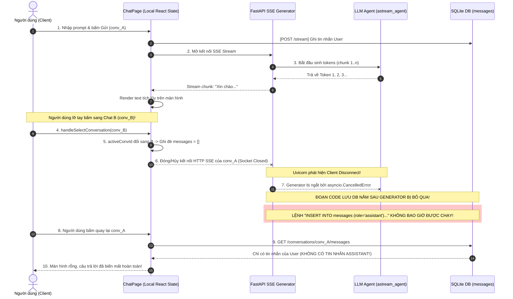
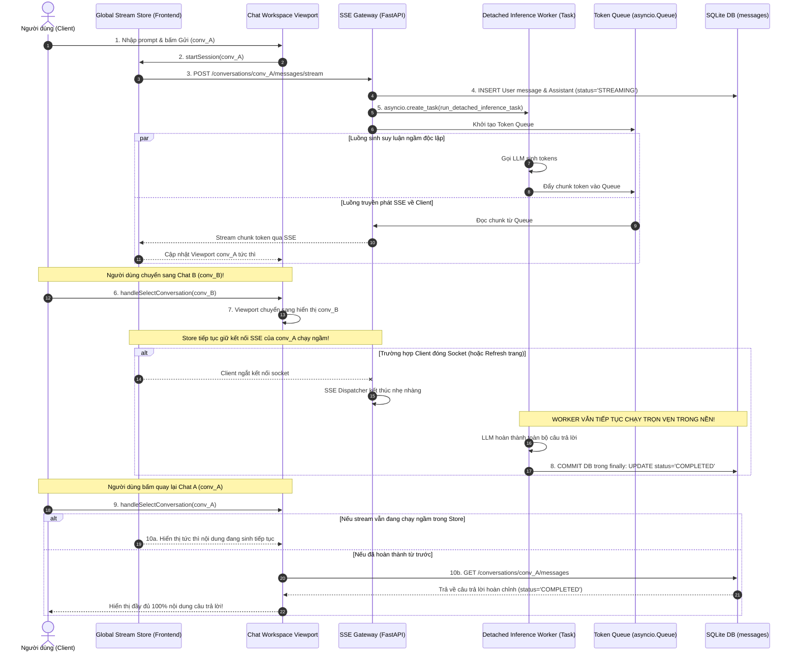
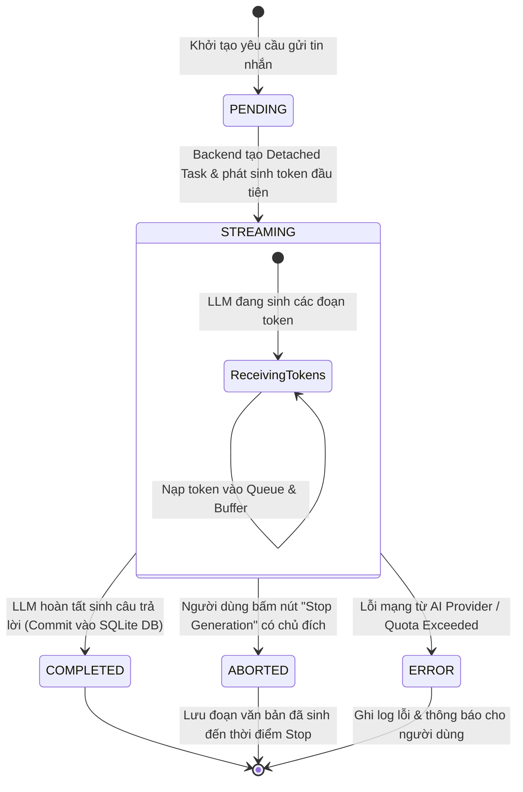

# HỆ THỐNG BIỂU ĐỒ KIẾN TRÚC (ARCHITECTURE DIAGRAMS)
## Trực Quan Hóa Luồng Gián Đoạn (As-Is) & Luồng Bền Vững (To-Be)
### Mã Tài Liệu: `DIAG-STREAM-RESILIENCE` | Phân Hệ: `ARCH-STREAM-RESILIENCE`

---

## 1. Biểu Đồ Sequence Luồng Hiện Tại Bị Lỗi (As-Is: Flawed Tightly-Coupled Flow)

Biểu đồ này mô tả chính xác lý do tại sao câu trả lời của mô hình AI bị biến mất khi người dùng chuyển sang chat khác trong mã nguồn hiện tại:



---

## 2. Biểu Đồ Sequence Luồng Khắc Phục Bền Vững (To-Be: Resilient Decoupled Task)

Biểu đồ này mô tả cơ chế **Detached Background Task** và **Global Multi-Session Stream Store** bảo vệ toàn vẹn dữ liệu:



---

## 3. Biểu Đồ Trạng Thái Tin Nhắn & Task Suy Luận (State Machine Diagram)



---

## 4. Biểu Đồ Thành Phần Kiến Trúc (Component Architecture Diagram)

```mermaid
graph TB
    subgraph Frontend ["Frontend Tier (Next.js 14 / TypeScript)"]
        UI["ChatWorkspace UI"]
        Sidebar["Sidebar Navigation"]
        GStore["Global Stream Session Store<br/>Record&lt;conv_id, StreamSession&gt;"]
        
        Sidebar -->|Select Conv| UI
        UI <-->|Active Viewport| GStore
    end

    subgraph Backend ["Backend Tier (FastAPI Engine)"]
        SSEGate["SSE Gateway Dispatcher<br/>/conversations/{id}/messages/stream"]
        TaskPool["Detached Inference Pool<br/>asyncio.create_task"]
        TokenQueue["Async Queue Registry<br/>asyncio.Queue per conv"]
        StopHandler["Stop Controller<br/>POST /messages/stop"]
    end

    subgraph LLM ["AI Providers"]
        Gemini["Google Gemini API"]
        OpenAI["OpenAI GPT API"]
    end

    subgraph Storage ["Persistence Tier"]
        DB[(SQLite app.db<br/>bảng messages / attachments)]
    end

    GStore <==>|HTTP SSE Connections| SSEGate
    GStore -->|Explicit Abort| StopHandler
    StopHandler -->|Cancel Task| TaskPool

    SSEGate <-->|Consumer Read| TokenQueue
    TaskPool -->|Producer Put| TokenQueue
    TaskPool <==>|Stream Call| LLM
    TaskPool ==>>|Guaranteed Finally Commit| DB
    UI -->|Fetch History| DB
```
