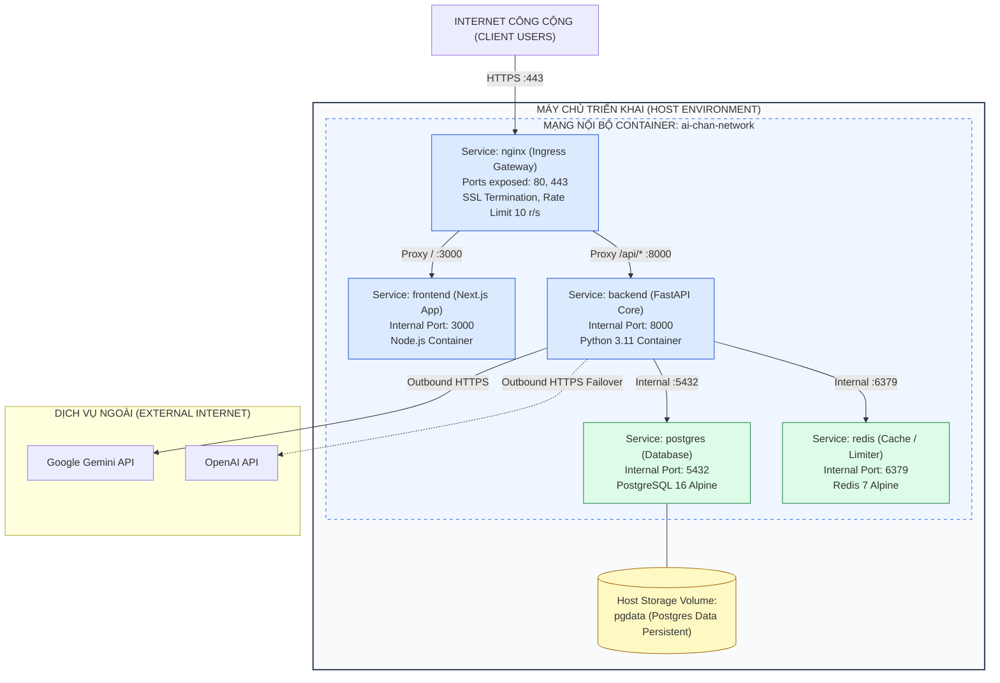

# KHÁI NIỆM KIẾN TRÚC TRIỂN KHAI (DEPLOYMENT ARCHITECTURE CONCEPT)
## Hệ Thống Website Chatbot Trợ Lý Ảo (AI-Chan Assistant)

---

| Thông Tin Tài Liệu | Chi Tiết |
| :--- | :--- |
| **Dự án** | Website Chatbot Trợ Lý Ảo (`ai-chan`) |
| **Mã tài liệu** | `ARCH-DEP-001` |
| **Trạng thái Baseline** | **BASELINED** |
| **Mục đích** | Mô tả cấu trúc triển khai container hóa (Docker Compose Topology), ranh giới mạng nội bộ và các nguyên tắc bảo mật cổng kết nối |

---

## 1. Sơ Đồ Cấu Trúc Triển Khai Container (Deployment Topology)

---

## 2. Nguyên Tắc Bảo Vệ Ranh Giới Mạng & Cổng Kết Nối (Network Isolation)

1. **Phơi Bày Cổng Công Khai Tối Thiểu (Minimum Exposed Ports)**:
   - **Chỉ mở duy nhất Cổng 80 (HTTP) và 443 (HTTPS)** của Nginx ra môi trường Internet.
   - Các cổng dịch vụ nội bộ: Backend (`8000`), Frontend (`3000`), PostgreSQL (`5432`), và Redis (`6379`) **tuyệt đối không được mở trực tiếp ra Host**. Chúng chỉ giao tiếp qua mạng Docker Bridge cô lập (`ai-chan-network`).
2. **Lưu Trữ Bền Vững (Volume Persistence)**:
   - Thư mục dữ liệu `/var/lib/postgresql/data` của PostgreSQL được ánh xạ vào Docker Volume `pgdata` trên máy chủ Host nhằm bảo đảm dữ liệu không bị mất khi container khởi động lại.
3. **Cấu Hình Môi Trường Tập Trung (.env Configuration)**:
   - Toàn bộ bí mật (`POSTGRES_PASSWORD`, `SECRET_KEY`, `GEMINI_API_KEY`, `OPENAI_API_KEY`) được nạp qua tệp môi trường `.env` an toàn, không hardcode vào Dockerfile hay mã nguồn.
