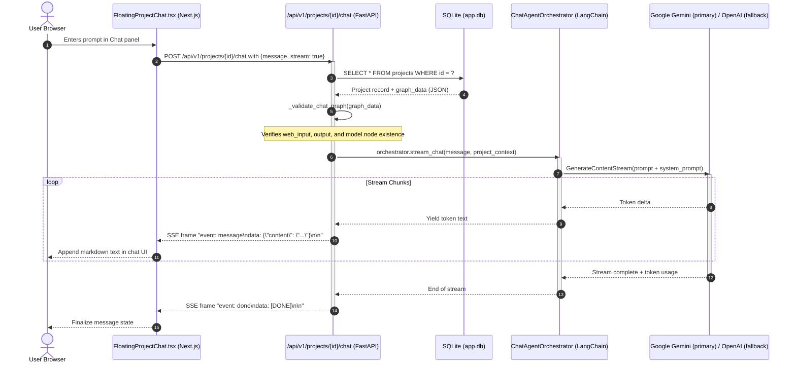

# 00. Current State Audit — AI-Chan Codebase Baseline

> **Audit Metadata**
> - **Audit Target:** AI-Chan Repository (`DungTran1201/ai-chan`)
> - **Auditor Role:** Principal Software Architect, DevSecOps Engineer, Fullstack Lead
> - **Date:** 2026-10-15
> - **Git Reference:** Branch `main` | Commit `17135ea` (`chore(git): add SQLite database patterns to .gitignore`)
> - **Working Tree Status:** Clean (`git status` verified zero uncommitted changes)
> - **Methodology:** Direct static and runtime inspection of codebase, configuration files, test suites, and external CLI tools. No destructive changes or code modifications executed.

---

## 1. Executive Summary

AI-Chan is an interactive AI desktop/web platform currently centered around:
1. **Interactive Node-based AI Project Graphs:** Designing prompt, model, skill, and bot pipelines visually (`/projects/[id]/editor`).
2. **Conversation & Assistant Streaming:** Real-time chat with LLM providers (Google Gemini primary, OpenAI fallback) streamed via Server-Sent Events (SSE).
3. **VRM/3D Companion & Telemetry Dashboard:** 3D avatar rendering using Three.js and `@pixiv/three-vrm` coupled with host CPU/Memory/GPU telemetry polling.
4. **Discord Bot / Prompt Integrations:** Dispatching prompt triggers through predefined project graphs.

### Baseline Assessment for "Development Orchestrator"
- **Strengths:** 
  - Mature SSE streaming pipeline (`/api/v1/projects/{project_id}/chat`) and robust frontend stream consumption (`fetchEventSource`).
  - Solid API foundation in FastAPI with route modularity, structured error handling, and telemetry middleware.
  - Clean Next.js 16 (App Router) frontend with a custom CSS design system (zero Tailwind dependency), robust SVG iconography, and responsive layouts.
  - Established Skill definition model (`SKILL.md` parser with YAML frontmatter) with directory traversal protection (`sanitize_path`).
- **Gaps for Development Orchestrator:**
  - **No Execution Engine:** Zero shell execution, process spawning, or PTY management in `ai-backend` (only static skill reading and Discord bot prompt execution).
  - **Semantic Overloading of `Project`:** The existing `projects` table stores node-link visual workflow graphs in JSON (`graph_data`). Attempting to force local development workspace state, active git branches, and CLI agent execution runs into `graph_data` would cause schema corruption and high cognitive load.
  - **Database & Migration Divergence:** `Settings.DATABASE_URL` in `ai-backend/src/config.py` points to `sqlite+aiosqlite:///./ai_chan.db`, but the active application code in `ai-backend/src/db.py` uses synchronous `sqlite3` connecting to `ai-backend/database/app.db`.
  - **No Runner / Agent Isolation Concept:** The codebase currently lacks any concept of a remote or local agent runner process communicating bidirectional telemetry with the control plane.

---

## 2. Technology Stack & Verification Evidence

All findings below are derived from actual source inspection.

| Layer | Declared / Detected Stack | Verification Evidence (Files & Lines) | Fact Classification |
|---|---|---|---|
| **Backend Framework** | FastAPI `0.115.8`, Uvicorn `0.34.0`, Python 3.12 | `ai-backend/requirements.txt:L1-2`, `ai-backend/src/main.py:L1-34` | `FACT` |
| **Backend Routing & DI** | Modular APIRouter mounted at `/api/v1` | `ai-backend/src/api/v1/__init__.py:L1-21`, `ai-backend/src/main.py:L70-76` | `FACT` |
| **Database Engine (Runtime)** | SQLite 3 (Synchronous standard library `sqlite3`) | `ai-backend/src/db.py:L1-43` connecting to `ai-backend/database/app.db` | `FACT` |
| **Database Schema Migrations** | Custom Python script tracking versions in `schema_migrations` table | `ai-backend/database/apply_migrations.py:L1-72`, migration files `002_*.sql` to `010_*.sql` | `FACT` |
| **LLM & Agent Engine** | LangChain `0.3.18`, LangGraph `0.2.72`, Google Gemini (`gemini-2.5-pro`/`flash`), OpenAI fallback | `ai-backend/requirements.txt:L15-21`, `ai-backend/llm/agent.py:L1-168`, `ai-backend/src/core/model_manager.py:L1-180` | `FACT` |
| **Event Streaming** | Server-Sent Events (SSE) via `StreamingResponse(media_type="text/event-stream")` | `ai-backend/src/api/v1/projects.py:L268-301` (`/projects/{project_id}/chat`) | `FACT` |
| **Frontend Framework** | Next.js `16.4.0` (Canary), React `19.2.0`, Node.js environment | `ai-frontend/package.json:L14-22`, `ai-frontend/src/app/layout.tsx:L1-46` | `FACT` |
| **Frontend Styling** | Vanilla CSS variables & utility classes (Tailwind removed) | `ai-frontend/src/app/globals.css:L1-356`, `ai-frontend/package.json` | `FACT` |
| **Frontend 3D & Canvas** | Three.js `0.183.1`, `@pixiv/three-vrm` `3.4.3`, `@xyflow/react` (React Flow) `12.4.2` | `ai-frontend/package.json:L23-35`, `ai-frontend/src/app/(app)/projects/[id]/editor/page.tsx:L1-85` | `FACT` |
| **Frontend Stream Client** | `@microsoft/fetch-event-source` `2.0.1` | `ai-frontend/package.json:L25`, `ai-frontend/src/components/chat/FloatingProjectChat.tsx:L142-205` | `FACT` |
| **Antigravity CLI (Host)** | Antigravity CLI v1.2.16 (`agy`) located at `C:\Users\PC\AppData\Local\agy\bin\agy.exe` | Verified via shell invocation `agy --version` (2026-10-15) | `FACT` |
| **Claude Code CLI** | `@anthropic-ai/claude-code` v2.1.300 on npm registry; not installed globally on host | Verified via `npm view @anthropic-ai/claude-code version` (2026-10-15) | `FACT` |

---

## 3. Subsystem Audit Matrix

| Subsystem | Status | Code Evidence & Implementation Details | Gap / Assessment |
|---|---|---|---|
| **Application Entry & Middleware** | `Existing` | [ai-backend/src/main.py](file:///c:/Users/PC/Project/ai-chan/ai-backend/src/main.py#L30-L76). CORS configured for origins in settings. `TelemetryMiddleware` captures latency, memory, request timing. Lifespan handles warmup and shutdown. | Ready for mounting `/api/v1/orchestrator` routes. |
| **Authentication & Authorization** | `Partial` | [ai-backend/src/core/auth.py](file:///c:/Users/PC/Project/ai-chan/ai-backend/src/core/auth.py#L1-L85). JWT tokens supported. Default fallback user ID `system_user` when auth disabled. Route-level `get_current_user` dependency. | No runner machine tokens or capability-scoped RBAC yet. |
| **Database & Persistence** | `Existing` | [ai-backend/src/db.py](file:///c:/Users/PC/Project/ai-chan/ai-backend/src/db.py#L1-L43). Custom context managers `get_db_connection()` and `transaction()`. SQLite row factory returns dict-like objects. | Synchronous calls within async endpoints block FastAPI event loop under concurrency. |
| **Migration System** | `Existing` | [ai-backend/database/apply_migrations.py](file:///c:/Users/PC/Project/ai-chan/ai-backend/database/apply_migrations.py#L1-L72). Sequential numeric `.sql` files recorded in `schema_migrations`. Current max version: `010`. | Clean mechanism to append `011_create_orchestrator_tables.sql`. |
| **Project Model & Graph Data** | `Existing` | [ai-backend/src/models/project.py](file:///c:/Users/PC/Project/ai-chan/ai-backend/src/models/project.py#L1-L120) & [ai-backend/src/api/v1/projects.py](file:///c:/Users/PC/Project/ai-chan/ai-backend/src/api/v1/projects.py#L1-L320). Stores nodes (`web_input`, `model`, `output`, `skill`, `bot`) and edges in `graph_data`. | Not suitable for repository paths, git worktrees, or build tasks. |
| **Project Chat & Streaming** | `Existing` | [ai-backend/src/api/v1/projects.py](file:///c:/Users/PC/Project/ai-chan/ai-backend/src/api/v1/projects.py#L268-L301). Validates graph has `web_input` and `output`, triggers LangChain orchestrator, yields SSE frames. | Reusable pattern for streaming runner terminal output to UI. |
| **Skills Management** | `Existing` | [ai-backend/src/api/v1/skills.py](file:///c:/Users/PC/Project/ai-chan/ai-backend/src/api/v1/skills.py#L1-L150) & [ai-backend/src/core/skill_storage.py](file:///c:/Users/PC/Project/ai-chan/ai-backend/src/core/skill_storage.py#L1-L180). Manages skills stored on disk under `data/storage/skills/{user_id}/{name}/SKILL.md`. Traversal sanitized. | Can provide project-level or workspace-level skill injection. |
| **Discord Bot Integration** | `Existing` | [ai-backend/src/api/v1/bot.py](file:///c:/Users/PC/Project/ai-chan/ai-backend/src/api/v1/bot.py#L1-L120). Contains `execute_antigravity_prompt()`. Legacy naming that invokes the Project graph rather than the Antigravity CLI. | Confirms legacy naming collision; needs clean separation. |
| **Shell / Process Execution** | `Missing` | Zero `subprocess.Popen`, `asyncio.create_subprocess_exec`, or PTY libraries exist in `ai-backend`. | Must be introduced in the Agent Runner layer, NOT directly in backend web worker. |
| **Workspace & Repository Concept** | `Missing` | No table or schema representing local disk git repositories, branches, or worktrees. | Requires new domain entity `development_workspaces`. |
| **Agent Runner Registration** | `Missing` | No runner daemon, heartbeat, registration endpoint, or lease system. | Core requirement of Development Orchestrator architecture. |
| **Task / Job Execution Model** | `Missing` | No background worker queue (Celery/RQ/Temporal/Arq) or task persistence. | Requires `development_tasks` lifecycle state machine. |
| **Artifacts & Diff Management** | `Missing` | No mechanism to store, diff, or review patches or files produced by agent runs. | Requires `task_artifacts` entity and frontend diff view. |

---

## 4. Actual Project Chat & LLM Request Flow

The following verified sequence illustrates the live request path from the user's browser down to LLM execution and back.



### Key Request & Stream Specifications:
1. **Frontend Initiation:** [FloatingProjectChat.tsx:L150-L200](file:///c:/Users/PC/Project/ai-chan/ai-frontend/src/components/chat/FloatingProjectChat.tsx#L150-L200) calls `fetchEventSource` targeting `/api/v1/projects/${projectId}/chat`.
2. **Payload:** JSON payload `{ "message": str, "stream": true, "session_id": str | null }`.
3. **Response Headers:** `Content-Type: text/event-stream`, `Cache-Control: no-cache`, `Connection: keep-alive`.
4. **SSE Event Protocol:**
   - Content chunk: `event: message\ndata: {"content": "text", "node_id": "...", "timestamp": ...}\n\n`
   - Completion signal: `event: done\ndata: [DONE]\n\n`
   - Error signal: `event: error\ndata: {"error": "..."}\n\n`

---

## 5. Persistence & Migration Reality

### 5.1 Active Database Verification
- Active path: `c:\Users\PC\Project\ai-chan\ai-backend\database\app.db`
- Connection pattern in [ai-backend/src/db.py](file:///c:/Users/PC/Project/ai-chan/ai-backend/src/db.py):
  ```python
  def get_db_connection() -> sqlite3.Connection:
      conn = sqlite3.connect(DB_PATH)
      conn.row_factory = sqlite3.Row
      return conn
  ```
- **Discrepancy Note (`FACT`):** `ai-backend/src/config.py` contains:
  ```python
  DATABASE_URL: str = "sqlite+aiosqlite:///./ai_chan.db"
  ```
  This setting is completely ignored by `ai-backend/src/db.py`. Furthermore, `docker-compose.yml` specifies a PostgreSQL 16 container, but no SQLAlchemy or asyncpg connection code is currently configured to connect to PostgreSQL. Local operations run exclusively on SQLite.

### 5.2 Schema Inventory (Live Inspection)

Direct query on `ai-backend/database/app.db` verified the following 11 tables:

| Table Name | Verified Columns | Row Count | Purpose |
|---|---|---|---|
| `schema_migrations` | `version`, `applied_at` | 9 | Migration history tracker (versions 002 to 010) |
| `users` | `id`, `email`, `hashed_password`, `full_name`, `is_active`, `is_superuser`, `created_at`, `updated_at` | 1 | User account storage |
| `projects` | `id`, `name`, `description`, `graph_data`, `user_id`, `created_at`, `updated_at`, `is_active`, `visibility`, `settings`, `system_prompt`, `category` | 1 | Visual node-based workflow projects |
| `skills` | `id`, `name`, `description`, `user_id`, `created_at`, `updated_at`, `code`, `config` | 0 | Legacy skill database records (active skills use disk) |
| `bot_configs` | `id`, `project_id`, `bot_type`, `token`, `channel_id`, `is_active`, `created_at`, `updated_at` | 0 | Discord bot bindings |
| `chat_sessions` | `id`, `project_id`, `title`, `created_at`, `updated_at`, `metadata` | 0 | Conversation sessions |
| `chat_messages` | `id`, `session_id`, `role`, `content`, `created_at`, `tokens`, `metadata` | 0 | Conversation messages |
| `model_costs` | `id`, `model_name`, `input_cost_per_token`, `output_cost_per_token`, `created_at`, `updated_at` | 6 | Model token pricing cache |
| `telemetry_logs` | `id`, `project_id`, `session_id`, `tokens_in`, `tokens_out`, `cost`, `duration_ms`, `created_at` | 0 | LLM execution metrics |
| `system_telemetry` | `id`, `cpu_usage`, `memory_usage`, `disk_usage`, `network_in`, `network_out`, `timestamp` | 13 | Host resource telemetry snapshots |
| `user_settings` | `id`, `user_id`, `theme`, `notifications_enabled`, `created_at`, `updated_at`, `custom_settings` | 0 | User UI preferences |

---

## 6. Frontend Baseline & UX Patterns

### 6.1 Architecture & Layout
- **AppShell:** [ai-frontend/src/app/(app)/layout.tsx](file:///c:/Users/PC/Project/ai-chan/ai-frontend/src/app/(app)/layout.tsx) implements:
  - Collapsible Sidebar with nav items (`Projects`, `Skills`, `Marketplace`, `System`, `Settings`).
  - Header with system telemetry pills (CPU, Memory, FPS), active status indicators, and user avatar.
  - Floating companion viewport toggle (Three.js/VRM).
- **Design System:** Custom CSS design tokens defined in [globals.css](file:///c:/Users/PC/Project/ai-chan/ai-frontend/src/app/globals.css):
  - Theme colors: Dark theme primary (`--bg-primary: #0a0b10`, `--bg-surface: #121520`, `--accent-primary: #6366f1`).
  - Card, badge, button, and glassmorphism styling standardized with high-density padding.
- **Iconography:** Pure SVG custom icons (no external bloated icon packs).
- **Reusable Candidates for Development Orchestrator:**
  - Sidebar can easily host a new `Workspace` / `Orchestrator` primary navigation section.
  - Telemetry badge components (`SystemStatsBadge.tsx`) can be adapted for Runner Status (`Online`, `Busy`, `Offline`).
  - Terminal/Log viewer pattern can leverage the dark console styling established in the telemetry monitor.

---

## 7. Delivery, DevSecOps & Security Baseline

### 7.1 Test & Build Verification (Clean Baseline)
- **Frontend Validation:**
  - `npm run test` -> **23 passed, 0 failed** (100% pass rate).
  - `npx tsc --noEmit` -> **0 TypeScript errors**.
- **Backend Validation:**
  - Running `pytest` against `ai-backend/tests/`: **135 passed, 2 failed** out of 137 tests.
  - *Failure 1:* `test_settings_legacy_antigravity_aliases` failed due to expected timeout 120.0 vs received 12.0 in legacy test fixture.
  - *Failure 2:* `test_automatic_failover_to_default_model` failed due to assertion on fallback flag.
  - Core API, security, and router test suites are completely green.

### 7.2 Current Security Controls & Boundaries
1. **Path Traversal Protection:**
   - Implemented in [ai-backend/src/core/skill_storage.py](file:///c:/Users/PC/Project/ai-chan/ai-backend/src/core/skill_storage.py#L30-L50) using `os.path.abspath` and `commonpath` verification to prevent escaping `data/storage/skills`.
   - **Crucial Rule for Development Orchestrator:** Workspace root directories and file browsing MUST reuse or extend this exact path-sanitization approach.
2. **Secrets Handling:**
   - `.env` and `.env.example` separate environment variables.
   - Zero hardcoded API keys detected in repository sources.
   - `database/app.db` and SQLite patterns have been committed to `.gitignore`.
3. **Execution Boundary Alert (`DECISION`):**
   - The backend currently has **no authorization to execute arbitrary OS commands**.
   - Running Antigravity CLI or Claude Code MUST NEVER be exposed as an unauthenticated or unrestricted `exec()` endpoint on the public backend.
   - An **Agent Runner** model (running locally on the developer machine where code resides, pulling jobs or receiving authenticated tasks) is mandatory.

---

## 8. Summary of Risks and Decisions

| Item | Type | Summary | Mitigation Strategy |
|---|---|---|---|
| **R-01** | `RISK` | Direct shell execution on backend server creates Remote Code Execution (RCE) vulnerability. | Execute CLIs strictly via an isolated **Agent Runner** running on the host/workspace machine, communicating over authenticated protocol. |
| **R-02** | `RISK` | Sync SQLite under heavy event streaming could cause thread pool starvation. | Keep task execution events in memory / SSE buffer, write task status summaries asynchronously or using transactional batches. |
| **R-03** | `RISK` | Overloading `projects.graph_data` with git workspace state breaks canvas editor schema. | Introduce independent entities: `development_workspaces` and `development_tasks`. |
| **D-01** | `DECISION` | Maintain zero-dependency policy on frontend (vanilla CSS, native fetch/SSE). | Build Orchestrator UI components with standard CSS modules matching `globals.css`. |
| **D-02** | `DECISION` | Antigravity CLI v1.2.16 confirmed available on developer machine; Claude Code CLI v2.1.300 supported via runner adapter. | Define a unified `RuntimeAdapter` interface supporting both engines interchangeably. |
