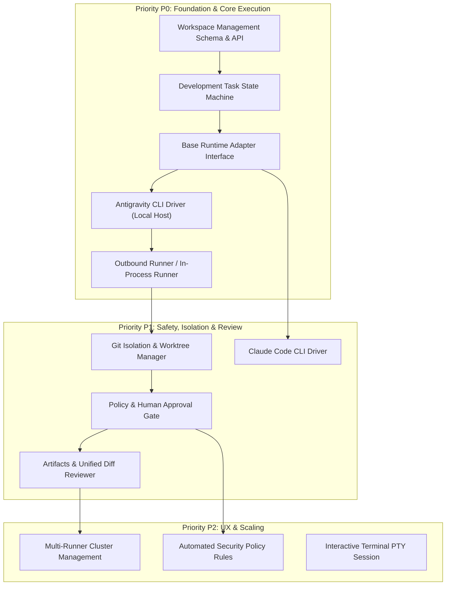

# 01. Capability Gap Matrix — Development Orchestrator

> **Scope:** Analysis of capabilities required to implement the AI-Chan Development Orchestrator against current repository baseline (`main` @ `17135ea`).
> **Fact Classification Policy:** `FACT` (verified in source), `ASSUMPTION` (inferred requirement), `DECISION` (architectural choice), `OPEN QUESTION` (unresolved trade-off).

---

## 1. Capability Gap Matrix Overview

The table below maps the 9 core capabilities required for the **AI-Chan Development Orchestrator**, auditing current code assets, identifying gaps, mapping dependencies, and proposing targeted solutions with priority classification.

- **P0 (Critical Path):** Required for minimal viable orchestration and safe execution.
- **P1 (Core Feature):** Essential for developer workflow, isolation, and reviewability.
- **P2 (Enhancement):** Advanced ergonomics, multi-runner scale, and automated policies.

---

## 2. Detailed Capability Evaluation

| Capability | Current Status | Evidence in Code | Dependencies & Constraints | Proposed Implementation & Architecture | Priority |
|---|---|---|---|---|---|
| **1. Workspace Management** | `Missing` | No table or service in `ai-backend`. Only visual projects exist in [models/project.py](file:///c:/Users/PC/Project/ai-chan/ai-backend/src/models/project.py). Path sanitization exists in [skill_storage.py:L35-L48](file:///c:/Users/PC/Project/ai-chan/ai-backend/src/core/skill_storage.py#L35-L48). | Requires local filesystem access, git binary on host, user authorization. | Create `development_workspaces` table (`id`, `name`, `root_path`, `git_remote`, `default_branch`, `created_at`). Add workspace registration endpoint with path traversal validation. | **P0** |
| **2. Agent Runner Host** | `Missing` | Zero daemon or runner protocol exists. Only Discord bot webhook exists in [api/v1/bot.py](file:///c:/Users/PC/Project/ai-chan/ai-backend/src/api/v1/bot.py). | Must run on developer workstation with access to code & CLI tools; must not expose inbound open ports. | Build an Outbound Agent Runner service (`ai-runner` or embedded worker). Connects to backend via authenticated long-lived SSE / polling / WebSocket to lease tasks. | **P0** |
| **3. Runtime Adapter Interface** | `Missing` | `llm/agent.py` only handles conversational LLM APIs (Gemini/OpenAI). No CLI driver abstraction. | Needs to decouple backend control plane from specific CLI syntax and output schemas. | Define abstract `BaseRuntimeAdapter` with methods: `validate_environment()`, `execute_prompt(workspace, prompt, options)`, `stream_output()`, `terminate()`. | **P0** |
| **4. Development Task Lifecycle** | `Missing` | No task entity or state machine exists. Only synchronous/streaming chat in [projects.py](file:///c:/Users/PC/Project/ai-chan/ai-backend/src/api/v1/projects.py). | SQLite database, FastAPI router, SSE streaming. | Create `development_tasks` table with states: `PENDING`, `DISPATCHED`, `PLANNING`, `RUNNING`, `WAITING_APPROVAL`, `COMPLETED`, `FAILED`, `CANCELLED`. | **P0** |
| **5. Real-time Event Streaming** | `Partial` | SSE streaming mature for chat in [projects.py:L268-L301](file:///c:/Users/PC/Project/ai-chan/ai-backend/src/api/v1/projects.py#L268-L301) and [FloatingProjectChat.tsx:L142-L205](file:///c:/Users/PC/Project/ai-chan/ai-frontend/src/components/chat/FloatingProjectChat.tsx#L142-L205). | Requires streaming raw terminal stdout/stderr chunks, structured step events, and token stats. | Reuse existing FastAPI `StreamingResponse(media_type="text/event-stream")` pattern. Define unified event types: `step_start`, `stdout_chunk`, `stderr_chunk`, `tool_call`, `approval_request`, `task_complete`. | **P0** |
| **6. Git Isolation & Worktree Safety** | `Missing` | No Git operations in backend. Git repository is unmanaged by application code. | Host git binary, valid working tree permissions. | Implement `GitManager` in Runner: detect uncommitted changes (`git status --porcelain`), enforce dedicated branch creation (e.g. `ai-chan/task-{task_id}`) or git worktrees before running agent modifications. | **P1** |
| **7. Policy & Human Approval Gate** | `Missing` | System prompt configuration exists in [models/project.py](file:///c:/Users/PC/Project/ai-chan/ai-backend/src/models/project.py), but no execution approval gates. | Task state machine must transition to `WAITING_APPROVAL` and block execution until user posts decision. | Implement approval interception: when agent attempts destructive actions or reaches completion checkpoint, emit `approval_request` event. Frontend displays diff and decision buttons (`Approve` / `Reject`). | **P1** |
| **8. Artifacts & Patch Review** | `Missing` | No artifact storage or diff visualizer exists. Telemetry dashboard only displays system metrics. | Git diff generation, markdown/syntax rendering on frontend. | Create `task_artifacts` table. Store generated patch files, planning notes, and test outputs. Build a unified diff viewer component on frontend using standard CSS. | **P1** |
| **9. Claude Code CLI Adapter** | `Missing` | CLI package `@anthropic-ai/claude-code` v2.1.300 verified on npm, but no runner adapter exists in code. | Node.js runtime on runner machine, `claude` executable, Anthropic API key / session. | Implement `ClaudeCodeRuntimeAdapter` subclassing `BaseRuntimeAdapter`. Invoke `claude` with `--non-interactive` / stream flags, parse stdout stream, and normalize into standard task events. | **P1** |
| **10. Antigravity CLI Adapter** | `Missing` | CLI binary `agy.exe` v1.2.16 verified installed on local host (`C:\Users\PC\AppData\Local\agy\bin\agy.exe`), but zero backend integration. | Windows shell execution, `agy` subcommands (`agy --help`), stdout/stderr piping. | Implement `AntigravityRuntimeAdapter` subclassing `BaseRuntimeAdapter`. Manage process lifecycle, pipe instructions, parse structured step outputs. | **P0** |

---

## 3. Detailed Gap Analysis by Area

### 3.1 Orchestration vs. Visual Project Graph
- **Current State (`FACT`):** `projects` in AI-Chan are visual canvas nodes (`web_input -> model -> output`) configured for conversational Q&A and Discord bots.
- **The Gap:** Visual nodes cannot represent a Git repository path, compiler toolchain, agent working directory, or long-running software engineering tasks.
- **Resolution (`DECISION`):** Introduce a clean separation of concerns:
  - `AI-Chan Project`: Visual graph & prompt template configuration.
  - `Development Workspace`: Real-world filesystem directory containing git repository.
  - `Development Task`: Unit of engineering work executed by an Agent Runner in a Workspace.

### 3.2 Host Security & Execution Model
- **Current State (`FACT`):** The FastAPI backend contains zero shell execution logic. All operations are in-process Python calls.
- **The Gap:** Running Antigravity CLI or Claude Code requires spawning child processes, capturing stdout/stderr, and inspecting file trees. Spawning arbitrary commands directly from backend web endpoints poses a fatal RCE security hazard if the backend is exposed to any network.
- **Resolution (`DECISION`):**
  - Employ an **Agent Runner** architecture. The runner executes directly on the developer's workstation where the code and CLI tools reside.
  - The runner initiates an **outbound** authenticated connection to the AI-Chan backend (via polling or SSE/WebSocket).
  - The backend never opens an unauthenticated inbound port on the host machine.

### 3.3 Event Streaming & Protocol Standardization
- **Current State (`FACT`):** [ai-backend/src/api/v1/projects.py:L268-L301](file:///c:/Users/PC/Project/ai-chan/ai-backend/src/api/v1/projects.py#L268-L301) and [ai-frontend/src/components/chat/FloatingProjectChat.tsx:L142-L205](file:///c:/Users/PC/Project/ai-chan/ai-frontend/src/components/chat/FloatingProjectChat.tsx#L142-L205) have a complete SSE implementation using `@microsoft/fetch-event-source`.
- **The Gap:** The current SSE stream format only passes `{"content": "..."}` chat text deltas. It cannot represent terminal ANSI sequences, tool call status, approval gates, or artifact diffs.
- **Resolution (`DECISION`):**
  - Standardize an extensible SSE event contract:
    - `event: task_status` -> state changes (`PLANNING`, `RUNNING`, `WAITING_APPROVAL`, `COMPLETED`, `FAILED`).
    - `event: terminal_output` -> chunk of stdout/stderr with stream identifier (`stdout`/`stderr`).
    - `event: tool_activity` -> tool call name, input arguments, execution status.
    - `event: approval_request` -> requested action description, diff preview, prompt for user approval.
    - `event: artifact_created` -> artifact ID, file path, change type (`added`, `modified`, `deleted`).

### 3.4 CLI Driver Normalization
- **Current State (`FACT`):** Antigravity CLI (`agy`) and Claude Code CLI (`claude`) have distinct invocation flags, streaming output formats, and session management paradigms.
- **The Gap:** Direct coupling between UI/Backend and specific CLI flags leads to brittle code and vendor lock-in.
- **Resolution (`DECISION`):** Implement the `BaseRuntimeAdapter` abstraction layer:
  ```python
  class BaseRuntimeAdapter(ABC):
      @abstractmethod
      async def check_availability(self) -> RuntimeAvailability: ...
      
      @abstractmethod
      async def execute_task(
          self, 
          workspace_path: str, 
          prompt: str, 
          context: TaskContext
      ) -> AsyncIterator[TaskEvent]: ...
      
      @abstractmethod
      async def handle_approval(self, task_id: str, approved: bool) -> None: ...
      
      @abstractmethod
      async def cancel(self, task_id: str) -> None: ...
  ```

---

## 4. Priority Roadmap for Implementation Prompts



This sequence guarantees that each prompt builds on verified foundations, with safety and git isolation guarding the codebase before any unmonitored code generation occurs.
