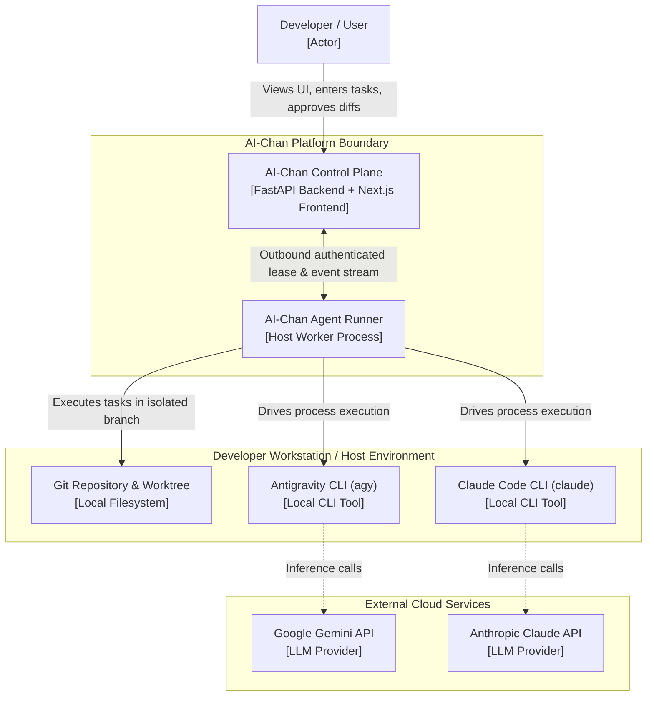
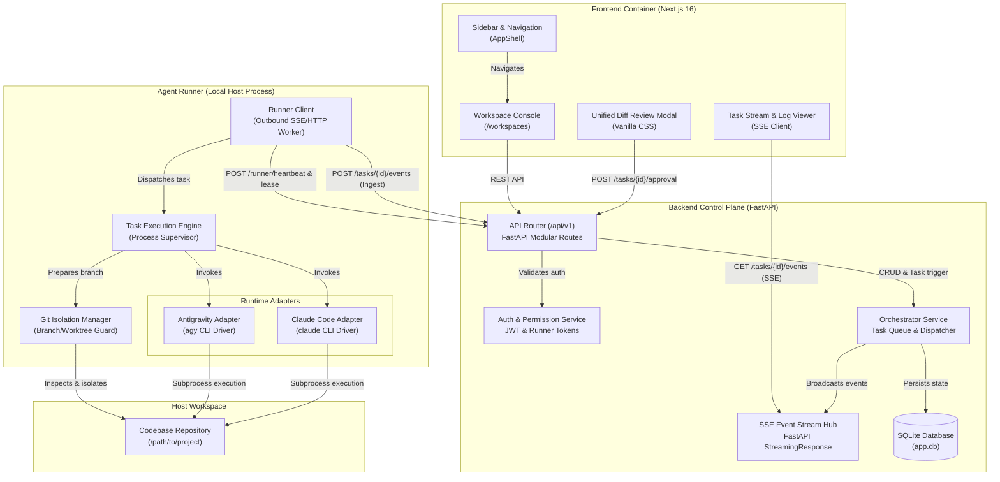
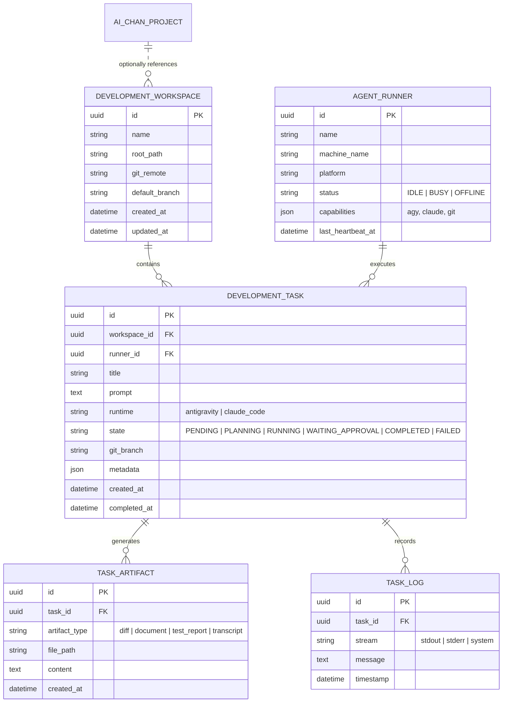

# 02. Proposed Context Boundaries — Development Orchestrator

> **Document Scope:** Architectural definition of context boundaries, domain concepts, and structural relationships for the AI-Chan Development Orchestrator.
> **Fact Classification:** `FACT` (verified codebase reality), `DECISION` (selected boundary architecture), `ASSUMPTION` (inferred requirements).

---

## 1. Domain Concept Separation

A fundamental design flaw would be conflating visual prompt graphs with local Git repositories. To ensure modularity, security, and scalability, the Development Orchestrator establishes six distinct boundaries:

| Concept | Boundary Scope | Responsibility | Primary Identity & State |
|---|---|---|---|
| **1. AI-Chan Project** | Web / UI Canvas Context | Visual node graph configuration (`web_input -> model -> output`), system prompt templates, Discord bot bindings. | `project_id` (UUID). Stored in `projects` table (`graph_data` JSON). |
| **2. Development Workspace** | Host Filesystem Context | Representation of a local software repository on host disk: root directory path, Git remote, active branch, and language runtime detection. | `workspace_id` (UUID). Stored in `development_workspaces` table. |
| **3. Agent Runner** | Execution Host Daemon | Host-side service that discovers local CLI runtimes (Antigravity CLI, Claude Code), accepts leased tasks, and spawns child processes securely. | `runner_id` (UUID). Connects outbound to Backend Control Plane. |
| **4. Runtime Adapter** | CLI Driver Context | Pluggable translation engine that adapts generic task instructions into CLI-specific command arguments, parses stdout/stderr streams, and normalizes events. | Polymorphic driver (e.g. `AntigravityAdapter`, `ClaudeCodeAdapter`). |
| **5. Development Task** | Lifecycle & Job Context | A discrete engineering change request with an explicit state machine: planning, running, waiting approval, completed, or failed. | `task_id` (UUID). Stored in `development_tasks` table. |
| **6. Task Artifact** | Verification & Review Context | Discrete outputs produced during a task: Git patch diffs, test logs, generated requirements, and conversation transcripts. | `artifact_id` (UUID). Stored in `task_artifacts` table. |

---

## 2. System Context Diagram (C4 Level 1)

The Context Diagram defines the boundary between external actors, AI-Chan, host machine tools, and external AI providers.

---

## 3. Container Architecture Diagram (C4 Level 2)

The Container Diagram details the internal layout of the AI-Chan system, separating web interaction from host execution.

---

## 4. Entity Relationship & Data Boundary

---

## 5. Security and Trust Boundaries

1. **Browser to Backend (Trust Boundary 1):**
   - Developer authenticates using existing JWT or session token.
   - Operations restricted to authorized user's workspaces and tasks.
2. **Backend to Agent Runner (Trust Boundary 2):**
   - Runner authenticates using a pre-shared `RUNNER_TOKEN`.
   - Communication is initiated **outbound** from Runner to Backend. The backend never attempts to connect directly into the developer's laptop port.
3. **Agent Runner to Local Filesystem (Trust Boundary 3):**
   - Execution is strictly scoped within `DEVELOPMENT_WORKSPACE.root_path`.
   - Path traversal prevention rejects paths resolving outside `root_path`.
   - Git status guard blocks tasks if uncommitted changes exist on current branch, automatically enforcing clean branch isolation (e.g., `ai-chan/task-{task_id}`).
