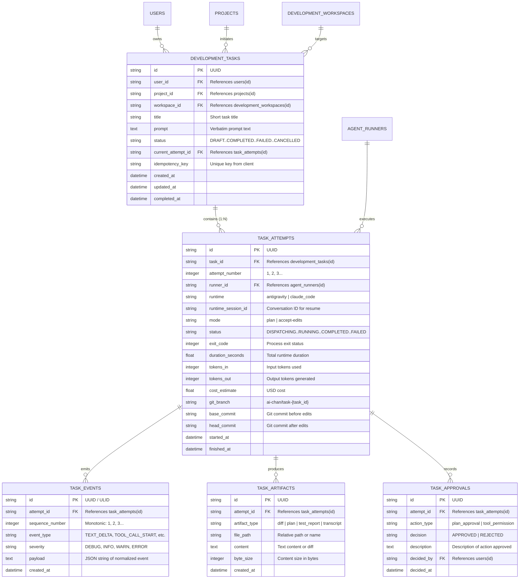

# Development Task Domain Model & Persistence Specification
## AI-Chan Development Orchestrator

> **Document ID:** DOM-TSK-01  
> **Version:** 1.0.0  
> **Target Database:** SQLite 3 (`ai-backend/database/app.db`)  
> **Migration Extension:** `012_development_task_management.sql` (Implemented in Prompt 05)  
> **Fact Classification:** `DECISION` (persistence design, attempt modeling, indexing, foreign keys).

---

## 1. Domain Entities & Structural Relationships

To preserve auditability, separate attempts from definitions, and avoid overwriting logs on retry, task persistence is decomposed into five core tables:



---

## 2. Table Specifications & Fields

### 2.1 `development_tasks`
Stores the top-level intent and lifecycle status of a change request.

| Field Name | Type | Constraints | Description |
|---|---|---|---|
| `id` | `VARCHAR(36)` | `PRIMARY KEY` | Task UUID. |
| `user_id` | `VARCHAR(36)` | `NOT NULL, FK -> users(id)` | Owner tenant. |
| `project_id` | `VARCHAR(36)` | `NOT NULL, FK -> projects(id)` | Source AI-Chan Project. |
| `workspace_id` | `VARCHAR(36)` | `NOT NULL, FK -> development_workspaces(id)`| Target codebase repository. |
| `title` | `VARCHAR(200)` | `NOT NULL` | Concise summary of the goal. |
| `prompt` | `TEXT` | `NOT NULL` | Verbatim prompt instruction. |
| `status` | `VARCHAR(30)` | `NOT NULL DEFAULT 'DRAFT'` | Top-level lifecycle state. |
| `current_attempt_id`| `VARCHAR(36)` | `NULL` | Pointer to active attempt record. |
| `idempotency_key` | `VARCHAR(64)` | `NULL, UNIQUE` | Deduplication key from client. |
| `created_at` | `DATETIME` | `NOT NULL DEFAULT CURRENT_TIMESTAMP` | Creation time. |
| `updated_at` | `DATETIME` | `NOT NULL DEFAULT CURRENT_TIMESTAMP` | Last updated time. |
| `completed_at` | `DATETIME` | `NULL` | Terminal completion time. |

### 2.2 `task_attempts` (Execution Runs)
Stores individual execution runs. If a task fails or is retried, a new attempt is created, preserving full history.

| Field Name | Type | Constraints | Description |
|---|---|---|---|
| `id` | `VARCHAR(36)` | `PRIMARY KEY` | Attempt UUID. |
| `task_id` | `VARCHAR(36)` | `NOT NULL, FK -> development_tasks(id)` | Parent task. |
| `attempt_number` | `INTEGER` | `NOT NULL DEFAULT 1` | Monotonic attempt index (1, 2...). |
| `runner_id` | `VARCHAR(36)` | `NOT NULL, FK -> agent_runners(id)` | Runner assigned to execute. |
| `runtime` | `VARCHAR(50)` | `NOT NULL DEFAULT 'antigravity'` | Engine: `antigravity` / `claude_code`. |
| `runtime_session_id`| `VARCHAR(100)`| `NULL` | Conversation ID for resume. |
| `mode` | `VARCHAR(30)` | `NOT NULL DEFAULT 'plan'` | `plan` or `accept-edits`. |
| `status` | `VARCHAR(30)` | `NOT NULL DEFAULT 'DISPATCHING'` | Attempt-specific state. |
| `exit_code` | `INTEGER` | `NULL` | Subprocess returncode. |
| `duration_seconds` | `FLOAT` | `NULL` | Total duration. |
| `tokens_in` | `INTEGER` | `NULL` | Prompt tokens. |
| `tokens_out` | `INTEGER` | `NULL` | Generated tokens. |
| `cost_estimate` | `FLOAT` | `NULL` | Estimated dollar cost. |
| `git_branch` | `VARCHAR(100)`| `NULL` | Dedicated branch (e.g. `ai-chan/task-123`). |
| `base_commit` | `VARCHAR(40)` | `NULL` | Commit SHA before task changes. |
| `head_commit` | `VARCHAR(40)` | `NULL` | Commit SHA after task changes. |
| `started_at` | `DATETIME` | `NOT NULL DEFAULT CURRENT_TIMESTAMP` | Spawn time. |
| `finished_at` | `DATETIME` | `NULL` | Termination time. |

### 2.3 `task_events`
Stores normalized domain events for replay and stream reconnection.

| Field Name | Type | Constraints | Description |
|---|---|---|---|
| `id` | `VARCHAR(36)` | `PRIMARY KEY` | Event UUID or ULID. |
| `attempt_id` | `VARCHAR(36)` | `NOT NULL, FK -> task_attempts(id)` | Parent attempt. |
| `sequence_number` | `INTEGER` | `NOT NULL` | Monotonic index (1, 2, 3...) per attempt. |
| `event_type` | `VARCHAR(50)` | `NOT NULL` | Standard event name (`TEXT_DELTA`, etc.). |
| `severity` | `VARCHAR(20)` | `NOT NULL DEFAULT 'INFO'` | `DEBUG`, `INFO`, `WARN`, `ERROR`. |
| `payload` | `TEXT` | `NOT NULL` | JSON serialized payload. |
| `created_at` | `DATETIME` | `NOT NULL DEFAULT CURRENT_TIMESTAMP` | Event timestamp. |

---

## 3. SQLite DDL Specification (Append to Migration 011)

```sql
-- Migration 011 (Part 2): Development Task Management Tables
-- File: ai-backend/database/migrations/011_create_orchestrator_tables.sql

-- 1. Create development_tasks table
CREATE TABLE IF NOT EXISTS development_tasks (
    id VARCHAR(36) PRIMARY KEY,
    user_id VARCHAR(36) NOT NULL,
    project_id VARCHAR(36) NOT NULL,
    workspace_id VARCHAR(36) NOT NULL,
    title VARCHAR(200) NOT NULL,
    prompt TEXT NOT NULL,
    status VARCHAR(30) NOT NULL DEFAULT 'DRAFT',
    current_attempt_id VARCHAR(36),
    idempotency_key VARCHAR(64) UNIQUE,
    created_at DATETIME NOT NULL DEFAULT CURRENT_TIMESTAMP,
    updated_at DATETIME NOT NULL DEFAULT CURRENT_TIMESTAMP,
    completed_at DATETIME,
    FOREIGN KEY (user_id) REFERENCES users(id) ON DELETE CASCADE,
    FOREIGN KEY (project_id) REFERENCES projects(id) ON DELETE CASCADE,
    FOREIGN KEY (workspace_id) REFERENCES development_workspaces(id) ON DELETE RESTRICT
);

CREATE INDEX IF NOT EXISTS idx_dev_tasks_user_id ON development_tasks(user_id);
CREATE INDEX IF NOT EXISTS idx_dev_tasks_workspace_id ON development_tasks(workspace_id);
CREATE INDEX IF NOT EXISTS idx_dev_tasks_status ON development_tasks(status);
CREATE INDEX IF NOT EXISTS idx_dev_tasks_idempotency ON development_tasks(idempotency_key);

-- 2. Create task_attempts table
CREATE TABLE IF NOT EXISTS task_attempts (
    id VARCHAR(36) PRIMARY KEY,
    task_id VARCHAR(36) NOT NULL,
    attempt_number INTEGER NOT NULL DEFAULT 1,
    runner_id VARCHAR(36) NOT NULL,
    runtime VARCHAR(50) NOT NULL DEFAULT 'antigravity',
    runtime_session_id VARCHAR(100),
    mode VARCHAR(30) NOT NULL DEFAULT 'plan',
    status VARCHAR(30) NOT NULL DEFAULT 'DISPATCHING',
    exit_code INTEGER,
    duration_seconds REAL,
    tokens_in INTEGER,
    tokens_out INTEGER,
    cost_estimate REAL,
    git_branch VARCHAR(100),
    base_commit VARCHAR(40),
    head_commit VARCHAR(40),
    started_at DATETIME NOT NULL DEFAULT CURRENT_TIMESTAMP,
    finished_at DATETIME,
    FOREIGN KEY (task_id) REFERENCES development_tasks(id) ON DELETE CASCADE,
    FOREIGN KEY (runner_id) REFERENCES agent_runners(id) ON DELETE RESTRICT,
    UNIQUE(task_id, attempt_number)
);

CREATE INDEX IF NOT EXISTS idx_task_attempts_task_id ON task_attempts(task_id);
CREATE INDEX IF NOT EXISTS idx_task_attempts_runner_id ON task_attempts(runner_id);

-- 3. Create task_events table
CREATE TABLE IF NOT EXISTS task_events (
    id VARCHAR(36) PRIMARY KEY,
    attempt_id VARCHAR(36) NOT NULL,
    sequence_number INTEGER NOT NULL,
    event_type VARCHAR(50) NOT NULL,
    severity VARCHAR(20) NOT NULL DEFAULT 'INFO',
    payload TEXT NOT NULL,
    created_at DATETIME NOT NULL DEFAULT CURRENT_TIMESTAMP,
    FOREIGN KEY (attempt_id) REFERENCES task_attempts(id) ON DELETE CASCADE,
    UNIQUE(attempt_id, sequence_number)
);

CREATE INDEX IF NOT EXISTS idx_task_events_attempt_seq ON task_events(attempt_id, sequence_number);

-- 4. Create task_artifacts table
CREATE TABLE IF NOT EXISTS task_artifacts (
    id VARCHAR(36) PRIMARY KEY,
    attempt_id VARCHAR(36) NOT NULL,
    artifact_type VARCHAR(50) NOT NULL,
    file_path VARCHAR(512) NOT NULL,
    content TEXT,
    byte_size INTEGER NOT NULL DEFAULT 0,
    created_at DATETIME NOT NULL DEFAULT CURRENT_TIMESTAMP,
    FOREIGN KEY (attempt_id) REFERENCES task_attempts(id) ON DELETE CASCADE
);

CREATE INDEX IF NOT EXISTS idx_task_artifacts_attempt_id ON task_artifacts(attempt_id);

-- 5. Create task_approvals table
CREATE TABLE IF NOT EXISTS task_approvals (
    id VARCHAR(36) PRIMARY KEY,
    attempt_id VARCHAR(36) NOT NULL,
    action_type VARCHAR(50) NOT NULL,
    decision VARCHAR(20) NOT NULL,
    description TEXT,
    decided_by VARCHAR(36) NOT NULL,
    decided_at DATETIME NOT NULL DEFAULT CURRENT_TIMESTAMP,
    FOREIGN KEY (attempt_id) REFERENCES task_attempts(id) ON DELETE CASCADE,
    FOREIGN KEY (decided_by) REFERENCES users(id) ON DELETE RESTRICT
);
```

---

## 4. Retention & Cleanup Policies

1. **Task Event Retention:**
   - Raw granular events (`task_events`) are retained for **30 days** post-task completion.
   - Summaries, metrics, artifacts, and approval records in `development_tasks`, `task_attempts`, and `task_artifacts` are retained **permanently**.
2. **Transaction Boundaries:**
   - Task creation + Initial attempt record insertion executes in an atomic transaction (`BEGIN IMMEDIATE`).
   - Recording a batch of stream events executes within a transaction with sequence locking to prevent gap anomalies.
