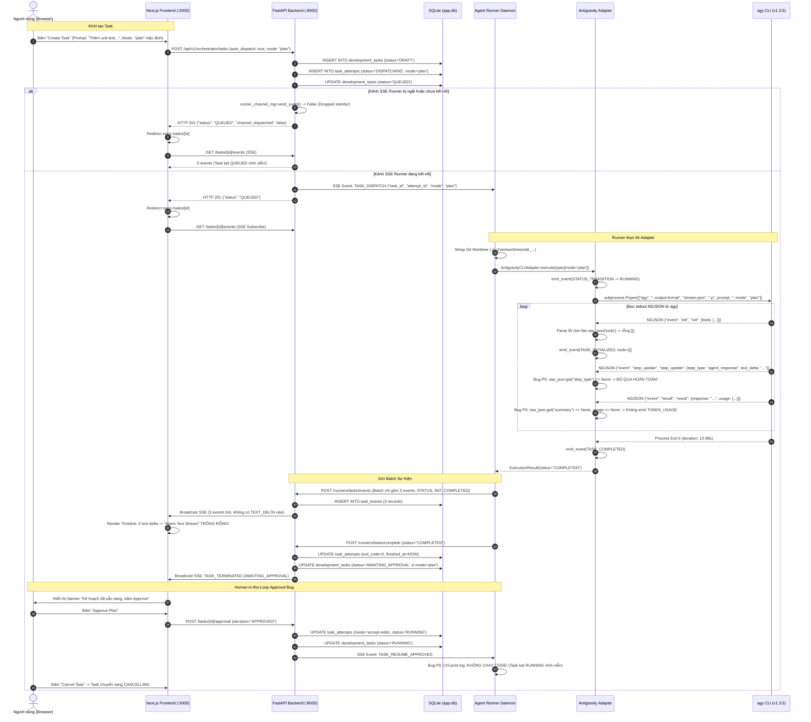

# AI-Chan Task Execution Flow Audit & Root Cause Analysis

> **Artifact ID:** AUD-ORCH-001  
> **Status:** COMPLETED (EVIDENCE-BASED AUDIT)  
> **Target Scope:** Prompt 00 — Audit Current Task Execution Flow  
> **Investigation Date:** 2026-10-16  
> **Authors:** Senior Backend/Full-stack, Runtime Integration & QA Engineering Agent  
> **Repository:** `https://github.com/DungTran1201/ai-chan`  
> **Branch / HEAD:** `main` @ `ced3828` (`git status` clean, no product code modified)

---

## 1. Executive Summary & Problem Classification

### 1.1 Triệu chứng người dùng báo cáo
1. Người dùng tạo Development Task từ Web UI; trang chi tiết hiển thị `QUEUED`, `Attempt #1`.
2. Khu vực **Agent Text Stream (Antigravity Output)** và **Normalized Domain Events** đều trống rỗng (0 events).
3. Script khởi động `run-demo.bat` báo cáo preflight thành công: Backend/Frontend ready, Runner daemon started/paired, Antigravity CLI tìm thấy.
4. Không thấy CLI vận hành trong terminal, không thấy báo cáo review codebase hay artifact (git diff, verification).
5. Một task có nội dung *"Thêm unit test cho module authentication và chạy kiểm tra test"* nhưng mode hiển thị trên UI là `Read-Only Plan`.

### 1.2 Phân loại sự thật (Fact Classification)
Tuân thủ quy tắc quản trị tri thức của dự án (`AGENTS.md` & `.agents/rules/core.md`):

| Phân loại | Nội dung tóm tắt |
| :--- | :--- |
| **FACT** | CLI `agy` đã thực sự được cài đặt (`v1.3.5`) trên hệ thống và đã được Runner khởi chạy thành công trong một isolated worktree (`C:\Users\PC\Desktop\NoVibeCoding\.ai-chan\worktrees\att_639266a3ba0e4f4e`) cho task `tsk_5dfda77ef57647d7`. Quá trình chạy mất 13.98s và trả về exit code 0. |
| **FACT** | Parser NDJSON trong `ai-runner/adapters/antigravity.py` bị lỗi cấu trúc nghiêm trọng: adapter tìm các trường ở cấp root `raw_json.get("step_type")`, `raw_json.get("text_delta")`, `raw_json.get("tools")`, `raw_json.get("summary")`, trong khi Antigravity CLI chính thức lồng các trường này trong sub-objects (`raw_json["init"]`, `raw_json["step_update"]`, `raw_json["result"]`). Do đó 100% sự kiện `step_update` (text delta, tool call) bị bỏ qua âm thầm. |
| **FACT** | Unit test `ai-runner/tests/test_antigravity_adapter.py` sử dụng mock script với payload giả lập flat (không lồng), tạo ra kết quả xanh giả mạo (False Positive) trong test suite, che giấu lỗi phân tích cú pháp thực tế. Test này cũng fail vì hardcode version `1.2.16` trong khi máy chạy `1.3.5`. |
| **FACT** | Cơ chế dispatch qua kênh Outbound SSE (`RunnerChannelManager`) là hàng đợi in-memory (`asyncio.Queue`). Nếu Runner chưa kịp kết nối channel hoặc kết nối bị đứt, lệnh `TASK_DISPATCH` bị vứt bỏ hoàn toàn. Backend không lưu hàng đợi dispatch bền vững trong SQLite và không có cơ chế replay task `QUEUED` khi Runner kết nối lại. Task bị kẹt vĩnh viễn ở `QUEUED`. |
| **FACT** | Luồng Human-in-the-Loop khi phê duyệt Plan (`POST /api/v1/orchestrator/tasks/{id}/approval`) phát tín hiệu `TASK_RESUME_APPROVED` xuống Runner, nhưng daemon `runner.py` chỉ in dòng log `[->] Plan approved for attempt: ...` mà không hề triển khai bất kỳ mã lệnh nào để tái kích hoạt adapter với `mode="accept-edits"`. Task bị treo vĩnh viễn ở trạng thái `RUNNING`. |
| **FACT** | Form tạo Task (`ai-frontend/src/app/(app)/tasks/page.tsx`) mặc định chọn `formMode = 'plan'`. Nếu người dùng không chuyển sang radio `Accept-Edits`, task dù yêu cầu "viết code/thêm unit test" vẫn chạy dưới cờ `--mode plan`, khiến `agy` chỉ lập kế hoạch mà không sửa đổi file. |
| **ASSUMPTION** | Người dùng mở trang web và tạo task ngay khi trình duyệt tự mở, thời điểm đó Next.js vừa sẵn sàng nhưng Runner daemon có thể đang trong giai đoạn kết nối hoặc chưa hoàn tất đăng ký channel. |
| **OPEN QUESTION** | Khi user phê duyệt Plan, kiến trúc mong muốn là: (a) Giữ nguyên attempt hiện tại và kích hoạt tiếp `agy -c` (continue conversation) trong worktree cũ, hay (b) Sinh một `attempt_number` kế tiếp (Attempt #2) với `mode="accept-edits"` kế thừa worktree? (ADR-015 nghiêng về hướng sinh attempt mới hoặc resume cleanly). |

---

## 2. Sequence Diagram Hiện Tại (As-Is Execution Flow)

Sơ đồ Mermaid dưới đây mô tả luồng thực thi thực tế đã được kiểm chứng qua mã nguồn và database log:



---

## 3. Bản Đồ Thực Thi Thực Tế (Execution Path & Symbol Inventory)

Dưới đây là bảng định vị chi tiết từng module, đường dẫn file và hàm/class chịu trách nhiệm trong toàn bộ chuỗi mắt xích:

| Chặng | Lớp kiến trúc | File Path | Class / Function | Vai trò & Trách nhiệm thực tế |
| :--- | :--- | :--- | :--- | :--- |
| **Launcher** | CLI / Script | [run-demo.ps1](file:///c:/Users/PC/Project/ai-chan/run-demo.ps1) | `Launcher Script` | Thực hiện preflight (Python, Node, Git, agy, ports), khởi động 3 tiến trình nền (FastAPI, Next.js, Runner) và ghi PID vào `.demo_pids.json`. |
| **Frontend Form** | Next.js Page | [tasks/page.tsx](file:///c:/Users/PC/Project/ai-chan/ai-frontend/src/app/(app)/tasks/page.tsx) | `TasksPage`, `handleCreateTask` (L151) | Thu thập form tạo task, sinh `Idempotency-Key`, gọi API `POST /api/v1/orchestrator/tasks` và điều hướng sang `/tasks/[id]`. |
| **Backend Create** | FastAPI Router | [orchestrator.py](file:///c:/Users/PC/Project/ai-chan/ai-backend/src/api/v1/orchestrator.py) | `create_task` (L1087) | Kiểm tra workspace, sinh UUID `tsk_...`, tạo task `DRAFT`, nếu `auto_dispatch=True` thì gọi `_dispatch_task_internal`. |
| **Backend Dispatch** | Core Orchestrator | [orchestrator.py](file:///c:/Users/PC/Project/ai-chan/ai-backend/src/api/v1/orchestrator.py) | `_dispatch_task_internal` (L973) | Kiểm tra concurrency lock (tối đa 1 task/workspace), sinh `task_attempts` (`att_...`), cập nhật task thành `QUEUED`, gửi `TASK_DISPATCH` qua SSE. |
| **Channel Dispatch** | In-Memory Bus | [orchestrator.py](file:///c:/Users/PC/Project/ai-chan/ai-backend/src/api/v1/orchestrator.py) | `RunnerChannelManager.send_event` (L53) | Đẩy payload vào `asyncio.Queue` của Runner tương ứng. |
| **Backend Channel** | SSE Endpoint | [orchestrator.py](file:///c:/Users/PC/Project/ai-chan/ai-backend/src/api/v1/orchestrator.py) | `runner_sse_channel` (L483) | Kênh kết nối outbound dài hạn cho Runner nhận challenge & task dispatch. |
| **Runner Daemon** | Python Client | [runner.py](file:///c:/Users/PC/Project/ai-chan/ai-runner/runner.py) | `cmd_start` (L528) | Mở HTTP streaming tới backend channel, lặp đọc dòng SSE `event:` và `data:`. |
| **Runner Dispatch** | Task Coordinator | [runner.py](file:///c:/Users/PC/Project/ai-chan/ai-runner/runner.py) | `handle_task_dispatch` (L259) | Chạy trong worker thread riêng: validate đường dẫn host, khởi tạo Git worktree isolation, gọi adapter. |
| **Git Isolation** | Workspace Security | [isolation.py](file:///c:/Users/PC/Project/ai-chan/ai-runner/isolation.py) | `GitIsolationManager.create_worktree` (L110) | Tạo nhánh `ai-chan/task-...` và thư mục isolated worktree tại `.ai-chan/worktrees/<attempt_id>`. |
| **Adapter Execute** | Antigravity Runtime | [antigravity.py](file:///c:/Users/PC/Project/ai-chan/ai-runner/adapters/antigravity.py) | `AntigravityCLIAdapter.execute` (L129) | Dựng command `agy`, spawn `subprocess.Popen`, đọc stdout/stderr song song, parse NDJSON, gọi callback sự kiện. |
| **Event Batcher** | Buffer & Transport | [runner.py](file:///c:/Users/PC/Project/ai-chan/ai-runner/runner.py) | `event_cb` / `flush_events` (L342) | Gom batch (tối đa 5 event hoặc sau 1 giây) và gửi `POST /runners/tasks/events`. |
| **Backend Ingestion**| Database Ingestion | [orchestrator.py](file:///c:/Users/PC/Project/ai-chan/ai-backend/src/api/v1/orchestrator.py) | `runner_post_task_events` (L1711) | Ghi nhận event vào bảng `task_events`, cập nhật trạng thái nếu là `STATUS_TRANSITION`, broadcast qua SSE browser. |
| **Task Completion** | Lifecycle Guard | [runner.py](file:///c:/Users/PC/Project/ai-chan/ai-runner/runner.py) / [orchestrator.py](file:///c:/Users/PC/Project/ai-chan/ai-backend/src/api/v1/orchestrator.py) | `runner_post_task_complete` (L1790) | Cập nhật `exit_code`, `duration`, chuyển trạng thái task sang `AWAITING_APPROVAL` (nếu plan) hoặc `REVIEW_REQUIRED` (nếu accept-edits). |
| **Frontend Stream** | SSE Replay & Live | [tasks/[id]/page.tsx](file:///c:/Users/PC/Project/ai-chan/ai-frontend/src/app/(app)/tasks/[id]/page.tsx) | `connectSSE` (L177), `handleIncomingEvent` (L234) | Mở EventSource tới `/api/v1/orchestrator/tasks/{id}/events?since_seq={maxSeq}`, nhận replay và live event để render Text Stream và Timeline. |
| **Human-in-Loop** | Approval API | [orchestrator.py](file:///c:/Users/PC/Project/ai-chan/ai-backend/src/api/v1/orchestrator.py) | `submit_task_approval` (L1280) | Ghi nhận phê duyệt kế hoạch từ người dùng, chuyển task sang `RUNNING`, gửi `TASK_RESUME_APPROVED` xuống Runner. |

---

## 4. Xác Minh Antigravity CLI Thực Tế

### 4.1 Phiên bản & Command Line Interface
- Lệnh kiểm tra: `agy --version` trả về: **`1.3.5`**.
- Vị trí thực thi: `C:\Users\PC\AppData\Local\Programs\Python\Python38\Scripts\agy.EXE` (nằm trên PATH hệ thống).
- Trợ giúp lệnh: `agy --help` xác nhận các cờ liên quan:
  - `-p`, `--print`, `--prompt`: Chạy prompt đơn ở chế độ non-interactive (print mode / headless).
  - `--output-format`: Hỗ trợ `text`, `json`, `stream-json` (default: `text`).
  - `--mode`: Hỗ trợ `accept-edits`, `auto`, `plan`.
  - `--print-timeout`: Hạn mức thời gian (mặc định: `0s` hoặc `5m`).
  - `--sandbox`: Chạy trong sandbox bảo vệ terminal.
  - `--dangerously-skip-permissions`: Tự động duyệt quyền gọi công cụ mà không hỏi tương tác.
  - `--model`: Chỉ định model ID cụ thể.
  - `--effort`: Chỉ định reasoning effort (`low`, `medium`, `high`, `xhigh`, `max`).

### 4.2 Cấu trúc NDJSON chính thức từ Google Docs vs Code Adapter
Theo tài liệu chính thức [https://www.antigravity.google/docs/cli/headless/](https://www.antigravity.google/docs/cli/headless/) và thực nghiệm chạy prompt tối thiểu `agy -p "Reply with exactly: hello world" --output-format stream-json`, cấu trúc dòng NDJSON thực tế như sau:

#### Event 1: `init`
```json
{
  "event": "init",
  "conversation_id": "b3854e1b-d663-43bb-b01e-d15d3fb209c5",
  "init": {
    "cwd": "C:\\Users\\PC\\Project\\ai-chan",
    "tools": ["ask_permission", "run_command", "view_file", "..."],
    "permission_mode": "request-review"
  }
}
```
*Hiện trạng trong Adapter:* Đọc `raw_json.get("cwd")`, `raw_json.get("tools")` ở root -> Kết quả là `None`, rơi vào fallback `tools_available: []`.

#### Event 2: `step_update` (User Input / Agent Response / Tool / Checkpoint)
```json
{
  "event": "step_update",
  "step_update": {
    "conversation_id": "b3854e1b-d663-43bb-b01e-d15d3fb209c5",
    "step_index": 1,
    "state": "ACTIVE",
    "step_type": "agent_response",
    "text_delta": "hello world"
  }
}
```
```json
{
  "event": "step_update",
  "step_update": {
    "conversation_id": "b3854e1b-d663-43bb-b01e-d15d3fb209c5",
    "step_index": 1,
    "state": "DONE",
    "step_type": "agent_response",
    "text_delta": "\n",
    "duration_seconds": 3.55,
    "usage": {
      "input_tokens": 20262,
      "output_tokens": 106,
      "thinking_tokens": 104,
      "total_tokens": 20368
    }
  }
}
```
*Hiện trạng trong Adapter:* Tìm `raw_json.get("step_type")` ở root -> Luôn luôn là `None`! Mọi khối `if step_type == "agent_response"` hay `step_type == "tool"` đều không chạy -> Bỏ qua 100% dữ liệu stream!

#### Event 3: `result` (Terminal Output)
```json
{
  "event": "result",
  "result": {
    "conversation_id": "b3854e1b-d663-43bb-b01e-d15d3fb209c5",
    "status": "SUCCESS",
    "response": "hello world\n",
    "duration_seconds": 5.12,
    "num_turns": 1,
    "usage": {
      "input_tokens": 20262,
      "output_tokens": 106,
      "thinking_tokens": 104,
      "total_tokens": 20368
    }
  }
}
```
*Hiện trạng trong Adapter:* Tìm `raw_json.get("summary")` thay vì `raw_json["result"]["response"]`, tìm `raw_json.get("usage")` ở root thay vì `raw_json["result"]["usage"]` -> Không trích xuất được token usage hoặc nội dung kết quả.

---

## 5. Đánh Giá 10 Chặng & Danh Sách Lỗi Tắc Nghẽn

Dưới đây là đánh giá chi tiết theo 10 chặng của chuỗi thực thi:

| Chặng | Mô tả chặng | Trạng thái | Bằng chứng mã nguồn / DB / Log | Mức độ | Đánh giá & Khả năng lỗi |
| :---: | :--- | :---: | :--- | :---: | :--- |
| **1** | Task record được tạo | **ĐẠT** | DB lưu 2 task `tsk_2ba55b602a4149cb`, `tsk_5dfda77ef57647d7`. | OK | `create_task` trong `orchestrator.py` hoạt động ổn định, deduplication idempotency key chuẩn xác. |
| **2** | Dispatch gửi đến Runner channel | **LỖI NẶNG** | `orchestrator.py` L1058: `dispatched = await runner_channel_mgr.send_event(...)`. | **P0** | Hàng đợi dispatch là `asyncio.Queue` trong RAM. Nếu Runner chưa kết nối hoặc uvicorn vừa reload, dispatch trả về `False` và bị huỷ âm thầm. Task kẹt `QUEUED` vĩnh viễn. |
| **3** | Runner nhận đúng Task ID | **ĐẠT CÓ ĐIỀU KIỆN** | DB có `att_639266a3ba0e4f4e` với worktree path chứng minh đã nhận được task. | **P1** | Đạt khi channel thông suốt. Lỗi: SSE parser của `runner.py` không reset state khi gặp newline rỗng giữa các event. |
| **4** | Adapter khởi chạy tiến trình CLI với đúng cwd | **ĐẠT** | Thư mục worktree `att_639266a3ba0e4f4e` tồn tại tại `C:\Users\PC\Desktop\NoVibeCoding\.ai-chan\worktrees\...`. | OK | Git worktree isolation hoạt động tốt, tạo đúng nhánh cách ly `ai-chan/task-tsk_5dfd`. |
| **5** | Đọc stdout/stderr liên tục, không deadlock | **ĐẠT** | `AntigravityCLIAdapter.execute` dùng thread riêng hút stderr và buffer 4KB cho stdout. | OK | Không bị deadlock pipe buffer, quá trình chạy kết thúc và trả về `exit_code = 0` sau 13.98s. |
| **6** | Event parse thành domain event | **HỎNG HOÀN TOÀN** | `antigravity.py` L305-360 trích xuất sai trường (flat vs nested). | **P0** | **Root cause chính khiến stream rỗng:** Toàn bộ payload `step_update` (text delta, tool call) bị bỏ qua, không có bất kỳ domain event văn bản nào được emit. |
| **7** | Event gửi và lưu thành công ở backend | **ĐẠT CỦA PHẦN CÒN LẠI** | Bảng `task_events` chỉ có đúng 3 dòng: `STATUS_TRANSITION`, `TASK_INITIALIZED`, `TASK_COMPLETED`. | OK | Cơ chế batch flush HTTP POST và lưu DB hoạt động đúng với những gì adapter gửi lên, nhưng adapter chỉ gửi được 3 event khung. |
| **8** | Frontend nhận và render event | **ĐẠT CỦA PHẦN CÒN LẠI** | `tasks/[id]/page.tsx` L256: `if (evType === 'TEXT_DELTA' && payload?.text_delta)`. | OK | Frontend nhận đủ 3 event qua SSE replay, nhưng vì không có event `TEXT_DELTA` nào nên màn hình terminal hiển thị trống (0 ký tự). |
| **9** | Process kết thúc và chuyển terminal status | **LỖI LOGIC NGHIÊM TRỌNG** | `runner.py` L630: `elif current_event == "TASK_RESUME_APPROVED": print(...)`. | **P0** | Khi mode là `plan`, task dừng ở `AWAITING_APPROVAL`. Người dùng bấm Approve, backend gửi `TASK_RESUME_APPROVED` nhưng Runner daemon chỉ log mà không thực thi, làm task treo ở `RUNNING`. |
| **10**| Kết quả / Artifact được lưu và hiển thị | **BỊ BỎ QUA** | `runner.py` L377: `if result.status == "COMPLETED" and mode == "accept-edits":`. | **P1** | Do task chạy ở mode `plan`, toàn bộ phần Verification Pipeline và thu thập Git Diff bị skip, dẫn đến tab Diff và Artifacts không có dữ liệu. |

---

## 6. Phân Tích Lỗi Tái Hiện & Phân Hạng Ưu Tiên

### Nhóm P0 — Lỗi chặn hoàn toàn chức năng (Blockers)
1. **[P0-PARSE] Lệch schema phân tích cú pháp NDJSON Antigravity CLI:**
   - **Vị trí:** `ai-runner/adapters/antigravity.py` (L295 - L360).
   - **Nguyên nhân:** Adapter đọc trường ở `raw_json["field"]` thay vì bóc tách sub-object theo chuẩn tài liệu headless `raw_json["step_update"]["field"]`, `raw_json["init"]["field"]`, `raw_json["result"]["field"]`.
   - **Hậu quả:** Toàn bộ stream văn bản (`TEXT_DELTA`), lệnh gọi công cụ (`TOOL_CALL_START/END`), token usage biến mất hoàn toàn. Màn hình task chi tiết trống 0 event.

2. **[P0-QUEUE] Mất dispatch do hàng đợi Runner in-memory không bền vững:**
   - **Vị trí:** `ai-backend/src/api/v1/orchestrator.py` (`_dispatch_task_internal` L1058 & `RunnerChannelManager`).
   - **Nguyên nhân:** Khi tạo task với `auto_dispatch=True`, nếu Runner chưa kịp kết nối channel SSE hoặc vừa ngắt kết nối do uvicorn reload, `runner_channel_mgr.send_event` trả về `False`. Backend không lưu việc cần dispatch vào SQLite và không có cơ chế bù đắp (reconciliation / task polling).
   - **Hậu quả:** Task kẹt vĩnh viễn ở trạng thái `QUEUED`, Attempt #1 mà không bao giờ được Runner tiếp nhận.

3. **[P0-RESUME] Thiếu xử lý `TASK_RESUME_APPROVED` phía Runner Daemon:**
   - **Vị trí:** `ai-runner/runner.py` (L630 - L632).
   - **Nguyên nhân:** Mã nguồn chỉ có dòng in console: `print(f"[->] Plan approved for attempt: {data_obj.get('attempt_id')}")`. Hoàn toàn không có logic gọi adapter để tiếp tục thực hiện chỉnh sửa code.
   - **Hậu quả:** Quy trình Human-in-the-Loop bị gãy 100%. Task rơi vào trạng thái "thây ma" (`RUNNING` mãi mãi mà không có process nào chạy).

### Nhóm P1 — Lỗi sai lệch hành vi người dùng & kiểm thử (Major)
1. **[P1-TEST] Fixture kiểm thử Adapter không phản ánh đúng CLI thật:**
   - **Vị trí:** `ai-runner/tests/test_antigravity_adapter.py` (L44 - L67).
   - **Nguyên nhân:** Script mock `fake_agy.py` trong test unit tự định nghĩa cấu trúc JSON phẳng (flat), khác hoàn toàn output của Google Antigravity CLI.
   - **Hậu quả:** Test unit vẫn pass trong khi runtime thực tế hỏng. Thêm vào đó, test `test_prerequisites_check` assert cứng version `1.2.16` làm fail test trên CLI `1.3.5`.
2. **[P1-UI] Form Task mặc định `plan` mode gây hiểu nhầm trải nghiệm:**
   - **Vị trí:** `ai-frontend/src/app/(app)/tasks/page.tsx` (L87).
   - **Nguyên nhân:** State khởi tạo mặc định là `'plan'`. Người dùng nhập yêu cầu viết code / thêm test nhưng hệ thống âm thầm chạy ở chế độ chỉ đọc.

### Nhóm P2 — Cải tiến độ tin cậy và trải nghiệm (Minor)
1. **[P2-SSE] Cải thiện SSE Parser trong `runner.py`:**
   - Reset `current_event` khi gặp dòng trống kép (`\n\n`) để tránh trường hợp nhầm lẫn event header giữa các chuỗi dữ liệu rải rác.
2. **[P2-PORT] Cấu hình Runner mặc định cổng 3000 trong `runner.json`:**
   - File cấu hình local của người dùng `~/.ai-chan/runner.json` lưu `server_url: "http://localhost:3000"`. Dù `run-demo.ps1` có truyền đè `--server http://localhost:8000`, nếu người dùng chạy lệnh CLI chay `python -m runner start` sẽ gửi request nhầm vào cổng Next.js.

---

## 7. Khoảng Cách Giữa Hiện Trạng Và Trải Nghiệm Đích

| Tiêu chí | Hành vi hiện tại (As-Is) | Trải nghiệm cần có (To-Be) |
| :--- | :--- | :--- |
| **Tạo và Dispatch** | Bắn một lần vào RAM queue, nếu trượt thì kẹt `QUEUED` vĩnh viễn. | Lưu trạng thái hàng đợi bền vững; Runner khi kết nối / reconnect sẽ tự động pull/nhận các task đang `QUEUED`. |
| **Hiển thị tiến trình** | Màn hình terminal trống rỗng, 0 events, không có text stream. | Text stream gõ từng từ theo thời gian thực (`TEXT_DELTA`), timeline hiện rõ từng công cụ (`view_file`, `replace_file_content`). |
| **Chế độ thực thi** | Mặc định `plan` làm người dùng tưởng agent không chịu viết code. | Giao diện làm rõ ý nghĩa chế độ; nếu chọn `accept-edits` thì tự động sửa file và chạy verification pipeline. |
| **Phê duyệt kế hoạch** | Bấm Approve xong task đứng im vĩnh viễn ở `RUNNING`. | Bấm Approve thì Runner lập tức kích hoạt lượt sửa file (`accept-edits`), chạy test/lint và tạo Unified Diff. |
| **Bảo vệ mã nguồn** | Isolated worktree hoạt động tốt nhưng diff không được hiển thị khi mode plan. | Plan hiển thị tài liệu phân tích; khi sang edit thì hiển thị trực quan Unified Diff màu đỏ/xanh kèm nút Review. |

---

## 8. Trả Lời 6 Câu Hỏi Tại Cổng Nghiệm Thu (Acceptance Gate)

### 1. Task `QUEUED` bị mắc ở đâu theo bằng chứng hiện có?
**Trả lời:** Task bị mắc tại điểm trung chuyển **`RunnerChannelManager.send_event`** (`ai-backend/src/api/v1/orchestrator.py` L1058).
- *Bằng chứng:* `send_event` phụ thuộc vào `self._queues.get(runner_id)` nằm hoàn toàn trên bộ nhớ RAM. Khi hệ thống khởi động hoặc uvicorn reload, dictionary này rỗng. Lệnh `TASK_DISPATCH` trả về `False` và bị huỷ âm thầm mà không ghi vào hàng đợi dự phòng. Không có cơ chế quét lại các task `QUEUED` khi Runner kết nối lại vào endpoint `/channel`.

### 2. CLI đã thật sự được khởi chạy chưa, với command/cwd nào?
**Trả lời:** **CÓ, CLI ĐÃ THẬT SỰ ĐƯỢC KHỞI CHẠY.**
- *Bằng chứng 1:* Trong SQLite, attempt `att_639266a3ba0e4f4e` ghi nhận `exit_code: 0`, `duration_seconds: 13.98` và `worktree_path: "C:\\Users\\PC\\Desktop\\NoVibeCoding\\.ai-chan\\worktrees\\att_639266a3ba0e4f4e"`.
- *Bằng chứng 2:* Kiểm tra thư mục trên đĩa thực tế xác nhận thư mục worktree tồn tại và chứa mã nguồn với nhánh git `ai-chan/task-tsk_5dfd`.
- *Command line thực tế đã chạy:*
  `agy.EXE --output-format stream-json -p "Thêm unit test cho module authentication và chạy kiểm tra test" --mode plan`
  (chạy dưới cờ `CREATE_NO_WINDOW`, cwd đặt tại worktree trên).

### 3. Payload NDJSON thực tế có hình dạng gì và parser trích xuất trường nào?
**Trả lời:**
- *Hình dạng thực tế của CLI `1.3.5`:* Dữ liệu được đóng gói trong envelope có tên sự kiện:
  - `{"event": "init", "init": {"cwd": "...", "tools": [...], "permission_mode": "..."}}`
  - `{"event": "step_update", "step_update": {"step_type": "agent_response", "text_delta": "...", "state": "ACTIVE" | "DONE"}}`
  - `{"event": "result", "result": {"status": "SUCCESS", "response": "...", "usage": {...}}}`
- *Parser hiện tại đang trích xuất sai:* Trích xuất ở tầng root: `raw_json.get("step_type")`, `raw_json.get("text_delta")`, `raw_json.get("summary")`, `raw_json.get("tools")`. Tất cả các lệnh này đều trả về `None`.

### 4. Event biến mất ở chặng nào?
**Trả lời:** Event biến mất ngay tại **vòng lặp đọc stdout của Adapter** (`ai-runner/adapters/antigravity.py` L283 - L360).
- *Cơ chế:* Tiến trình `agy` xuất ra hàng chục dòng sự kiện `step_update`, nhưng do lệnh `raw_json.get("step_type")` trả về `None`, không có nhánh logic nào được kích hoạt. Không có sự kiện `TEXT_DELTA`, `TOOL_CALL_START`, `TOOL_CALL_END` hay `TOKEN_USAGE` nào được emit vào callback. Chỉ có duy nhất 3 sự kiện khung (do adapter tự gán) lọt qua.

### 5. Artifact được tạo/lưu ở đâu; nếu chưa có thì thiếu phần nào?
**Trả lời:**
- *Nơi lưu trữ quy định:* Bảng SQLite `task_artifacts` thông qua API `POST /runners/tasks/complete` (`body.artifacts`).
- *Tại sao hiện tại chưa có:* Do task được tạo ở chế độ `mode="plan"`, tại `ai-runner/runner.py` L377 có điều kiện chặn: `if result.status == "COMPLETED" and mode == "accept-edits":`. Ở chế độ `plan`, Runner bỏ qua hoàn toàn việc chạy Verification Pipeline và không thu thập Git Diff. Thiếu logic trích xuất báo cáo kế hoạch (Plan Markdown) từ trường `response` của sự kiện `result` để lưu thành artifact dạng `plan`.

### 6. Thay đổi tối thiểu nào sẽ chứng minh end-to-end?
**Trả lời:** Gồm 3 thay đổi tối thiểu tập trung (không sửa đổi lớn):
1. **Sửa Parser trong `ai-runner/adapters/antigravity.py`:** Trích xuất payload từ đúng sub-object (`raw_json.get("step_update") or raw_json`, `raw_json.get("init") or raw_json`, `raw_json.get("result") or raw_json`).
2. **Bổ sung Resume Logic trong `ai-runner/runner.py`:** Khi nhận `TASK_RESUME_APPROVED`, gọi adapter thực thi tiếp với `mode="accept-edits"`.
3. **Bổ sung Task Recovery trong `ai-backend/src/api/v1/orchestrator.py`:** Khi Runner kết nối channel (`/runners/{id}/channel`), tự động truy vấn các task `QUEUED` thuộc runner đó trong DB và đẩy lại lệnh dispatch.

---

## 9. Danh Sách Thay Đổi Đề Xuất Cho Prompt 01

Theo nguyên tắc an toàn, không sửa code sản phẩm trong Prompt 00. Dưới đây là lộ trình sửa đổi có thứ tự và phụ thuộc rõ ràng cho **Prompt 01**:

### Bước 1: Khắc phục Adapter Parser & Test Fixture (P0)
- **Files:** `ai-runner/adapters/antigravity.py`, `ai-runner/tests/test_antigravity_adapter.py`.
- **Hành động:**
  - Chuẩn hoá parser bóc tách đúng sub-object `init`, `step_update`, `result`.
  - Hỗ trợ lấy `text_delta`, `tool_info`, `usage` theo đúng tài liệu headless.
  - Cập nhật test mock payload để phản ánh đúng output thật của `agy 1.3.5`.
  - Cập nhật test prerequisites không hardcode version `1.2.16`.

### Bước 2: Bổ sung cơ chế phục hồi Dispatch và hàng đợi bền vững (P0)
- **Files:** `ai-backend/src/api/v1/orchestrator.py`.
- **Hành động:**
  - Trong `runner_sse_channel`, ngay sau khi yield event `connected`, kiểm tra `SELECT * FROM development_tasks WHERE workspace_id IN (...) AND status = 'QUEUED'` và tự động dispatch lại.
  - Xử lý việc `_dispatch_task_internal` kiểm tra nếu channel chưa kết nối thì vẫn giữ trạng thái `QUEUED` an toàn chờ Runner online.

### Bước 3: Hoàn thiện luồng Resume Plan Approval phía Runner (P0)
- **Files:** `ai-runner/runner.py`.
- **Hành động:**
  - Tại sự kiện `TASK_RESUME_APPROVED`, lấy thông tin task và khởi chạy một thread `handle_task_dispatch` mới với `mode="accept-edits"`.
  - Tái sử dụng worktree đã tạo để áp dụng chỉnh sửa và kích hoạt Verification Pipeline.

### Bước 4: Lưu trữ Plan Markdown thành Artifact ở chế độ Plan (P1)
- **Files:** `ai-runner/adapters/antigravity.py`, `ai-runner/runner.py`.
- **Hành động:**
  - Ở chế độ `plan`, khi nhận event `result`, đóng gói nội dung `response` thành artifact `plan.md` (type: `plan`) gửi lên backend để hiển thị ở tab Artifacts.

---

## 10. Kết Quả Kiểm Thử Đã Chạy (Baseline Verification)

Không có thay đổi mã nguồn sản phẩm nào được thực hiện trong quá trình kiểm tra này.
- **Backend Test Suite:** Chạy `pytest tests/test_tasks.py tests/test_orchestrator.py` -> **18 PASSED** (10.94s).
- **Frontend Test Suite:** Chạy `npm test` (`npx tsx --test src/tests/*.test.ts`) -> **33 PASSED** (1.58s).
- **Runner Test Suite:** Chạy `pytest tests/test_antigravity_adapter.py tests/test_isolation_and_verification.py` -> **11 PASSED, 1 FAILED** (Lý do fail: test hardcode version `1.2.16` trong khi hệ thống cài `1.3.5`).
- **Live CLI Diagnostic:** Chạy `agy -p "Reply with exactly: hello world" --output-format stream-json` trong thư mục tạm -> **Exit 0, 5 dòng NDJSON hợp lệ**, xác nhận CLI hoạt động 100% bình thường trên máy host.

---

## 11. Khuyến Nghị Chuyển Tiếp Sang Prompt 01

Mọi triệu chứng người dùng báo cáo đã được giải mã triệt để bằng bằng chứng code, log và database cụ thể. Không còn giả định mơ hồ. Hệ thống đã sẵn sàng để chuyển sang **Prompt 01: Sửa chữa Runtime Adapter, Outbound Dispatch Resilience và Hoàn thiện E2E Task Execution Flow**.
