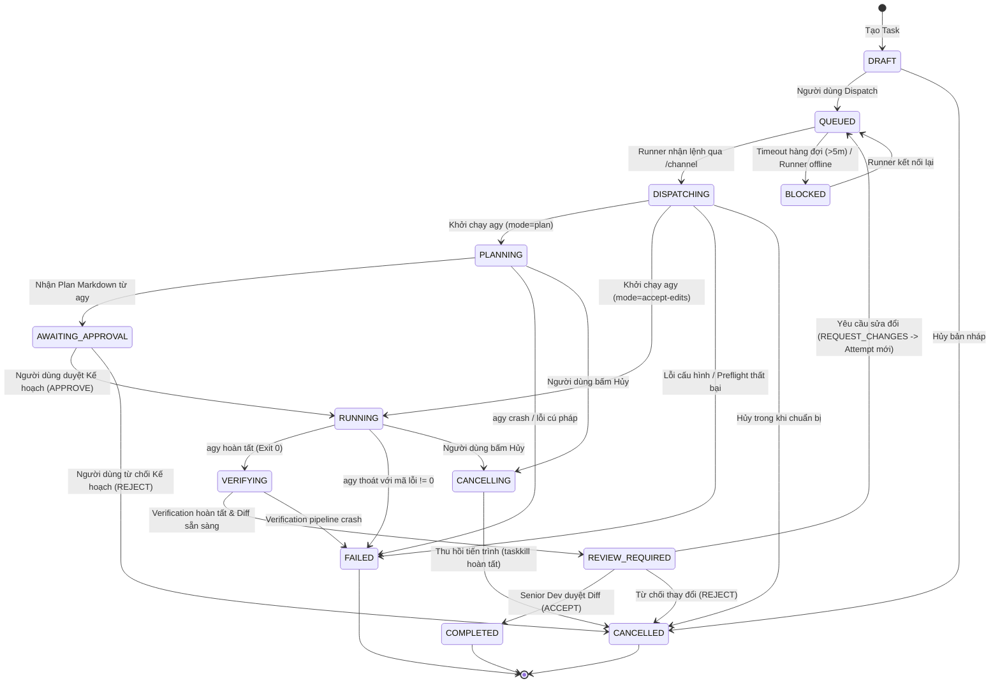
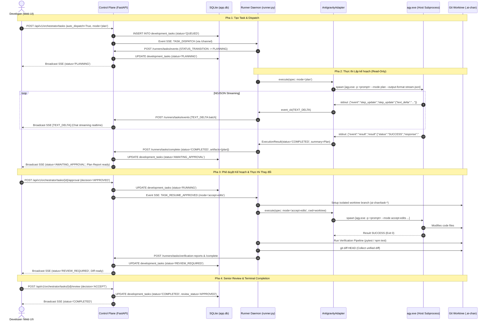

# Task Execution, Runtime Integration & Acceptance Contract
## AI-Chan Development Orchestrator

> **Document ID:** SPEC-CTR-01  
> **Version:** 1.0.0  
> **Status:** BASELINED & APPROVED FOR IMPLEMENTATION (Prompts 02–07)  
> **Target Subsystems:** Control Plane (`ai-backend`), Agent Runner Daemon (`ai-runner`), Web UI (`ai-frontend`)  
> **Empirical References:**  
> - Host CLI: `agy.exe` (Version `1.3.5`, verified on PATH 2026-10-16)  
> - Official Documentation: `https://antigravity.google/docs/cli/headless/` (verified 2026-10-16)  
> - Audit Reference: [`docs/development-orchestrator/task-execution-audit.md`](file:///c:/Users/PC/Project/ai-chan/docs/development-orchestrator/task-execution-audit.md)  
> **Fact Classification:** `FACT` (verified existing DB schema, API endpoints, CLI behavior), `DECISION` (contract rules, invariants, and acceptance gates).

---

## 1. Task Lifecycle & State Transitions Contract

### 1.1 Status Enums & Definitions

The lifecycle maintains strict backwards compatibility with existing database columns, Pydantic schemas, and client state machines:

```
[Database Tables]
- development_tasks.status:       DRAFT | QUEUED | DISPATCHING | PLANNING | AWAITING_APPROVAL |
                                  RUNNING | VERIFYING | REVIEW_REQUIRED | COMPLETED | FAILED |
                                  CANCELLING | CANCELLED | BLOCKED
- development_tasks.review_status: PENDING | APPROVED | CHANGES_REQUESTED | REJECTED
- task_attempts.status:           DISPATCHING | PLANNING | RUNNING | VERIFYING |
                                  COMPLETED | FAILED | CANCELLED
```

| Status | Component Meaning | Active / Terminal |
|---|---|---|
| `DRAFT` | Tác vụ mới khởi tạo trong DB; chưa gửi đi thực thi. | Active (Edit allowed) |
| `QUEUED` | Đã đưa vào hàng đợi; chờ Agent Runner nhận lệnh qua `/channel`. | Active (Waiting) |
| `DISPATCHING` | Runner đã nhận task; đang xác thực workspace và chuẩn bị Git worktree. | Active (Pre-flight) |
| `PLANNING` | Runner đang chạy CLI ở chế độ đọc/lập kế hoạch (`mode="plan"`). | Active (Executing) |
| `AWAITING_APPROVAL`| Agent đã xuất bản kế hoạch (Plan markdown); chờ người dùng duyệt. | Active (Paused / HITL) |
| `RUNNING` | Runner đang thực thi chỉnh sửa mã nguồn (`mode="accept-edits"`). | Active (Executing) |
| `VERIFYING` | Quá trình sửa đổi xong; Runner đang chạy pipeline kiểm thử (test/lint/build). | Active (Verification) |
| `REVIEW_REQUIRED` | Pipeline kiểm thử hoàn tất; chờ Senior Developer duyệt Git diff cuối cùng. | Active (Paused / Review) |
| `CANCELLING` | Tín hiệu hủy đã phát đi; đang thu hồi cây tiến trình (`taskkill`). | Active (Aborting) |
| `BLOCKED` | Runner offline quá thời gian chờ, hoặc workspace có lỗi môi trường nghiêm trọng. | Stalled (Needs Action) |
| `COMPLETED` | Thành công kết thúc; người dùng đã phê duyệt kết quả cuối cùng. | **Terminal Success** |
| `FAILED` | Thất bại kết thúc; tiến trình lỗi, timeout hoặc kiểm thử không vượt qua. | **Terminal Failure** |
| `CANCELLED` | Bị hủy bỏ; người dùng từ chối kế hoạch hoặc dừng tác vụ giữa chừng. | **Terminal Aborted** |

---

### 1.2 Transition Matrix & Invariants

```
+--------------------+-----------------------------------------------------+--------------------------------------------------+
| Current State      | Allowed Next States                                 | Trigger & Guard Condition                        |
+--------------------+-----------------------------------------------------+--------------------------------------------------+
| DRAFT              | QUEUED, CANCELLED                                   | User clicks "Dispatch" / User discards draft     |
| QUEUED             | DISPATCHING, BLOCKED, CANCELLED                     | Runner connected / Queue timeout (>5m) / Cancel  |
| DISPATCHING        | PLANNING, RUNNING, FAILED, CANCELLED                | Pre-flight passed (Plan vs Edit) / Host error    |
| PLANNING           | AWAITING_APPROVAL, FAILED, CANCELLING               | Result event received / Subprocess crash / Cancel|
| AWAITING_APPROVAL  | RUNNING, CANCELLED                                  | User APPROVED plan / User REJECTED plan          |
| RUNNING            | VERIFYING, AWAITING_APPROVAL, FAILED, CANCELLING     | Process exit 0 / Tool approval / Crash / Cancel  |
| VERIFYING          | REVIEW_REQUIRED, FAILED                             | All checks evaluated / Pipeline crash            |
| REVIEW_REQUIRED    | COMPLETED, QUEUED, CANCELLED                        | User ACCEPT / User REQUEST_CHANGES / User REJECT|
| CANCELLING         | CANCELLED, FAILED                                   | Subprocess killed confirmation                   |
| COMPLETED          | (None - Terminal)                                   | No further transitions allowed                   |
| FAILED             | QUEUED                                              | User clicks "Retry" (Creates new attempt)        |
| CANCELLED          | QUEUED                                              | User clicks "Retry" (Creates new attempt)        |
+--------------------+-----------------------------------------------------+--------------------------------------------------+
```

### 1.3 Điều kiện chuyển trạng thái nghiêm ngặt

1. **Điều kiện chuyển từ `QUEUED` sang `DISPATCHING` / `RUNNING`:**
   - **Cấm:** Không bao giờ tự động chuyển sang `RUNNING` chỉ vì bản ghi task vừa được insert vào SQLite.
   - **Bắt buộc:** Phải có một Agent Runner đã xác thực gửi tín hiệu nhận lệnh (`DISPATCH_RECEIVED`), vượt qua kiểm tra đường dẫn trên máy host (`validate_host_path`), thiết lập worktree Git thành công, và tiến trình subprocess `agy.exe` đã được spawn với PID hợp lệ. Khi đó, Runner phát sự kiện `STATUS_TRANSITION` (`to_status: "PLANNING"` hoặc `"RUNNING"`).
2. **Điều kiện hoàn tất thành công (Terminal Success):**
   - Runner nhận được sự kiện `result` từ CLI với `status == "SUCCESS"`.
   - Tiến trình subprocess kết thúc với `exit_code == 0`.
   - Các artifact bắt buộc đã được thu thập và lưu trữ đầy đủ:
     * Trong `mode="plan"`: Markdown plan report được lưu vào bảng `task_artifacts` với `artifact_type="plan"`. Task chuyển sang `AWAITING_APPROVAL`.
     * Trong `mode="accept-edits"`: Unified Git diff được trích xuất từ worktree và lưu vào `task_artifacts` với `artifact_type="diff"`; các bước kiểm thử được ghi nhận vào `task_verification_reports`. Task chuyển sang `REVIEW_REQUIRED`.
     * **Chỉ khi** người dùng gửi quyết định `ACCEPT`/`APPROVE` tại `/tasks/{id}/review`, task mới đạt trạng thái cuối cùng `COMPLETED` (`review_status: "APPROVED"`).
3. **Điều kiện thất bại, hủy bỏ và giới hạn thời gian (Timeouts):**
   - **Queue Timeout:** Task ở trạng thái `QUEUED` quá 5 phút mà không có Runner online nào kết nối và nhận lệnh sẽ tự động chuyển sang `BLOCKED`.
   - **Turn Execution Timeout:** Runner áp dụng thời gian chạy tối đa thông qua cờ `--print-timeout 900s` và timeout của adapter (mặc định 900s, cấu hình tối đa 1800s). Khi vượt ngưỡng, adapter phát lệnh hủy và trả về `status="FAILED"`, `error_message="Execution turn timed out"`.
   - **Runner Heartbeat Watchdog:** Nếu Runner mất kết nối quá 60 giây khi task đang ở trạng thái `RUNNING`/`PLANNING`/`VERIFYING`, Control Plane đánh dấu task là `FAILED` kèm lý do `"Runner disconnected unexpectedly"`.
4. **Cô lập lần thử (Retry & Attempt Isolation):**
   - Mỗi lần chạy lại (Retry) hoặc mỗi vòng chỉnh sửa theo phản hồi (`REQUEST_CHANGES`) bắt buộc phải tạo một bản ghi `task_attempts` mới với `attempt_number` tăng dần và `attempt_id` duy nhất (`att_<hex>`).
   - Mọi sự kiện runtime, báo cáo kiểm thử và artifact đều liên kết chặt chẽ với `attempt_id`. Sự kiện từ attempt cũ bị cô lập hoàn toàn, không được phép làm thay đổi trạng thái của attempt mới.
5. **Tính bất biến và chống trùng lặp (Idempotency):**
   - **Tạo task:** Sử dụng header `Idempotency-Key` lưu tại cột `development_tasks.idempotency_key`. Nếu nhận lại key cũ, backend trả về task đã tạo mà không sinh task mới.
   - **Ghi nhận sự kiện:** Bảng `task_events` có ràng buộc `UNIQUE(attempt_id, sequence_number)` và thực hiện `INSERT OR IGNORE`.
   - **Hoàn tất tác vụ:** Endpoint `/runners/tasks/complete` kiểm tra trạng thái hiện tại. Nếu task đã ở trạng thái terminal (`COMPLETED`, `FAILED`, `CANCELLED`), yêu cầu hoàn tất tiếp theo sẽ bị bỏ qua an toàn (no-op).

---

## 2. Antigravity Runtime Integration Contract

### 2.1 Thông số CLI thực tế (`FACT` — `agy 1.3.5`)

Dựa trên kiểm tra trực tiếp thực thi trên môi trường host:
```bash
agy --output-format stream-json -p "<prompt>" --mode <plan|accept-edits> --print-timeout <seconds>s
```

* **Cờ bắt buộc khi gọi subprocess:**
  * `-p` / `--print`: Thực thi non-interactive cho 1 lượt prompt.
  * `--output-format stream-json`: Xuất stream NDJSON trên kênh `stdout`.
  * `--mode <plan|accept-edits>`: Định hướng chế độ hoạt động của Agent.
  * `--print-timeout <timeout_seconds>s`: Đặt giới hạn thời gian thực thi của CLI.
* **Cờ bảo vệ an ninh:**
  * Tuyệt đối **không** truyền `--dangerously-skip-permissions` trừ khi chạy trong môi trường Git worktree cô lập hoàn toàn và policy kiểm soát cho phép.
  * Truyền `--conversation <id>` khi muốn tiếp tục phiên làm việc trước đó.

---

### 2.2 Quy tắc Ánh xạ từ CLI NDJSON sang Normalized Domain Events

CLI `agy 1.3.5` đóng gói dữ liệu trong cấu trúc JSON lồng nhau (Nested Envelopes). Adapter bắt buộc phải trích xuất từ các đối tượng lồng này thay vì đọc ở root:

```
+---------------------------------------------------------------------------------------------------+
| 1. RAW CLI ENVELOPE: init                                                                         |
| {"event":"init", "conversation_id":"<id>", "init":{"cwd":"<path>", "tools":[...], ...}}          |
| -> Map to: TASK_INITIALIZED                                                                       |
|    payload: { cwd: init.cwd, tools: init.tools, conversation_id: conversation_id }               |
+---------------------------------------------------------------------------------------------------+
| 2. RAW CLI ENVELOPE: step_update (agent_response)                                                 |
| {"event":"step_update", "step_update":{"step_index":1, "step_type":"agent_response",              |
|                                        "text_delta":"...", "state":"ACTIVE|DONE", "usage":{...}}} |
| -> Map to: TEXT_DELTA (khi có text_delta) & STEP_METRICS (khi state == DONE)                       |
|    payload: { text_delta: step_update.text_delta, step_index: step_update.step_index }            |
+---------------------------------------------------------------------------------------------------+
| 3. RAW CLI ENVELOPE: step_update (tool / tool_call)                                               |
| {"event":"step_update", "step_update":{"step_index":2, "step_type":"tool",                        |
|                                        "tool_name":"...", "tool_info":{...}, "state":"ACTIVE"}}   |
| -> Map to: TOOL_CALL_START (ACTIVE) / TOOL_CALL_END (DONE)                                        |
|    payload: { tool_name: tool_name, tool_info: tool_info, duration_seconds: ... }                |
+---------------------------------------------------------------------------------------------------+
| 4. RAW CLI ENVELOPE: result                                                                       |
| {"event":"result", "result":{"status":"SUCCESS|FAILURE", "response":"...",                        |
|                              "duration_seconds":..., "usage":{"input_tokens":..., ...}}}          |
| -> Map to: TASK_TERMINATED / PLAN_CREATED & TOKEN_USAGE                                           |
|    payload: { status: result.status, response: result.response, usage: result.usage }             |
+---------------------------------------------------------------------------------------------------+
```

### 2.3 Chiến lược xử lý an toàn dữ liệu khuyết thiếu & Unknown Events

1. **Truy cập phòng vệ (Defensive Accessor):**
   ```python
   container = raw_json.get(event_type) if isinstance(raw_json.get(event_type), dict) else raw_json
   ```
   Nếu một trường bất kỳ không có mặt trong payload, gán giá trị mặc định (`None`, `""`, hoặc `{}`) một cách an toàn; không để phát sinh `KeyError`.
2. **Bảo tồn Unknown Events:**
   Nếu xuất hiện sự kiện lạ không nằm trong danh mục nhận diện, adapter thu gọn nội dung tối đa 500 ký tự và phát ra sự kiện `DIAGNOSTIC_LOG` với `severity="DEBUG"`. Tuyệt đối không throw Exception làm đứt gãy luồng thực thi.

---

## 3. End-to-End Event Contract

### 3.1 Cấu trúc Chuẩn hóa Envelope Sự kiện (Tier 2)

Mọi sự kiện được chuyển giao giữa Runner ↔ Control Plane ↔ Web UI phải tuân thủ schema JSON sau:

```json
{
  "event_id": "evt_3b8a10ef2a4b",
  "sequence_number": 42,
  "task_id": "tsk_2ba55b602a4149cb",
  "attempt_id": "att_639266a3ba0e4f4e",
  "runner_id": "rnr_10af89c20a11",
  "runtime": "antigravity",
  "event_type": "TEXT_DELTA",
  "severity": "INFO",
  "timestamp": "2026-10-16T10:45:00.123Z",
  "payload": {
    "text_delta": "Phân tích cấu trúc thư mục dự án...",
    "step_index": 2
  },
  "schema_version": "1.0.0"
}
```

### 3.2 Danh mục 15 Sự kiện Chuẩn hóa & Phân loại Lưu trữ

| Event Type | Mức độ | Chính sách lưu trữ | Mô tả & Ý nghĩa nghiệp vụ |
|---|---|---|---|
| `RUNNER_CONNECTED` | `INFO` | Ephemeral (Chỉ phát SSE) | Runner vừa mở kết nối `/channel` tới Control Plane. |
| `DISPATCH_RECEIVED` | `INFO` | Lưu DB `task_events` | Runner xác nhận đã nhận nhiệm vụ thực thi. |
| `RUNTIME_STARTED` | `INFO` | Lưu DB `task_events` | Tiến trình CLI đã được khởi tạo thành công cùng PID. |
| `TASK_INITIALIZED` | `INFO` | Lưu DB `task_events` | CLI báo cáo môi trường phiên (`cwd`, `tools`, `model`). |
| `STATUS_TRANSITION` | `INFO` | Lưu DB `task_events` + Cập nhật `status` | Máy trạng thái của Task hoặc Attempt thay đổi. |
| `TEXT_DELTA` | `INFO` | **Ephemeral (Chỉ phát SSE)** | Dòng chữ suy luận/giải thích của Agent theo thời gian thực. |
| `TOOL_CALL_START` | `INFO` | Lưu DB `task_events` | Bắt đầu gọi một công cụ (đã lọc tham số nhạy cảm). |
| `TOOL_CALL_END` | `INFO` | Lưu DB `task_events` | Công cụ thực thi xong kèm thời gian và trạng thái. |
| `PLAN_CREATED` | `INFO` | Lưu DB `task_events` | Kế hoạch hoàn chỉnh được tạo (chế độ Plan). |
| `APPROVAL_REQUIRED` | `WARN` | Lưu DB `task_events` | Tạm dừng chờ quyết định người dùng (Human-in-the-Loop). |
| `VERIFICATION_STARTED`| `INFO` | Lưu DB `task_events` | Bắt đầu chạy pipeline kiểm thử tự động. |
| `VERIFICATION_STEP` | `INFO`/`WARN`| Lưu DB `task_verification_reports` | Kết quả từng bước kiểm thử (test, lint, typecheck, build). |
| `ARTIFACT_REGISTERED`| `INFO` | Lưu DB `task_events` | Artifact mới đã được lưu trữ (diff, plan, log). |
| `TOKEN_USAGE` | `INFO` | Lưu DB `task_events` + Cập nhật `tokens` | Thống kê số lượng token đầu vào/đầu ra và ước tính chi phí. |
| `TASK_TERMINATED` | `INFO`/`ERROR`| Lưu DB `task_events` + Chuyển terminal | Báo cáo hoàn tất chu trình thực thi kèm mã thoát. |

---

### 3.3 Khôi phục Stream khi mất kết nối & Khử trùng lặp

1. **Cơ chế Replay:**
   - Web UI kết nối lại thông qua `GET /api/v1/orchestrator/tasks/{id}/events?since_seq={last_seq}`.
   - Backend truy vấn các sự kiện đã lưu trong `task_events` có `sequence_number > last_seq`, đẩy về cho client trước, sau đó tiếp tục gắn client vào hàng đợi phát trực tiếp.
2. **Khử trùng lặp tại Frontend:**
   - Client duy trì `Set<number>` lưu `sequence_number`. Mọi event trùng lặp do phát lại sẽ bị bỏ qua an toàn.
3. **Lọc thông tin bí mật (Redaction Policy):**
   - Mọi chuỗi văn bản trước khi phát ra SSE hoặc lưu DB phải đi qua bộ lọc regex để che giấu:
     * API Keys: `sk-[a-zA-Z0-9]{32,}`, `AIza[0-9A-Za-z-_]{30,}`, `ghp_[a-zA-Z0-9]{36}`.
     * Runner Secrets & Bearer: `rsk_[a-f0-9]{32,}`, `Bearer\s+[a-zA-Z0-9._-]+`.
     * Đường dẫn thư mục cá nhân trên host: `C:\Users\<username>\...` -> `C:\Users\***\...`.

---

## 4. Artifact Contract

### 4.1 Phân cấp Ranh giới Artifact (4 Nhóm độc lập)

```
+---------------------------------------------------------------------------------------+
| NHÓM 1: BACKEND ARTIFACT STORAGE                                                      |
| Quản lý bởi Backend DB (task_artifacts). Ví dụ: Báo cáo Kế hoạch (Plan Report MD).     |
| Truy cập qua: GET /api/v1/orchestrator/tasks/{id}/artifacts/{art_id}                  |
+---------------------------------------------------------------------------------------+
| NHÓM 2: WORKSPACE CODE FILES (Máy Host của Runner)                                    |
| Chứa trong Git Worktree (.ai-chan/worktrees/att_*). Chỉ đọc/ghi trong ranh giới này.   |
| Tuyệt đối không cho phép truy cập đường dẫn tuyệt đối tùy tiện từ bên ngoài.           |
+---------------------------------------------------------------------------------------+
| NHÓM 3: DIAGNOSTIC & LOG ARTIFACTS                                                    |
| Lưu trữ tại thư mục log của Runner host, phục vụ debug và điều tra sự cố.              |
+---------------------------------------------------------------------------------------+
| NHÓM 4: GIT DIFF & TEST VERIFICATION REPORTS                                          |
| Trích xuất tự động qua git diff và pytest/npm test pipeline.                           |
| Truy cập qua: GET /api/v1/orchestrator/tasks/{id}/diff và /verifications              |
+---------------------------------------------------------------------------------------+
```

### 4.2 Metadata Schema của Artifact

```json
{
  "artifact_id": "art_9f8b2c1a4e5d6f7a",
  "task_id": "tsk_2ba55b602a4149cb",
  "attempt_id": "att_639266a3ba0e4f4e",
  "artifact_type": "plan",
  "display_name": "Implementation Plan Report",
  "file_path": "reports/plan.md",
  "mime_type": "text/markdown",
  "byte_size": 4820,
  "checksum_sha256": "e3b0c44298fc1c149afbf4c8996fb92427ae41e4649b934ca495991b7852b855",
  "created_at": "2026-10-16T10:48:00.000Z",
  "source": "runner",
  "visibility": "user"
}
```

### 4.3 Quy tắc An toàn Chống Path Traversal
- **Cấm:** Backend và Runner từ chối mọi yêu cầu đọc/ghi file chứa ký tự `..` hoặc đường dẫn tuyệt đối trỏ ra ngoài thư mục Workspace / Worktree được chỉ định.
- **Xác thực quyền:** Mọi thao tác tải hoặc xem artifact phải được xác thực qua token người dùng (`get_orchestrator_user`) và chỉ được xem task thuộc sở hữu của mình.

---

## 5. Mode Semantics Contract

Để đảm bảo an toàn tuyệt đối và tính nhất quán, **AI-Chan không phụ thuộc duy nhất vào cờ `--mode` của CLI**:

```
+------------------+----------------------------------+---------------------------------+-----------------------------------+
| Đặc tính         | 1. Mode Plan / Review            | 2. Mode Implement               | 3. Mode Verify                    |
+------------------+----------------------------------+---------------------------------+-----------------------------------+
| Mục tiêu         | Điều tra, phân tích, lập kế hoạch| Sửa đổi code trong worktree     | Chạy kiểm thử tự động             |
| Quyền Workspace  | Read-only (Bảo toàn 100% repo)   | Read-Write trên isolated branch | Read-only thực thi test/lint      |
| Cơ chế bảo vệ    | Prompt guard + Cảnh báo dirty git| Git Worktree Isolation          | Sandboxed command execution       |
| Kết quả đầu ra   | Markdown Plan Artifact           | Unified Git Diff Artifact       | Verification Step Reports         |
| Chuyển trạng thái| `PLANNING` -> `AWAITING_APPROVAL`| `RUNNING` -> `VERIFYING`        | `VERIFYING` -> `REVIEW_REQUIRED`  |
+------------------+----------------------------------+---------------------------------+-----------------------------------+
```

1. **Chế độ `Plan/Review`:**
   - Prompt được bổ sung chỉ thị rõ ràng: *"Đây là bước khảo sát và lập kế hoạch. Không chỉnh sửa bất kỳ file mã nguồn nào."*
   - Runner kiểm tra trạng thái Git sau khi chạy; nếu phát hiện file bị sửa đổi, hệ thống hủy bỏ thay đổi (`git checkout .`) để giữ nguyên repo.
   - Báo cáo lập kế hoạch được gửi về Control Plane dưới dạng artifact để hiển thị trên giao diện phê duyệt (Human-in-the-Loop).
2. **Chế độ `Implement`:**
   - Chỉ được kích hoạt khi người dùng bấm nút **Approve Plan** hoặc chủ động chọn chế độ chỉnh sửa.
   - Luôn chạy trên một nhánh Git riêng biệt (`ai-chan/task-<short_id>`) trong thư mục worktree cô lập (`.ai-chan/worktrees/att_*`).
   - Kết thúc lượt chạy, Runner trích xuất `git diff` so với `base_commit` và gửi về Backend.
3. **Chế độ `Verify`:**
   - Được kích hoạt độc lập bởi Runner sau khi Agent hoàn tất lượt chạy ở chế độ Implement.
   - Không phụ thuộc vào LLM: Runner tự chạy các lệnh được định cấu hình trong `verification_policy` (ví dụ: `pytest`, `npm test`, `flake8`).
   - Ghi nhận mã thoát và log preview; nếu có lỗi, báo cáo chi tiết hiển thị cho reviewer.
4. **Xử lý khi quyền CLI bị chặn (`BLOCKED` / `NEEDS_APPROVAL`):**
   - Nếu CLI đòi hỏi cấp quyền tương tác mà đang chạy ở chế độ headless, hệ thống ghi nhận trạng thái `AWAITING_APPROVAL` hoặc báo lỗi cấu hình minh bạch, tuyệt đối không giả lập thành công ảo.

---

## 6. Acceptance Matrix (Ma trận 13 Tiêu chí Nghiệm thu Kiểm thử được)

| STT | Kịch bản Kiểm thử | Điều kiện tiên quyết | Hành động kích hoạt | Kết quả mong đợi & Assertions |
|---|---|---|---|---|
| **AC-01** | **Dispatch khi Runner Offline / Online** | Runner chưa bật / hoặc đang online. | Gửi `POST /tasks/{id}/dispatch`. | Khi Offline: Task ở `QUEUED`. Khi Runner kết nối lại `/channel`, tự động quét và dispatch task, chuyển sang `DISPATCHING`. |
| **AC-02** | **CLI Credentials & Version Check** | Máy host có `agy` version 1.3.5. | Khởi động Runner và gọi `check_prerequisites`. | Trả về `available: True`, nhận diện đúng phiên bản `1.3.5`, không báo lỗi hardcode `1.2.16`. |
| **AC-03** | **Stream có events vs không có events** | Task đang chạy; CLI xử lý turn lâu. | Trình duyệt mở kết nối SSE `/tasks/{id}/events`. | Nhận được `: keepalive` ping định kỳ mỗi 15s nếu CLI chưa có output; không bị timeout HTTP 504. |
| **AC-04** | **Bóc tách Nested JSON (`agy 1.3.5`)** | CLI phát ra stream NDJSON lồng nhau. | Adapter nhận dòng `step_update` và `result`. | 100% `TEXT_DELTA`, `TOOL_CALL_*`, và `TOKEN_USAGE` được trích xuất thành công, không bị `None`. |
| **AC-05** | **Xử lý Stdout & Stderr khối lượng lớn** | CLI in đồng thời hàng nghìn dòng log và stream. | Adapter chạy với dual asynchronous draining. | Không bị nghẽn deadlock pipe; buffer tự cắt dòng quá 2MB và ghi nhận cảnh báo an toàn. |
| **AC-06** | **Malformed Line & Unknown Event** | CLI in ra 1 dòng rác/hỏng JSON hoặc event lạ. | Dòng rác xuất hiện giữa stream NDJSON. | Adapter không crash; dòng rác được gói vào `DIAGNOSTIC_LOG` (DEBUG/WARN); các dòng JSON sau vẫn xử lý bình thường. |
| **AC-07** | **Process Exit 0 / Non-Zero / Cancel / Timeout**| Lần lượt: chạy thành công, chạy crash, bấm Cancel, quá giờ. | Kích hoạt tương ứng từng tình huống. | Exit 0 -> chuyển `VERIFYING`/`AWAITING_APPROVAL`; Non-zero -> `FAILED`; Cancel -> `taskkill` cây tiến trình & `CANCELLED`; Timeout -> `FAILED` kèm thông báo timeout. |
| **AC-08** | **Event Ingestion 4xx/5xx & Reconnect** | Backend restart hoặc mất mạng tạm thời khi Runner đang post event. | Runner gửi batch event thất bại. | Runner lưu tạm batch, thử lại với exponential backoff; không làm sập Runner daemon. |
| **AC-09** | **Lưu trữ & Đọc lại Plan Report** | Task chạy xong ở `mode="plan"`. | Xem chi tiết Task tại UI `/tasks/{id}`. | Plan markdown hiển thị đầy đủ trong tab Plan; nút "Approve Plan" và "Reject Plan" sẵn sàng. |
| **AC-10** | **Implement tạo thay đổi thật trên fixture** | Task chạy ở `mode="accept-edits"`. | Agent sửa 1 file trong fixture repository. | Worktree có diff thật; `GET /tasks/{id}/diff` trả về unified diff chính xác; repo gốc không bị ảnh hưởng. |
| **AC-11** | **Workspace có thay đổi chưa commit** | Thư mục repo chính đang có uncommitted edits. | Bắt đầu task ở chế độ `accept-edits`. | Runner phát hiện dirty tree, tạo isolated worktree từ `HEAD`; không làm mất uncommitted work của user. |
| **AC-12** | **Lọc thông tin bí mật (Secret Redaction)** | Output của Agent chứa API key hoặc Runner Secret. | Đọc dữ liệu từ event stream và artifact. | Toàn bộ chuỗi nhạy cảm bị thay thế bằng `[REDACTED_API_KEY]` / `[REDACTED_RUNNER_SECRET]`. |
| **AC-13** | **Kịch bản `run-demo.bat` & Stop/Restart** | Chạy `run-demo.bat` từ đầu trên môi trường Windows. | Khởi động, thực hiện 1 task, tắt và bật lại. | Preflight pass, backend & runner ghép nối thành công; task cũ giữ nguyên trạng thái; hệ thống hoạt động ổn định. |

---

## 7. Kiến trúc Biểu đồ Hợp đồng

### 7.1 State Machine Diagram (Trực quan hóa Vòng đời Tác vụ)



### 7.2 End-to-End Execution Sequence Diagram



---

## 8. Cổng Nghiệm thu Sẵn sàng cho Prompts 02–07

1. **Tính tương thích ngược:** Hợp đồng bảo tồn 100% các cột bảng hiện hữu trong SQLite (`development_tasks`, `task_attempts`, `task_events`, `task_artifacts`, `task_approvals`, `task_verification_reports`) và schema REST API hiện có.
2. **Khắc phục triệt để lỗi NDJSON:** Hợp đồng định nghĩa chính xác cấu trúc envelope lồng nhau của `agy 1.3.5` (`init`, `step_update`, `result`), chấm dứt hoàn toàn tình trạng stream event bị nuốt.
3. **Phân biệt task thành công thật:** Phải có exit code 0, sự kiện terminal result từ CLI, artifact kế hoạch (hoặc Git diff + báo cáo test) và phê duyệt từ người dùng.
4. **Không phụ thuộc cờ CLI ảo:** Chế độ Plan vs Implement được bảo vệ nhiều lớp qua policy, prompt instructions và Git worktree isolation.
5. **Độc lập triển khai:** Đội ngũ kỹ sư có thể triển khai trực tiếp Prompts 02, 03, 04, 05, 06, 07 dựa trên hợp đồng này mà không cần phỏng đoán.
