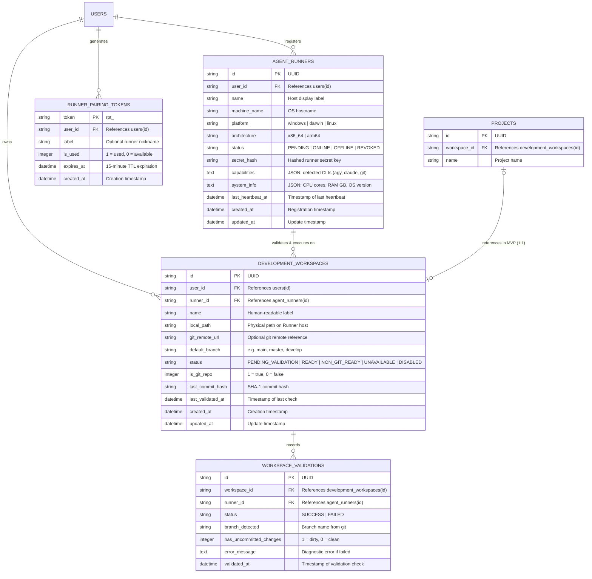

# Domain Model & Persistence Specification
## Capability: Development Workspace & Agent Runner

> **Document ID:** DOM-ORCH-01  
> **Version:** 1.0.0  
> **Target Database:** SQLite 3 (`ai-backend/database/app.db`)  
> **Migration ID:** `011_create_orchestrator_tables.sql`  
> **Fact Classification:** `FACT` (existing schema verified in audit), `DECISION` (proposed DDL and entity design).

---

## 1. Domain Entities & Conceptual Boundaries

The Development Orchestrator introduces core entities to manage developer workstations, repositories, and execution engines without overloading visual prompt graphs.



---

## 2. Entity Field Specifications

### 2.1 Entity: `DevelopmentWorkspace` (`DOM-WKR-001`)
Represents the local codebase directory on the developer workstation.

| Field Name | Type | Nullable | Default | Description & Constraint |
|---|---|---|---|---|
| `id` | `VARCHAR(36)` | No | UUIDv4 | Primary key |
| `user_id` | `VARCHAR(36)` | No | - | Foreign key to `users(id)`. Tenant isolation scope. |
| `runner_id` | `VARCHAR(36)` | Yes | NULL | Foreign key to `agent_runners(id)`. Assigned executor host. |
| `name` | `VARCHAR(100)` | No | - | Human-friendly workspace name (e.g., `ai-chan-core`). |
| `local_path` | `VARCHAR(1024)`| No | - | Local path on the Runner host (e.g. `C:\Users\PC\Project\ai-chan`). Must not be treated as a server-side path. |
| `git_remote_url` | `VARCHAR(512)` | Yes | NULL | Git remote URL (e.g. `https://github.com/DungTran1201/ai-chan.git`). |
| `default_branch` | `VARCHAR(100)` | Yes | `'main'` | Default target branch for tasks. |
| `status` | `VARCHAR(30)` | No | `'PENDING_VALIDATION'` | Enum: `PENDING_VALIDATION`, `READY`, `NON_GIT_READY`, `UNAVAILABLE`, `DISABLED`. |
| `is_git_repo` | `INTEGER` | No | 0 | Boolean flag (1 = true, 0 = false). |
| `last_commit_hash`| `VARCHAR(40)` | Yes | NULL | Last verified git commit hash. |
| `last_validated_at`| `DATETIME` | Yes | NULL | Timestamp of last successful validation by Runner. |
| `created_at` | `DATETIME` | No | `CURRENT_TIMESTAMP` | Record creation time. |
| `updated_at` | `DATETIME` | No | `CURRENT_TIMESTAMP` | Last updated time. |

### 2.2 Entity: `AgentRunner` (`DOM-RUN-001`)
Represents an active or registered developer execution host.

| Field Name | Type | Nullable | Default | Description & Constraint |
|---|---|---|---|---|
| `id` | `VARCHAR(36)` | No | UUIDv4 | Primary key |
| `user_id` | `VARCHAR(36)` | No | - | Foreign key to `users(id)`. Tenant isolation scope. |
| `name` | `VARCHAR(100)` | No | - | Display name (e.g., `Desktop-Win11-Main`). |
| `machine_name` | `VARCHAR(100)` | No | - | Hostname reported by OS. |
| `platform` | `VARCHAR(50)` | No | - | Platform type: `windows`, `darwin`, `linux`. |
| `architecture` | `VARCHAR(30)` | No | - | CPU architecture: `x86_64`, `arm64`. |
| `status` | `VARCHAR(20)` | No | `'ONLINE'` | Enum: `PENDING`, `ONLINE`, `OFFLINE`, `REVOKED`. |
| `secret_hash` | `VARCHAR(128)` | No | - | SHA-256 salted hash of `runner_secret`. |
| `capabilities` | `TEXT` | Yes | `'{}'` | JSON object documenting verified CLI runtimes. |
| `system_info` | `TEXT` | Yes | `'{}'` | JSON object: CPU cores, total RAM, OS build number. |
| `last_heartbeat_at`| `DATETIME` | Yes | `CURRENT_TIMESTAMP` | Heartbeat timestamp. Used for offline TTL check (> 60s). |
| `created_at` | `DATETIME` | No | `CURRENT_TIMESTAMP` | Registration timestamp. |
| `updated_at` | `DATETIME` | No | `CURRENT_TIMESTAMP` | Last update timestamp. |

### 2.3 Entity: `RunnerPairingToken` (`DOM-RUN-002`)
Transient challenge tokens used for initial secure runner handshake.

| Field Name | Type | Nullable | Default | Description & Constraint |
|---|---|---|---|---|
| `token` | `VARCHAR(64)` | No | - | Primary Key: `rpt_<uuid>`. |
| `user_id` | `VARCHAR(36)` | No | - | Foreign key to `users(id)`. |
| `label` | `VARCHAR(100)` | Yes | NULL | Friendly label proposed by developer. |
| `is_used` | `INTEGER` | No | 0 | 1 = consumed, 0 = active. |
| `expires_at` | `DATETIME` | No | - | Expiration timestamp (created_at + 15 minutes). |
| `created_at` | `DATETIME` | No | `CURRENT_TIMESTAMP` | Generation timestamp. |

---

## 3. SQLite DDL Migration Specification

File: `ai-backend/database/migrations/011_create_orchestrator_tables.sql`  
Executed via: `ai-backend/database/apply_migrations.py`

```sql
-- Migration 011: Development Workspace & Agent Runner Foundation
-- Author: AI-Chan Architecture Team
-- Date: 2026-10-15

-- 1. Create agent_runners table
CREATE TABLE IF NOT EXISTS agent_runners (
    id VARCHAR(36) PRIMARY KEY,
    user_id VARCHAR(36) NOT NULL,
    name VARCHAR(100) NOT NULL,
    machine_name VARCHAR(100) NOT NULL,
    platform VARCHAR(50) NOT NULL,
    architecture VARCHAR(30) NOT NULL,
    status VARCHAR(20) NOT NULL DEFAULT 'ONLINE',
    secret_hash VARCHAR(128) NOT NULL,
    capabilities TEXT DEFAULT '{}',
    system_info TEXT DEFAULT '{}',
    last_heartbeat_at DATETIME DEFAULT CURRENT_TIMESTAMP,
    created_at DATETIME DEFAULT CURRENT_TIMESTAMP,
    updated_at DATETIME DEFAULT CURRENT_TIMESTAMP,
    FOREIGN KEY (user_id) REFERENCES users(id) ON DELETE CASCADE
);

CREATE INDEX IF NOT EXISTS idx_agent_runners_user_id ON agent_runners(user_id);
CREATE INDEX IF NOT EXISTS idx_agent_runners_status ON agent_runners(status);
CREATE INDEX IF NOT EXISTS idx_agent_runners_last_heartbeat ON agent_runners(last_heartbeat_at);

-- 2. Create runner_pairing_tokens table
CREATE TABLE IF NOT EXISTS runner_pairing_tokens (
    token VARCHAR(64) PRIMARY KEY,
    user_id VARCHAR(36) NOT NULL,
    label VARCHAR(100),
    is_used INTEGER NOT NULL DEFAULT 0,
    expires_at DATETIME NOT NULL,
    created_at DATETIME DEFAULT CURRENT_TIMESTAMP,
    FOREIGN KEY (user_id) REFERENCES users(id) ON DELETE CASCADE
);

CREATE INDEX IF NOT EXISTS idx_runner_pairing_tokens_expires ON runner_pairing_tokens(expires_at, is_used);

-- 3. Create development_workspaces table
CREATE TABLE IF NOT EXISTS development_workspaces (
    id VARCHAR(36) PRIMARY KEY,
    user_id VARCHAR(36) NOT NULL,
    runner_id VARCHAR(36),
    name VARCHAR(100) NOT NULL,
    local_path VARCHAR(1024) NOT NULL,
    git_remote_url VARCHAR(512),
    default_branch VARCHAR(100) DEFAULT 'main',
    status VARCHAR(30) NOT NULL DEFAULT 'PENDING_VALIDATION',
    is_git_repo INTEGER NOT NULL DEFAULT 0,
    last_commit_hash VARCHAR(40),
    last_validated_at DATETIME,
    created_at DATETIME DEFAULT CURRENT_TIMESTAMP,
    updated_at DATETIME DEFAULT CURRENT_TIMESTAMP,
    FOREIGN KEY (user_id) REFERENCES users(id) ON DELETE CASCADE,
    FOREIGN KEY (runner_id) REFERENCES agent_runners(id) ON DELETE SET NULL
);

CREATE INDEX IF NOT EXISTS idx_dev_workspaces_user_id ON development_workspaces(user_id);
CREATE INDEX IF NOT EXISTS idx_dev_workspaces_runner_id ON development_workspaces(runner_id);
CREATE INDEX IF NOT EXISTS idx_dev_workspaces_status ON development_workspaces(status);

-- 4. Create workspace_validations audit table
CREATE TABLE IF NOT EXISTS workspace_validations (
    id VARCHAR(36) PRIMARY KEY,
    workspace_id VARCHAR(36) NOT NULL,
    runner_id VARCHAR(36) NOT NULL,
    status VARCHAR(20) NOT NULL,
    branch_detected VARCHAR(100),
    has_uncommitted_changes INTEGER NOT NULL DEFAULT 0,
    error_message TEXT,
    validated_at DATETIME DEFAULT CURRENT_TIMESTAMP,
    FOREIGN KEY (workspace_id) REFERENCES development_workspaces(id) ON DELETE CASCADE,
    FOREIGN KEY (runner_id) REFERENCES agent_runners(id) ON DELETE CASCADE
);

CREATE INDEX IF NOT EXISTS idx_workspace_validations_ws ON workspace_validations(workspace_id);

-- 5. Add workspace_id foreign key reference to projects table
-- Note: SQLite does not support adding FK via ALTER TABLE easily, column added nullable.
ALTER TABLE projects ADD COLUMN workspace_id VARCHAR(36) REFERENCES development_workspaces(id) ON DELETE SET NULL;
CREATE INDEX IF NOT EXISTS idx_projects_workspace_id ON projects(workspace_id);
```

---

## 4. Deletion Policies & Transaction Boundaries

1. **Workspace Deletion:**
   - Soft or hard delete allowed ONLY if no tasks are actively in `PLANNING`, `RUNNING`, or `WAITING_APPROVAL`.
   - Deleting a workspace sets `projects.workspace_id = NULL` via `ON DELETE SET NULL`.
   - Deleting a workspace removes `workspace_validations` via `ON DELETE CASCADE`.
   - Local files on the host machine are NEVER touched or removed.
2. **Runner Revocation / Deletion:**
   - Setting a runner to `REVOKED` immediately rejects subsequent bearer tokens.
   - Associated workspaces have `runner_id` set to `NULL` (state transitions to `UNAVAILABLE` until rebound to another online runner).
3. **Transaction Boundaries:**
   - Creating a workspace + triggering initial validation event executes within a single database transaction.
   - Consuming a pairing token + inserting a runner record is strictly atomic (`BEGIN IMMEDIATE`).
