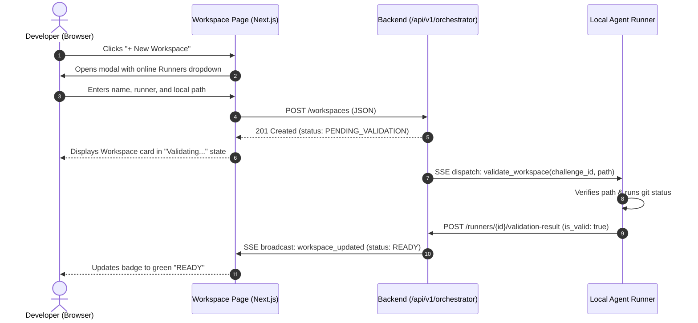
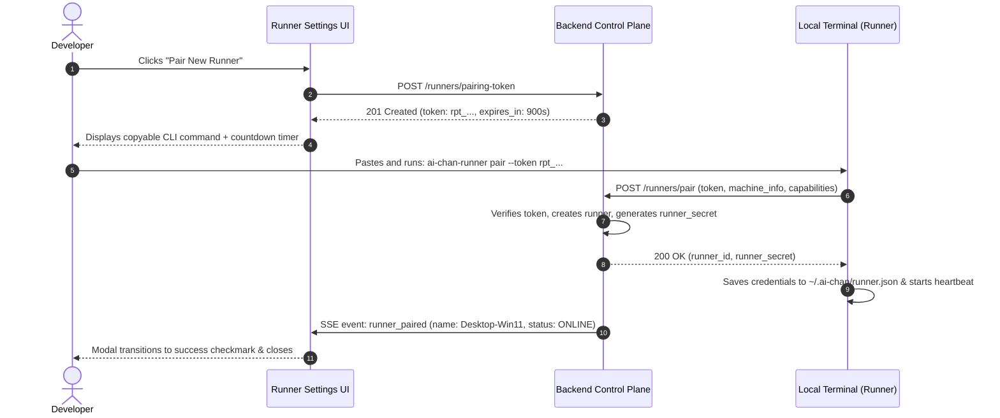

# UX Specifications & User Flows
## Capability: Development Workspace & Agent Runner

> **Document ID:** UX-ORCH-01  
> **Version:** 1.0.0  
> **Design System:** AI-Chan Custom Design Tokens (`globals.css` - Dark Palette, High Density)  
> **Target Framework:** Next.js 16 (App Router) + React 19  
> **Route Conventions:** AppShell layout inside `ai-frontend/src/app/(app)/`

---

## 1. UX Design Principles & Navigation Integration

The Development Orchestrator integrates cleanly into the existing AI-Chan UI/UX without breaking established patterns:
1. **Adherence to AppShell:** Workspaces are added to the primary sidebar in `Sidebar.tsx` under a new section `Developer`.
2. **Design Tokens:** Strict usage of existing CSS variables:
   - Primary Background: `--bg-primary: #0a0b10`
   - Card/Surface Background: `--bg-surface: #121520`
   - Borders: `--border-subtle: #1e2433`
   - Accent: `--accent-primary: #6366f1`
   - Statuses: Green (`#10b981`), Amber (`#f59e0b`), Red (`#ef4444`), Muted (`#64748b`).
3. **No External Icon Packs:** All icons use custom, lightweight inline SVGs matching `ai-frontend/src/components/icons`.

---

## 2. Screen Inventories & Wireframe Structures

### 2.1 Workspace List Screen (`/workspaces`)

```
+---------------------------------------------------------------------------------------+
|  AI-Chan AppShell Header  [CPU: 14%] [RAM: 48%] [FPS: 60]              [User Avatar]  |
+------------+--------------------------------------------------------------------------+
|  SIDEBAR   |  Workspaces                                        [+ New Workspace]    |
|            |  Manage software repositories connected to Agent Runners                |
|  Projects  |                                                                          |
|  Skills    |  +--------------------------------------------------------------------+  |
| >Workspaces|  | [Git Icon] ai-chan-core                                [READY]     |  |
|  System    |  | Host Path: C:\Users\...\Project\ai-chan                            |  |
|  Settings  |  | Runner: Desktop-Win11-Main (Online) | Branch: main [commit: 17135ea]|  |
|            |  | Last Validated: 2 mins ago                       [Open] [Recheck] |  |
|            |  +--------------------------------------------------------------------+  |
|            |                                                                          |
|            |  +--------------------------------------------------------------------+  |
|            |  | [Folder] backend-service                               [UNAVAILABLE]| |
|            |  | Host Path: D:\Code\backend-service                                 |  |
|            |  | Runner: MacMini-M2 (Offline 4h ago) | Path not accessible          |  |
|            |  | Reason: Directory not found on runner host.       [Edit] [Retry]   |  |
|            |  +--------------------------------------------------------------------+  |
+------------+--------------------------------------------------------------------------+
```

### 2.2 Create Workspace Modal (`/workspaces?action=new`)

```
+---------------------------------------------------------------+
|  Add Development Workspace                                [X] |
+---------------------------------------------------------------+
|  Workspace Name:                                              |
|  [ ai-chan-core                                            ]  |
|                                                               |
|  Select Agent Runner:                                         |
|  [ Desktop-Win11-Main (Online, Windows x86_64)            v]  |
|  * Only online runners can validate local directories.         |
|                                                               |
|  Host Local Path (on Runner machine):                         |
|  [ C:\Users\PC\Project\ai-chan                             ]  |
|  * The absolute filesystem path on your runner workstation.   |
|                                                               |
|  Remote Git URL (Optional):                                   |
|  [ https://github.com/DungTran1201/ai-chan.git             ]  |
|                                                               |
|  Default Branch:                                              |
|  [ main                                                    ]  |
|                                                               |
|  [Cancel]                                 [Create & Validate] |
+---------------------------------------------------------------+
```

### 2.3 Runner Pairing Modal (`/settings/runners?pair=true`)

```
+---------------------------------------------------------------+
|  Pair Agent Runner                                        [X] |
+---------------------------------------------------------------+
|  Run this command in the terminal of your workstation to      |
|  connect your local machine to AI-Chan:                       |
|                                                               |
|  +---------------------------------------------------------+  |
|  | ai-chan-runner pair \                                   |  |
|  |   --server https://ai-chan.local \                      |  |
|  |   --token rpt_9a4f2c1d8e7b4a3c2d1e0f9a8b7c6d5e         |  |
|  +---------------------------------------------------------+  |
|  [ Copy Command ]                                             |
|                                                               |
|  (i) Token expires in: 14:45. Valid for single pairing only.  |
|                                                               |
|  Waiting for runner handshake... [Animated Spinner]           |
|                                                               |
|  [Done]                                                       |
+---------------------------------------------------------------+
```

---

## 3. State Progressions & Visual Feedback

| Status Key | Visual Badge | Meaning & Next Action |
|---|---|---|
| `PENDING_VALIDATION` | Amber Pill with rotating spinner | Challenge dispatched to runner; awaiting filesystem inspection. |
| `READY` | Green Pill (`#10b981`) with checkmark icon | Path verified on runner host, valid git repository, ready for tasks. |
| `NON_GIT_READY` | Cyan Pill (`#06b6d4`) with folder icon | Valid readable folder on host, but not a git repo. Task runs without git branch isolation. |
| `UNAVAILABLE` | Red Pill (`#ef4444`) with alert icon | Runner offline, directory missing, or access denied. Offers "Re-check" button. |
| `DISABLED` | Muted Gray Pill (`#64748b`) | Workspace paused by user. No new tasks permitted. |

---

## 4. User Interaction Flows

### Flow 1: Add and Verify Workspace Flow


### Flow 2: Runner Pairing Flow

