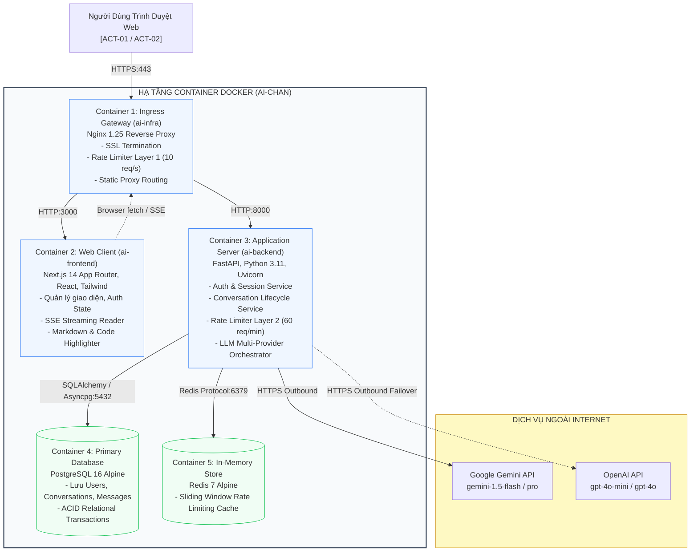
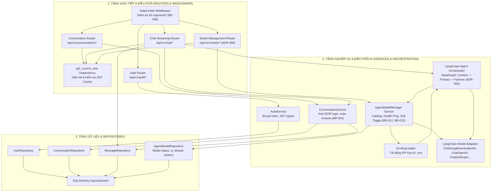

# TÀI LIỆU ĐẶC TẢ KIẾN TRÚC PHẦN MỀM (SOFTWARE ARCHITECTURE DOCUMENT - SAD)
## Hệ Thống Website Chatbot Trợ Lý Ảo (AI-Chan Assistant)

---

| Thông Tin Tài Liệu | Chi Tiết |
| :--- | :--- |
| **Dự án** | Website Chatbot Trợ Lý Ảo (`ai-chan`) |
| **Mã tài liệu** | `ARCH-SAD-001` |
| **Trạng thái Baseline** | **BASELINED** |
| **Mục đích** | Mô tả kiến trúc tổng thể của hệ thống dựa trên mô hình C4 (Context, Container, Component), xác lập các nguyên tắc phân tầng và lựa chọn công nghệ cốt lõi |

---

## 1. Mục Tiêu Kiến Trúc & Nguyên Tắc Thiết Kế (Architectural Drivers)

1. **Hiệu Năng & Độ Trễ Thấp (Performance & Low Latency)**: Tối ưu hóa thời gian bắt đầu stream phản hồi dưới 2 giây (`NFR-003`) thông qua Server-Sent Events (SSE).
2. **Độ Sẵn Sàng & Tính Tự Phục Hồi (High Availability & Resilience)**: Không phụ thuộc vào một nhà cung cấp duy nhất; tự động chuyển vùng dự phòng (Failover) từ Google Gemini sang OpenAI (`BR-005`, `NFR-008`).
3. **Bảo Mật Phòng Thủ Theo Chiều Sâu (Defense in Depth)**: Kiểm soát tần suất 2 tầng (`BP-SEC-001`), băm mật khẩu bcrypt (`SEC-002`), bảo vệ phiên bằng HttpOnly Secure Cookie (`SEC-004`) và cách ly dữ liệu cá nhân triệt tiêu lỗ hổng IDOR (`BR-002`, `NFR-018`).
4. **Kiến Trúc Tối Giản & Dễ Vận Hành (Simplicity - Ponytail Senior Dev Mode)**: Cấu trúc 3 tầng (3-tier) containerized rõ ràng, không thêm thấu kính phức tạp khi chưa có yêu cầu; đóng gói hoàn chỉnh qua Docker Compose.

---

## 2. Mô Hình Kiến Trúc C4 — Cấp Độ 2: Container View

---

## 3. Mô Hình Kiến Trúc C4 — Cấp Độ 3: Component View (ai-backend Core)

---

## 4. Công Nghệ Chủ Đạo & Cơ Sở Lựa Chọn (Technology Stack Rationale)

1. **Backend Core (FastAPI & Python 3.11)**: Hỗ trợ bất đồng bộ nguyên bản (`async/await`), tích hợp sẵn Pydantic tự động validate dữ liệu chặt chẽ và cơ chế `StreamingResponse` hỗ trợ SSE hoàn hảo.
2. **Frontend UI (Next.js 14 App Router & React)**: Server Components kết hợp Client Components tối ưu SEO và tốc độ tải trang; quản lý trạng thái mượt mà cho trải nghiệm Chatbot hiện đại.
3. **Database (PostgreSQL 16)**: Đảm bảo toàn vẹn giao dịch ACID, quan hệ chặt chẽ giữa User, Conversation và Message, hỗ trợ cascade delete đáng tin cậy.
4. **Ingress (Nginx 1.25)**: Reverse proxy tiêu chuẩn cao, cấu hình bảo vệ tải Layer 1 mạnh mẽ, xử lý SSL Termination an toàn.
5. **AI Agent Framework (LangChain & LangGraph - ADR-005)**: Chuẩn hóa điều phối Agent qua đồ thị trạng thái StateGraph có khả năng xử lý failover mượt mà, tải các adapter nhà cung cấp động dựa trên key cấu hình trong `.env`, hỗ trợ truyền luồng token thời gian thực qua SSE.
6. **Multi-Provider Agent Model Manager (ADR-006)**: Quản lý danh mục mô hình tập trung từ các nhà cung cấp bên ngoài (Google, Anthropic, OpenAI, Groq, Ollama), cung cấp cơ chế kiểm tra kết nối trực tiếp (Ping/Health Check), kích hoạt và hủy kích hoạt linh hoạt qua chính sách Soft State (không xóa cứng theo `BR-012`), và bảo toàn bất biến duy trì ít nhất một mô hình mặc định hoạt động (`BR-013`).

