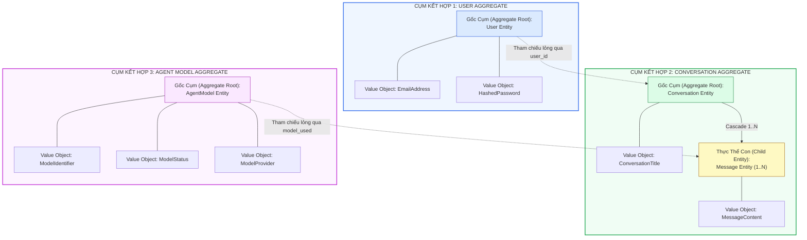

# ĐẶC TẢ CỤM KẾT HỢP MIỀN (AGGREGATES & ROOTS)
## Hệ Thống Website Chatbot Trợ Lý Ảo (AI-Chan Assistant)

---

| Thông Tin Tài Liệu | Chi Tiết |
| :--- | :--- |
| **Dự án** | Website Chatbot Trợ Lý Ảo (`ai-chan`) |
| **Mã tài liệu** | `DOM-AGG-001` |
| **Trạng thái Baseline** | **BASELINED** |
| **Mục đích** | Xác định ranh giới nhất quán giao dịch (Transactional Consistency Boundaries) và các Gốc cụm kết hợp (Aggregate Roots) trong thiết kế miền |

---

## 1. Ranh Giới Cụm Kết Hợp (Aggregate Boundaries)

Hệ thống AI-Chan được phân chia thành **3 cụm kết hợp chính**:

---

## 2. Chi Tiết Các Cụm Kết Hợp

### 2.1 Cụm Kết Hợp 1: User Aggregate
- **Gốc Cụm (Aggregate Root)**: Thực thể `User`.
- **Ranh Giới Bảo Toàn (Consistency Boundary)**:
  - Duy trì tính duy nhất của địa chỉ email.
  - Bảo đảm mật khẩu luôn ở trạng thái mã hóa băm (`SEC-002`).
  - Quản lý trạng thái hoạt động hoặc vô hiệu hóa của tài khoản.

### 2.2 Cụm Kết Hợp 2: Conversation Aggregate
- **Gốc Cụm (Aggregate Root)**: Thực thể `Conversation`.
- **Thực Thể Thành Viên (Internal Members)**: Tập hợp các thực thể con `Message (1..N)`.
- **Ranh Giới Bảo Toàn (Consistency Boundary)**:
  - **Toàn vẹn vòng đời (Lifecycle Cascade)**: Khi cuộc trò chuyện (`Conversation`) bị xóa, toàn bộ các tin nhắn con (`Message`) bên trong bắt buộc phải bị xóa đồng thời (`FR-007`).
  - **Toàn vẹn quyền sở hữu (`BR-002`)**: Không thể thêm, đọc hoặc sửa tin nhắn nếu không thông qua việc kiểm tra tính hợp lệ của `Conversation.user_id`.
  - **Tự động hóa tiêu đề (`BR-004`)**: Việc thêm tin nhắn đầu tiên kích hoạt sự thay đổi trạng thái tiêu đề của chính `Conversation`.

### 2.3 Cụm Kết Hợp 3: AgentModel Aggregate
- **Gốc Cụm (Aggregate Root)**: Thực thể `AgentModel`.
- **Ranh Giới Bảo Toàn (Consistency Boundary)**:
  - **Cấm xóa cứng dữ liệu (`BR-012`)**: Tuyệt đối không cho phép xóa thực thể `AgentModel` khỏi hệ thống nhằm bảo vệ toàn vẹn lịch sử tin nhắn đàm thoại (`model_used`). Quản trị vòng đời 100% qua cơ chế Soft State (`ACTIVE` <-> `INACTIVE`).
  - **Bất biến mô hình mặc định hoạt động (`BR-013`)**: Luôn đảm bảo duy nhất 1 mô hình ở trạng thái `ACTIVE` mang cờ `is_default = true`. Cấm hủy kích hoạt mô hình đang là mặc định nếu chưa chọn mô hình thay thế.
  - **Xác thực khóa trước khi kích hoạt (`BR-014`)**: Mô hình chỉ được chuyển sang `ACTIVE` nếu nhà cung cấp tương ứng có khóa API hợp lệ trong `.env`.
  - **Tự động hạ cấp độ ưu tiên (`BR-015`)**: Mô hình tự động chuyển sang `DEGRADED` khi gặp lỗi hạn ngạch kéo dài.

