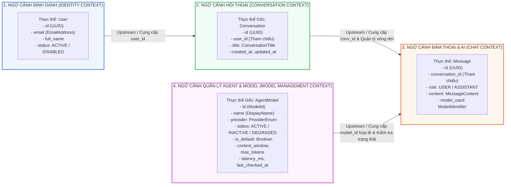

# MÔ HÌNH MIỀN & RANH GIỚI NGỮ CẢNH (DOMAIN MODEL & BOUNDED CONTEXTS)
## Hệ Thống Website Chatbot Trợ Lý Ảo (AI-Chan Assistant)

---

| Thông Tin Tài Liệu | Chi Tiết |
| :--- | :--- |
| **Dự án** | Website Chatbot Trợ Lý Ảo (`ai-chan`) |
| **Mã tài liệu** | `DOM-MODEL-001` |
| **Trạng thái Baseline** | **BASELINED** |
| **Mục đích** | Phân định ranh giới ngữ cảnh miền (Bounded Contexts) và thiết lập Ngôn ngữ chung (Ubiquitous Language) của hệ thống |

---

## 1. Bản Đồ Ngữ Cảnh Miền (Bounded Context Map)

---

## 2. Ngôn Ngữ Chung Của Miền (Ubiquitous Language)

| Thuật Ngữ Nghiệp Vụ | Định Nghĩa Trong Ngữ Cảnh Hệ Thống | Phạm Vi Sử Dụng |
| :--- | :--- | :--- |
| **User (Người Dùng)** | Chủ thể tài khoản định danh cá nhân có quyền sở hữu các phiên trò chuyện. | Identity Context, Security |
| **Conversation (Cuộc Trò Chuyện)** | Một không gian ngữ cảnh đàm thoại độc lập gắn liền với một người dùng xác định (`BR-002`). | Conversation Context |
| **Message (Tin Nhắn)** | Một lượt trao đổi văn bản đơn lẻ bên trong cuộc trò chuyện, mang vai trò người gửi (`user`) hoặc trợ lý ảo (`assistant`). | Chat Context |
| **Prompt** | Đoạn văn bản câu hỏi hoặc yêu cầu do người dùng đưa vào để mô hình AI xử lý. | Chat Context |
| **Token Stream** | Luồng các mảnh văn bản (tokens) được mô hình AI sinh ra và truyền phát dần theo thời gian thực. | Chat & Inference Context |
| **Failover (Chuyển Vùng)** | Hành vi tự động chuyển đổi nhà cung cấp từ Google Gemini sang OpenAI/Anthropic khi có lỗi phát sinh (`BR-005`). | Inference Context |
| **Anti-IDOR Policy** | Quy tắc bất biến cấm người dùng truy cập hoặc thao tác lên cuộc trò chuyện của tài khoản khác (`BR-002`). | Cross-Cutting Rule |
| **Agent Model** | Thực thể mô hình AI từ các nhà cung cấp ngoài (Google, Anthropic, OpenAI, Groq, Ollama), quản trị qua vòng đời trạng thái (`ADR-006`). | Model Management Context |
| **Soft Toggle (Bật / Tắt Mềm)** | Hành vi kích hoạt hoặc hủy kích hoạt mô hình (`ACTIVE` <-> `INACTIVE`) mà tuyệt đối không xóa cứng khỏi CSDL (`BR-012`). | Model Management Context |
| **Default Model Invariant** | Quy tắc bất biến bảo đảm hệ thống luôn duy trì chính xác 1 mô hình `ACTIVE` mang cờ mặc định (`BR-013`). | Model Management Context |

