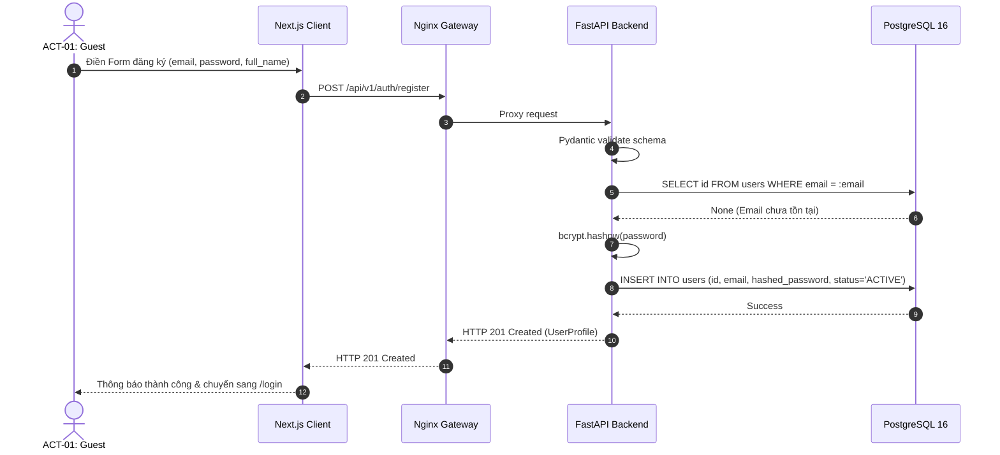
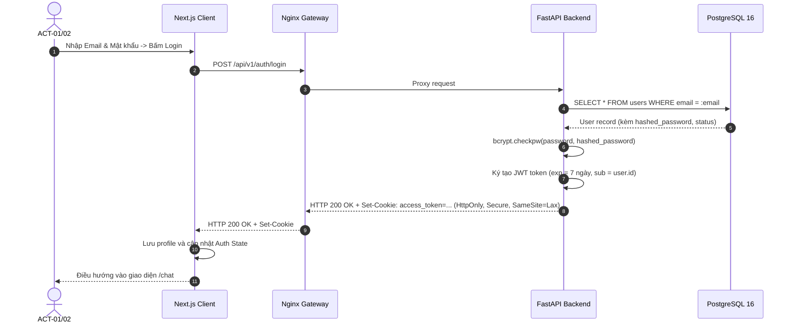
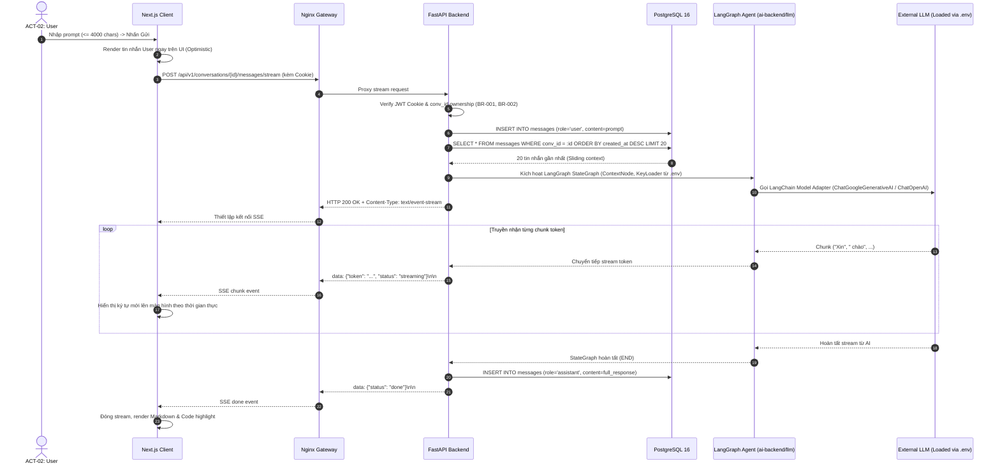
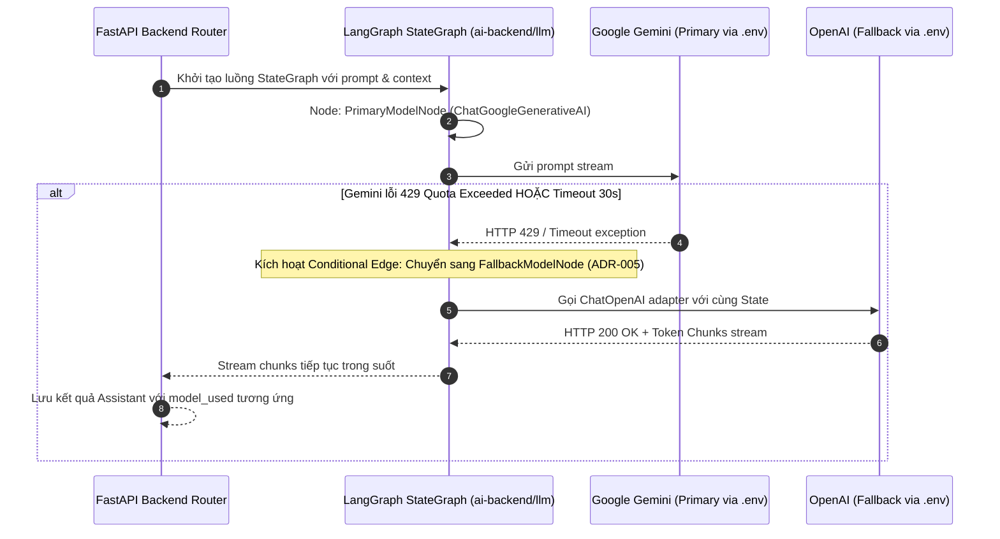
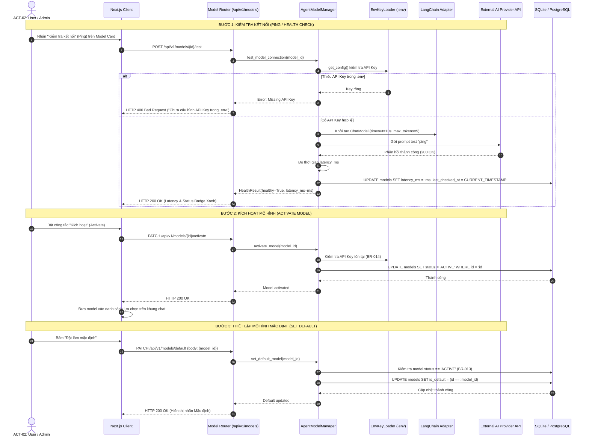
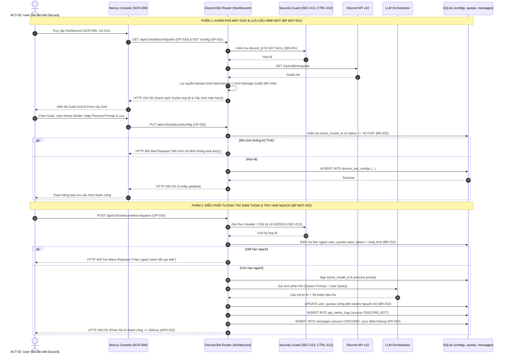

# ĐẶC TẢ SƠ ĐỒ TUẦN TỰ HÀNH VI (SEQUENCE DIAGRAMS SPECIFICATION)
## Hệ Thống Website Chatbot Trợ Lý Ảo (AI-Chan Assistant)

---

| Thông Tin Tài Liệu | Chi Tiết |
| :--- | :--- |
| **Dự án** | Website Chatbot Trợ Lý Ảo (`ai-chan`) |
| **Mã tài liệu** | `BEH-SEQ-001` |
| **Trạng thái Baseline** | **BASELINED** |
| **Mục đích** | Mô hình hóa chuỗi trao đổi thông điệp tuần tự giữa Client, Ingress, Backend, Database và AI Services |

---

## 1. SEQ-001: Luồng Đăng Ký Tài Khoản & Băm Mật Khẩu (Registration Flow)

---

## 2. SEQ-002: Luồng Đăng Nhập & Thiết Lập HttpOnly Cookie (Login Flow)

---

## 3. SEQ-003: Luồng Gửi Tin Nhắn & Server-Sent Events Streaming (Chat SSE Flow)

---

## 4. SEQ-004: Luồng Tự Động Chuyển Vùng Dự Phòng (LLM Failover Flow)

---

## 5. SEQ-005: Luồng Kiểm Tra Kết Nối, Kích Hoạt & Cấu Hình Mặc Định Model (Model Management Flow)

---

## 6. SEQ-011: Luồng Quản Lý Cấu Hình & Điều Phối Đàm Thoại Bot Discord

