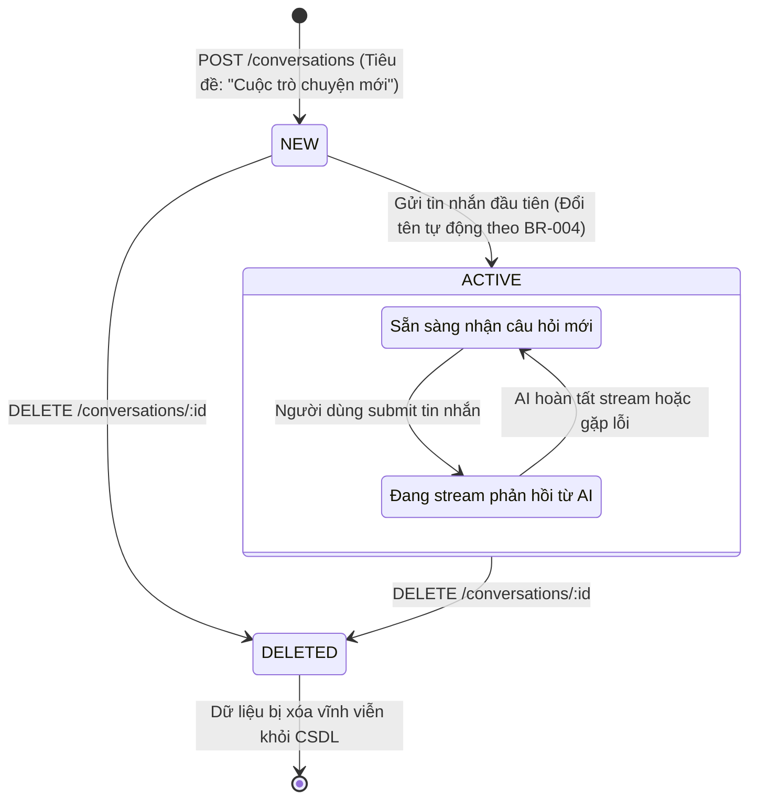
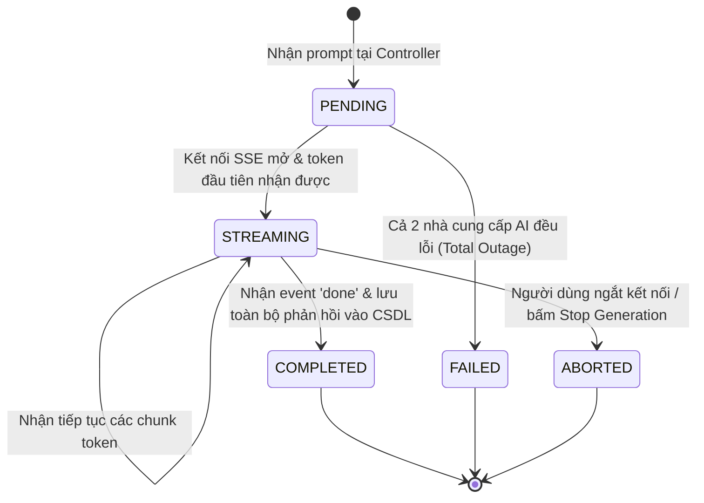
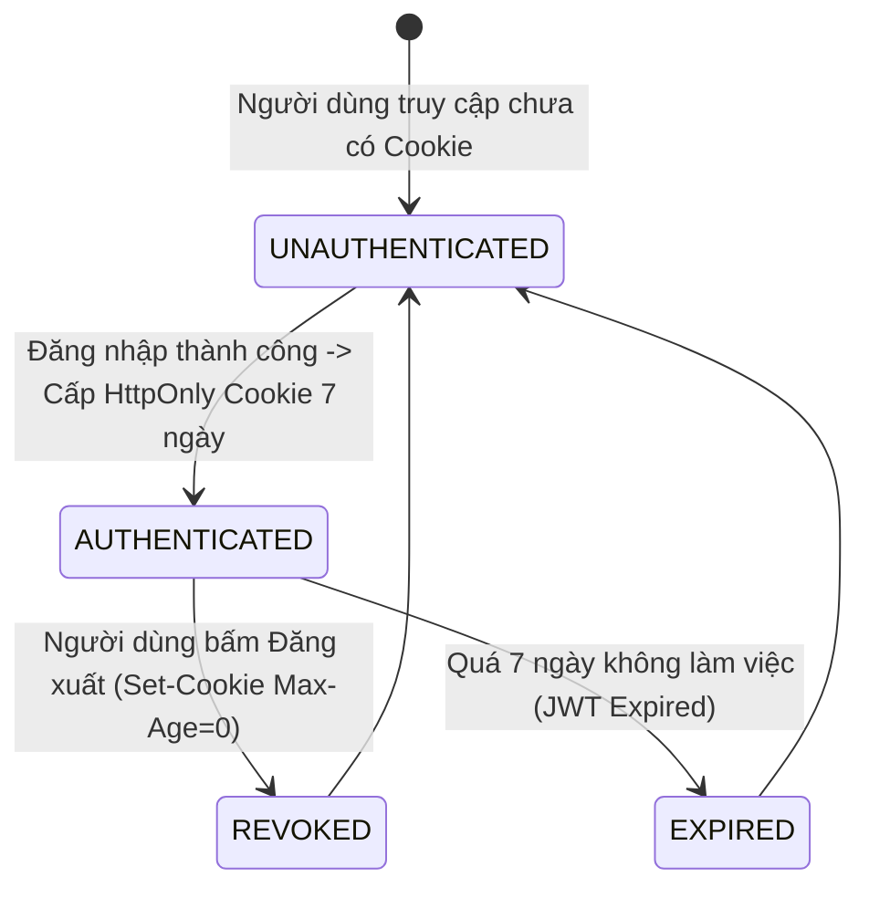
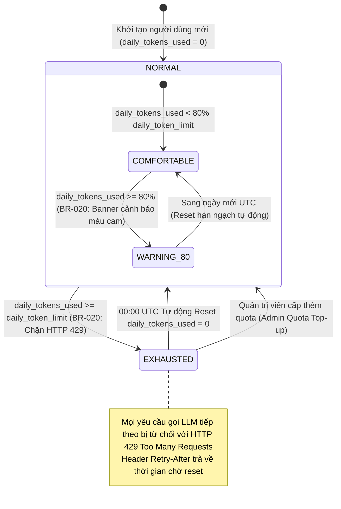
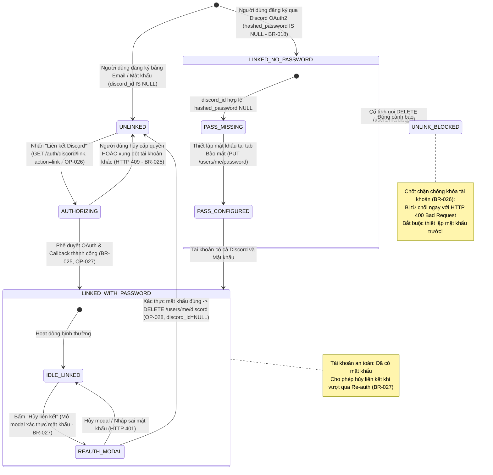
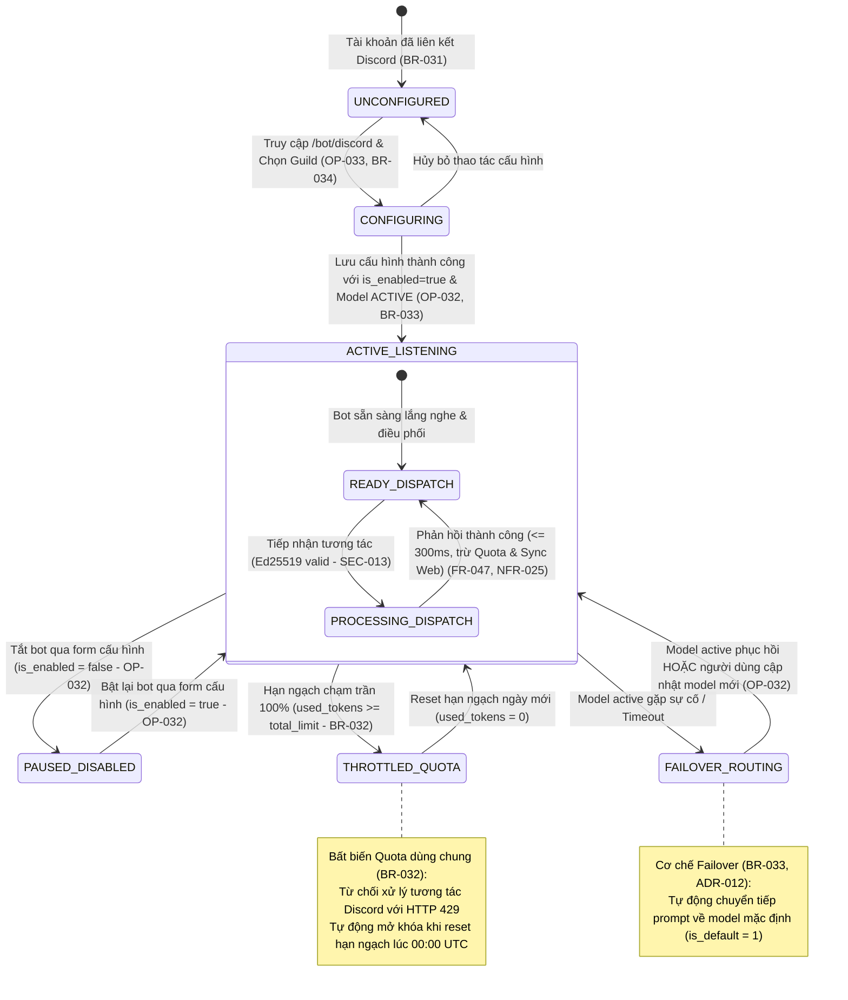

# ĐẶC TẢ MÁY TRẠNG THÁI HÀNH VI (STATE MACHINES SPECIFICATION)
## Hệ Thống Website Chatbot Trợ Lý Ảo (AI-Chan Assistant)

---

| Thông Tin Tài Liệu | Chi Tiết |
| :--- | :--- |
| **Dự án** | Website Chatbot Trợ Lý Ảo (`ai-chan`) |
| **Mã tài liệu** | `BEH-STATE-001` |
| **Trạng thái Baseline** | **BASELINED** |
| **Mục đích** | Mô hình hóa máy trạng thái hữu hạn cho các thực thể Hội thoại, Tin nhắn và Phiên làm việc |

---

## 1. STATE-001: Vòng Đời Trạng Thái Cuộc Trò Chuyện (Conversation Lifecycle)



---

## 2. STATE-002: Vòng Đời Tin Nhắn Đàm Thoại (Message Delivery Lifecycle)



---

## 3. STATE-003: Vòng Đời Phiên Xác Thực Người Dùng (Session Lifecycle)



---

## 4. STATE-004: Vòng Đời Trạng Thái Mô Hình Agent Mở Rộng (Agent Model Extended Lifecycle)

```mermaid
stateDiagram-v2
    [*] --> INACTIVE: Đăng ký mô hình mới qua POST /models (OP-022, BR-022, BR-024)

    INACTIVE --> TESTING: Người dùng nhấn "Kiểm tra kết nối" (Ping)
    TESTING --> INACTIVE: Ping thất bại (Thiếu API Key hoặc lỗi kết nối)
    TESTING --> ACTIVE: Kiểm tra thành công & Bấm Kích hoạt (BR-014)

    INACTIVE --> ACTIVE: PATCH /models/:id/activate (Khi đã có API Key trong .env)
    ACTIVE --> INACTIVE: PATCH /models/:id/deactivate (Điều kiện: Không phải Default Model - BR-013)

    ACTIVE --> DEGRADED: Gặp lỗi 429 Quota Exceeded hoặc 5xx liên tiếp 3 lần (BR-015)
    DEGRADED --> ACTIVE: Health ping nền định kỳ thành công trở lại
    DEGRADED --> INACTIVE: Người dùng chủ động tạm tắt (Deactivate)

    INACTIVE --> ARCHIVED: DELETE /models/:id (Xóa mềm - FR-039, Điều kiện: is_default != true - BR-023)
    ACTIVE --> ARCHIVED: Chặn nếu is_default == true; Cho phép nếu không phải mặc định (BR-023)
    DEGRADED --> ARCHIVED: Chuyển vào lưu trữ khi mô hình bị ngừng cung cấp

    ARCHIVED --> INACTIVE: Khôi phục mô hình từ lưu trữ (Restore Model)

    note right of ARCHIVED
        Xóa mềm an toàn: không xóa cứng CSDL (BR-012).
        Loại khỏi danh mục chọn đàm thoại của Agent.
        Bảo toàn toàn vẹn khóa ngoại với messages và metrics.
        Nghiêm cấm xóa/lưu trữ nếu đang là Default Model (BR-023).
    end note

    note right of ACTIVE
        Sẵn sàng đàm thoại.
        Tham gia chuỗi điều phối LangGraph (ADR-005).
        Ít nhất 1 model duy trì is_default = true (BR-013, BR-023).
    end note
```

---

## 5. STATE-005: Vòng Đời Hạn Ngạch Quota Người Dùng (User Quota Lifecycle)



---

## 6. STATE-006: Vòng Đời Liên Kết Danh Tính Discord (Discord Identity Association Lifecycle)



---

## 7. STATE-007: Máy Trạng Thái Cấu Hình & Vận Hành Bot Discord (DIAG-STATE-009)




