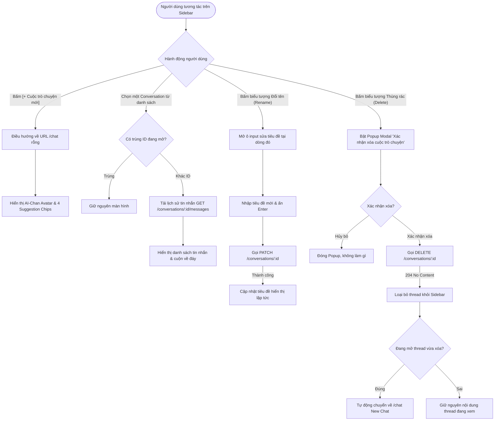

# Sơ Đồ Luồng Người Dùng (User Flows)
## Hệ Thống Website Chatbot Trợ Lý Ảo (AI-Chan Assistant)

---

| Thông Tin Tài Liệu | Chi Tiết |
| :--- | :--- |
| **Mã tài liệu** | `UX-FLOW-001` |
| **Giai đoạn** | **Phase 11 — User Experience & Interface Design** |
| **Canonical Model** | `models/ux/ux.yaml` |
| **Phụ thuộc Thượng nguồn** | `UC-001` - `UC-009`, `PROC-001` - `PROC-010`, `SEQ-001` - `SEQ-004` |
| **Trạng thái** | **BASELINED** |

---

## 1. Luồng Xác Thực Người Dùng (FLOW-AUTH: Authentication & Session Flow)

Minh họa hành trình từ khi người dùng chưa đăng nhập, đăng ký tài khoản mới hoặc đăng nhập, và điều hướng vào hệ thống chat:

```mermaid
flowchart TD
    Start([Người dùng truy cập Hệ thống]) --> CheckSession{Đã có Cookie<br/>access_token?}
    
    CheckSession -- Có --> DirectChat[Chuyển hướng vào /chat]
    CheckSession -- Không --> ShowLogin[Hiển thị Trang Đăng Nhập /login]
    
    ShowLogin --> ActionAuth{Hành động}
    ActionAuth -- Chưa có tài khoản --> GoRegister[Chuyển sang /register]
    ActionAuth -- Nhập thông tin đăng nhập --> SubmitLogin[Bấm Đăng Nhập]
    
    GoRegister --> FillReg[Điền Email & Mật khẩu hợp lệ]
    FillReg --> SubmitReg[Bấm Đăng Ký]
    SubmitReg --> ValidateReg{Hợp lệ?}
    ValidateReg -- Lỗi (409/422) --> ShowToastReg[Hiển thị Toast lỗi] --> GoRegister
    ValidateReg -- Thành công (201) --> RegSuccess[Toast 'Đăng ký thành công'] --> ShowLogin
    
    SubmitLogin --> CallLoginAPI{API /auth/login (200 OK)?}
    CallLoginAPI -- Sai thông tin (401) --> ShowToastLogin[Toast 'Sai email hoặc mật khẩu'] --> ShowLogin
    CallLoginAPI -- Thành công --> SetCookie[Trình duyệt lưu HttpOnly Cookie] --> DirectChat
    
    DirectChat --> ActiveState([Bắt đầu sử dụng Chat Workspace])
    ActiveState --> ClickLogout[Bấm Đăng xuất từ Profile Menu]
    ClickLogout --> CallLogoutAPI[Gọi API /auth/logout] --> ClearState[Xóa Cache Client] --> ShowLogin
```

---

## 2. Luồng Gửi Tin Nhắn & Truyền Luồng SSE (FLOW-CHAT-STREAM: Prompting & Real-Time Stream)

Minh họa cơ chế tương tác gửi câu hỏi, hiển thị Optimistic UI, tiếp nhận từng chunk chữ chạy thời gian thực và hành động Dừng phản hồi (`UX-002`, `UX-003`):

```mermaid
flowchart TD
    InChat([Người dùng tại màn hình /chat/[id]]) --> TypePrompt[Gõ tin nhắn vào Textarea]
    TypePrompt --> CharCheck{Độ dài <= 4000 ký tự?}
    CharCheck -- Vượt quá --> ShowCounterWarn[Hiển thị nhãn đỏ cảnh báo giới hạn] --> TypePrompt
    CharCheck -- Hợp lệ --> TriggerSend[Bấm nút Gửi hoặc ấn Enter]
    
    TriggerSend --> OptimisticRender[Render bong bóng tin nhắn User ngay lập tức]
    OptimisticRender --> ClearInput[Xóa trắng ô Textarea và khóa ô nhập]
    ClearInput --> SwitchStopButton[Đổi nút Gửi thành nút 'Dừng phản hồi' Stop]
    ClearInput --> InitAIPlaceholder[Tạo khung tin nhắn AI với con trỏ nhấp nháy]
    
    InitAIPlaceholder --> CallStreamAPI[Gửi POST /conversations/:id/messages/stream]
    
    CallStreamAPI --> StreamLoop{Sự kiện SSE nhận được}
    StreamLoop -- chunk: 'từ vựng' --> AppendText[Nối text vào bong bóng AI]
    AppendText --> AutoScroll[Tự động cuộn mượt xuống đáy trang] --> StreamLoop
    
    StreamLoop -- Người dùng bấm 'Stop' --> UserAbort[Gọi abort() trên ReadableStream]
    UserAbort --> TerminateUI[Cố định nội dung đã nhận đến thời điểm đó] --> ResetComposer[Khôi phục nút Gửi và mở khóa Textarea]
    
    StreamLoop -- done: [DONE] --> CompleteStream[Đóng kết nối SSE thành công]
    CompleteStream --> RenderMarkdown[Render hoàn chỉnh Markdown và Code Blocks]
    RenderMarkdown --> ResetComposer
    
    StreamLoop -- error: [ERR] --> ErrorStream[Toast thông báo lỗi kết nối AI]
    ErrorStream --> ShowRetry[Hiển thị nút 'Thử lại' bên cạnh tin nhắn] --> ResetComposer
```

---

## 3. Luồng Quản Lý Cuộc Trò Chuyện (FLOW-CONV-MANAGE: Lifecycle Operations)

Minh họa tương tác của người dùng trên danh sách Sidebar khi tạo mới, đổi tên hoặc xóa cuộc trò chuyện (`UC-004`, `UC-005`, `UC-006`):


