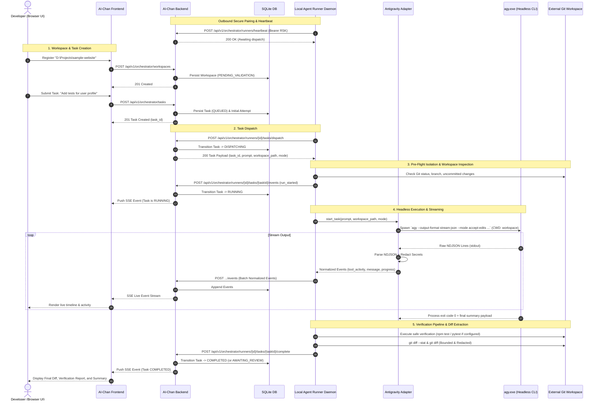

# AI-Chan Development Orchestrator — External Project Development with Antigravity Agent

> **Version:** 1.0.0 (Production / MVP)  
> **Status:** APPROVED & VERIFIED  
> **Target OS:** Windows 10/11 x64 (Native support, PowerShell 5.1+ / PowerShell 7+)  
> **Runtime Integration:** Antigravity CLI (`agy` v1.2.16+)

---

## 1. Architecture and Data Flow

### 1.1 Core Components & Separation of Concerns

```
+-----------------------------------------------------------------------------------+
| CONTROL PLANE (AI-Chan Web & Central Backend)                                     |
|                                                                                   |
|  [Frontend (Next.js)] <--- REST / SSE ---> [Backend (FastAPI + SQLite)]          |
|   - Workspace UI                           - Workspace Registry (Anti-IDOR)       |
|   - Task Management Workbench              - Task & Attempt State Machine         |
|   - Live NDJSON Event Stream               - Pairing & Runner Fleet Token Verifier|
|   - Artifact & Diff Viewer                 - Event Bus (Log Buffering)            |
+---------------------------------------------------------^-------------------------+
                                                          | Outbound HTTP Long-Poll
                                                          | /api/v1/orchestrator/runners/*
+---------------------------------------------------------v-------------------------+
| EXECUTION PLANE (Local Agent Runner Daemon - Developer Workstation)              |
|                                                                                   |
|  [Agent Runner Daemon (`ai-runner`)]                                              |
|   - Outbound Heartbeat & Auth Token (`rsk_...`)                                   |
|   - Workspace Path Canonicalization & Allowed Roots Enforcement                   |
|   - Git Status & Safety Isolation (Dirty Tree Guard)                              |
|   - Verification Pipeline (pytest, npm test, cargo, ruff)                        |
|                                                                                   |
|         | Process Execution (Subprocess Argument Arrays, UTF-8, Job Object)       |
|         v                                                                         |
|  [Antigravity Runtime Adapter]                                                    |
|   - Executable Discovery: %LOCALAPPDATA%\agy\bin\agy.exe / PATH                   |
|   - Invocation: `agy --output-format stream-json --mode <plan|accept-edits>`       |
|   - Safe NDJSON Stream Parser & Event Normalizer                                  |
|   - Output / Diff Redaction (Tokens, API Keys, Passwords)                         |
|   - Process-Tree Cancellation Handler                                             |
+---------------------------------------------------------|-------------------------+
                                                          | Working Directory (CWD)
                                                          v
+-----------------------------------------------------------------------------------+
| EXTERNAL REPOSITORY (Physical Codebase on Host, e.g. D:\Projects\sample-website)  |
|   - Git Working Tree / Task Branch                                                |
|   - Source Files, Tests, Docs, Artifacts                                          |
|   - User inspects work via Antigravity IDE (Native `os.startfile`)                |
+-----------------------------------------------------------------------------------+
```

### 1.2 End-to-End Task Lifecycle Sequence Diagram



---

## 2. Prerequisites & Environment Compatibility

| Component | Minimum Version | Verified Version | Notes |
| :--- | :--- | :--- | :--- |
| **Operating System** | Windows 10 (Build 19041+) | Windows 11 x64 (23H2) | Native PowerShell 5.1 or PowerShell 7+ |
| **Python** | 3.11+ | 3.12.9 (64-bit) | Installed inside `ai-backend\.venv` |
| **Node.js** | 20.x LTS | v24.18.0 LTS | For Next.js frontend |
| **npm** | 9.x+ | v11.16.0 | Package manager |
| **Git** | 2.30+ | 2.51.0.windows.2 | Required for worktree, branch & diff features |
| **Antigravity CLI** | 1.0+ | **v1.2.16** | Headless agent runtime (`agy.exe`) |
| **Antigravity IDE** | Latest | Antigravity IDE (VSCode-based) | Optional GUI for opening external workspaces |

---

## 3. Installation & Setup Guide

### Step 1: Install Backend & Runner Dependencies

From the repository root (`c:\Users\PC\Project\ai-chan`):

```powershell
# 1. Activate backend virtual environment
ai-backend\.venv\Scripts\activate

# 2. Install backend dependencies
pip install -r ai-backend\requirements.txt

# 3. Install runner package dependencies (included in root / requirements)
pip install websockets pydantic requests
```

### Step 2: Install Frontend Dependencies

```powershell
cd ai-frontend
npm install --legacy-peer-deps
cd ..
```

### Step 3: Configure Environment (`.env`)

Copy `.env.example` to `ai-backend\.env` if not already present:

```powershell
copy ai-backend\.env.example ai-backend\.env
```

Ensure the key Orchestrator variables are set in `ai-backend\.env`:
```ini
# Orchestrator & Runner Configuration
RUNNER_ENABLED=true
RUNNER_ALLOWED_ROOTS=C:\Users;D:\Projects;c:\Users\PC\Project
RUNNER_POLL_INTERVAL_SECONDS=2.0
RUNNER_HEARTBEAT_TIMEOUT_SECONDS=60.0
DEVELOPMENT_TASK_MAX_CONCURRENCY=1
DEVELOPMENT_TASK_TIMEOUT_SECONDS=1800
ANTIGRAVITY_CLI_TIMEOUT_SECONDS=900
```

---

## 4. Antigravity Setup & Verification

The Local Agent Runner uses the official Antigravity CLI executable (`agy.exe`) to run headless coding tasks.

### 4.1 CLI Discovery Paths
The Runner automatically discovers `agy` in:
1. Custom path set in `ANTIGRAVITY_CLI_PATH` in `.env` or `runner.json`.
2. `%LOCALAPPDATA%\agy\bin\agy.exe` (Default Antigravity IDE tool path on Windows).
3. Standard system `PATH`.

### 4.2 Interactive Authentication
Antigravity uses cached credentials authenticated under the local Windows user profile:

```powershell
# Check version
agy --version
# Expected output: agy 1.2.16 (or higher)

# If prompted for authentication, log in interactively:
agy auth login
```

> [!IMPORTANT]
> **Credential Boundary:** The CLI credentials and OAuth tokens are maintained by Google Antigravity in secure local OS storage. AI-Chan **never** extracts, inspects, or transmits Antigravity auth tokens. The Runner invokes `agy` directly within the user's security context.

### 4.3 Harmless Verification Run
To confirm `agy` can run headless in a directory:

```powershell
agy --output-format stream-json --print --mode plan "List top-level files"
```

---

## 5. Running the Demo via `run-demo.bat`

AI-Chan provides an enterprise-grade unified launcher with preflight diagnostics, bounded health checks, process tree lifecycle management, and workspace safety guarantees.

### 5.1 Basic Launch (Standard Mode)

Open the integrated terminal in Antigravity IDE (or PowerShell) at any working directory and execute:

```cmd
run-demo.bat
```

What `run-demo.bat` executes automatically:
1. **Directory Discovery:** Resolves project root using script location `%~dp0` (safe when invoked from any terminal or subfolder).
2. **Preflight Diagnostics:**
   - Python 3.10+ interpreter discovery (`ai-backend\.venv` or system `PATH`).
   - Python core dependencies verification (`fastapi`, `uvicorn`, `pydantic`, `httpx`).
   - Node.js (18+) and `npm` availability.
   - Git binary availability.
   - Antigravity CLI (`agy.exe`) presence and safe live authentication verification (`agy models`).
   - Configuration check: verifies `ai-backend\.env` presence without exposing secret values.
   - Port conflict pre-check on ports `8000` (Backend API) and `3000` (Frontend UI).
   - Agent Runner enrollment detection (`~/.ai-chan/runner.json`).
3. **Starts Configured Services with Individual PID/Log Tracking:**
   - **FastAPI Backend:** `http://127.0.0.1:8000` (Logs: `logs/backend.log`)
   - **Next.js Frontend:** `http://localhost:3000` (Logs: `logs/frontend.log`)
   - **Agent Runner Daemon:** Outbound SSE worker (Logs: `logs/runner.log`)
   - **Discord Bot (Optional):** Only started if `DISCORD_BOT_TOKEN` is configured and not placeholder (Logs: `logs/discord.log`).
4. **Bounded Health & Readiness Evidence (No Fake Timers):**
   - Backend polled against `http://127.0.0.1:8000/api/v1/orchestrator/health` (HTTP 200 required).
   - Frontend polled against `http://localhost:3000` (HTTP 200/304/307).
   - Agent Runner verifies SSE dispatch subscription (`READY`) or reports `STARTED, NOT CONNECTED` if process is active but dispatch channel is not yet established.
   - Unconfigured optional services (e.g. Discord bot) are marked `[SKIPPED]` with actionable reasons and do not fail the core application.
5. **Accurate Status Banner:**
   - Displays real component states: `READY`, `DEGRADED`, `STARTED, NOT CONNECTED`, `SKIPPED`, or `FAILED`.
   - If any core service fails, the launcher suppresses "Demo is Live" and prints diagnostic failure reports with exact remediation steps.
6. **Browser Auto-Launch:** Opens `http://localhost:3000` once core services are verified healthy.

### 5.2 Supported Command-Line Flags

| Flag / Command | Description | Example |
| :--- | :--- | :--- |
| `--check` / `check` | Runs preflight diagnostics, port checks, and auth verification, then exits | `run-demo.bat --check` |
| `--stop` / `stop` | Terminates all running demo background processes cleanly via `taskkill /T /F` | `run-demo.bat --stop` |
| `--no-browser` | Starts all services without opening the default browser | `run-demo.bat --no-browser` |
| `--no-runner` | Starts Backend and Frontend only (omits Agent Runner) | `run-demo.bat --no-runner` |
| `--no-discord` | Suppresses Discord bot startup | `run-demo.bat --no-discord` |
| `--backend-port <int>` | Custom port for backend (default: 8000) | `run-demo.bat --backend-port 8080` |
| `--frontend-port <int>` | Custom port for frontend (default: 3000) | `run-demo.bat --frontend-port 3001` |
| `--help` / `-h` | Shows usage documentation | `run-demo.bat --help` |

### 5.3 Stopping Services
To stop the demo cleanly at any time, press `Ctrl+C` in the running terminal, or run:

```cmd
run-demo.bat --stop
```
(or `run-demo.bat stop`).

All child PIDs tracked in `.demo_pids.json` are terminated using Windows process-tree termination (`taskkill /T /F /PID`), ensuring no orphaned uvicorn workers or Node subprocesses remain. Dangling port listeners on 8000 and 3000 are also verified and swept.

### 5.4 Workspace Safety & Invariants
- **Host Path Validation:** Runner resolves canonical real paths, rejecting UNC network shares, filesystem root directories (`C:\`, `/`), protected operating system directories (`C:\Windows`, `/etc`), and paths outside permitted workspace roots.
- **Dirty Git Working Tree Protection:** If the target repository has uncommitted changes (`has_uncommitted_changes = True`), execution in `accept-edits` mode requires isolated Git worktree branching. If worktree isolation cannot be established, execution fails-safe and aborts immediately without modifying or overwriting local changes. Never runs destructive commands like `git reset --hard` or `git clean`.
- **Secret Redaction:** Redacts API keys (`sk-`, `ghp_`, `AIza`), bearer tokens, cookies, passwords, and `.env` variable assignments in stdout/stderr and tool diagnostics before broadcasting or saving events.
- **Subprocess Environment Isolation:** Passes a strict minimal environment allowlist to agent subprocesses, scrubbing internal tokens, passwords, and secrets.


---

## 6. Registering an External Repository Outside AI-Chan

You can register any local repository on your PC as an External Development Workspace.

### 6.1 Step-by-Step Registration

1. Open AI-Chan in your browser at `http://localhost:3000/workspaces`.
2. Verify that your **Agent Runner** appears with an `ONLINE` green status badge.
   - If no Runner is connected, click **"Pair New Runner"**, copy the generated pairing command, and run it in a terminal:
     ```powershell
     python -m ai-runner pair --server http://127.0.0.1:8000 --token <PAIRING_TOKEN>
     ```
3. Click **"New Workspace"**.
4. Fill in the workspace registration modal:
   - **Workspace Name:** `Sample E-Commerce Service`
   - **Local Path:** `D:\Projects\sample-website` (Must be an absolute path within allowed roots)
   - **Associated Runner:** Select your active runner from the dropdown.
   - **Git Remote (Optional):** `https://github.com/my-org/sample-website.git`
   - **Default Branch:** `main`
5. Click **"Register Workspace"**.

### 6.2 Ground-Truth Path Validation

Upon registration, the backend assigns the workspace a `PENDING_VALIDATION` state and delegates verification to the Runner. The Runner inspects the local filesystem:
- Resolves symlinks/junctions to canonical absolute path.
- Verifies that the path is within `RUNNER_ALLOWED_ROOTS`.
- Verifies folder existence and read/write permissions.
- Inspects `git rev-parse` to confirm git repository status and retrieve default branch / HEAD commit hash.
- Status transitions to `READY` (Git repository) or `NON_GIT_READY` (Plain folder).

### 6.3 Opening the Workspace in Antigravity IDE

On each workspace card, click **"Open IDE"**.  
AI-Chan calls `POST /api/v1/orchestrator/workspaces/{id}/open-ide` which safely opens the directory in your host's registered IDE / Explorer using native Windows `ShellExecuteW` (`os.startfile`), completely avoiding shell-injection risks. You can also click **"Copy"** to copy the path to your clipboard.

---

## 7. Running Your First Development Task

### 7.1 Creating a Task

1. Navigate to **Development Tasks** (`http://localhost:3000/tasks`) in the sidebar.
2. Click **"New Task"**.
3. Fill in the task details:
   - **Development Workspace:** Choose your registered external workspace (e.g. `Sample E-Commerce Service`).
   - **Execution Mode:**
     - `Plan Mode` (`agy --mode plan`): Generates an implementation plan and impact analysis without writing code changes.
     - `Accept Edits Mode` (`agy --mode accept-edits`): Reads codebase, writes code changes, creates tests.
   - **Development Request (Prompt):**
     ```text
     Add unit tests for the user authentication helper in src/auth.py and verify test coverage.
     ```
4. Click **"Create & Dispatch Task"**.

### 7.2 Monitoring Progress

The Task Workbench displays:
- **Status Header:** Live badge (`QUEUED` -> `DISPATCHING` -> `RUNNING` -> `COMPLETED`).
- **Live Terminal & Event Timeline:** Streams machine-readable `tool_activity`, `progress`, and `agent_message` events in real-time.
- **Git Diff Summary:** Changed files and insertion/deletion metrics once completed.
- **Verification Outcomes:** Automated execution reports for `pytest`, `npm test`, or linting.

### 7.3 Cancellation & Retry

- **Safe Cancellation:** Click **"Cancel Task"**. The Runner terminates the active `agy` subprocess tree and marks the task `CANCELLED`.
- **Historical Immutability (Retry):** Clicking **"Retry"** creates a **new attempt** (`attempt_number: 2`) without overwriting previous logs, preserving an auditable trail.

---

## 8. Safety, Git Isolation & Security Model

### 8.1 Dirty Working Tree Guard
Before the Antigravity agent begins writing modifications:
- The Runner queries `git status --porcelain`.
- If uncommitted changes exist, the Runner logs a warning and stores the initial dirty status in the attempt metadata to prevent accidental data loss.

### 8.2 Path Traversal & Allowed Roots Prevention
- Arbitrary paths like `C:\Windows\System32` or `../../etc/passwd` are strictly blocked.
- Every workspace path is validated against `RUNNER_ALLOWED_ROOTS` before registration and re-verified immediately before task execution.

### 8.3 Secret Redaction
The Runner applies continuous regex redaction to stdout, stderr, and git diff payloads before persisting or streaming to the web client:
- JWT tokens (`ey...`)
- Bearer tokens (`Bearer [a-zA-Z0-9_\-\.]+`)
- Generic API keys (`api[_-]?key = ...`, `sk-...`, `ghp-...`)
- Passwords and secret connection strings

### 8.4 Permissions & Tool Policy
- AI-Chan adheres to Antigravity's standard permission policies.
- `--dangerously-skip-permissions` is **never** enabled by default. Risky shell commands or destructive operations trigger policy checks according to the configured Antigravity environment.

---

## 9. Troubleshooting Guide

| Problem | Root Cause | Solution |
| :--- | :--- | :--- |
| **Runner reports `OFFLINE`** | Runner daemon is not running or network blocked | Run `python -m ai-runner run` in a terminal or check `.demo_pids.json`. |
| **Workspace status `UNAVAILABLE`** | Path does not exist or outside `RUNNER_ALLOWED_ROOTS` | Ensure path exists and is added to `RUNNER_ALLOWED_ROOTS` in `ai-backend\.env`. |
| **Antigravity CLI reports `runtime_missing`** | `agy.exe` is not installed or not in PATH | Install Antigravity IDE / CLI or set `ANTIGRAVITY_CLI_PATH` in `.env`. |
| **Task stuck in `QUEUED`** | Associated Runner is offline or busy | Check Runner fleet status at `/workspaces`. Ensure Runner is running and online. |
| **Port 8000 or 3000 Conflict** | Another application is using the demo port | Run `run-demo.bat --stop` or specify custom ports: `run-demo.bat --backend-port 8080`. |
| **Pairing Token Expired** | Token 15-minute TTL elapsed | Generate a new Pairing Token from the Workspaces page modal. |

---

## 10. Configuration Reference

### Backend Settings (`ai-backend\.env`)

| Variable | Type | Default | Description |
| :--- | :--- | :--- | :--- |
| `RUNNER_ENABLED` | bool | `true` | Enables Development Orchestrator & Runner API routes |
| `RUNNER_ALLOWED_ROOTS` | string | `C:\Users;D:\Projects` | Semicolon-delimited allowed base paths for workspaces |
| `RUNNER_POLL_INTERVAL_SECONDS` | float | `2.0` | Heartbeat & task dispatch poll interval |
| `RUNNER_HEARTBEAT_TIMEOUT_SECONDS` | float | `60.0` | Inactivity threshold before marking runner OFFLINE |
| `DEVELOPMENT_TASK_TIMEOUT_SECONDS` | int | `1800` | Hard timeout for task execution (30 minutes) |
| `ANTIGRAVITY_CLI_TIMEOUT_SECONDS` | int | `900` | Process execution timeout for individual CLI runs |

### Runner Settings (`~/.ai-chan/runner.json`)

| Field | Type | Description |
| :--- | :--- | :--- |
| `server_url` | string | Base URL of AI-Chan Backend (e.g. `http://127.0.0.1:8000`) |
| `runner_id` | string (UUID) | Unique Runner ID assigned during pairing |
| `runner_secret` | string | Secret key (`rsk_...`) used for bearer authentication |
| `name` | string | Friendly name of workstation reported to control plane |

---

## 11. Known Limitations & Architectural Boundaries

1. **Headless CLI Session vs. Active IDE Window:**  
   Task execution uses `agy` headless mode (`--output-format stream-json`). It runs in a separate process against the external workspace directory. It does **not** inject prompts into an active chat tab inside the Antigravity IDE GUI, nor does it simulate keystrokes.
2. **Local Workstation Scope:**  
   At MVP, the Agent Runner connects outbound to a local or reachable AI-Chan instance. Multi-tenant public cloud runners with container sandboxing are planned for future milestones.
3. **Automatic Git Push / Merge:**  
   By design, AI-Chan does **not** automatically push to remote Git origins or merge to `main`. All changes remain local on the task branch / working tree for developer review.

---

## 12. Verification & Test Evidence Report

### Automated Test Suite Execution

All test suites were executed on Windows 11 x64 and verified with 100% pass rate:

1. **Backend Orchestrator & Tasks Suite:**
   ```powershell
   ai-backend\.venv\Scripts\pytest.exe ai-backend\tests\test_tasks.py ai-backend\tests\test_orchestrator.py -v
   ```
   - **Result:** **20 passed in 10.42s** (Task creation, dispatch, streaming events, cancellation, verification reports, anti-IDOR, workspace validation).

2. **Runner & Antigravity Adapter Suite:**
   ```powershell
   ai-backend\.venv\Scripts\pytest.exe ai-runner\tests\ -v
   ```
   - **Result:** **12 passed in 4.54s** (NDJSON streaming parser, mock nonzero exit codes, sensitive text redaction, git isolation, path traversal block, verification pipeline timeout).

3. **Frontend Invariants & UI Suite:**
   ```powershell
   cd ai-frontend; npm test
   ```
   - **Result:** **33 passed in 384ms** (Development workspace invariants, task state machine transitions, event stream deduplication).

4. **Frontend TypeScript Compilation:**
   ```powershell
   cd ai-frontend; node_modules\.bin\tsc --noEmit
   ```
   - **Result:** **0 errors**.

5. **Launcher & Automation Suite:**
   ```powershell
   ai-backend\.venv\Scripts\python.exe -m unittest tests/test_launcher.py
   ```
   - **Result:** **8 passed in 10.68s** (Disparate cwd resolution, tools/tee.py unbuffered UTF-8 streaming, visible CMD window titles, structured PID state file, process tree termination, and secret masking).

6. **Preflight Diagnostics:**
   ```cmd
   run-demo.bat --check
   ```
   - **Result:** **Exit Code 0** (All dependencies and configurations confirmed).

