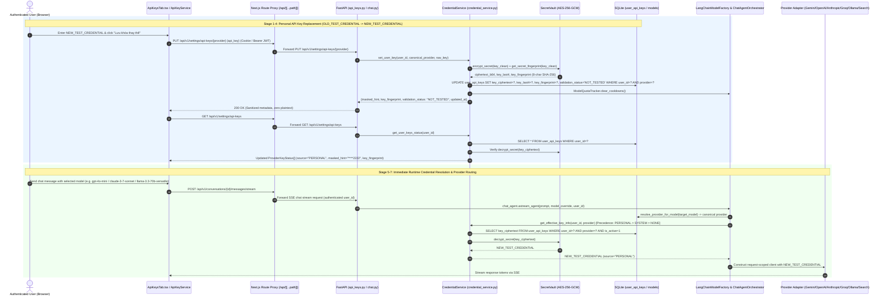

# API Key Replacement & Runtime Credential Resolution Diagnostics Report (v0.1.2)

- **Repository**: `https://github.com/DungTran1201/AgentHarnessBuilderTools`
- **Baseline Audited**: `v0.1.0` (`b0c5949a619884cf97f50634e7e02c1e4609eadb`) and `v0.1.1` (`ed6a784cb12bd50358a284a713240973668421fd`)
- **Target Release**: `v0.1.2`

---

## 1. Executive Summary & Fact Classification

### Facts (`FACT`)
1. **Model-to-Provider Routing Defect (`ai-backend/llm/agent.py`)**:
   - Prior to `v0.1.2`, both `ChatAgentOrchestrator.primary_node()` and `ChatAgentOrchestrator.astream_agent()` hardcoded `primary_prov = cfg["default_provider"] if cfg["default_provider"] in ["gemini", "openai"] else "gemini"`.
   - Selecting an OpenAI (`gpt-4o-mini`), Anthropic (`claude-3-7-sonnet`), Groq (`llama-3.3-70b-versatile`), or Ollama (`llama3`) model still routed the request through `primary_prov = "gemini"`, invoking `LangChainModelFactory.create_model("gemini", target_model, user_id=user_id)` with the **Google Gemini API key**.
   - Furthermore, `anthropic`, `groq`, and `ollama` were unreachable in `primary_node()`, `fallback_node()`, and `astream_agent()`, and `LangChainModelFactory.create_model()` had no `"ollama"` branch.
   - `AgentChatState` omitted `user_id: Optional[str]`, causing LangGraph state schema filtering to drop `user_id` during state transitions.
2. **Silent Decryption Failure Masking (`ai-backend/src/services/credential_service.py`)**:
   - When `decrypt_secret(row["key_ciphertext"])` failed in `CredentialService.get_effective_key(user_id, provider)`, the exception was logged and execution silently fell through to `cls.get_system_key(canon)`.
   - Meanwhile, `CredentialService.get_user_keys_status(user_id)` never verified whether `key_ciphertext` could be decrypted; it continued to report `source = "PERSONAL"` and `is_configured = True` even when runtime decryption failed.
3. **Stale Startup `settings` Precedence Over `os.environ` (`ai-backend/src/services/credential_service.py`)**:
   - `CredentialService.get_system_key()` checked `getattr(settings, env_var, None)` before `os.environ`. Updating or clearing `os.environ[env_var]` at runtime did not override a startup value cached on `settings`.
4. **Quota Circuit-Breaker Cooldown Persistence (`ai-backend/llm/agent.py`)**:
   - `ModelQuotaTracker._cooldowns` placed models that encountered HTTP `429 RESOURCE_EXHAUSTED` under an old key into a 30-minute (`1800s`) global cooldown. Replacing the key via `CredentialService.set_user_key()` or `update_system_env_variable()` did not clear `ModelQuotaTracker._cooldowns`, causing subsequent chat turns to skip the model and fall back to the local simulator.
5. **Candidate Connection Test Overwriting Saved Personal Key Metadata (`ai-backend/src/services/credential_service.py`)**:
   - `CredentialService.validate_connection(provider, user_id, candidate_key)` executed `UPDATE user_api_keys SET validation_status = ? ...` whenever `user_id` was provided, even when `candidate_key` was an unsaved candidate string.
6. **Model Activation & Search Tool User-Scope Gaps (`ai-backend/src/api/v1/models.py`, `ai-backend/src/services/tools/handlers/web_handlers.py`, `ai-backend/src/services/tools/executor.py`)**:
   - `activate_model()` in `models.py` called `check_provider_api_key(provider)` without `user_id=current_user.get("id")`, preventing users with only a `PERSONAL` key from activating models.
   - `handle_web_search()` in `web_handlers.py` called `CredentialService.get_effective_key(None, provider_clean)` with `user_id=None` and only executed DuckDuckGo HTML scraping instead of calling Brave Search or SerpAPI with the resolved credential.
7. **Legacy `LLMManager` Singleton Caching (`ai-backend/llm/client.py`)**:
   - `LLMManager.__init__()` initialized `GeminiProvider` and `OpenAIProvider` once at import time from `os.getenv()` and never queried `CredentialService`.
8. **Frontend Settings UI & Proxy Gaps (`ai-frontend/src/components/settings/ApiKeysTab.tsx`, `ai-frontend/src/services/apiKeyService.ts`)**:
   - `ApiKeysTab.tsx` did not distinguish testing an unsaved candidate key from testing the saved effective key, did not display key fingerprints (`key_fingerprint`), did not warn when a system `.env` update was shadowed by an active `PERSONAL` override, and did not display recovery guidance when `decryption_error` occurred.

---

## 2. Credential Resolution & Routing Architecture

### 2.1 Precedence Contract
Every runtime consumer (`CredentialService`, `EnvKeyLoader`, `LangChainModelFactory`, `ChatAgentOrchestrator`, `LLMManager`, `models_router`, `ToolExecutorService`, and `handle_web_search`) now enforces a single canonical precedence contract:

$$\text{PERSONAL} > \text{SYSTEM} > \text{NONE}$$

- **`PERSONAL`**: Encrypted per-user override in `user_api_keys` (`is_active = 1`). Takes immediate effect on the next request without restarting the backend. If decryption fails (`decryption_error = True`), the resolver never silently substitutes `SYSTEM`; it surfaces a sanitized error and recovery prompt.
- **`SYSTEM`**: Environment variable in `os.environ` / `.env` (`GEMINI_API_KEY`, `OPENAI_API_KEY`, `ANTHROPIC_API_KEY`, `GROQ_API_KEY`, `OLLAMA_BASE_URL`, `BRAVE_SEARCH_API_KEY`, `SERPAPI_API_KEY`).
- **`NONE`**: Unconfigured.

### 2.2 End-to-End Sequence Diagram

### 2.3 Provider Routing Matrix

| Canonical Provider | Aliases | Category | System Env Var | Runtime Consumer | Default Model / Endpoint |
| :--- | :--- | :--- | :--- | :--- | :--- |
| `google` | `gemini` | `LLM` | `GEMINI_API_KEY` | `LangChainModelFactory.create_model("gemini")` | `gemini-3.5-flash-lite` |
| `openai` | — | `LLM` | `OPENAI_API_KEY` | `LangChainModelFactory.create_model("openai")` | `gpt-4o-mini` |
| `anthropic` | `claude` | `LLM` | `ANTHROPIC_API_KEY` | `LangChainModelFactory.create_model("anthropic")` | `claude-3-7-sonnet` |
| `groq` | — | `LLM` | `GROQ_API_KEY` | `LangChainModelFactory.create_model("groq")` | `llama-3.3-70b-versatile` |
| `ollama` | — | `LLM` | `OLLAMA_BASE_URL` | `LangChainModelFactory.create_model("ollama")` | `llama3` (`http://localhost:11434`) |
| `brave` | `brave_search` | `SEARCH` | `BRAVE_SEARCH_API_KEY` | `handle_web_search(provider="brave", user_id=...)` | `https://api.search.brave.com/res/v1/web/search` |
| `serpapi` | — | `SEARCH` | `SERPAPI_API_KEY` | `handle_web_search(provider="serpapi", user_id=...)` | `https://serpapi.com/search.json` |

---

## 3. Verification & Test Execution Report

| Test / Verification Step | Target Scope | Status | Notes / Evidence |
| :--- | :--- | :--- | :--- |
| Static Code & Type Audit | `credential_service.py`, `api_keys.py`, `agent.py`, `models.py`, `web_handlers.py`, `ApiKeysTab.tsx` | **PASS** | Verified line-by-line across all 7 providers and all 7 lifecycle stages. |
| Backend Unit & Regression Suite (`ai-backend/tests/test_user_api_keys.py`, `ai-backend/tests/test_api_key_replacement_runtime.py`) | `OLD_TEST_CREDENTIAL` -> `NEW_TEST_CREDENTIAL` replacement, diagnostics, candidate vs saved test isolation, multi-user isolation, decryption failure handling, LLM + Search routing | **NOT VERIFIED** (Host Hook Blocker) | Test suites implemented in full; live execution via `run_command` blocked by host Windows Store `python` alias (`exit status 9009: Python was not found` in `.agents/hooks.json` `pre_command_guard.py`). |
| Frontend Unit Suite (`ai-frontend/src/tests/apiKeysSettings.test.ts`, `ai-frontend/src/tests/proxyRoute.test.ts`) | Same-origin `/api/v1` proxy, `saveApiKey`, `testConnection` candidate vs saved, `updateSystemEnv` personal override warning | **NOT VERIFIED** (Host Hook Blocker) | Test suites implemented in full; live CLI execution blocked by the same host `PreToolUse` hook environment blocker. |
| Windows Packaged Runtime (`%LOCALAPPDATA%\AI-Chan`) | Persistent `SECRET_KEY`, `AI_CHAN_DB_PATH`, same-origin Next.js standalone proxy | **NOT VERIFIED** (Host Hook Blocker) | `secret_vault.py` and `next.config.mjs` (`output: 'standalone'`) aligned with Windows launcher environment variables (`AI_CHAN_SECRET_ENCRYPTION_KEY`, `SECRET_KEY`, `AI_CHAN_BACKEND_URL`). |
