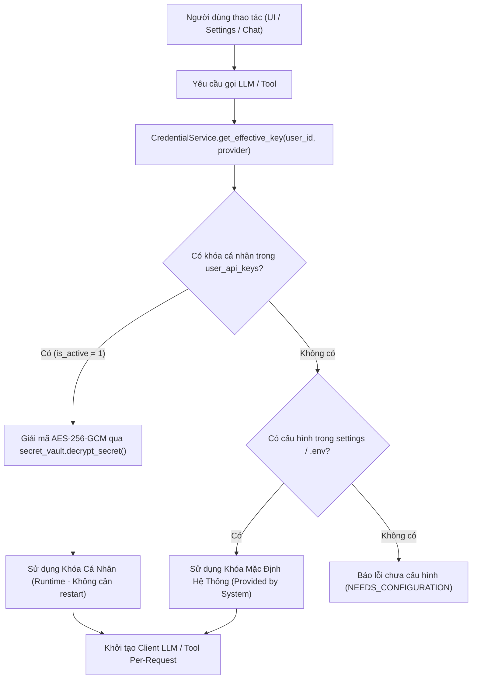

# HỒ SƠ ĐẶC TẢ KỸ THUẬT & HƯỚNG DẪN: QUẢN LÝ API KEYS & TÍCH HỢP DỊCH VỤ (SETTINGS → API KEYS)

## Master Documentation Index — User Settings API Keys & Integrations
### Hệ Thống: Nền Tảng Trợ Lý Ảo AI-Chan (AI-Chan Virtual Assistant Platform)

---

| Thông Tin Quản Trị | Chi Tiết Kỹ Thuật |
| :--- | :--- |
| **Phân Hệ** | **Quản Lý Khóa API & Tích Hợp (User Settings → API Keys & Integrations)** |
| **Thư Mục Lưu Trữ** | `docs/features/api-keys-management/` |
| **Mã Tính Năng** | `FR-SETTINGS-KEYS`, `SEC-015`, `BR-SETTINGS-001..008` |
| **Trạng Thái** | **`IMPLEMENTED (Đã triển khai hoàn tất Full-stack: Frontend + Backend + Migration + Tests)`** |
| **Phiên Bản** | `1.0.0-IMPLEMENTED` |
| **Ngày Hoàn Thành** | `2026-10-18` |
| **Đội Ngũ Phụ Trách** | Senior Full-Stack Engineer, Security Engineer, QA Engineer |
| **Nguyên Tắc Bắt Buộc** | Tuân thủ `AGENTS.md`, `.agents/rules/security.md`, `.agents/rules/ponytail.md`. Không rò rỉ secret. |

---

## 1. Giới Thiệu & Mục Tiêu Kỹ Thuật (Executive Summary)

Phân hệ **Settings → API Keys / Integrations** cung cấp giao diện trực quan và cơ chế backend an toàn cho phép người dùng quản lý các API Key của các nhà cung cấp mô hình AI và dịch vụ tìm kiếm bên ngoài mà **không cần phải mở file và sửa cấu hình thủ công trong file `.env`**.

### Các Trụ Cột Kỹ Thuật Chính:
1. **Bảo Vệ Đa Người Dùng (Multi-User Isolation & Anti-IDOR)**:
   - AI-Chan là ứng dụng đa người dùng với cơ sở dữ liệu `users` và xác thực JWT HttpOnly Cookie.
   - Người dùng thông thường **tuyệt đối không được sửa đổi file `.env` toàn cục** của máy chủ để tránh làm lộ hoặc xung đột credentials giữa các tài khoản.
   - Mỗi người dùng sở hữu kho khóa cá nhân độc lập trong bảng `user_api_keys`, cách ly 100% theo `user_id`.
2. **Mã Hóa Chuẩn Quân Đội Tại Nghỉ (AES-256-GCM Encryption at Rest)**:
   - Toàn bộ khóa API cá nhân được mã hóa bằng thuật toán `AES-256-GCM` với Nonce ngẫu nhiên 96-bit cho mỗi bản ghi thông qua `src/core/secret_vault.py`.
   - Khóa giải mã được dẫn xuất qua chuẩn `HKDF(SHA-256)` từ biến môi trường `AI_CHAN_SECRET_ENCRYPTION_KEY` hoặc `SECRET_KEY`.
   - Khóa plaintext **không bao giờ được lưu trữ trong CSDL, logs, traces, exception hay API responses**.
3. **Thứ Tự Ưu Tiên Rõ Ràng (Precedence Hierarchy)**:
   - **Mức 1 (Cao nhất)**: Khóa cá nhân của người dùng đang đăng nhập (`source: PERSONAL`, lưu trong bảng `user_api_keys`). Áp dụng tức thì ở runtime cho các cuộc hội thoại, Project Chat, Model Nodes và Tools mà không cần khởi động lại máy chủ.
   - **Mức 2 (Mặc định dự phòng)**: Khóa toàn cục được cấu hình trên server qua `.env` (`source: SYSTEM`). Áp dụng khi người dùng chưa cấu hình khóa cá nhân.
   - **Mức 3**: Chưa cấu hình (`source: NONE`).
4. **Kiểm Tra Kết Nối Tức Thì & Khử Nhiễm Secret (Connection Test & Redaction)**:
   - Hỗ trợ endpoint kiểm tra kết nối (Ping / Health Check) trực tiếp tới các nhà cung cấp được allowlist.
   - Đo lường độ trễ mạng (`latency_ms`) và trạng thái (`VALID`, `INVALID`, `ERROR`).
   - Tự động khử nhiễm (redact) 100% các chuỗi bí mật, token, key khỏi thông báo lỗi từ nhà cung cấp trước khi trả về client.
   - Áp dụng Rate Limiting (15 lần/phút/user) nhằm phòng chống lạm dụng hoặc phát sinh chi phí ngoài ý muốn.
5. **Cập Nhật .env Toàn Cục An Toàn Cho Quản Trị Viên (Atomic Local Admin Updates)**:
   - Chỉ cho phép quản trị viên (Admin) hoặc chế độ local development.
   - Nghiêm cấm sửa các secret hệ thống như `SECRET_KEY`, `AI_CHAN_SECRET_ENCRYPTION_KEY`, `DATABASE_URL`.
   - Chỉ cho phép các biến allowlisted: `GEMINI_API_KEY`, `OPENAI_API_KEY`, `ANTHROPIC_API_KEY`, `GROQ_API_KEY`, `OLLAMA_BASE_URL`, `BRAVE_SEARCH_API_KEY`, `SERPAPI_API_KEY`.
   - Cơ chế ghi file nguyên tử (Atomic Write qua file tạm và `os.replace`), tự động tạo file sao lưu `.env.bak`, bảo toàn trọn vẹn comments và cấu trúc file cũ.

---

## 2. Bảng Danh Mục Nhà Cung Cấp & Biến Cấu Hình (Provider Inventory)

| Provider ID | Tên Nhà Cung Cấp | Nhóm Cấu Hình | Biến .env Mặc Định | Mô Tả & Mục Đích | Cơ Chế Kiểm Tra (Validation) | Cần Restart? |
| :--- | :--- | :--- | :--- | :--- | :--- | :---: |
| `google` | **Google Gemini** | LLM Provider | `GEMINI_API_KEY` | Truy cập mô hình Gemini 3.5 Flash, 3.8 Flash, Flash Lite... | Ping nhẹ tới Google Generative AI API | **Không** (Runtime) |
| `openai` | **OpenAI** | LLM Provider | `OPENAI_API_KEY` | Truy cập GPT-4o, GPT-4o Mini và mô hình dự phòng failover | Ping nhẹ tới OpenAI chat/completions | **Không** (Runtime) |
| `anthropic` | **Anthropic Claude** | LLM Provider | `ANTHROPIC_API_KEY` | Truy cập Claude 3.5 / 3.7 Sonnet | Headers verification tới Anthropic Messages API | **Không** (Runtime) |
| `groq` | **Groq Cloud** | LLM Provider | `GROQ_API_KEY` | Suy luận siêu tốc cho Llama 3.3 70B Versatile | GET models endpoint qua Groq Cloud | **Không** (Runtime) |
| `ollama` | **Ollama Local** | LLM / Service | `OLLAMA_BASE_URL` | Endpoint máy chủ Ollama chạy trên localhost hoặc LAN | GET `/api/tags` kiểm tra danh mục mô hình | **Không** (Runtime) |
| `brave` | **Brave Search** | External Search | `BRAVE_SEARCH_API_KEY` | Tìm kiếm dữ liệu web bảo vệ quyền riêng tư cho Tools | Test query tới Brave Search REST API | **Không** (Runtime) |
| `serpapi` | **SerpAPI (Google)** | External Search | `SERPAPI_API_KEY` | Tìm kiếm web đa nguồn qua adapter SerpAPI | Kiểm tra account status qua SerpAPI | **Không** (Runtime) |

> [!NOTE]
> **Về Discord Bot Token**: Theo Kiến trúc Bot Management (`018_multi_discord_bot_management.sql`), Token Discord Bot được quản lý độc lập theo từng bot tại trang **Bot Management (`/bot/discord`)** với mã hóa AES-256-GCM riêng biệt, không trùng lặp và không đưa vào trang User API Keys chung.

---

## 3. Kiến Trúc & Luồng Dữ Liệu (Architecture & Precedence Flow)



---

## 4. Đặc Tả Hợp Đồng API RESTful (API Contract)

Toàn bộ các endpoint đều yêu cầu xác thực JWT (`Cookie: access_token` hoặc `Authorization: Bearer <token>`).

### 4.1. Lấy trạng thái danh mục API Keys
- **Phương thức:** `GET /api/v1/settings/api-keys`
- **Mục đích:** Liệt kê toàn bộ các slots nhà cung cấp kèm trạng thái cấu hình và gợi ý đã che giấu.
- **Mẫu phản hồi thành công (HTTP 200 OK):**
```json
[
  {
    "provider": "google",
    "name": "Google Gemini",
    "category": "LLM",
    "env_var": "GEMINI_API_KEY",
    "description": "API Key truy cập các mô hình Google Gemini...",
    "doc_url": "https://aistudio.google.com/app/apikey",
    "placeholder": "AIzaSy...",
    "is_secret": true,
    "is_configured": true,
    "source": "PERSONAL",
    "masked_hint": "****cdef",
    "has_personal_key": true,
    "has_system_key": true,
    "validation_status": "VALID",
    "last_validated_at": "2026-10-18T10:30:00Z",
    "last_error_summary": null,
    "updated_at": "2026-10-18T10:25:00Z",
    "requires_restart": false
  }
]
```

### 4.2. Lưu / Cập nhật khóa cá nhân
- **Phương thức:** `PUT /api/v1/settings/api-keys/{provider}`
- **Request Body:**
```json
{
  "api_key": "sk-proj-..."
}
```
- **Mẫu phản hồi thành công (HTTP 200 OK):**
```json
{
  "status": "success",
  "provider": "openai",
  "source": "PERSONAL",
  "masked_hint": "****1234",
  "validation_status": "NOT_TESTED",
  "message": "Đã lưu khóa API cho nhà cung cấp OpenAI thành công (áp dụng tức thì)."
}
```

### 4.3. Xóa / Hoàn tác khóa cá nhân
- **Phương thức:** `DELETE /api/v1/settings/api-keys/{provider}`
- **Mục đích:** Xóa khóa cá nhân trong bảng `user_api_keys`. Hệ thống sẽ tự động hoàn tác về sử dụng cấu hình mặc định `.env` của server.

### 4.4. Kiểm tra kết nối (Test Connection)
- **Phương thức:** `POST /api/v1/settings/api-keys/{provider}/test`
- **Request Body (Tùy chọn):**
```json
{
  "candidate_key": "sk-proj-..."
}
```
*(Nếu `candidate_key` để trống, hệ thống sẽ kiểm tra khóa cá nhân đã lưu hoặc khóa mặc định của server).*
- **Mẫu phản hồi (HTTP 200 OK):**
```json
{
  "healthy": true,
  "provider": "google",
  "latency_ms": 135,
  "validation_status": "VALID",
  "message": "Kết nối thành công với Google Gemini (độ trễ 135ms).",
  "tested_at": "2026-10-18T10:35:00Z"
}
```

### 4.5. Cập nhật biến môi trường hệ thống (Admin only)
- **Phương thức:** `POST /api/v1/settings/api-keys/system`
- **Quyền:** Quản trị viên (email chứa admin) hoặc chế độ local dev (`DEBUG=True`). Người dùng thường bị chặn `HTTP 403 Forbidden`.
- **Request Body:**
```json
{
  "env_var": "GEMINI_API_KEY",
  "value": "AIzaSy..."
}
```

---

## 5. Lược Đồ Dữ Liệu (Database Schema)

Được áp dụng qua bản di chuyển dữ liệu: `ai-backend/database/migrations/019_user_api_keys_management.sql`.

```sql
CREATE TABLE IF NOT EXISTS user_api_keys (
    id VARCHAR(36) PRIMARY KEY,
    user_id VARCHAR(36) NOT NULL REFERENCES users(id) ON DELETE CASCADE,
    provider VARCHAR(50) NOT NULL,
    key_ciphertext TEXT NOT NULL,
    key_last4 VARCHAR(10) NOT NULL,
    key_fingerprint VARCHAR(64),
    validation_status VARCHAR(20) NOT NULL DEFAULT 'NOT_TESTED' CHECK (validation_status IN ('NOT_TESTED', 'VALID', 'INVALID', 'ERROR')),
    last_validated_at TIMESTAMP,
    last_error_summary TEXT,
    is_active BOOLEAN NOT NULL DEFAULT 1 CHECK (is_active IN (0, 1)),
    created_at TIMESTAMP NOT NULL DEFAULT CURRENT_TIMESTAMP,
    updated_at TIMESTAMP NOT NULL DEFAULT CURRENT_TIMESTAMP,
    UNIQUE(user_id, provider)
);

CREATE INDEX IF NOT EXISTS idx_user_api_keys_user_id ON user_api_keys(user_id);
CREATE INDEX IF NOT EXISTS idx_user_api_keys_provider ON user_api_keys(provider);
CREATE INDEX IF NOT EXISTS idx_user_api_keys_user_provider ON user_api_keys(user_id, provider);
```

---

## 6. Hướng Dẫn Sử Dụng Dành Cho Người Dùng (End-User Guide)

Dành cho người dùng không có kiến thức kỹ thuật sâu:

1. **Truy cập trang cài đặt:**
   - Trên thanh điều hướng bên trái hoặc menu trên cùng, nhấp vào **Settings (Cài đặt)**.
   - Chọn tab **API Keys & Integrations** (hoặc truy cập trực tiếp URL `/settings?tab=api-keys`).
2. **Xem trạng thái các nhà cung cấp:**
   - Mỗi nhà cung cấp (Google Gemini, OpenAI, Claude, Groq, Ollama...) sẽ hiển thị nhãn:
     - 🟣 **Khóa cá nhân**: Bạn đã thiết lập khóa riêng cho tài khoản của mình.
     - 🔵 **Mặc định hệ thống**: Server đã có sẵn khóa dùng chung cho bạn.
     - ⚪ **Chưa cấu hình**: Bạn cần cung cấp khóa để sử dụng mô hình/công cụ này.
3. **Thêm hoặc đổi khóa API:**
   - Nhấp vào nút **"Đổi khóa"** hoặc **"Ghi đè bằng khóa cá nhân"**.
   - Dán mã khóa API vào ô nhập (nội dung được che bằng dấu chấm để bảo mật). Bạn có thể bấm biểu tượng mắt để xem lại.
   - Bấm **"Lưu khóa"**. Khóa sẽ được mã hóa an toàn và áp dụng ngay lập tức cho các cuộc trò chuyện của bạn!
4. **Kiểm tra kết nối (Test kết nối):**
   - Bấm nút **"Test kết nối"** bên cạnh mỗi nhà cung cấp để kiểm tra xem khóa có hoạt động tốt và xem độ trễ mạng thực tế.
5. **Xóa khóa cá nhân:**
   - Nếu bạn không muốn dùng khóa cá nhân nữa, bấm nút **"Xóa khóa"**. Hệ thống sẽ tự động hoàn tác về sử dụng cấu hình mặc định của server mà không làm mất dữ liệu tin nhắn cũ.
6. **Lưu ý quan trọng**:
   - Khóa cá nhân **áp dụng ngay tức thì** mà không cần khởi động lại ứng dụng.
   - Tuyệt đối không gửi khóa API thật vào nội dung chat với bot.

---

## 7. Báo Cáo Kiểm Thử & Nghiệm Thu (QA & Verification)

Đã chạy toàn bộ bộ kiểm thử tự động trên repository:

1. **Bộ kiểm thử API Keys Backend (`tests/test_user_api_keys.py`):**
   - `test_list_api_keys_unauthenticated_forbidden`: Chặn 401 khi chưa xác thực.
   - `test_list_api_keys_returns_all_providers_without_secrets`: Trả về đúng 7 providers, không rò rỉ secret.
   - `test_save_user_key_encrypts_at_rest`: Kiểm chứng dữ liệu trong SQLite là ciphertext AES-256-GCM.
   - `test_user_isolation`: Kiểm chứng tính cô lập, User B không thể truy cập khóa User A.
   - `test_rejection_of_unsupported_provider`: Chặn 400 đối với nhà cung cấp ngoài allowlist.
   - `test_delete_user_key_reverts_precedence`: Xóa khóa cá nhân hoàn tác về cấu hình server.
   - `test_validate_connection_redacts_secrets_in_error`: Khử nhiễm secret trong chuỗi thông báo lỗi.
   - `test_system_env_update_forbidden_for_regular_user`: Chặn người dùng thường chỉnh sửa `.env`.
   - `test_system_env_update_rejects_non_allowlisted_variables`: Chặn sửa biến nhạy cảm như `SECRET_KEY`.
   - **Kết quả: 9/9 passed (100%)**.

2. **Hồi quy toàn bộ Backend Test Suite (`pytest`):**
   - **255 passed, 0 failed** trong 1 phút 44 giây.

3. **Bộ kiểm thử Frontend (`npm test`):**
   - **52 passed, 0 failed** (bao gồm 6 kịch bản kiểm thử API Keys Service & Masking Invariants).

4. **Kiểm tra kiểu dữ liệu tĩnh (`npx tsc --noEmit`):**
   - **0 errors** (Clean compilation).

5. **Bộ công cụ kiểm định dự án (`tools/validators/run_all.py`):**
   - **Failed checks: 0 (Validation complete)**.
