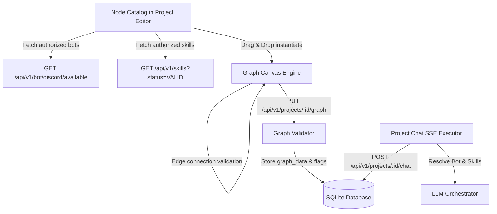

# Architecture Specification: Project Canvas Bots and Skills Subsystem

## 1. System Boundary and Resource Lifecycle


## 2. Cardinality & Connection Rules
1. **Model -> Bot**:
   - `0..1` relationship.
   - When 0 bots are connected: Model executes as a standalone web project.
   - When 1 bot is connected: Model binds to the verified Discord bot instance.
   - Attempting to connect a second Bot to the same Model is rejected in real time with the message:
     `"This model can be connected to only one bot. Remove the existing bot connection before selecting another."`
   - The UI never silently replaces or deletes an existing bot connection.
2. **Model -> Skills**:
   - `0..N` relationship.
   - Multiple distinct skills can connect to a single Model.
   - Duplicate edges connecting the same Model to the same Skill are rejected with `"This connection already exists."`
   - Adding or removing a Skill preserves the existing Bot connection and sibling Skills.
3. **Handle & Direction Topology**:
   - Source: Model (`out` handle).
   - Target:
     - Bot node (`bot_in` handle).
     - Skill node (`skill_in` handle).
     - Output node (`in` handle).
   - Reverse attempts (`Bot -> Model`, `Skill -> Model`, `Output -> Model`) are rejected.

## 3. Authoritative Identification vs. Presentation
- `id`: Stable occurrence ID inside graph (e.g. `node_bot_1710000000`, `node_skill_1710000000`).
- `config.bot_id`: Stable reference to `discord_bot_configs.id`.
- `config.skill_id`: Stable reference to `skills.id`.
- `label`: Visual display name. Can be updated without altering the authoritative binding.

## 4. Execution Runtime Semantics
- At project chat invocation (`/api/v1/projects/{project_id}/chat`):
  1. Verifies project is `ACTIVE`.
  2. Resolves connected Bot node: verifies bot config exists, is enabled, and user is Discord-linked.
  3. Resolves connected Skill nodes: deduplicates referenced IDs, verifies skills exist and are in `VALID` status.
  4. Reads `SKILL.md` or falls back to skill `description`, appending structured guidelines:
     ```markdown
     --- ACTIVE SKILLS INSTRUCTIONS ---
     ### Skill: <name>
     <instructions>
     --- END SKILLS INSTRUCTIONS ---
     ```
  5. Emits `event: start` SSE payload with `bot` and `skills` metadata.
