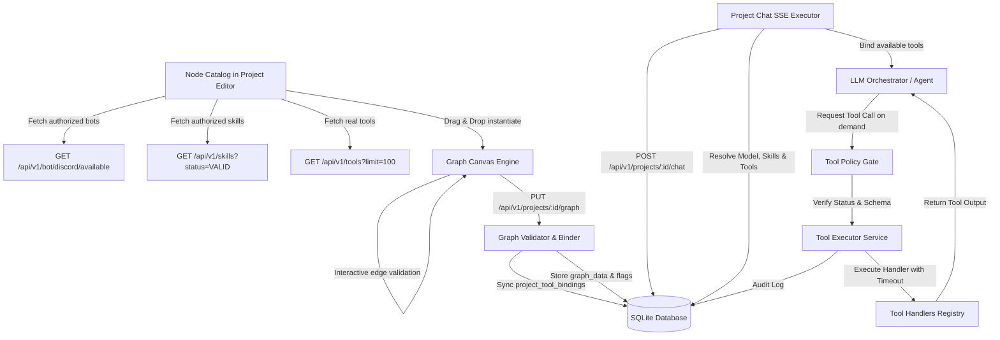

# Architecture Specification: Project Canvas Bots, Skills, and Tools Subsystem

## 1. System Boundary and Resource Lifecycle


## 2. Cardinality & Connection Rules
1. **Model -> Bot**:
   - `0..1` relationship.
   - When 0 bots are connected: Model executes as a standalone web project.
   - When 1 bot is connected: Model binds to the verified Discord bot instance.
   - Attempting to connect a second Bot to the same Model is rejected in real time with the message:
     `"This model can be connected to only one bot. Remove the existing bot connection before selecting another."`
   - The UI never silently replaces or deletes an existing bot connection.
2. **Model -> Skills**:
   - `0..N` relationship.
   - Multiple distinct skills can connect to a single Model.
   - Duplicate edges connecting the same Model to the same Skill are rejected with `"This connection already exists."`
   - Adding or removing a Skill preserves the existing Bot connection and sibling Skills.
3. **Model -> Tools (1:N)**:
   - `0..N` relationship.
   - A single Model can be connected to multiple distinct Tool Nodes (e.g., `calculator`, `convert_units`, `date_time_info`).
   - Each Tool Node instance belongs to at most one Model Node in a graph.
   - Connecting duplicate tool types to the same Model is rejected with `"Phát hiện công cụ trùng lặp '<tool_id>' trong cùng một Model."`
   - Edge semantics: `MODEL_TOOL` availability binding (`Model -> Tool`, handle `out` -> `tool_in`, sky-blue stroke `#0ea5e9`).
   - Reverse attempts (`Tool -> Model`, `Bot -> Model`, `Skill -> Model`, `Output -> Model`) are strictly rejected.

## 3. Authoritative Identification vs. Presentation
- `id`: Stable occurrence ID inside graph (e.g. `node_bot_1710000000`, `node_skill_1710000000`, `node_tool_1710000000`).
- `config.bot_id`: Stable reference to `discord_bot_configs.id`.
- `config.skill_id`: Stable reference to `skills.id`.
- `config.tool_id`: Stable reference to `tools.id` in Tool Registry.
- `config.is_enabled`: Toggle flag determining if tool is active in runtime binding.
- `config.custom_timeout_seconds`: Instance-specific execution timeout override.
- `label`: Visual display name. Can be updated without altering the authoritative binding.

## 4. Execution Runtime Semantics
- At project chat invocation (`POST /api/v1/projects/{project_id}/chat`):
  1. Verifies project is `ACTIVE`.
  2. Resolves connected Bot node: verifies bot config exists, is enabled, and user is Discord-linked.
  3. Resolves connected Skill nodes: deduplicates referenced IDs, verifies skills exist and are in `VALID` status.
  4. Resolves connected Tool nodes:
     - Verifies tool exists in Tool Registry and is in `AVAILABLE` status (raises HTTP 422 `TOOL_DISABLED` if disabled).
     - Checks `project_tool_bindings` for instance enablement and timeout overrides.
     - Formats tool definitions with `id`, `name`, `description`, `input_schema`, and `timeout_seconds`.
  5. Injects structured active skills instructions and available tools manifest into the system prompt:
     ```markdown
     --- ACTIVE SKILLS INSTRUCTIONS ---
     ### Skill: <name>
     <instructions>
     --- END SKILLS INSTRUCTIONS ---

     --- AVAILABLE TOOLS FOR THIS MODEL ---
     - **<name>** (`<tool_id>`): <description>
     --- END AVAILABLE TOOLS ---
     ```
  6. Emits `event: start` SSE payload with `bot`, `skills`, and `tools` metadata.
  7. Passes formatted tools to `chat_agent.astream_agent`:
     - Model binds tool definitions.
     - Model decides whether to reply directly or request tool calls.
     - When model requests a tool call, `ToolExecutorService.execute_tool` validates arguments against schema, verifies project binding, executes handler under timeout limit, audits execution to `tool_executions`, and feeds results back to model cycle.
     - The system **never** runs all tools automatically on every message.
