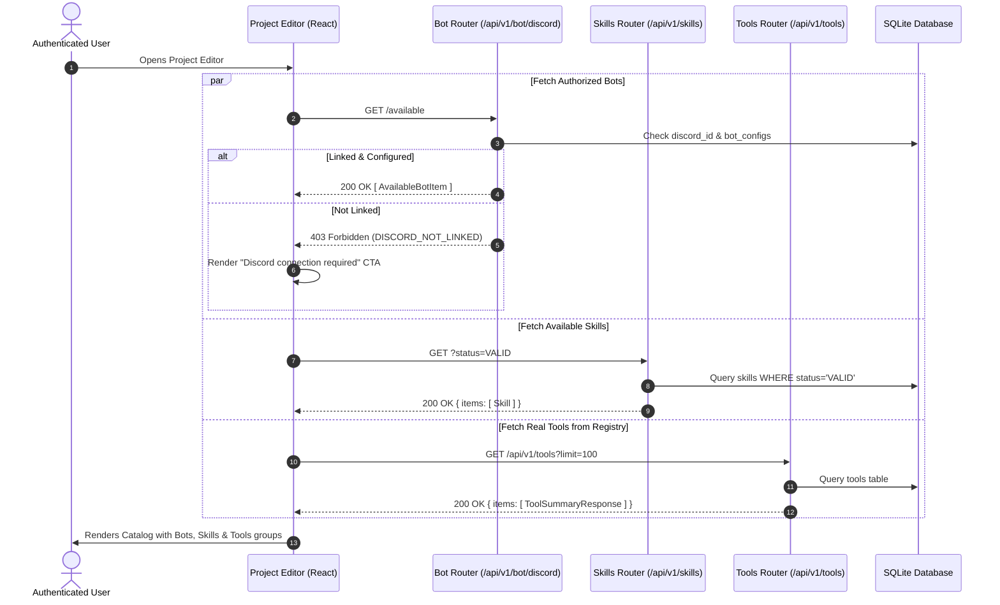
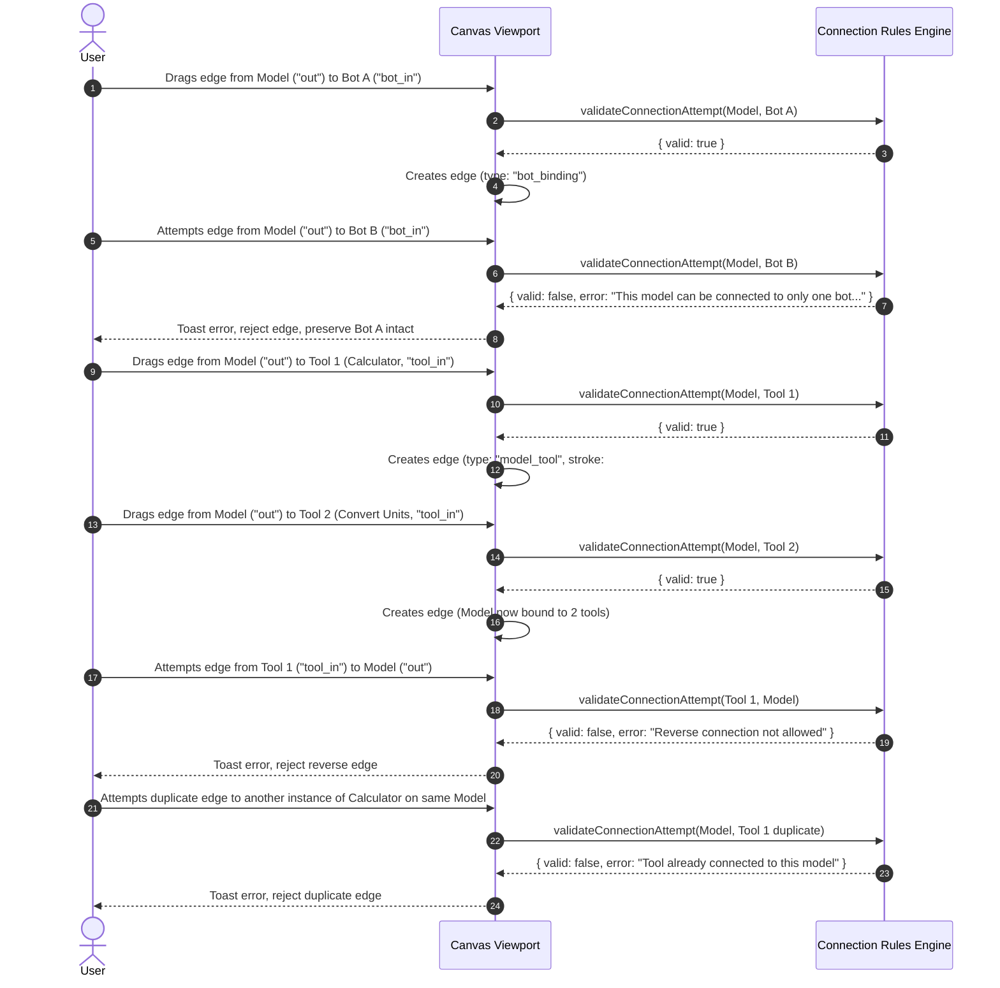
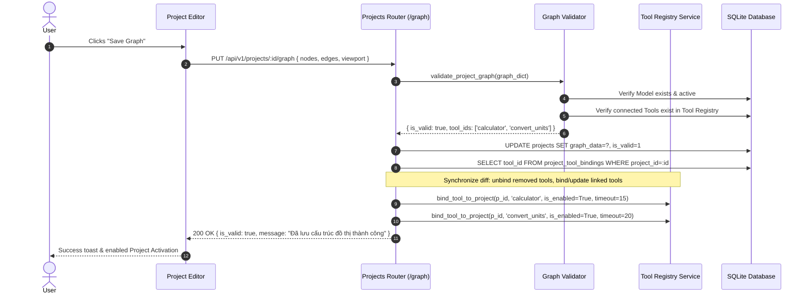
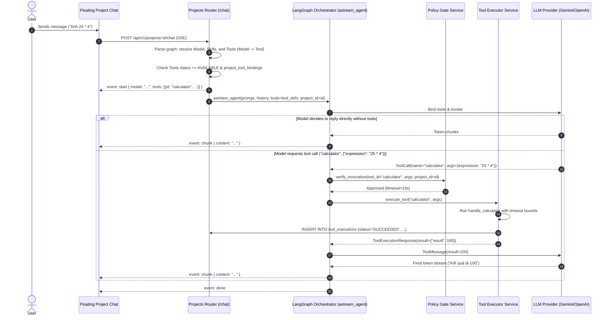
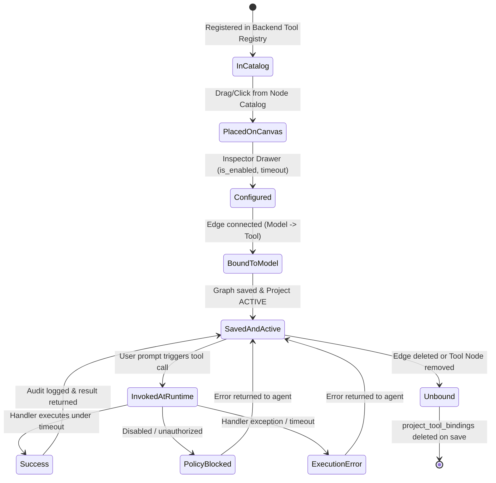
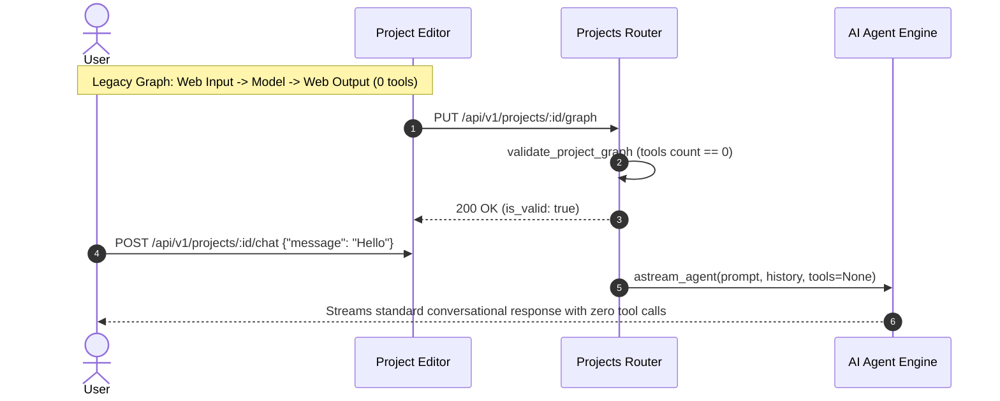

# Diagrams: Project Canvas Bots, Skills, and Tools Subsystem

## 1. Catalog Discovery & Dynamic Loading

## 2. Interactive Connection Validation (Single Bot, Multi Skills, Multi Tools)

## 3. Graph Saving & Project Tool Bindings Synchronization

## 4. Project Chat Execution Runtime with On-Demand Tool Calling

## 5. Tool Node Lifecycle State Machine

## 6. Regression Flow for Legacy Graph without Tools

