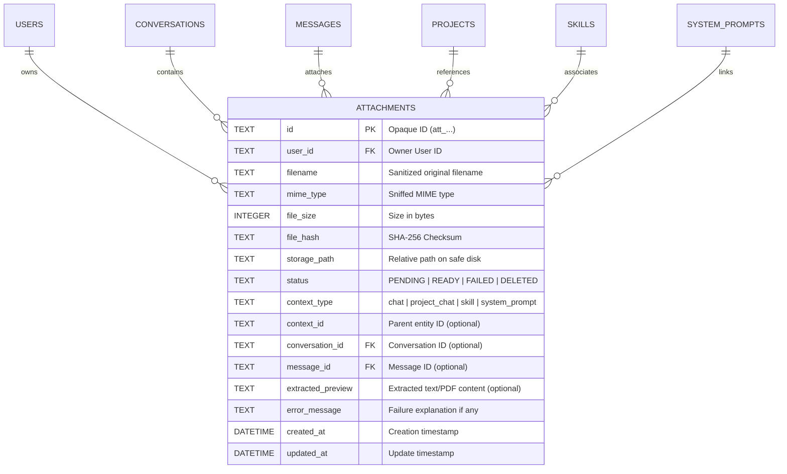

# 02 - Kiến trúc Dữ liệu và Hợp đồng API (Data Model & API Contracts)

## 1. Mô hình Dữ liệu (Entity Relationship Diagram)



---

## 2. Đặc tả Hợp đồng REST API (`/api/v1/attachments`)

### 2.1 `GET /api/v1/attachments/capabilities`
Truy vấn khả năng xử lý modality và giới hạn dung lượng của hệ thống.
- **Quyền hạn:** Mọi người dùng đã đăng nhập hoặc khách hợp lệ.
- **Response 200 OK:**
```json
{
  "default_provider": "google",
  "max_file_size_mb": 20,
  "max_files_per_request": 5,
  "allowed_categories": ["image", "text", "document", "code"],
  "supported_mime_types": [
    "image/png", "image/jpeg", "image/webp", "image/gif",
    "text/plain", "text/markdown", "application/pdf",
    "application/json", "text/csv", "text/html"
  ],
  "models": [
    {
      "model_id": "gemini-2.5-flash",
      "provider": "google",
      "supports_images": true,
      "supports_pdf_native": true,
      "supports_text_documents": true,
      "max_file_size_mb": 20
    },
    {
      "model_id": "gpt-4o",
      "provider": "openai",
      "supports_images": true,
      "supports_pdf_native": false,
      "supports_text_documents": true,
      "max_file_size_mb": 20
    }
  ]
}
```

---

### 2.2 `POST /api/v1/attachments/upload`
Tải lên một tệp nhị phân cục bộ.
- **Content-Type:** `multipart/form-data`
- **Form Fields:**
  - `file`: Binary file stream (bắt buộc)
  - `context_type`: `"chat"` | `"project_chat"` | `"skill"` | `"system_prompt"` (tùy chọn, mặc định `"chat"`)
  - `context_id`: ID của thực thể cha (project id / skill id / prompt id, tùy chọn)
  - `conversation_id`: ID phiên trò chuyện (tùy chọn)
- **Response 200 OK:**
```json
{
  "id": "att_a1b2c3d4e5f6...",
  "user_id": "guest_user",
  "filename": "annual_report.pdf",
  "mime_type": "application/pdf",
  "file_size": 245760,
  "status": "READY",
  "context_type": "chat",
  "context_id": null,
  "created_at": "2026-10-17T01:30:00Z",
  "extracted_preview": "Báo cáo thường niên 2026...",
  "download_url": "/api/v1/attachments/att_a1b2c3d4e5f6.../download",
  "view_url": "/api/v1/attachments/att_a1b2c3d4e5f6.../view"
}
```
- **Error Codes:**
  - `422 Unprocessable Entity`: `{"error_code": "EMPTY_FILE", "message": "Tệp rỗng không có nội dung."}`
  - `422 Unprocessable Entity`: `{"error_code": "EXECUTABLE_FILE_BLOCKED", "message": "Tệp thực thi hoặc kịch bản không được phép tải lên."}`
  - `413 Request Entity Too Large`: `{"error_code": "FILE_TOO_LARGE", "message": "Kích thước tệp vượt quá 20MB."}`

---

### 2.3 `GET /api/v1/attachments/`
Liệt kê danh sách tệp đính kèm theo bộ lọc ngữ cảnh của người dùng hiện tại (Anti-IDOR).
- **Query Parameters:** `context_type`, `context_id`, `conversation_id`, `limit`, `offset`.
- **Response 200 OK:**
```json
{
  "items": [ /* Danh sách AttachmentItem */ ],
  "total": 1,
  "limit": 50,
  "offset": 0
}
```

---

### 2.4 `GET /api/v1/attachments/{attachment_id}`
Lấy thông tin chi tiết một tệp đính kèm.
- **Kiểm tra quyền sở hữu:** Nếu tệp không tồn tại hoặc thuộc người dùng khác -> Trả về `404 Not Found`.

---

### 2.5 `GET /api/v1/attachments/{attachment_id}/download`
Tải xuống tệp gốc dạng tệp đính kèm (`Content-Disposition: attachment; filename="..."`).

### 2.6 `GET /api/v1/attachments/{attachment_id}/view`
Xem trước tệp nội tuyến (`Content-Disposition: inline; filename="..."`). Hỗ trợ hiển thị ảnh và tài liệu an toàn.

---

### 2.7 `DELETE /api/v1/attachments/{attachment_id}`
Xóa tệp đính kèm và dọn dẹp đĩa an toàn.
- **Quyền hạn:** Chỉ chủ sở hữu mới có quyền xóa.
- **Response 200 OK:** `{"status": "deleted", "id": "att_..."}`

---

## 3. Mở rộng Payload Streaming Chat

### 3.1 Chat thường: `POST /api/v1/conversations/{id}/messages/stream`
- **Request Body:**
```json
{
  "content": "Hãy tóm tắt tài liệu này giúp tôi",
  "model": "gemini-2.5-flash",
  "attachments": ["att_a1b2c3d4e5f6...", "att_f7e8d9c0..."]
}
```

### 3.2 Project Chat: `POST /api/v1/projects/{id}/chat`
- **Request Body:**
```json
{
  "message": "Phân tích sơ đồ hệ thống trong ảnh đính kèm",
  "conversation_id": "conv_98765...",
  "attachments": ["att_photo123..."]
}
```
Backend tự động kiểm tra `Anti-IDOR` cho từng attachment ID trong danh sách trước khi khởi chạy agent.
