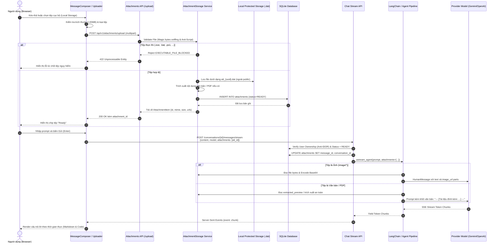
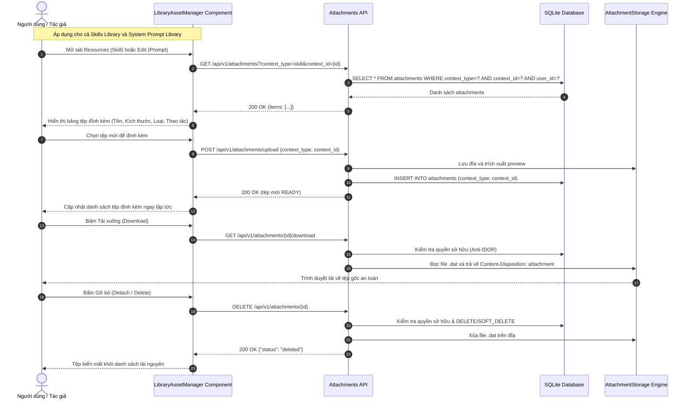
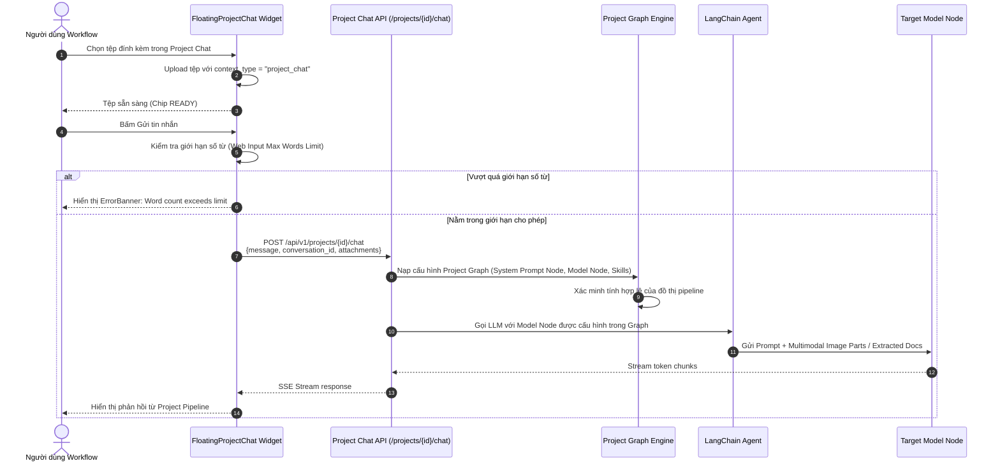

# 03 - Sơ đồ Tuần tự và Luồng Thực thi (Sequence Diagrams & Flows)

## 1. Luồng Upload Tệp và Gửi Tin nhắn Chat (Chat Attachment Flow)

---

## 2. Luồng Quản lý Tài nguyên Thư viện (Library Asset Flow)

---

## 3. Luồng Đính kèm Tệp trong Project Workflow (Project Chat Flow)

