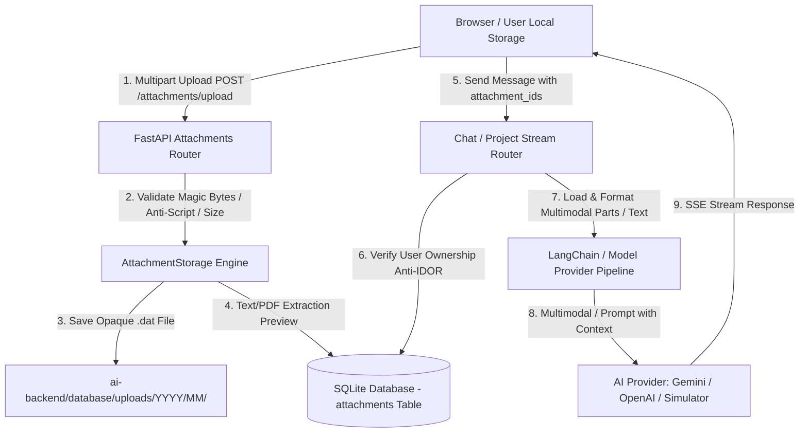

# Unified File Upload System (Hệ thống Upload File dùng chung)

## 1. Giới thiệu tổng quan
Hệ thống **Unified File Upload** trong AI-Chan giải quyết bài toán xử lý và quản lý tệp đính kèm cục bộ (Local Storage) từ trình duyệt của người dùng cho 4 trụ cột nghiệp vụ:
1. **Standard Chat (Chat thông thường):** Đính kèm tệp văn bản, tài liệu, mã nguồn hoặc hình ảnh vào lượt trò chuyện. Hỗ trợ truyền đa phương tiện trực tiếp (Native Multimodal Parts) cho mô hình hỗ trợ (ví dụ Gemini, GPT-4o) hoặc trích xuất văn bản an toàn (Text & PDF extraction fallback).
2. **Project Chat (Interactive Workflow Chat):** Đính kèm tệp trực tiếp trong floating chat widget hoặc main chat workspace khi chạy workflow, đồng thời tuân thủ toàn vẹn cấu hình Project Graph (System Prompt Node, Model Node, Skills Node, Web Input word limit).
3. **Skills Library:** Quản lý và lưu trữ các tệp tài nguyên tham chiếu, hướng dẫn hoặc dữ liệu hỗ trợ gắn liền với Skill trong thư viện; tách biệt rõ ràng việc lưu trữ an toàn với việc thực thi runtime.
4. **System Prompt Library:** Quản lý và lưu trữ các tài liệu ngữ cảnh mẫu cho System Prompt trong thư viện, đảm bảo quyền sở hữu cá nhân và không tự ý bơm tài liệu vào context khi chưa kích hoạt.

---

## 2. Kiến trúc giải pháp (Architecture & Design)

### 2.1 Các nguyên tắc cốt lõi
- **Không gửi path giả / local path:** Trình duyệt không thể và không được gửi đường dẫn tệp trên máy người dùng lên backend. Tệp được truyền qua multipart/form-data thực sự.
- **Lưu trữ an toàn, không lộ file thực:** Tệp được lưu dưới định dạng `.dat` tại `ai-backend/database/uploads/{YYYY}/{MM}/{attachment_id}.dat` ngoài web public root, đường dẫn được bảo vệ chống Path Traversal và ngăn ngừa thực thi script (`.exe`, `.bat`, `.ps1`, `.sh`, `.php` bị từ chối triệt để).
- **Kiểm tra loại tệp thực tế (Magic Bytes):** Sử dụng thư viện `filetype` để phát hiện chữ ký nhị phân thực tế, không tin cậy tuyệt đối phần mở rộng hay header `Content-Type` từ client.
- **Bảo vệ quyền truy cập (Anti-IDOR):** Mọi API truy vấn, tải xuống, xem trước, gỡ liên kết hoặc đưa vào context mô hình đều kiểm tra quyền sở hữu `user_id` của phiên đăng nhập hiện tại.
- **Tách biệt Storage và Runtime Context:** Các tài nguyên trong Thư viện Skill / System Prompt được lưu giữ an toàn và chỉ tải xuống/xem khi người dùng yêu cầu, không tự ý bơm toàn bộ nhị phân vào mọi prompt gây tràn context và tốn chi phí token.

---

## 3. Bản đồ thành phần (Component Map)

### 3.1 Backend (`ai-backend`)
| File / Module | Nhiệm vụ |
| :--- | :--- |
| `database/migrations/015_unified_file_upload_system.sql` | Migration tạo bảng `attachments` và các ràng buộc toàn vẹn |
| `src/core/attachment_storage.py` | Engine lưu trữ đĩa an toàn, kiểm tra magic bytes, SHA-256, trích xuất text/PDF |
| `src/core/config.py` | Cấu hình `UPLOAD_DIR`, `MAX_FILE_SIZE_MB: 20`, `MAX_FILES_PER_REQUEST: 5` |
| `src/api/v1/attachments.py` | REST API: upload, capabilities, download, view, delete, list |
| `src/api/v1/chat.py` | Xác thực IDOR, liên kết message_id và conversation_id, chuyển parts tới LLM |
| `src/api/v1/projects.py` | Xử lý attachments cho Project Chat, tôn trọng graph validation |
| `src/api/v1/conversations.py` | Trả về danh sách attachments đã format trong lịch sử tin nhắn |
| `src/api/v1/prompts.py` | Truy vấn và trả về attachments gắn liền với System Prompt |
| `src/api/v1/skills.py` | Truy vấn và trả về attachments gắn liền với Skill |
| `llm/agent.py` | Đóng gói `HumanMessage` đa phương tiện (Base64 data URL cho ảnh, delimited text cho docs) |

### 3.2 Frontend (`ai-frontend`)
| File / Module | Nhiệm vụ |
| :--- | :--- |
| `src/services/attachmentService.ts` | Service API client xử lý upload tiến độ (XHR), capabilities, CRUD |
| `src/components/ui/AttachmentUploader.tsx` | Export `AttachmentButton`, `ComposerAttachmentChips`, `MessageAttachments`, `LibraryAssetManager` |
| `src/components/chat/MessageComposer.tsx` | Nút chọn tệp toolbar, kéo-thả dropzone, quản lý chip tệp đang tải |
| `src/components/chat/ChatWorkspace.tsx` | Hiển thị thumbnail ảnh & card xem/tải tài liệu trong bong bóng chat |
| `src/components/chat/FloatingProjectChat.tsx` | Upload tệp & xem attachments ngay trên interactive workflow floating widget |
| `src/app/(app)/chat/page.tsx` | Điều phối gửi tệp cho Chat thường và Project workflow, duy trì lịch sử |
| `src/app/(app)/skills/[id]/page.tsx` | Tích hợp `LibraryAssetManager` trong tab Resources của Skill Editor |
| `src/app/(app)/prompts/[id]/edit/page.tsx` | Tích hợp `LibraryAssetManager` trong trang chỉnh sửa System Prompt |

---

## 4. Hướng dẫn sử dụng nhanh (User Guide)

### 4.1 Đính kèm tệp trong Chat thường và Project Chat
1. Tại khung nhập tin nhắn, nhấn biểu tượng **Kẹp giấy (Paperclip)** hoặc **kéo-thả (drag-and-drop)** tệp từ máy tính vào khung chat.
2. Tệp sẽ hiển thị chip trạng thái (Uploading % -> Ready). Bạn có thể bấm nút `✕` để gỡ bỏ hoặc bấm `Retry` nếu lỗi.
3. Nhập câu hỏi và nhấn **Gửi (Enter)**.
4. Tin nhắn của bạn sẽ hiển thị thumbnail xem trước (với ảnh) hoặc thẻ tài liệu (với PDF/code/text) kèm nút tải xuống/xem trực tiếp. Mô hình sẽ phân tích trực tiếp nội dung tệp để trả lời.

### 4.2 Quản lý tài nguyên trong Skills Library
1. Truy cập **Skills** -> Chọn Skill cần quản lý -> Chuyển sang tab **Resources**.
2. Tại khu vực **Tài nguyên hỗ trợ (Library Assets)**, kéo-thả hoặc chọn tệp từ máy tính.
3. Danh sách tệp sẽ hiển thị tên tệp, kích thước, định dạng và trạng thái. Bạn có thể nhấn **Xem (View)**, **Tải xuống (Download)** hoặc **Gỡ bỏ (Detach)**.

### 4.3 Quản lý tài nguyên trong System Prompt Library
1. Truy cập **System Prompts** -> Bấm **Sửa (Edit)** prompt mong muốn.
2. Cuộn xuống khu vực **Tài nguyên đính kèm hỗ trợ (Prompt Library Assets)**.
3. Tải lên các tài liệu tham chiếu mẫu. Tệp được lưu độc lập, không làm phình prompt text và có thể tải về bất cứ lúc nào.
