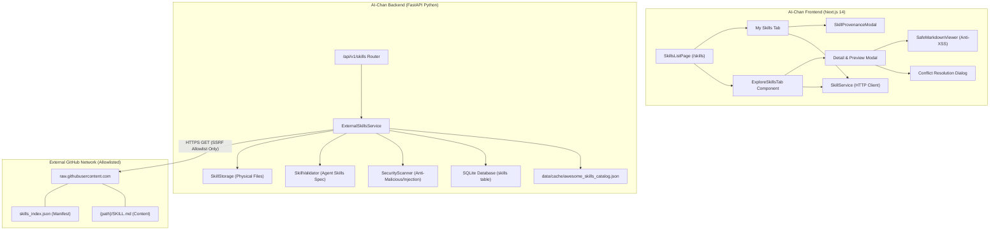
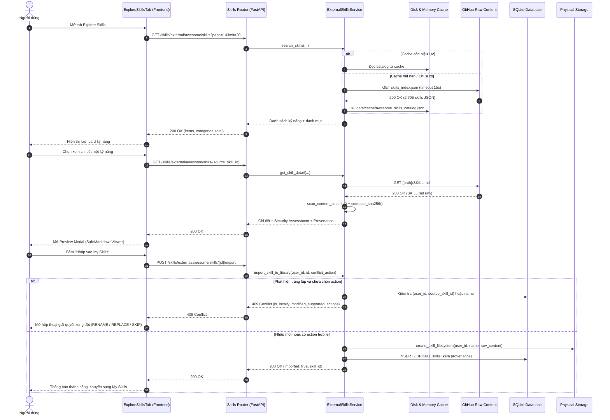
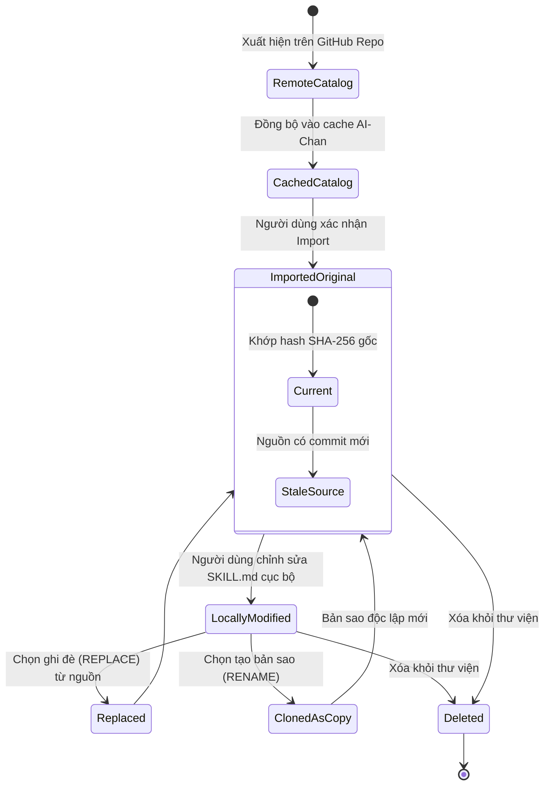

# Đặc Tả Kỹ Thuật: Tích Hợp Thư Viện Skills AI-Chan Với Awesome Skills Catalog

**Mã tài liệu**: `FEAT-EXT-SKILLS-CATALOG`  
**Trạng thái**: `IMPLEMENTED`  
**Phiên bản**: `1.0.0`  
**Ngày hoàn thiện**: `18/10/2026`  
**Tác giả**: Antigravity Full-Stack & Integration Architecture Team  

---

## 1. Giới Thiệu & Mục Tiêu Nghiệp Vụ

### 1.1 Bối Cảnh & Mục Tiêu Người Dùng
Thư viện Agent Skills trong AI-Chan cho phép người dùng mở rộng năng lực trợ lý ảo bằng các chỉ dẫn và tài nguyên chuẩn hóa (`SKILL.md`). Tuy nhiên, việc tự viết hoặc sao chép thủ công từng kỹ năng từ cộng đồng gây mất nhiều thời gian và dễ phát sinh lỗi định dạng.

Tính năng **Tích Hợp Thư Viện Skills AI-Chan Với Awesome Skills** kết nối trực tiếp website AI-Chan với kho lưu trữ cộng đồng `sickn33/agentic-awesome-skills` (canonical URL được chuyển hướng từ `antigravity-awesome-skills`), cung cấp cho người dùng khả năng:
1. Duyệt và tìm kiếm danh mục hơn 2.700 kỹ năng phong phú theo tên, mô tả, danh mục và mức độ rủi ro (Risk Level).
2. Xem trước nội dung kỹ năng (`SKILL.md`) với trình hiển thị an toàn chống mã độc (**Safe Markdown Viewer**).
3. Kiểm tra thông tin bản quyền (License), ghi nhận tác giả (Attribution) và cảnh báo an ninh nội dung (Security Assessment).
4. Nhập kỹ năng vào thư viện cá nhân (`My Skills`) với quy trình xác nhận minh bạch và cơ chế phát hiện trùng lặp/giải quyết xung đột thông minh (**Conflict Resolution**).
5. Lưu trữ và truy xuất đầy đủ thông tin nguồn gốc (**Provenance Metadata**) cho mọi kỹ năng được nhập về.

### 1.2 Phân Biệt Khái Niệm Trạng Thái Kỹ Năng
Hệ thống phân định rạch ròi 3 tầng khái niệm:
- **External Catalog Skill**: Bản ghi dữ liệu đọc từ nguồn bên ngoài (Awesome Skills), được lưu tạm trong bộ nhớ đệm (Cache) của hệ thống. Kỹ năng này **chưa** nằm trong thư viện riêng của người dùng.
- **Imported Skill**: Kỹ năng đã được người dùng chủ động chọn và xác nhận nhập vào thư viện cá nhân. Dữ liệu đã được lưu trữ vật lý tại `data/storage/skills/{user_id}/{name}/SKILL.md` và ghi nhận bản ghi trong bảng `skills` với định danh nguồn gốc `source_provider = 'awesome-skills'`.
- **Runtime Activated / Project Node Skill**: Kỹ năng sau khi nhập có thể được hiển thị trong Project Node Catalog, nhưng **tuyệt đối không tự động gắn vào Project** hay tự động nạp vào phiên làm việc thời gian thực của mô hình khi chưa có thao tác kết nối từ người dùng.

---

## 2. Xác Minh Nguồn Gốc & Chính Sách Bản Quyền

### 2.1 Kết Quả Xác Minh Kho Lưu Trữ Nguồn (Fact Check)
- **Repository URL đầu vào**: `https://github.com/sickn33/antigravity-awesome-skills`
- **Canonical Repository thực tế**: `https://github.com/sickn33/agentic-awesome-skills` (Đã kiểm tra chuyển hướng HTTP và xác thực qua GitHub API).
- **Nhánh mặc định**: `main`.
- **Tệp chỉ mục (Catalog Manifest)**: `https://raw.githubusercontent.com/sickn33/agentic-awesome-skills/main/skills_index.json` (Chứa 2.705 kỹ năng với cấu trúc: `id`, `path`, `category`, `name`, `description`, `risk`, `source`, `date_added`, `plugin`).
- **Đường dẫn tệp nội dung**: `https://raw.githubusercontent.com/sickn33/agentic-awesome-skills/main/{path}/SKILL.md`.

### 2.2 Chính Sách Giấy Phép (License & Attribution)
- **Nội dung kỹ năng (Content)**: Phân phối theo giấy phép **Creative Commons Attribution 4.0 International (CC BY 4.0)** theo tệp `LICENSE-CONTENT` của kho lưu trữ nguồn.
- **Mã nguồn bổ trợ (Code)**: Giấy phép **MIT License** theo tệp `LICENSE`.
- **Quy tắc ghi nhận bản quyền**: Mọi kỹ năng nhập vào AI-Chan đều được lưu trữ trường `attribution` và `source_license` tương ứng, ghi rõ nguồn gốc tác giả từ cộng đồng `sickn33/agentic-awesome-skills`.

---

## 3. Kiến Trúc Hệ Thống & Sơ Đồ Thành Phần

### 3.1 Sơ Đồ Thành Phần Kiến Trúc (Component Architecture Diagram)



---

## 4. Đặc Tả Cơ Sở Dữ Liệu & Migration 020

Bổ sung 11 trường thông tin nguồn gốc vào bảng `skills` qua tệp di chuyển dữ liệu `020_external_skills_catalog_provenance.sql`:

```sql
-- Migration 020: Thêm các cột định danh nguồn gốc vào bảng skills
ALTER TABLE skills ADD COLUMN source_provider VARCHAR(50);
ALTER TABLE skills ADD COLUMN source_repository_url VARCHAR(500);
ALTER TABLE skills ADD COLUMN source_skill_id VARCHAR(100);
ALTER TABLE skills ADD COLUMN source_path VARCHAR(500);
ALTER TABLE skills ADD COLUMN source_version VARCHAR(100);
ALTER TABLE skills ADD COLUMN source_content_hash VARCHAR(64);
ALTER TABLE skills ADD COLUMN source_license VARCHAR(100);
ALTER TABLE skills ADD COLUMN attribution VARCHAR(500);
ALTER TABLE skills ADD COLUMN imported_at TIMESTAMP;
ALTER TABLE skills ADD COLUMN source_updated_at TIMESTAMP;
ALTER TABLE skills ADD COLUMN source_status VARCHAR(50) DEFAULT 'current';

-- Chỉ mục tối ưu hóa kiểm tra trùng lặp
CREATE INDEX IF NOT EXISTS idx_skills_source_skill_id 
ON skills(user_id, source_provider, source_skill_id);
```

---

## 5. Hợp Đồng Giao Tiếp API (API Contract)

### 5.1 `GET /api/v1/skills/external/providers`
- **Mục đích**: Lấy danh sách các nhà cung cấp catalog bên ngoài khả dụng và tình trạng kết nối.
- **Response `200 OK`**:
  ```json
  [
    {
      "id": "awesome-skills",
      "name": "Awesome Skills (Agentic Community Catalog)",
      "canonical_url": "https://github.com/sickn33/agentic-awesome-skills",
      "redirected_from": "https://github.com/sickn33/antigravity-awesome-skills",
      "status": "connected",
      "total_skills": 2705,
      "last_synced_at": "2026-02-28T00:00:00Z",
      "is_stale": false,
      "license_policy": "CC-BY-4.0 (Content), MIT (Code)",
      "attribution_requirement": "Bắt buộc ghi nhận nguồn tác giả cộng đồng Awesome Skills"
    }
  ]
  ```

### 5.2 `GET /api/v1/skills/external/awesome/skills`
- **Mục đích**: Tìm kiếm, lọc theo danh mục / mức độ rủi ro và phân trang danh mục kỹ năng bên ngoài.
- **Query Parameters**:
  - `q`: Từ khóa tìm kiếm (tên, mô tả, danh mục, id).
  - `category`: Lọc danh mục (ví dụ `development`, `security`, `data-science`).
  - `risk`: Lọc mức độ rủi ro (`safe`, `standard`, `sensitive`).
  - `page`: Số trang (1-indexed, mặc định 1).
  - `limit`: Số mục trên mỗi trang (mặc định 20, tối đa 100).
- **Response `200 OK`**:
  ```json
  {
    "items": [
      {
        "id": "react-best-practices",
        "path": "skills/react-best-practices",
        "category": "development",
        "name": "React Best Practices",
        "description": "Reviews React code for hooks and state optimization.",
        "risk": "safe",
        "source": "community",
        "date_added": "2025-01-10"
      }
    ],
    "total": 2705,
    "page": 1,
    "limit": 20,
    "total_pages": 136,
    "categories": [
      { "name": "development", "count": 420 },
      { "name": "security", "count": 185 }
    ],
    "is_stale": false,
    "last_synced_at": "2026-02-28T00:00:00Z"
  }
  ```

### 5.3 `GET /api/v1/skills/external/awesome/skills/{source_skill_id}`
- **Mục đích**: Lấy thông tin chi tiết kỹ năng ngoài, tải nội dung `SKILL.md` phục vụ xem trước và đánh giá an toàn.
- **Response `200 OK`**:
  ```json
  {
    "source_provider": "awesome-skills",
    "source_repository_url": "https://github.com/sickn33/agentic-awesome-skills",
    "source_skill_id": "react-best-practices",
    "source_path": "skills/react-best-practices",
    "source_version": "main",
    "source_content_hash": "a1b2c3d4...",
    "source_license": "CC-BY-4.0",
    "attribution": "Tác giả cộng đồng Awesome Skills theo giấy phép CC BY 4.0 / MIT",
    "name": "React Best Practices",
    "description": "Reviews React code for hooks and state optimization.",
    "category": "development",
    "risk": "safe",
    "raw_content": "---\nname: react-best-practices\n---\n# React Best Practices...",
    "markdown_body": "# React Best Practices...",
    "security_assessment": {
      "risk_level": "SAFE",
      "warnings": [],
      "is_safe_to_preview": true,
      "has_prompt_injection_warning": false
    },
    "is_imported": false,
    "local_skill_id": null,
    "local_skill_name": null
  }
  ```

### 5.4 `POST /api/v1/skills/external/awesome/skills/{source_skill_id}/import`
- **Mục đích**: Nhập kỹ năng từ Awesome Skills vào thư viện người dùng.
- **Request Body (Tùy chọn)**:
  ```json
  {
    "conflict_action": "RENAME", // "RENAME" | "REPLACE" | "SKIP" | null
    "target_name": "my-custom-react-skill"
  }
  ```
- **Responses**:
  - `200 OK`: Nhập thành công (`status: "CREATED"` hoặc `"REPLACED"` hoặc `"SKIPPED"`).
  - `409 Conflict`: Phát hiện trùng lặp khi chưa chỉ định `conflict_action`:
    ```json
    {
      "code": "SKILL_IMPORT_CONFLICT",
      "message": "Kỹ năng 'react-best-practices' đã tồn tại trong thư viện của bạn.",
      "conflict_type": "DUPLICATE_SOURCE",
      "existing_skill_id": "skl_123456789abc",
      "existing_skill_name": "react-best-practices",
      "is_locally_modified": true,
      "supported_actions": ["RENAME", "REPLACE", "SKIP"]
    }
    ```

### 5.5 `POST /api/v1/skills/external/awesome/refresh`
- **Mục đích**: Chủ động làm mới bộ đệm catalog từ kho lưu trữ nguồn GitHub.

### 5.6 `GET /api/v1/skills/{id}/source`
- **Mục đích**: Lấy thông tin nguồn gốc (provenance) và trạng thái chỉnh sửa của một kỹ năng nội bộ.
- **Response `200 OK`**:
  ```json
  {
    "skill_id": "skl_123456789abc",
    "name": "react-best-practices",
    "is_imported": true,
    "source_type": "IMPORTED",
    "source_provider": "awesome-skills",
    "source_repository_url": "https://github.com/sickn33/agentic-awesome-skills",
    "source_skill_id": "react-best-practices",
    "source_path": "skills/react-best-practices",
    "source_version": "main",
    "source_content_hash": "a1b2c3d4...",
    "current_content_hash": "e5f6g7h8...",
    "is_locally_modified": true,
    "source_license": "CC-BY-4.0",
    "attribution": "Tác giả cộng đồng Awesome Skills",
    "imported_at": "2026-10-18T10:00:00Z",
    "source_updated_at": "2026-10-18T10:00:00Z",
    "source_status": "current"
  }
  ```

---

## 6. Sơ Đồ Tuần Tự & Luồng Hoạt Động (Sequence & State Diagrams)

### 6.1 Sơ Đồ Tuần Tự Khám Phá & Nhập Kỹ Năng (Search, Preview & Import Flow)



### 6.2 Sơ Đồ Máy Trạng Thái Của Kỹ Năng Nhập (State Transition Flow)



---

## 7. Mô Hình Đe Dọa & Kiểm Soát An Ninh (Threat Model & Controls - SEC-020)

| Mã Đe Dọa | Mô Tả Mối Nguy | Mức Độ | Biện Pháp Kiểm Soát & Giải Pháp Kỹ Thuật (Mitigation) |
| :--- | :--- | :---: | :--- |
| **THR-EXT-001** | **Server-Side Request Forgery (SSRF)**: Kẻ tấn công lợi dụng endpoint để máy chủ gửi request đến mạng nội bộ hoặc máy chủ độc hại. | **CRITICAL** | **Strict Allowlist**: Máy chủ chỉ cho phép kết nối đến `raw.githubusercontent.com` và `api.github.com` với tiền tố cố định `sickn33/agentic-awesome-skills`. Mọi URL hoặc path vượt ngoài đều bị chặn lập tức (HTTP 400). |
| **THR-EXT-002** | **Path Traversal / Directory Escaping**: Tham số `source_skill_id` hoặc `path` chứa `../` hoặc ký tự điều khiển nhằm đọc tệp hệ thống. | **HIGH** | **Regex & Path Sanitization**: Kiểm tra nghiêm ngặt `^[a-zA-Z0-9_\-\./]+$`, loại bỏ triệt để chuỗi `..`, ký tự null byte và dấu phân cách thư mục bất thường. |
| **THR-EXT-003** | **Prompt Injection trong `SKILL.md`**: Kỹ năng chứa các mệnh lệnh ẩn (`ignore previous instructions`, `system override`) nhằm chiếm quyền điều khiển LLM. | **HIGH** | **Security Scanner**: Quét regex các cụm từ nghi vấn jailbreak/prompt injection, gán nhãn rủi ro `MEDIUM`/`HIGH` và hiển thị cảnh báo rõ ràng trước khi người dùng xác nhận nhập. |
| **THR-EXT-004** | **Cross-Site Scripting (XSS) trong Preview**: Tệp Markdown chứa thẻ `<script>`, `onerror=`, `javascript:` nhằm tấn công trình duyệt người dùng. | **HIGH** | **Safe Markdown Renderer**: Sử dụng `SafeMarkdownViewer.tsx` với bộ phân tích cú pháp an toàn, không dùng `dangerouslySetInnerHTML`, chỉ cho phép liên kết HTTP/HTTPS an toàn. |
| **THR-EXT-005** | **Thực thi mã từ xa (RCE) / Shell Scripts**: Tệp kỹ năng chứa các hook cài đặt hoặc lệnh `curl \| sh`. | **CRITICAL** | **Không thực thi**: AI-Chan coi mọi kỹ năng nhập vào thuần túy là tài liệu văn bản tĩnh (`SKILL.md`). Tuyệt đối không tự động chạy script, shell command hay pip install. |
| **THR-EXT-006** | **GitHub API Rate Limit Exhaustion / Mất mạng**: Hệ thống bị từ chối phục vụ khi vượt hạn mức GitHub API. | **MEDIUM** | **Disk Caching & Stale Fallback**: Cache catalog trong `data/cache/awesome_skills_catalog.json` (TTL 24 giờ). Nếu mất mạng hoặc gặp HTTP 403 Rate Limit, hệ thống tự động phục vụ bản cache hợp lệ và đánh dấu `is_stale: true`. |
| **THR-EXT-007** | **Ghi đè âm thầm dữ liệu người dùng (Silent Overwrite)**: Nhập lại kỹ năng làm mất các sửa đổi người dùng đã đầu tư công sức chỉnh sửa. | **HIGH** | **Conflict Detection & Hash Checking**: So sánh mã băm SHA-256 của tệp local với bản gốc. Nếu đã sửa đổi, bắt buộc người dùng chọn `RENAME` hoặc `REPLACE`, không bao giờ tự động cập nhật đè. |

---

## 8. Hướng Dẫn Sử Dụng Chi Tiết (User Guide)

### Bước 1: Truy Cập Khu Vực Khám Phá Kỹ Năng
1. Trên thanh điều hướng chính, mở trang **Agent Skills** (`/skills`).
2. Nhấp vào tab **Khám phá Catalog ngoài (Explore Skills)** nằm cạnh tab **Thư viện của tôi (My Skills)**.
3. Giao diện sẽ hiển thị tổng số kỹ năng hiện hành từ cộng đồng Awesome Skills cùng tình trạng đồng bộ.

### Bước 2: Tìm Kiếm & Lọc Kỹ Năng
- **Tìm kiếm theo từ khóa**: Nhập tên hoặc chức năng vào ô tìm kiếm (ví dụ: `react`, `security`, `docker`, `python`). Kết quả sẽ tự động lọc sau 250ms.
- **Lọc theo danh mục**: Nhấp chọn các chip danh mục phía dưới (ví dụ: `development`, `security`, `data-science`, `analysis`).
- **Lọc theo mức độ rủi ro**: Chọn mức rủi ro mong muốn tại menu thả xuống (`An toàn`, `Tiêu chuẩn`, `Nhạy cảm`).

### Bước 3: Xem Chi Tiết & Kiểm Tra An Toàn
1. Nhấp nút **Xem & Nhập** trên thẻ kỹ năng tương ứng.
2. Hộp thoại chi tiết sẽ mở ra gồm 3 tab:
   - **Xem trước hướng dẫn (SKILL.md)**: Nội dung đầy đủ được hiển thị an toàn.
   - **Văn bản thô (Raw Markdown)**: Xem mã nguồn Markdown nguyên bản.
   - **Bảo mật & Giấy phép**: Xem đánh giá an toàn, cảnh báo Prompt Injection, mã băm SHA-256 và thông tin bản quyền CC BY 4.0 / MIT.

### Bước 4: Nhập Kỹ Năng Vào Thư Viện Cá Nhân
1. Nhấp nút **Nhập vào My Skills** ở góc dưới hộp thoại.
2. Kiểm tra tên lưu trữ (có thể đổi tên theo nhu cầu cá nhân) và xác nhận.
3. **Xử lý khi phát hiện trùng lặp**:
   - Nếu kỹ năng đã tồn tại, hệ thống sẽ hiển thị hộp thoại thông báo xung đột và trạng thái tệp local.
   - Bạn có thể chọn:
     - **Tạo bản sao mới**: Tự động thêm hậu tố để lưu thành một kỹ năng độc lập.
     - **Ghi đè nội dung local (REPLACE)**: Cập nhật tệp local theo phiên bản nguồn mới nhất.
     - **Bỏ qua (Hủy)**: Giữ nguyên trạng thái hiện tại.
4. Sau khi nhập thành công, kỹ năng sẽ xuất hiện ngay trong tab **Thư viện của tôi (My Skills)** và sẵn sàng để chỉnh sửa hoặc kết nối.

### Bước 5: Xem Nguồn Gốc (Provenance) Kỹ Năng Đã Nhập
1. Tại tab **Thư viện của tôi (My Skills)**, các kỹ năng nhập từ Awesome Skills sẽ có huy hiệu **Awesome Skills**.
2. Nhấp vào huy hiệu này để mở hộp thoại **Nguồn Gốc Kỹ Năng (Provenance)**: xem link GitHub nguồn, commit/branch, ngày nhập, mã băm SHA-256 và trạng thái tệp (đã sửa đổi hay nguyên bản).
