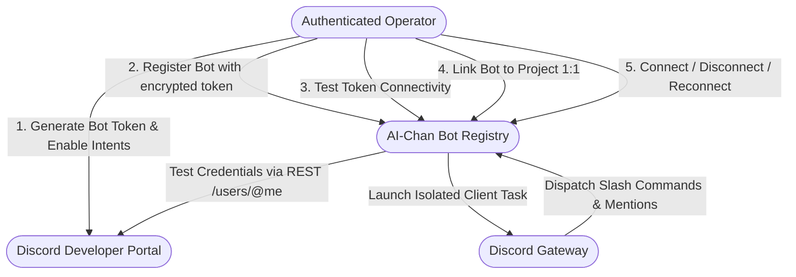
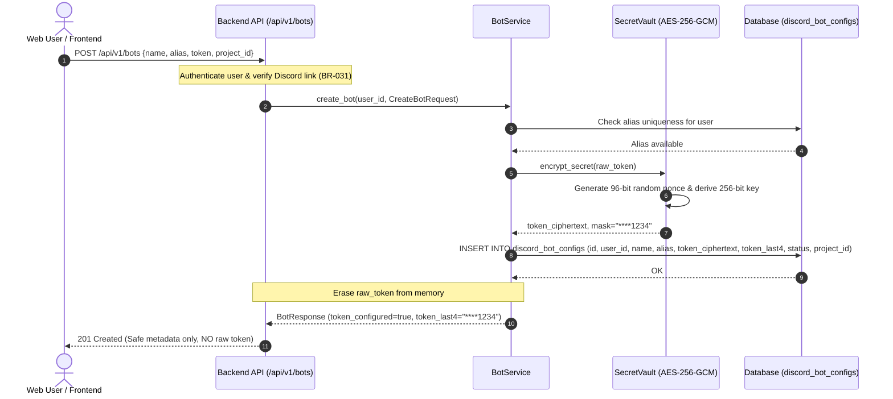
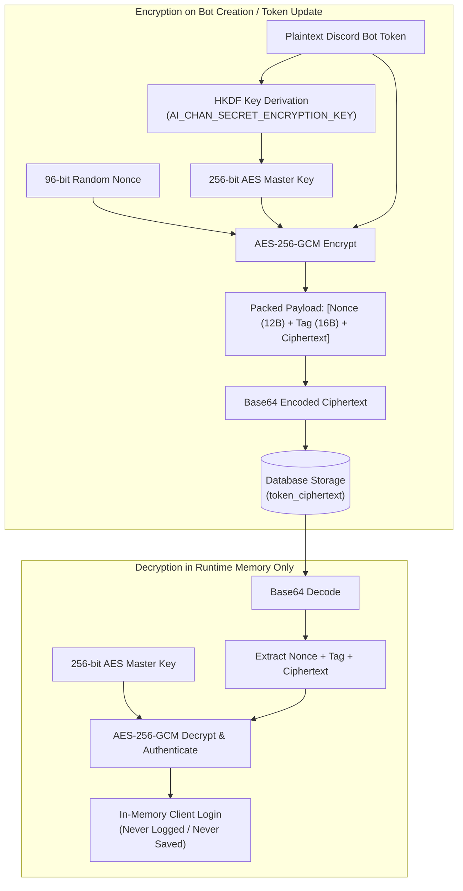
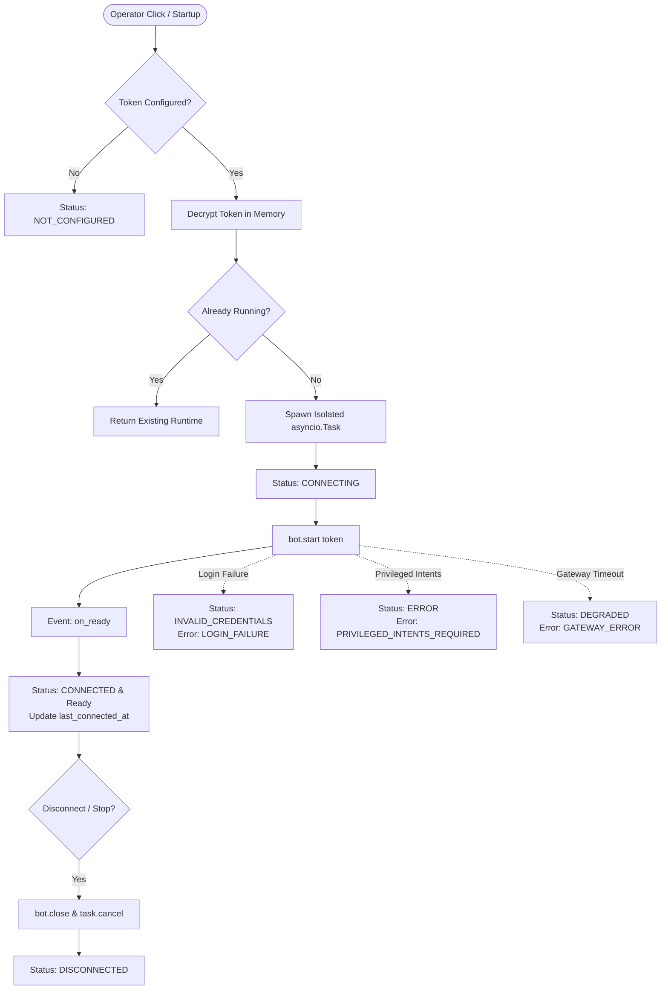
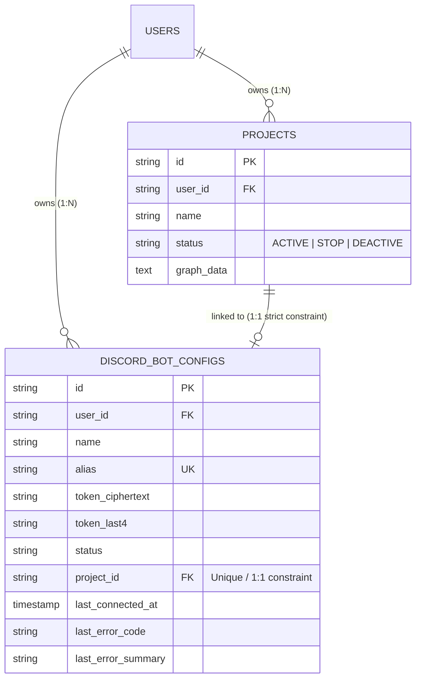
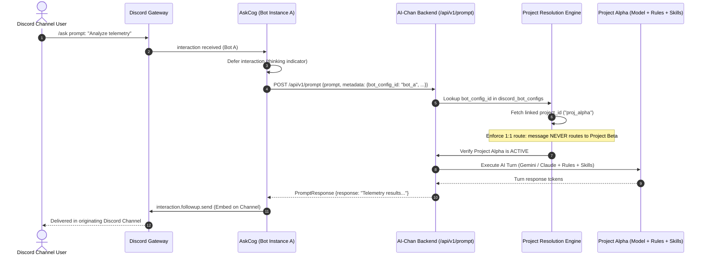
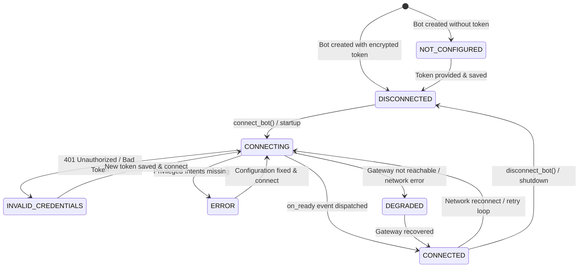
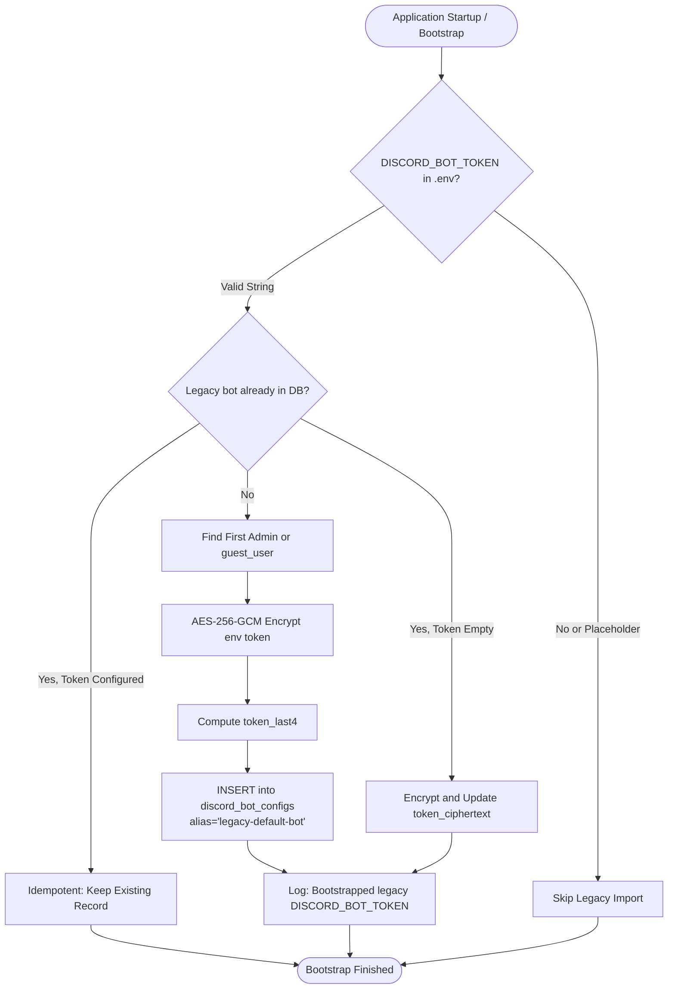
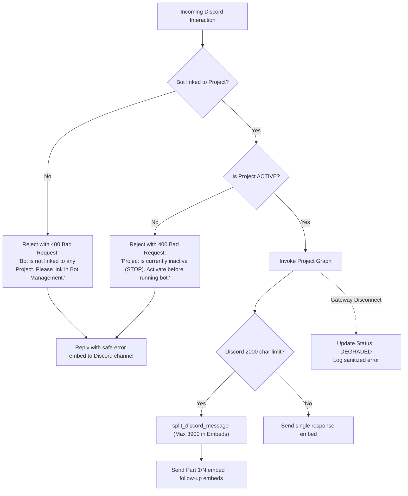

# Multi-Discord Bot Management — Mermaid Diagrams Specification

This document provides formal, renderable Mermaid architecture and behavioral models for Multi-Discord Bot Management and Project Routing in AI-Chan.

---

## 1. Bot Management Use Case Diagram

---

## 2. Create Bot / Save Credential Sequence Diagram

---

## 3. Credential Encryption & Decryption Flow

---

## 4. Bot Runtime Startup, Reconnect & Shutdown Lifecycle

---

## 5. Project ↔ Bot 1:1 Assignment Cardinality

---

## 6. Discord Message → Project Runtime → Response Route

---

## 7. Bot Runtime State Machine

---

## 8. Legacy `.env` Token Migration Flow

---

## 9. Error Handling, Rate Limits & Disconnected Bot Behavior

