# 12. BỘ BIỂU ĐỒ HỆ THỐNG MERMAID (STANDARDIZED MERMAID DIAGRAMS)
## Phân Hệ: Tích Hợp Thư Viện System Prompt Vào Visual Project Editor & Chat Runtime
### Nền Tảng: AI-Chan Virtual Assistant Platform

---

| Thông Tin Tài Liệu | Chi Tiết |
| :--- | :--- |
| **Mã Tài Liệu** | `DOC-SPN-DIAG-01` |
| **Trạng Thái** | `PROPOSED` |
| **Phiên Bản** | `1.0.0-MVP` |
| **Ngày Lập** | `2026-10-11` |

---

## 1. Danh Mục Các Biểu Đồ Chuẩn Hóa

Bộ tài liệu này định nghĩa chính xác 12 biểu đồ Mermaid tiêu chuẩn, bao phủ toàn bộ các khía cạnh từ ca sử dụng, giao diện, luồng tuần tự, cấu trúc dữ liệu đến kiến trúc an ninh:

1. **`DIAG-SPN-UC-001`**: Sơ đồ Use Case tổng thể hệ thống.
2. **`DIAG-SPN-IA-001`**: Sơ đồ kiến trúc thông tin Node Catalog (4 nhóm & thanh công cụ).
3. **`DIAG-SPN-UF-001`**: Sơ đồ luồng người dùng (User Flow) chỉnh sửa Project và liên kết Prompt.
4. **`DIAG-SPN-ACT-001`**: Sơ đồ hoạt động (Activity Flow) tìm kiếm và lọc Node Catalog.
5. **`DIAG-SPN-SEQ-001`**: Sơ đồ tuần tự thêm System Prompt Node vào Canvas.
6. **`DIAG-SPN-SEQ-002`**: Sơ đồ tuần tự lưu cấu trúc đồ thị Project an toàn.
7. **`DIAG-SPN-SEQ-003`**: Sơ đồ tuần tự thực thi Chat phân giải System Prompt ra Provider.
8. **`DIAG-SPN-GRAPH-001`**: Sơ đồ cấu trúc kết nối đồ thị Canvas đa kiểu (Typed Ports & Edges).
9. **`DIAG-SPN-STATE-001`**: Sơ đồ máy trạng thái vòng đời Project và bộ kiểm tra hợp lệ Graph.
10. **`DIAG-SPN-ERD-001`**: Sơ đồ thực thể quan hệ miền dữ liệu (Domain Entity Relationship).
11. **`DIAG-SPN-ARCH-001`**: Sơ đồ phân rã thành phần kiến trúc hệ thống (Component Architecture).
12. **`DIAG-SPN-SEC-001`**: Sơ đồ phân vùng ranh giới tin cậy và luồng kiểm soát an toàn (Trust Boundaries).

---

## 2. Chi Tiết 12 Biểu Đồ Hệ Thống Chuẩn Hóa

### 2.1. Biểu Đồ 1: Sơ Đồ Use Case Tổng Thể (`DIAG-SPN-UC-001`)
*Mô tả:* Minh họa các tương tác chính của Người dùng và AI Model Provider đối với Project Editor, Thư viện Prompt và Chat Runtime.  
*Truy vết:* `UC-SPN-01` đến `UC-SPN-06`, `FR-SPN-001` đến `FR-SPN-014`.

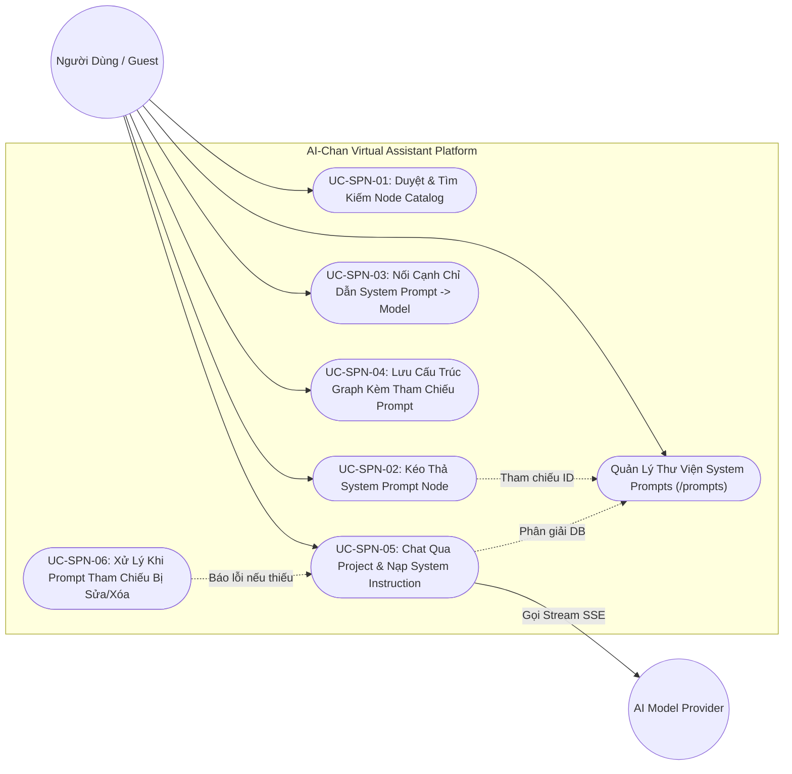

---

### 2.2. Biểu Đồ 2: Kiến Trúc Thông Tin Node Catalog (`DIAG-SPN-IA-001`)
*Mô tả:* Cấu trúc phân cấp 4 nhóm Accordion cùng thanh tìm kiếm và bộ lọc nhóm tại sidebar bên trái.  
*Truy vết:* `FR-SPN-001` đến `FR-SPN-005`, `BR-SPN-001`.

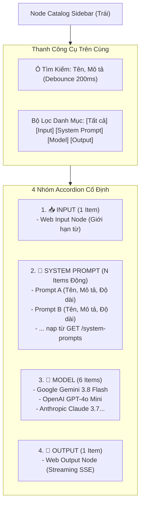

---

### 2.3. Biểu Đồ 3: Luồng Người Dùng Chỉnh Sửa Project (`DIAG-SPN-UF-001`)
*Mô tả:* Trình tự các bước thao tác của người dùng từ khi mở Project Editor đến khi lưu đồ thị thành công.  
*Truy vết:* `UC-SPN-01` đến `UC-SPN-04`, `AC-CANVAS-01` đến `AC-CANVAS-04`.

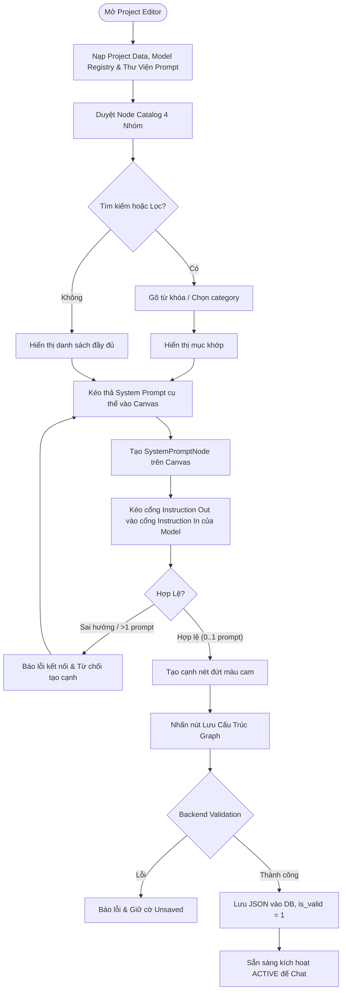

---

### 2.4. Biểu Đồ 4: Sơ Đồ Hoạt Động Tìm Kiếm & Lọc Catalog (`DIAG-SPN-ACT-001`)
*Mô tả:* Cơ chế xử lý trạng thái giao diện khi tìm kiếm, lọc, lỗi và rỗng trong Node Catalog.  
*Truy vết:* `FR-SPN-003`, `FR-SPN-004`, `AC-CAT-01` đến `AC-CAT-04`.

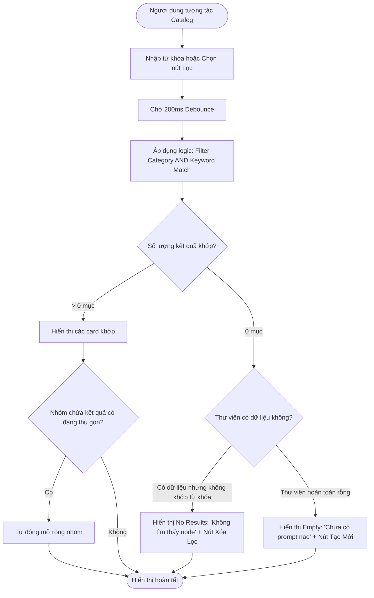

---

### 2.5. Biểu Đồ 5: Sơ Đồ Tuần Tự Thêm System Prompt Node (`DIAG-SPN-SEQ-001`)
*Mô tả:* Tương tác chi tiết giữa Frontend Canvas, Catalog và Engine khi kéo thả node.  
*Truy vết:* `UC-SPN-02`, `UC-SPN-03`, `AC-CANVAS-01`.

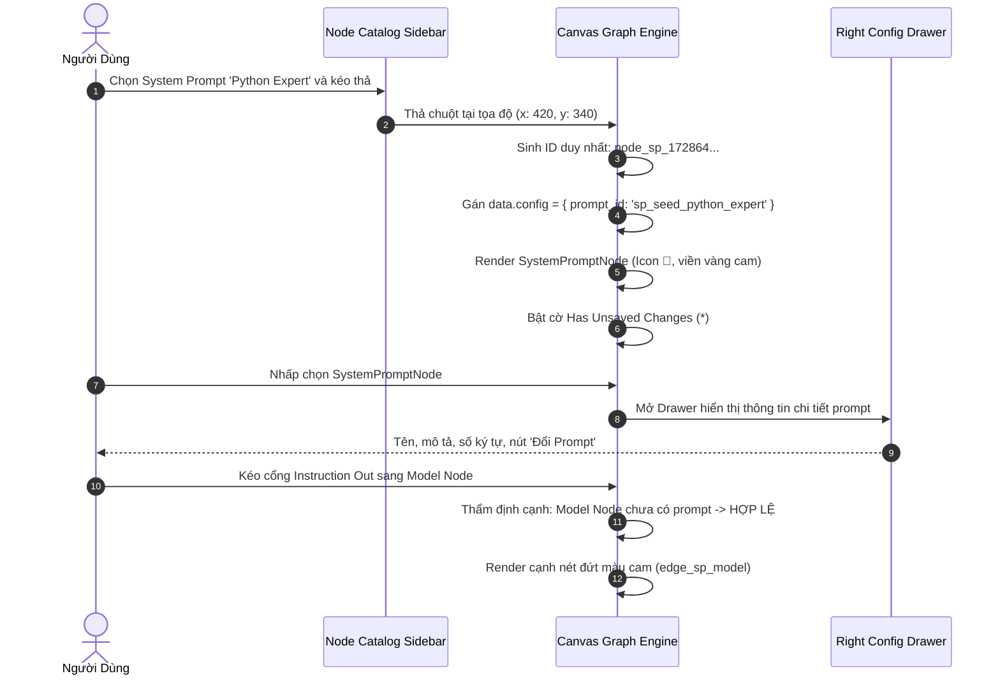

---

### 2.6. Biểu Đồ 6: Sơ Đồ Tuần Tự Lưu Đồ Thị Project (`DIAG-SPN-SEQ-002`)
*Mô tả:* Quy trình Frontend xác thực sơ bộ, gửi API và Backend thực thi Anti-IDOR để lưu đồ thị.  
*Truy vết:* `UC-SPN-04`, `FR-SPN-009`, `FR-SPN-010`, `RISK-SPN-01`.

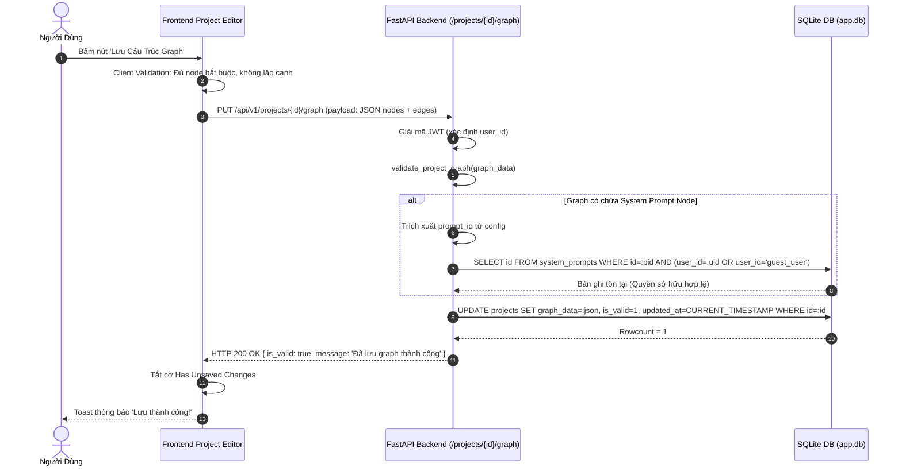

---

### 2.7. Biểu Đồ 7: Sơ Đồ Tuần Tự Thực Thi Chat Với System Prompt (`DIAG-SPN-SEQ-003`)
*Mô tả:* Luồng runtime hoàn chỉnh khi chat qua Project: phân giải prompt, tách vai trò và gọi LLM stream SSE.  
*Truy vết:* `UC-SPN-05`, `FR-SPN-011`, `FR-SPN-012`, `FR-SPN-013`.

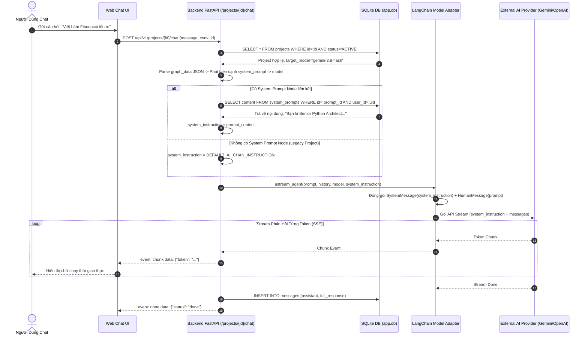

---

### 2.8. Biểu Đồ 8: Cấu Trúc Kết Nối Đồ Thị Canvas Đa Kiểu (`DIAG-SPN-GRAPH-001`)
*Mô tả:* Biểu diễn trực quan 2 cấu trúc đồ thị hợp lệ trong MVP: Chuẩn Legacy và Chuẩn Extended.  
*Truy vết:* `FR-SPN-007`, `FR-SPN-009`, `BR-SPN-003`, `BR-SPN-004`.

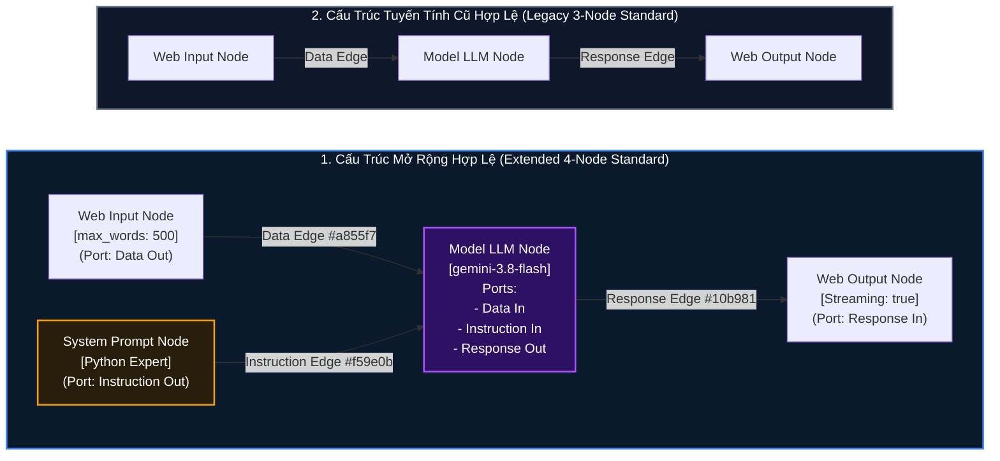

---

### 2.9. Biểu Đồ 9: Máy Trạng Thái Project & Thẩm Định Graph (`DIAG-SPN-STATE-001`)
*Mô tả:* Tương quan giữa tính hợp lệ của cấu trúc đồ thị (`is_valid`) và các trạng thái vòng đời Project.  
*Truy vết:* `FR-SPN-009`, `FR-SPN-013`.

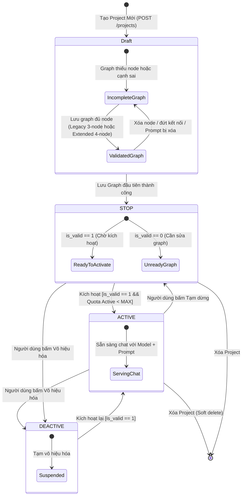

---

### 2.10. Biểu Đồ 10: Sơ Đồ Thực Thể Quan Hệ Miền Dữ Liệu (`DIAG-SPN-ERD-001`)
*Mô tả:* Mối quan hệ giữa User, Project, Graph JSON, System Prompt và Model Registry trong CSDL SQLite.  
*Truy vết:* `DOC-SPN-DOM-01`, `models/domain/domain.yaml`.

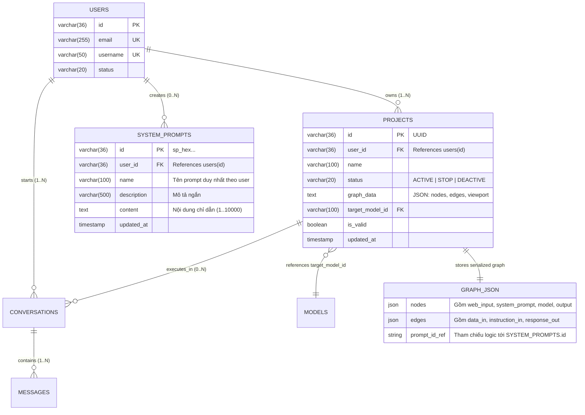

---

### 2.11. Biểu Đồ 11: Phân Rã Thành Phần Kiến Trúc Hệ Thống (`DIAG-SPN-ARCH-001`)
*Mô tả:* Bản đồ các module và ranh giới trách nhiệm giữa Frontend, Backend và External Services.  
*Truy vết:* `DOC-SPN-ARCH-01`.

```mermaid
componentDiagram
    package "ai-frontend (Next.js 15 App Router)" {
        [ProjectEditorPage] --> [NodeCatalogComponent]
        [ProjectEditorPage] --> [CanvasWorkspaceComponent]
        [ProjectEditorPage] --> [NodeConfigDrawerComponent]
        [NodeCatalogComponent] --> [SystemPromptService]
        [ProjectEditorPage] --> [ProjectService]
    }

    package "ai-backend (FastAPI Service)" {
        [ProjectsRouter] --> [GraphValidatorEngine]
        [ProjectsRouter] --> [ChatRuntimeController]
        [SystemPromptsRouter] --> [PromptRepository]
        [ChatRuntimeController] --> [PromptResolver]
        [ChatRuntimeController] --> [LangGraphAgentOrchestrator]
    }

    database "SQLite Engine (app.db)" {
        folder "Tables" {
            [projects]
            [system_prompts]
            [models]
            [conversations]
            [messages]
        }
    }

    package "External AI Services" {
        [Google Gemini API]
        [OpenAI API]
        [Anthropic Claude API]
    }

    [SystemPromptService] ..> [SystemPromptsRouter] : HTTP GET
    [ProjectService] ..> [ProjectsRouter] : HTTP PUT/POST
    [PromptResolver] --> [system_prompts] : SQL Query
    [ProjectsRouter] --> [projects] : SQL Query
    [LangGraphAgentOrchestrator] --> [Google Gemini API] : HTTPS SSE
    [LangGraphAgentOrchestrator] --> [OpenAI API] : HTTPS SSE
```

---

### 2.12. Biểu Đồ 12: Phân Vùng Ranh Giới Tin Cậy & Bảo Mật (`DIAG-SPN-SEC-001`)
*Mô tả:* 4 vùng ranh giới tin cậy, luồng dữ liệu an toàn và điểm thực thi Anti-IDOR.  
*Truy vết:* `DOC-SPN-SEC-01`, `RISK-SPN-01` đến `RISK-SPN-06`.

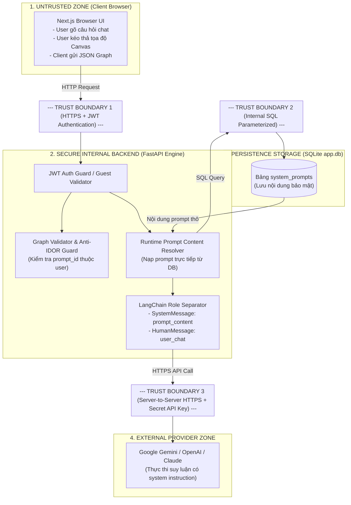
