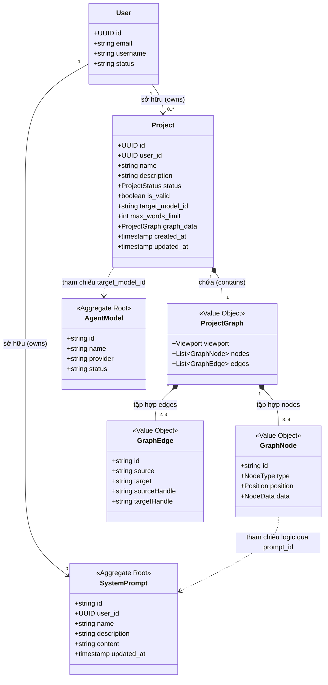

# 07. THIẾT KẾ MÔ HÌNH MIỀN & TỪ ĐIỂN DỮ LIỆU (DOMAIN MODEL & DATA DICTIONARY)
## Phân Hệ: Tích Hợp Thư Viện System Prompt Vào Visual Project Editor & Chat Runtime
### Nền Tảng: AI-Chan Virtual Assistant Platform

---

| Thông Tin Tài Liệu | Chi Tiết |
| :--- | :--- |
| **Mã Tài Liệu** | `DOC-SPN-DOM-01` |
| **Trạng Thái** | `PROPOSED` |
| **Phiên Bản** | `1.0.0-MVP` |
| **Ngày Lập** | `2026-10-11` |

---

## 1. Bóc Tách 4 Khái Niệm Miền Cốt Lõi (Core Domain Concepts Disambiguation)

Nhằm ngăn chặn sự nhầm lẫn giữa định nghĩa giao diện, thực thể đồ thị và tài nguyên cơ sở dữ liệu, phân hệ phân định rạch ròi 4 khái niệm sau:

```
┌─────────────────────────────────────────────────────────────────────────────────────────────┐
│ 1. Catalog Item (Mục Danh Mục Palette)                                                      │
│    - Đối tượng giao diện nguyên mẫu (Prototype Definition) trong thanh bên trái.             │
│    - Cung cấp template: type, label, icon, category ('input' | 'system_prompt' | ...)       │
└──────────────────────────────────────────────┬──────────────────────────────────────────────┘
                                               │ (Kéo thả lên Canvas)
                                               ▼
┌─────────────────────────────────────────────────────────────────────────────────────────────┐
│ 2. Node Instance (Thực Thể Node Trên Đồ Thị)                                                │
│    - Thực thể nằm trong tập hợp `nodes` của `ProjectGraph`.                                  │
│    - Mang định danh đồ thị duy nhất (`id: node_sp_1728...`), tọa độ (x, y) và cấu hình.    │
└──────────────────────────────────────────────┬──────────────────────────────────────────────┘
                                               │
                                               ├─ Nếu type == 'system_prompt':
                                               ▼
┌─────────────────────────────────────────────────────────────────────────────────────────────┐
│ 3. System Prompt Node (Node Chỉ Dẫn Đồ Thị)                                                 │
│    - Một biến thể của Node Instance chuyên biệt hóa cho việc định hình chỉ dẫn hệ thống.    │
│    - Chứa tham chiếu: `data.config.prompt_id = "sp_seed_python_expert"`.                     │
│    - Chỉ có 1 cổng ra: Instruction Out.                                                     │
└──────────────────────────────────────────────┬──────────────────────────────────────────────┘
                                               │ (Tham chiếu khóa ngoại logic)
                                               ▼
┌─────────────────────────────────────────────────────────────────────────────────────────────┐
│ 4. System Prompt Resource (Tài Nguyên System Prompt Trong CSDL)                             │
│    - Aggregate Root độc lập trong Prompt Management Context (bảng `system_prompts`).        │
│    - Lưu trữ có thẩm quyền: `id`, `user_id`, `name`, `description`, `content` (1..10.000 ký tự)│
└─────────────────────────────────────────────────────────────────────────────────────────────┘
```

---

## 2. Mô Hình Tổng Thể & Ranh Giới Aggregate (DDD Aggregates)



---

## 3. Quyết Định Kiến Trúc: Reference Hay Snapshot (DEC-SPN-01 Rationale)

Hệ thống bắt buộc phải lựa chọn giữa 2 phương án lưu trữ mối liên kết giữa System Prompt và Project:

| Tiêu Chí So Sánh | Phương Án A: Reference (Tham Chiếu ID) | Phương Án B: Snapshot (Nhúng Bản Sao Content) |
| :--- | :--- | :--- |
| **Cơ chế lưu trữ** | Node chỉ lưu `prompt_id`. Khi chạy Chat, Backend truy vấn CSDL `system_prompts` để lấy `content`. | JSON đồ thị lưu trực tiếp toàn bộ chuỗi văn bản `content` tại thời điểm kéo thả hoặc lưu project. |
| **Tính nhất quán dữ liệu** | **Rất cao (Single Source of Truth).** Khi người dùng sửa prompt trong Thư viện `/prompts`, mọi project tham chiếu đều tự động nhận nội dung mới nhất. | **Kém.** Dễ xảy ra lệch đồng bộ (Drift). Sửa prompt trong thư viện không cập nhật vào project, gây bối rối cho người dùng. |
| **Dung lượng CSDL Project** | **Tối ưu (Rất nhẹ).** JSON graph chỉ tốn thêm ~50 bytes cho mỗi prompt node. | **Nặng.** JSON graph phình to thêm 10KB - 30KB cho mỗi project, gây quá tải khi fetch danh sách project. |
| **Bảo mật & Phân quyền** | **Chặt chẽ.** Backend luôn kiểm tra quyền sở hữu prompt tại thời điểm thực thi chat, ngăn chặn IDOR. | **Lỏng lẻo.** Client có thể giả mạo payload content gửi lên server nếu không kiểm tra kỹ. |
| **Tính tái lập (Reproducibility)** | Cần lưu version nếu muốn tái lập tuyệt đối. Trong MVP, phản ánh nội dung mới nhất là hành vi mong muốn. | Cố định nội dung cũ trừ khi người dùng chủ động mở lại editor để lưu lại. |

> **QUYẾT ĐỊNH CHÍNH THỨC (`DEC-SPN-01`):**
> **Áp dụng phương án REFERENCE (Tham Chiếu ID).**
> - `GraphNode.data.config.prompt_id` là trường duy nhất lưu định danh tài nguyên.
> - Nội dung văn bản được phân giải có thẩm quyền tại Backend SQLite Engine khi thực thi chat (`POST /projects/{id}/chat`).
> - Nếu System Prompt bị xóa, Project sẽ nhận diện được ngay lập tức tại runtime và báo lỗi hành động rõ ràng thay vì chạy ngầm bằng dữ liệu cũ không kiểm soát.

---

## 4. Từ Điển Dữ Liệu Các Cấu Trúc JSON Đồ Thị (Graph Data Dictionary)

### 4.1. Cấu Trúc Đối Tượng `GraphNode`
```typescript
export interface GraphNode {
  id: string;                      // Định danh duy nhất của node trong canvas (ví dụ: 'node_sp_1728641234')
  type: 'web_input' | 'system_prompt' | 'model' | 'output'; // Loại node
  position: { x: number; y: number }; // Tọa độ hiển thị 2D trên canvas
  data: {
    label: string;                 // Nhãn hiển thị của node (ví dụ: 'Chuyên Gia Python')
    config: Record<string, any>;   // Cấu hình tham số nghiệp vụ của node
  };
}
```

### 4.2. Bảng Cấu Hình `data.config` Cho Từng Loại Node
| Loại Node (`type`) | Các Trường Cấu Hình Trong `data.config` | Kiểu Dữ Liệu | Ràng Buộc & Ý Nghĩa Nghiệp Vụ |
| :--- | :--- | :--- | :--- |
| **`web_input`** | `max_words` | `integer` | Giới hạn số từ tối đa của câu hỏi từ người dùng (10..4000 từ, mặc định: 500). |
| **`system_prompt`** | `prompt_id` | `string` | **Bắt buộc.** Định danh khóa ngoại logic trỏ tới `system_prompts.id` (ví dụ: `sp_seed_python_expert`). |
| | `prompt_name` | `string` | *(Tùy chọn)* Snapshot tên prompt hiển thị nhanh trên canvas. |
| | `content_length` | `integer` | *(Tùy chọn)* Snapshot độ dài ký tự hiển thị huy hiệu. |
| **`model`** | `model_id` | `string` | **Bắt buộc.** Khóa ngoại trỏ tới `models.id` (ví dụ: `gemini-3.8-flash`). |
| | `temperature` | `float` | Độ sáng tạo của mô hình (0.0 .. 2.0, mặc định: 0.7). |
| | `max_tokens` | `integer` | Giới hạn số token tối đa cho mỗi phản hồi (256 .. 8192, mặc định: 2048). |
| **`output`** | `streaming` | `boolean` | Chế độ truyền dòng thời gian thực Server-Sent Events (mặc định: `true`). |

### 4.3. Cấu Trúc Đối Tượng `GraphEdge`
```typescript
export interface GraphEdge {
  id: string;                      // Định danh duy nhất của cạnh (ví dụ: 'edge_sp_model_1')
  source: string;                  // ID của node phát tín hiệu (source node)
  target: string;                  // ID của node nhận tín hiệu (target node)
  sourceHandle?: string;           // Mã định danh cổng ra (ví dụ: 'instruction_out')
  targetHandle?: string;           // Mã định danh cổng vào (ví dụ: 'instruction_in')
}
```
