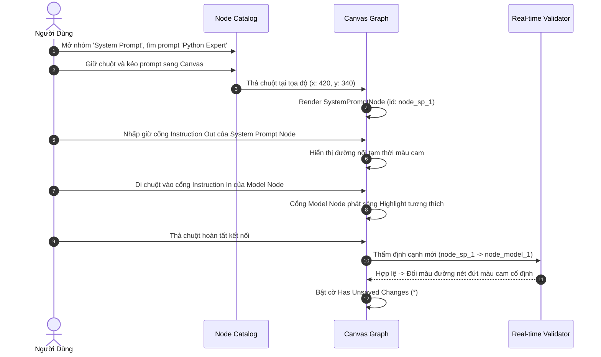

# 06. THIẾT KẾ TRẢI NGHIỆM NGƯỜI DÙNG & LUỒNG TƯƠNG TÁC (UX FLOWS & IA)
## Phân Hệ: Tích Hợp Thư Viện System Prompt Vào Visual Project Editor & Chat Runtime
### Nền Tảng: AI-Chan Virtual Assistant Platform

---

| Thông Tin Tài Liệu | Chi Tiết |
| :--- | :--- |
| **Mã Tài Liệu** | `DOC-SPN-UX-01` |
| **Trạng Thái** | `PROPOSED` |
| **Phiên Bản** | `1.0.0-MVP` |
| **Ngày Lập** | `2026-10-11` |

---

## 1. Kiến Trúc Thông Tin & Bố Cục Không Gian (Layout Information Architecture)

Không gian giao diện của màn hình Project Editor (`/projects/[id]/editor`) được phân chia thành 4 khu vực chức năng rõ ràng, nhất quán với phong cách Dark Modern UI của AI-Chan:

```
┌──────────────────────────────────────────────────────────────────────────────────────────────────┐
│  HEADER: [✨ AI-Chan] / [Projects] / [Tên Project]  | [Trạng thái: STOP] | [Lưu Graph] [Kích Hoạt]   │
├─────────────────────┬──────────────────────────────────────────────────────┬─────────────────────┤
│   NODE CATALOG      │                  CANVAS AREA                         │    CONFIG DRAWER    │
│  (Thanh bên trái)   │             (Khu vực đồ thị trung tâm)               │ (Thanh cấu hình phải│
│                     │                                                      │  chỉ mở khi chọn)   │
│  [🔍 Tìm kiếm node] │  ┌────────────┐                                      │                     │
│  [All][In][SP][Mod] │  │ Web Input  │──(Data)──┐                           │  [Cấu hình Node]    │
│                     │  └────────────┘          ▼                           │                     │
│  ▼ 📥 INPUT (1)     │                  ┌──────────────┐      ┌───────────┐ │  - Tên Node         │
│    - Web Input Node │                  │  Model LLM   │──(R)─│Web Output │ │  - Tham số          │
│                     │  ┌────────────┐  │[gemini-flash]│      └───────────┘ │    (temp, tokens)   │
│  ▼ 📜 SYSTEM PROMPT │  │SystemPrompt│──┘(Instruction)                      │                     │
│    - Python Expert  │  │[sp_seed...]│                                      │  - Đổi Prompt       │
│    - Business Anal. │  └────────────┘                                      │  - Xem chi tiết     │
│                     │                                                      │                     │
│  ▼ 🧠 MODEL (6)     │  [Zoom: 100%] [Fit] [Mini-map]                       │  [Xóa Node]         │
│  ▼ 💬 OUTPUT (1)    │                                                      │                     │
└─────────────────────┴──────────────────────────────────────────────────────┴─────────────────────┘
```

---

## 2. Đặc Tả Chi Tiết Thanh Node Catalog Bên Trái

### 2.1. Cấu Trúc Thanh Công Cụ Đầu Danh Sách (Toolbar)
1. **Ô Tìm Kiếm (Search Box):**
   - Vị trí: Đặt cố định ở đầu sidebar.
   - Placeholder: `"Tìm kiếm node, prompt, model..."`.
   - Cơ chế: Lọc client-side tức thì sau 200ms debounce.
   - Nút xóa nhanh: Hiển thị icon `✕` khi có văn bản; bấm vào sẽ làm sạch ô tìm kiếm.
2. **Bộ Lọc Danh Mục (Category Filter Pills):**
   - 5 nút chọn nhanh dạng pill badge:
     - `Tất cả` (Mặc định).
     - `Input`.
     - `System Prompt`.
     - `Model`.
     - `Output`.
   - Tương tác: Nhấp vào một pill sẽ ẩn các nhóm khác; chỉ nhóm được chọn hiển thị.
   - Logic kết hợp: `Filter Category AND Search Query`.

### 2.2. Trạng Thái Accordion Của Bốn Nhóm Node
Mỗi nhóm được đóng gói trong một khối Accordion có thể gập/mở:
- **Header Khối:**
  - Icon nhận diện nhóm: `📥` Input, `📜` System Prompt, `🧠` Model, `💬` Output.
  - Tên nhóm in hoa nhẹ, font-weight 600.
  - Huy hiệu số lượng: `(1)`, `(3)`, `(6)`, v.v.
  - Icon mũi tên trạng thái: `▼` (đang mở) hoặc `▶` (đang thu gọn).
- **Hành vi mở tự động:**
  - Khi người dùng gõ từ khóa tìm kiếm và kết quả khớp nằm trong nhóm đang bị thu gọn, nhóm đó **tự động bung ra** để làm nổi bật kết quả khớp.

### 2.3. Hiển Thị Chi Tiết Từng Loại Item Trong Catalog
- **Input Node Item:**
  - Tiêu đề: `"Web Input Node"`.
  - Mô tả: `"Nhận câu hỏi từ Web Chat (giới hạn từ)"`.
  - Huy hiệu trạng thái: Nếu trên canvas đã có Web Input Node, item hiển thị mờ với badge `"Đã có"` (vì MVP giới hạn 1 Input Node).
- **System Prompt Item:**
  - Tiêu đề: Tên prompt (ví dụ: `"Chuyên Gia Python & Kiến Trúc Phần Mềm"`).
  - Mô tả: Mô tả tóm tắt nếu có.
  - Huy hiệu độ dài: `1.845 ký tự` (màu cam nhạt).
  - Khả năng kéo: Có thể kéo nhiều lần hoặc thay thế prompt hiện có trên canvas.
- **Model Item:**
  - Tiêu đề: Tên mô hình (ví dụ: `"Google Gemini 3.8 Flash"`).
  - Nhà cung cấp: Provider badge (`Google`, `OpenAI`, `Anthropic`).
  - Trạng thái: Chỉ hiển thị các model có trạng thái `ACTIVE` trong Model Registry.
- **Output Node Item:**
  - Tiêu đề: `"Web Output Node"`.
  - Mô tả: `"Định dạng phản hồi streaming cho user"`.
  - Huy hiệu: Badge `"Đã có"` nếu canvas đã tồn tại node Output.

---

## 3. Đặc Tả Thao Tác Canvas & Nhận Diện Trực Quan Các Node

### 3.1. Thiết Kế Trực Quan Của System Prompt Node Trên Canvas
- **Kích thước chuẩn:** Rộng 260px, Cao tự động (tối thiểu 110px).
- **Màu sắc chủ đạo:** Viền vàng cam hổ phách (`#f59e0b`), nền thẻ `rgba(30, 41, 59, 0.95)`.
- **Header Node:**
  - Icon: `📜`.
  - Tag loại node: `SYSTEM PROMPT` (chữ nhỏ, nền vàng cam nhạt).
  - Nút thao tác nhanh: `×` (xóa node khỏi canvas).
- **Body Node:**
  - Tên prompt in đậm, ngắt dòng an toàn (`line-clamp: 2`).
  - Badge độ dài ký tự: `1.845 ký tự`.
  - Trạng thái liên kết:
    - Nếu prompt hợp lệ trong DB: Icon xanh `● Đã liên kết`.
    - Nếu prompt bị xóa/không tìm thấy: Viền đỏ báo động, icon đỏ `⚠️ Prompt không tồn tại`.
- **Cổng Ra (Port Handle):**
  - Đặt ở cạnh phải chính giữa node.
  - Màu sắc: Chấm tròn vàng cam `#f59e0b` phát sáng nhẹ khi hover.
  - Tooltip: `"Instruction Out — Kéo vào cổng chỉ dẫn của Model Node"`.

### 3.2. Cải Tiến Cổng Vào Đa Kiểu Trên Model Node
Model Node trên canvas được nâng cấp từ 1 cổng vào chung thành **2 cổng vào chuyên biệt** ở cạnh trái:
1. **Cổng Dữ Liệu Đầu Vào (Data Inbound Port - Vị trí: 35% từ trên xuống):**
   - Màu sắc: Chấm tròn xanh lơ `#06b6d4`.
   - Tooltip: `"Data In — Nhận câu hỏi từ Web Input Node"`.
2. **Cổng Chỉ Dẫn Hệ Thống (Instruction Inbound Port - Vị trí: 65% từ trên xuống):**
   - Màu sắc: Chấm tròn vàng cam `#f59e0b`.
   - Tooltip: `"Instruction In — Nhận chỉ dẫn từ System Prompt Node"`.

```
┌──────────────────────────────────────────────────┐
│ 🧠 MODEL LLM NODE                 [gemini-flash] │
├──────────────────────────────────────────────────┤
│ (Data In) ● ───┐                                 │
│                │                                 │
│                ├─► [ Suy Luận LLM ] ──► ● (Out)  │
│                │                                 │
│ (Inst In) ● ───┘                                 │
└──────────────────────────────────────────────────┘
```

---

## 4. Các Luồng Tương Tác Trọng Yếu (Critical UX Flows)

### 4.1. Luồng Kéo Thả & Nối Dây Chỉ Dẫn (Drag-Drop & Connection Flow)


### 4.2. Luồng Cảnh Báo Thay Đổi Chưa Lưu (Unsaved Changes Guard)
1. Khi người dùng thêm, xóa, di chuyển node hoặc thay đổi cạnh nối, nút `"Lưu Cấu Trúc Graph"` chuyển sang trạng thái nổi bật kèm dấu hoa thị `* Đồ thị có thay đổi chưa lưu`.
2. Nếu người dùng nhấp vào breadcrumb để rời khỏi trang hoặc ấn nút quay lại:
   - Hệ thống hiển thị Modal xác nhận:
     - Tiêu đề: *"Thay đổi đồ thị chưa được lưu!"*
     - Nội dung: *"Các thay đổi về node và liên kết System Prompt sẽ bị mất nếu bạn rời khỏi màn hình này mà không bấm Lưu."*
     - Nút bấm: `"Hủy bỏ và rời đi"` (màu đỏ) và `"Ở lại lưu đồ thị"` (màu tím).

---

## 5. Bảng Trạng Thái Giao Diện (UI State Matrix)

| Trạng Thái (State) | Biểu Hiện Trên Giao Diện (Visual Presentation) | Hành Động Cho Người Dùng (Action) |
| :--- | :--- | :--- |
| **Catalog Đang Tải (Loading)** | 4 Skeleton card mờ nhấp nháy tại khu vực catalog. | Không cần thao tác, tự động hoàn tất. |
| **Thư Viện Prompt Rỗng (Empty)** | Nhóm System Prompt hiển thị icon 📜 mờ kèm thông báo: *"Chưa có prompt nào trong thư viện"*. | Nút bấm nhanh: `"➕ Tạo System Prompt Mới"` (mở tab `/prompts/new`). |
| **Tìm Kiếm Không Thấy (No Results)** | Thông báo: *"Không tìm thấy node/prompt phù hợp với từ khóa '{query}'"*. | Nút bấm: `"Xóa bộ lọc tìm kiếm"`. |
| **Đồ Thị Chưa Đủ Kết Nối** | Viền canvas hiển thị cảnh báo vàng, nút Kích Hoạt `ACTIVE` bị disabled. | Nối đủ các cạnh bắt buộc theo hướng dẫn. |
| **Đồ Thị Hợp Lệ Hoàn Toàn** | Huy hiệu `✓ Graph Hợp Lệ` màu xanh lá ở thanh toolbar trên cùng. | Nút `"Kích Hoạt Project"` sẵn sàng hoạt động. |
| **Prompt Liên Kết Bị Xóa** | Node trên canvas đổi sang viền đỏ đứt nét, badge `⚠️ Prompt Đã Bị Xóa`. | Nhấp vào node để chọn lại prompt khác hoặc xóa node. |
