# 02. ĐẶC TẢ YÊU CẦU PHẦN MỀM (SOFTWARE REQUIREMENTS SPECIFICATION - SRS)
## Nhánh Tính Năng: Quản Lý Project (Project Management MVP)
### Hệ Thống: AI-Chan Virtual Assistant Platform

---

| Thông Tin Tài Liệu | Chi Tiết |
| :--- | :--- |
| **Mã Tài Liệu** | `DOC-PRJ-02` |
| **Trạng Thái** | `PROPOSED (Chờ Duyệt Từ Product Owner)` |
| **Vai Trò Phụ Trách** | Senior Business Analyst & QA Engineer |
| **Phiên Bản** | `1.0.0-MVP` |
| **Ngày Lập** | `2026-10-11` |

---

## 1. Giới Thiệu & Mục Đích Tài Liệu (Introduction & Purpose)

Tài liệu này đặc tả chi tiết toàn bộ các yêu cầu chức năng (Functional Requirements - FR), yêu cầu phi chức năng (Non-Functional Requirements - NFR), quy tắc nghiệp vụ (Business Rules - BR), kịch bản ca sử dụng (Use Cases - UC), và tiêu chí chấp nhận (Acceptance Criteria - AC) cho phân hệ **Quản lý Project (Project Management MVP)** thuộc nền tảng AI-Chan.

Tài liệu đóng vai trò là hợp đồng kỹ thuật giữa Business Analyst, Solution Architect, Đội ngũ Lập trình (Frontend/Backend) và Đội ngũ Kiểm thử (QA/QC).

---

## 2. Danh Sách Yêu Cầu Kỹ Thuật (Requirements Catalog)

### 2.1. Yêu Cầu Chức Năng (Functional Requirements - `PRJ-FR-xxx`)

| Mã Yêu Cầu | Tên Yêu Cầu | Mô Tả Kỹ Thuật & Hành Vi Hệ Thống | Độ Ưu Tiên |
| :--- | :--- | :--- | :--- |
| **PRJ-FR-001** | Truy vấn danh sách Project của người dùng | Hệ thống phải cung cấp API và giao diện cho phép người dùng (kể cả khách vãng lai) lấy danh sách các project thuộc quyền sở hữu của họ hoặc tài khoản demo. Không được trả về project của người dùng khác. Kết quả bao gồm `id`, `name`, `description`, `status`, `node_count`, `updated_at`. | **MUST** |
| **PRJ-FR-002** | Tạo mới Project cơ bản (Không yêu cầu xác thực) | Hệ thống phải cho phép người dùng (kể cả khách vãng lai chưa đăng nhập) tạo một project mới với Tên (bắt buộc, 1-100 ký tự) và Mô tả (tùy chọn, tối đa 500 ký tự) mà **không bắt buộc xác thực tài khoản**. Project sau khi tạo mặc định ở trạng thái `stop`, có ID UUID v4 ổn định. | **MUST** |
| **PRJ-FR-003** | Truy vấn chi tiết Project & Graph | Hệ thống phải cho phép người dùng lấy toàn bộ thông tin chi tiết của một project cụ thể, bao gồm metadata và cấu trúc graph đã lưu (`nodes`, `edges`, `viewport`). Trả về HTTP 404 nếu không tìm thấy hoặc 403 nếu không phải chủ sở hữu. | **MUST** |
| **PRJ-FR-004** | Cập nhật thông tin Project | Hệ thống phải cho phép người dùng sửa Tên và Mô tả của project. Hệ thống phải kiểm tra tính hợp lệ của dữ liệu đầu vào trước khi lưu vào cơ sở dữ liệu. | **MUST** |
| **PRJ-FR-005** | Lưu cấu trúc Graph và Cấu hình Node | Hệ thống phải cho phép người dùng lưu trữ toàn bộ cấu trúc graph (tọa độ các node, cấu hình từng node, danh sách các edge nối). Backend phải thực thi validation cấu trúc graph trước khi chấp nhận ghi đè. | **MUST** |
| **PRJ-FR-006** | Xóa Project an toàn (Soft Delete) | Hệ thống phải cho phép người dùng xóa project của mình. Nếu project đang ở trạng thái `active`, hệ thống phải tự động giải phóng 1 slot trong hạn ngạch `MAX_ACTIVE_PROJECTS` trước khi chuyển trạng thái sang `DELETED`. | **SHOULD** |
| **PRJ-FR-007** | Hiển thị Canvas và Thư Viện Node | Giao diện người dùng phải hiển thị canvas đồ họa hỗ trợ kéo-thả, di chuyển (Pan), phóng to/thu nhỏ (Zoom), lưới tọa độ (Grid background), và thanh công cụ chứa 3 node: Web Input, Model, Output. | **MUST** |
| **PRJ-FR-008** | Giới hạn số lượng Node trên Canvas | Trong MVP, hệ thống phải cưỡng chế quy tắc: Mỗi loại node (`web_input`, `model`, `output`) chỉ được phép xuất hiện **chính xác 1 lần** trên canvas. Nếu người dùng cố kéo node trùng loại thứ hai vào canvas, UI phải từ chối và hiển thị thông báo. | **MUST** |
| **PRJ-FR-009** | Bảng cấu hình thuộc tính Node | Khi người dùng click chọn bất kỳ node nào trên canvas, giao diện phải mở bảng cấu hình (Config Drawer) tương ứng với loại node đó. | **MUST** |
| **PRJ-FR-010** | Cấu hình tham số Web Input Node | Hệ thống phải cho phép người dùng thiết lập tham số `max_words` (giới hạn số từ) cho Web Input Node, với giá trị hợp lệ từ 10 đến 4000 từ (mặc định 500 từ). | **MUST** |
| **PRJ-FR-011** | Cấu hình tham số Model Node | Hệ thống phải cho phép người dùng chọn một Model từ danh mục Model khả dụng (`status = 'ACTIVE'` trong Model Catalog) và cấu hình các tham số: `temperature` (0.0 - 2.0, mặc định 0.7), `max_tokens` (256 - giới hạn model, mặc định 2048). | **MUST** |
| **PRJ-FR-012** | Cấu hình tham số Output Node | Hệ thống phải cho phép người dùng cấu hình tiêu đề hiển thị kết quả và chế độ phản hồi dòng chảy (Streaming). | **MUST** |
| **PRJ-FR-013** | Quản lý kết nối giữa các Node (Edges) | Hệ thống chỉ cho phép tạo kết nối hợp lệ theo đúng thứ tự: Cổng xuất của `Web Input Node` sang Cổng nhập của `Model Node`, và Cổng xuất của `Model Node` sang Cổng nhập của `Output Node`. Mọi nỗ lực kết nối sai chiều, ngược chiều, nối tắt hoặc tạo chu trình đều bị chặn. | **MUST** |
| **PRJ-FR-014** | Kiểm tra tính hợp lệ của Graph (Validation) | Hệ thống phải cung cấp cơ chế kiểm tra tính toàn vẹn của graph ở cả Frontend và Backend: Đủ 3 node, đủ 2 edge đúng chiều, các tham số hợp lệ, model được chọn vẫn tồn tại và có API key khả dụng. | **MUST** |
| **PRJ-FR-015** | Cảnh báo rời khỏi Editor khi chưa lưu | Giao diện phải phát hiện trạng thái thay đổi chưa lưu (Dirty State) và hiển thị hộp thoại xác nhận khi người dùng có hành động điều hướng rời khỏi trang editor. | **SHOULD** |
| **PRJ-FR-016** | Kích hoạt Project (`active`) | Hệ thống phải cho phép người dùng chuyển trạng thái project sang `active` nếu: (1) Graph đã lưu hợp lệ 100%, và (2) Số lượng project đang `active` của người dùng hiện tại < `MAX_ACTIVE_PROJECTS`. | **MUST** |
| **PRJ-FR-017** | Tạm dừng Project (`stop`) | Hệ thống phải cho phép người dùng chuyển trạng thái project từ `active` về `stop`. Project ở trạng thái `stop` sẽ không xuất hiện trên Trang Chủ và giải phóng 1 slot hạn ngạch active. | **MUST** |
| **PRJ-FR-018** | Vô hiệu hóa Project (`deactive`) | Hệ thống phải cho phép người dùng chuyển trạng thái project sang `deactive`. Project ở trạng thái này bị vô hiệu hóa hoàn toàn, không thể chat và không chiếm hạn ngạch active. | **MUST** |
| **PRJ-FR-019** | Cưỡng chế Hạn Ngạch Đồng Thời An Toàn | Backend phải xử lý an toàn đối với các request kích hoạt đồng thời (Race Condition) bằng Database Transaction / Atomic Update, đảm bảo tổng số project active không bao giờ vượt quá `MAX_ACTIVE_PROJECTS`. | **MUST** |
| **PRJ-FR-020** | Truy vấn thông tin Hạn ngạch (Quota API) | Hệ thống phải cung cấp API trả về số lượng project active hiện tại, giới hạn tối đa, và số slot còn lại của người dùng (`active_count`, `max_limit`, `remaining_slots`). | **SHOULD** |
| **PRJ-FR-021** | Danh sách chọn Project trên Trang Chủ | Trang Chủ của ứng dụng phải tải và hiển thị danh sách các project đang ở trạng thái `active` của người dùng hiện tại để họ chọn bắt đầu phiên hội thoại. | **MUST** |
| **PRJ-FR-022** | Thực thi Chat theo Graph của Project | Khi người dùng gửi tin nhắn trong phiên chat gắn với một Project `active`, hệ thống phải: (1) Kiểm tra số từ tin nhắn theo `max_words` của Web Input Node, (2) Gọi Model LLM với các tham số đã cấu hình tại Model Node, (3) Định dạng và phản hồi dòng chảy SSE qua Output Node. | **MUST** |
| **PRJ-FR-023** | Xử lý lỗi trong quá trình thực thi Chat | Hệ thống phải xử lý có kiểm soát và trả về thông báo lỗi rõ ràng nếu: Tin nhắn vượt quá `max_words`, Model đã bị Admin tắt trong Model Catalog, Provider gặp lỗi quota/timeout, hoặc Project đã bị chuyển sang `stop`/`deactive`. | **MUST** |

---

### 2.2. Yêu Cầu Phi Chức Năng (Non-Functional Requirements - `PRJ-NFR-xxx`)

| Mã Yêu Cầu | Nhóm Yêu Cầu | Tiêu Chí Đo Lường Cụ Thể |
| :--- | :--- | :--- |
| **PRJ-NFR-001** | **Hiệu năng Canvas (Performance)** | Tốc độ khung hình khi tương tác trên Canvas (kéo-thả, di chuyển, phóng to) phải đạt tối thiểu **55 - 60 FPS** trên trình duyệt tiêu chuẩn (Chrome/Edge/Firefox). |
| **PRJ-NFR-002** | **Thời gian phản hồi API (Latency)** | Thời gian phản hồi của các API CRUD Project (`GET`, `POST`, `PUT`, `PATCH`) phải có thời gian xử lý $P_{95} < 150\text{ ms}$ (không tính thời gian mạng). |
| **PRJ-NFR-003** | **Thời gian khởi tạo luồng Chat (TTFT)** | Thời gian từ lúc người dùng gửi tin nhắn trên Trang Chủ đến khi nhận được chunk đầu tiên (Time to First Token - TTFT) phải $P_{95} < 1.5\text{ s}$ khi sử dụng cloud model (Gemini/Groq). |
| **PRJ-NFR-004** | **Tính toàn vẹn dữ liệu (Data Integrity)** | Thao tác lưu Graph phải đảm bảo tính nguyên khối (Atomicity). Nếu lưu thất bại, trạng thái trước đó của project không bị sửa đổi một phần. |
| **PRJ-NFR-005** | **Bảo mật cách ly (Anti-IDOR Security)** | 100% các API truy xuất hoặc thao tác trên Project phải kiểm tra quyền sở hữu (`user_id = current_user.id`). Người dùng A tuyệt đối không thể xem, sửa hoặc xóa project của người dùng B. |
| **PRJ-NFR-006** | **Bảo mật bí mật (Secret Hardening)** | API Project tuyệt đối không được trả về, lưu trữ hoặc ghi log bất kỳ API Key nào của nhà cung cấp mô hình. Chỉ lưu tham chiếu `model_id`. |
| **PRJ-NFR-007** | **Khả năng tương thích (Compatibility)** | Giao diện Visual Builder phải tương thích hoàn hảo trên độ phân giải màn hình từ 1280x720 trở lên; hỗ trợ các trình duyệt hiện đại (Chrome, Edge, Safari, Firefox). |
| **PRJ-NFR-008** | **Khả năng mở rộng kiến trúc (Extensibility)** | Cấu trúc dữ liệu `graph_data` phải thiết kế dạng schema JSON mở rộng, cho phép bổ sung các loại node mới (Prompt, Tools, Skills, Memory) trong tương lai mà không phải thay đổi cấu trúc bảng cơ sở dữ liệu. |

---

## 3. Quy Tắc Nghiệp Vụ Cốt Lõi (Business Rules - `PRJ-BR-xxx`)

| Mã Quy Tắc | Tên Quy Tắc | Nội Dung Chi Tiết Cưỡng Chế Nghiệp Vụ |
| :--- | :--- | :--- |
| **PRJ-BR-001** | **Quyền Sở Hữu Tuyệt Đối (Ownership Invariant)** | Mỗi Project thuộc sở hữu duy nhất của 1 người dùng (`user_id`). Chỉ chủ sở hữu mới có quyền truy vấn, chỉnh sửa, lưu, thay đổi trạng thái hoặc xóa project. |
| **PRJ-BR-002** | **Ràng Buộc Tên Project (Name Constraint)** | Tên project không được để trống, độ dài từ 1 đến 100 ký tự sau khi cắt khoảng trắng (`trim`). Tên có thể trùng nhau giữa các người dùng khác nhau, nhưng khuyến nghị duy nhất trong cùng 1 tài khoản người dùng. |
| **PRJ-BR-003** | **Trạng Thái Khởi Tạo Mặc Định (Initial State)** | Khi một Project được tạo mới, trạng thái ban đầu bắt buộc phải là `stop`. Không được phép tự động chuyển sang `active` ngay khi tạo. |
| **PRJ-BR-004** | **Cấu Trúc Graph Tuyến Tính Chuẩn (Linear Graph Rule)** | Một Graph hợp lệ trong MVP bắt buộc phải có: (1) Chính xác 1 `Web Input Node`, (2) Chính xác 1 `Model Node`, (3) Chính xác 1 `Output Node`. Không được thiếu hoặc thừa bất kỳ node nào. |
| **PRJ-BR-005** | **Quy Tắc Liên Kết Đồ Thị (Topology Invariant)** | Cấu trúc liên kết bắt buộc phải gồm đúng 2 Edge có hướng: Edge 1 từ `web_input` đến `model`; Edge 2 từ `model` đến `output`. Nghiêm cấm mọi liên kết tắt (`web_input → output`), liên kết vòng (Cycle), hoặc các node cô lập (Disconnected). |
| **PRJ-BR-006** | **Tính Hợp Lệ Của Cấu Hình Node (Node Config Validity)** | Mọi node trên canvas phải được cấu hình đầy đủ: `web_input` phải có `max_words` hợp lệ; `model` phải chọn một `model_id` còn tồn tại và đang `ACTIVE` trong Model Catalog. |
| **PRJ-BR-007** | **Quy Tắc Giải Phóng Quota Khi Xóa (Quota Release on Delete)** | Nếu một project đang ở trạng thái `active` bị người dùng xóa, hệ thống phải tự động thu hồi trạng thái active và hoàn trả 1 slot vào hạn ngạch `MAX_ACTIVE_PROJECTS`. |
| **PRJ-BR-008** | **Cưỡng Chế Giới Hạn Từ Đầu Vào (Word Limit Enforcement)** | Khi người dùng chat qua một Project, số từ trong tin nhắn không được vượt quá `max_words` đã cấu hình trong Web Input Node. Quy tắc đếm từ dựa trên khoảng trắng Unicode (`\s+`). Nếu vượt quá, hệ thống từ chối xử lý và thông báo lỗi rõ ràng. |
| **PRJ-BR-009** | **Ràng Buộc Khả Dụng Của Model (Model Availability Invariant)** | Không được phép lưu hoặc kích hoạt Project nếu mô hình được chọn trong Model Node không tồn tại, đang ở trạng thái `INACTIVE`/`ARCHIVED`, hoặc nhà cung cấp tương ứng chưa được cấu hình API Key. |
| **PRJ-BR-010** | **Xử Lý Model Bị Vô Hiệu Hóa Đột Xuất (Runtime Fallback Guard)** | Nếu một Project đã `active` nhưng sau đó mô hình AI tương ứng bị tắt trong Model Catalog hoặc mất API Key, khi người dùng gửi tin nhắn chat, hệ thống phải dừng xử lý, trả về mã lỗi `MODEL_UNAVAILABLE` kèm hướng dẫn cấu hình lại, không để hệ thống crash. |
| **PRJ-BR-011** | **Nguyên Tắc 3 Trạng Thái Nghiệp Vụ (3-State Semantics)** | Project chỉ có 3 trạng thái hợp lệ: `active`, `stop`, `deactive`. Tuyệt đối không dùng lẫn lộn giữa `stop` (tạm dừng, sẵn sàng bật lại) và `deactive` (vô hiệu hóa chủ động). |
| **PRJ-BR-012** | **Cưỡng Chế Hạn Ngạch Dự Án Hoạt Động (Active Quota Limit)** | Tổng số project có `status = 'ACTIVE'` của một người dùng tại bất kỳ thời điểm nào không được vượt quá `MAX_ACTIVE_PROJECTS` (mặc định = 3). |
| **PRJ-BR-013** | **Tính Nguyên Tử Khi Kích Hoạt Đồng Thời (Atomic Concurrency Rule)** | Việc kiểm tra hạn ngạch và chuyển trạng thái sang `active` phải được thực thi trong một Database Transaction duy nhất hoặc câu lệnh Atomic Update. Nếu 2 request cùng kích hoạt khi chỉ còn 1 slot, đúng 1 request thành công, request còn lại thất bại với lỗi `QUOTA_EXCEEDED`. |
| **PRJ-BR-014** | **Xử Lý Request Chat Đang Chạy Khi Dừng Project (In-Flight Request Drain)** | Khi project chuyển từ `active` sang `stop` hoặc `deactive`, các request chat đang streaming dở dang được phép tiếp tục hoàn tất. Mọi request mới gửi đến sau thời điểm chuyển trạng thái sẽ bị từ chối ngay lập tức. |
| **PRJ-BR-015** | **Trang Chủ Chỉ Hiển Thị Project Active (Home Chat Visibility)** | Chỉ các Project có trạng thái `active` mới được xuất hiện trong danh sách lựa chọn trên Trang Chủ. Các project `stop` hoặc `deactive` tuyệt đối không được hiển thị cho việc bắt đầu hội thoại mới. |

---

## 4. Biểu Đồ Ca Sử Dụng & Luồng Người Dùng Toàn Diện

### 4.1. Use Case Diagram (`PRJ-DIAG-UC-001`)

```mermaid
flowchart LR
    User(["Registered User"])
    Guest(["Guest (Chưa Đăng Nhập)"])
    System(["System / Backend Engine"])

    subgraph ProjectManagement["Phân Hệ Quản Lý Project (MVP)"]
        UC1(["PRJ-UC-001: Xem Danh Sách Project"])
        UC2(["PRJ-UC-002: Tạo Mới Project (Không Cần Xác Thực)"])
        UC3(["PRJ-UC-003: Xem & Sửa Thông Tin Project"])
        UC4(["PRJ-UC-004: Xây Dựng & Lưu Graph (Canvas)"])
        UC5(["PRJ-UC-005: Xóa Project (Soft Delete)"])
        UC6(["PRJ-UC-006: Kích Hoạt Project (Active)"])
        UC7(["PRJ-UC-007: Tạm Dừng Project (Stop)"])
        UC8(["PRJ-UC-008: Vô Hiệu Hóa Project (Deactive)"])
        UC9(["PRJ-UC-009: Chọn Project Active & Chat"])
    end

    subgraph SystemActions["Tác Vụ Hệ Thống"]
        ValGraph(["Validate Cấu Trúc Graph"])
        CheckQuota(["Kiểm Tra Quota MAX_ACTIVE_PROJECTS"])
        ExecChat(["Thực Thi Graph & Gọi LLM"])
    end

    Guest --> UC1
    Guest --> UC2
    User --> UC1
    User --> UC2
    User --> UC3
    User --> UC4
    User --> UC5
    User --> UC6
    User --> UC7
    User --> UC8
    User --> UC9

    UC4 ..>|include| ValGraph
    UC6 ..>|include| ValGraph
    UC6 ..>|include| CheckQuota
    UC9 ..>|include| ExecChat

    ValGraph --- System
    CheckQuota --- System
    ExecChat --- System
```

---

### 4.2. End-to-End User Flow / Swimlane Diagram (`PRJ-DIAG-SWIM-001`)

```mermaid
sequenceDiagram
    autonumber
    actor User as Người Dùng (User)
    participant UI as Giao Diện Web (Frontend)
    participant API as Cổng API Backend (FastAPI)
    participant DB as Cơ Sở Dữ Liệu (SQLite)
    participant LLM as Model Provider (Gemini/OpenAI)

    %% Giai đoạn 1: Tạo và Xây dựng Project
    rect rgb(20, 25, 45)
    note right of User: GIAI ĐOẠN 1: Tạo và Xây Dựng Graph Trên Canvas
    User->>UI: 1. Nhấn 'Tạo Project Mới' -> Nhập Tên: 'Trợ Lý Lập Trình'
    UI->>API: POST /api/v1/projects { name, description }
    API->>DB: INSERT INTO projects (status='STOP')
    DB-->>API: Project ID = proj_123
    API-->>UI: 201 Created { id: 'proj_123', status: 'stop' }
    UI->>User: Mở Visual Canvas Editor

    User->>UI: 2. Kéo thả 3 Node: Web Input, Model, Output vào Canvas
    User->>UI: 3. Nối dây: Web Input -> Model -> Output
    User->>UI: 4. Cấu hình: max_words=500, model='gemini-3.8-flash', temp=0.7
    User->>UI: 5. Nhấn 'Lưu Graph'
    UI->>API: PUT /api/v1/projects/proj_123/graph { nodes, edges }
    API->>API: Kiểm tra Graph: Đủ 3 node, 2 cạnh, model khả dụng
    API->>DB: UPDATE projects SET graph_data = :data WHERE id = 'proj_123'
    API-->>UI: 200 OK { message: 'Lưu graph thành công' }
    UI->>User: Hiển thị thông báo lưu thành công & Graph hợp lệ
    end

    %% Giai đoạn 2: Quản lý Trạng thái & Kích hoạt
    rect rgb(25, 35, 30)
    note right of User: GIAI ĐOẠN 2: Kích Hoạt Project Sang ACTIVE
    User->>UI: 6. Nhấn nút chuyển trạng thái sang 'ACTIVE'
    UI->>API: POST /api/v1/projects/proj_123/activate
    API->>DB: BEGIN IMMEDIATE TRANSACTION
    API->>DB: SELECT COUNT(*) FROM projects WHERE user_id=:uid AND status='ACTIVE'
    alt Số lượng active < MAX_ACTIVE_PROJECTS (Còn Quota)
        API->>DB: UPDATE projects SET status='ACTIVE' WHERE id='proj_123'
        API->>DB: COMMIT
        API-->>UI: 200 OK { status: 'active', active_count: 2, max_limit: 3 }
        UI->>User: Badge chuyển sang 'ACTIVE' (Xanh lá)
    else Đã đạt tối đa MAX_ACTIVE_PROJECTS (Hết Quota)
        API->>DB: ROLLBACK
        API-->>UI: 409 Conflict { error_code: 'QUOTA_EXCEEDED', message: 'Đã đạt tối đa 3 project active' }
        UI->>User: Báo lỗi hết quota kèm hướng dẫn tắt bớt project khác
    end
    end

    %% Giai đoạn 3: Thực thi Chat từ Trang Chủ
    rect rgb(35, 25, 40)
    note right of User: GIAI ĐOẠN 3: Sử Dụng Project Để Chat Từ Trang Chủ
    User->>UI: 7. Truy cập Trang Chủ (HomePage)
    UI->>API: GET /api/v1/projects/active
    API->>DB: SELECT * FROM projects WHERE user_id=:uid AND status='ACTIVE'
    DB-->>API: Danh sách [proj_123]
    API-->>UI: Trả về danh sách project active
    UI->>User: Hiển thị dropdown: 'Trợ Lý Lập Trình (Active)'

    User->>UI: 8. Chọn 'Trợ Lý Lập Trình' & Nhập tin nhắn: 'Viết thuật toán QuickSort bằng Python'
    UI->>UI: Đếm số từ: 7 từ <= max_words (500) -> Hợp lệ
    UI->>API: POST /api/v1/projects/proj_123/chat { message: '...' }
    API->>DB: Kiểm tra project_id = 'proj_123' có status == 'ACTIVE'
    API->>API: Đọc Model Node -> model='gemini-3.8-flash', temp=0.7
    API->>LLM: Gọi Streaming API (Gemini Gateway) với prompt
    LLM-->>API: Trả về các chunk SSE theo dòng chảy
    API-->>UI: Stream SSE chunks tới giao diện
    UI-->>User: Render phản hồi thời gian thực qua Output Node
    end
```



---

## 5. Đặc Tả Chi Tiết Các Ca Sử Dụng (Use Case Specifications)

### 5.1. `PRJ-UC-002`: Tạo Mới Project Cơ Bản (Không Yêu Cầu Xác Thực)
- **Actor chính**: Khách Vãng Lai (ACT-01) & Registered User (ACT-02).
- **Mục tiêu**: Tạo một Project mới để bắt đầu thiết kế workflow trên canvas.
- **Tiền điều kiện (Preconditions)**: Không yêu cầu xác thực tài khoản trước (Cho phép tạo project dạng khách/ẩn danh hoặc người dùng đã đăng nhập).
- **Sự kiện kích hoạt (Trigger)**: Người dùng nhấn nút `+ Tạo Project Mới` trên trang danh sách project hoặc trang chủ.
- **Luồng chính (Main Flow)**:
  1. Hệ thống hiển thị Modal Tạo Project.
  2. Người dùng nhập Tên Project (ví dụ: "AI Tutor"), Mô tả (tùy chọn).
  3. Người dùng nhấn nút "Tạo Project".
  4. Frontend gửi request `POST /api/v1/projects` với payload `{ name, description }` (không bắt buộc header Authorization).
  5. Backend kiểm tra: Tên không rỗng, độ dài từ 1 đến 100 ký tự.
  6. Backend tạo bản ghi Project với ID mới, gán `user_id` (nếu đã đăng nhập thì lấy ID tài khoản, nếu chưa đăng nhập thì gán ID tài khoản khách mặc định), `status = 'STOP'`, cấu trúc graph rỗng.
  7. Backend trả về mã HTTP `201 Created` kèm metadata của project.
  8. Frontend đóng modal và điều hướng người dùng trực tiếp tới trang Visual Canvas Editor của project vừa tạo (`/projects/{id}/editor`).
- **Luồng thay thế (Alternative Flows)**:
  - *A1: Người dùng hủy thao tác*: Nhấn nút "Hủy" hoặc click ngoài modal -> Modal đóng lại, không có dữ liệu nào được ghi nhận.
- **Luồng ngoại lệ (Exception Flows)**:
  - *E1: Tên project không hợp lệ*: Người dùng nhập chuỗi rỗng hoặc toàn khoảng trắng -> Hệ thống báo lỗi: *"Tên project là bắt buộc và phải từ 1 đến 100 ký tự"*, không gửi API.
- **Hậu điều kiện (Postconditions)**: Project mới được lưu trong DB với trạng thái `stop`.

---

### 5.2. `PRJ-UC-004`: Xây Dựng, Cấu Hình Node và Lưu Graph Trên Canvas
- **Actor chính**: Registered User (ACT-02).
- **Mục tiêu**: Kéo thả 3 node chuẩn, kết nối và lưu cấu hình graph hoàn chỉnh vào cơ sở dữ liệu.
- **Tiền điều kiện (Preconditions)**: Người dùng đang mở màn hình Visual Canvas Editor của một project thuộc quyền sở hữu của mình.
- **Sự kiện kích hoạt (Trigger)**: Người dùng thao tác kéo node, nối dây và nhấn nút "Lưu Graph".
- **Luồng chính (Main Flow)**:
  1. Người dùng kéo thẻ `Web Input Node` từ thanh Node Palette bên trái thả vào Canvas.
  2. Người dùng kéo thẻ `Model Node` thả vào Canvas.
  3. Người dùng kéo thẻ `Output Node` thả vào Canvas.
  4. Người dùng nối cổng xuất của `Web Input` sang cổng nhập của `Model`.
  5. Người dùng nối cổng xuất của `Model` sang cổng nhập của `Output`.
  6. Người dùng click chọn `Web Input Node`, bảng Drawer mở ra: cấu hình `max_words = 500`.
  7. Người dùng click chọn `Model Node`, bảng Drawer mở ra: chọn model `Google Gemini 3.8 Flash`, đặt `temperature = 0.7`, `max_tokens = 2048`.
  8. Người dùng nhấn nút "Lưu Graph" trên thanh công cụ.
  9. Frontend thực hiện pre-validation: Kiểm tra đủ 3 node, 2 cạnh đúng chiều.
  10. Frontend gửi request `PUT /api/v1/projects/{id}/graph` chứa toàn bộ tọa độ, cấu hình nodes và edges.
  11. Backend xác thực cấu trúc graph theo quy tắc `PRJ-BR-004`, `PRJ-BR-005`, `PRJ-BR-006`.
  12. Backend lưu dữ liệu JSON vào cột `graph_data` của bảng `projects`.
  13. Backend trả về mã HTTP `200 OK` kèm kết quả validation.
  14. Frontend hiển thị thông báo "Lưu graph thành công" và cập nhật trạng thái "Đã lưu".
- **Luồng thay thế (Alternative Flows)**:
  - *A1: Xóa và nối lại cạnh*: Người dùng click chọn một dây kết nối, nhấn phím `Delete` hoặc nút xóa cạnh -> Cạnh bị gỡ bỏ, canvas chuyển sang trạng thái chưa hợp lệ.
- **Luồng ngoại lệ (Exception Flows)**:
  - *E1: Kéo node trùng loại*: Người dùng cố kéo thêm 1 thẻ Model Node thứ hai vào canvas -> UI hiển thị thông báo lỗi: *"Trong phiên bản MVP, mỗi project chỉ được chứa tối đa 1 Model Node"*, thao tác thả bị hủy.
  - *E2: Nối sai cổng*: Người dùng cố kéo dây từ Output ngược về Web Input -> Giao diện từ chối bắt điểm (Snap/Connect), không tạo edge.
  - *E3: Model đã chọn bị vô hiệu hóa*: Tại bước Backend validate, model ID được chọn không còn khả dụng trong DB -> Backend trả về HTTP `422 Unprocessable Entity` kèm thông báo: *"Mô hình AI đã chọn hiện không khả dụng. Vui lòng chọn mô hình khác"*.
- **Hậu điều kiện (Postconditions)**: Cấu hình graph được lưu bền vững trong DB.

---

### 5.3. `PRJ-UC-006`: Kích Hoạt Project (`active`) & Kiểm Soát Quota
- **Actor chính**: Registered User (ACT-02).
- **Mục tiêu**: Đưa Project vào trạng thái `active` để sẵn sàng sử dụng trò chuyện trên Trang Chủ.
- **Tiền điều kiện (Preconditions)**:
  1. Người dùng là chủ sở hữu của Project.
  2. Project hiện đang ở trạng thái `stop` hoặc `deactive`.
  3. Graph của Project đã được lưu và hợp lệ 100%.
- **Sự kiện kích hoạt (Trigger)**: Người dùng nhấn nút chuyển trạng thái "Kích Hoạt (Active)" trên giao diện.
- **Luồng chính (Main Flow)**:
  1. Frontend gửi request `POST /api/v1/projects/{id}/activate`.
  2. Backend khởi tạo một Database Transaction.
  3. Backend kiểm tra tính toàn vẹn của Graph: Nếu chưa lưu hoặc graph rỗng -> Thất bại.
  4. Backend đếm số lượng project của user hiện tại đang có `status = 'ACTIVE'`:
     `SELECT COUNT(*) FROM projects WHERE user_id = :uid AND status = 'ACTIVE'`.
  5. Nếu số lượng hiện tại < `MAX_ACTIVE_PROJECTS`:
     - Cập nhật project sang `status = 'ACTIVE'`, cập nhật `updated_at`.
     - Commit transaction.
     - Trả về HTTP `200 OK` kèm `{ status: 'active', active_count: X, max_limit: Y }`.
  6. Frontend nhận phản hồi, đổi badge trạng thái sang màu xanh lá (`ACTIVE`), hiển thị thông báo: *"Kích hoạt project thành công! Giờ bạn có thể chat với project này từ Trang Chủ"*.
- **Luồng ngoại lệ (Exception Flows)**:
  - *E1: Graph chưa hợp lệ*: Project chưa đủ 3 node hoặc thiếu kết nối -> Backend rollback và trả về `400 Bad Request` kèm chi tiết lỗi validation. Frontend hiển thị banner lỗi và trỏ đến vị trí cần hoàn thiện.
  - *E2: Hết hạn ngạch (Quota Exceeded)*: Số lượng project active đã đạt giới hạn (ví dụ 3/3) -> Backend rollback và trả về `409 Conflict` kèm mã lỗi `QUOTA_EXCEEDED`: *"Bạn đã đạt giới hạn tối đa 3 project hoạt động đồng thời. Vui lòng tạm dừng một project khác trước khi kích hoạt"*. Frontend mở modal hướng dẫn người dùng tắt bớt project.
  - *E3: Tranh chấp đồng thời (Concurrent Activation Race)*: 2 request cùng kích hoạt khi chỉ còn 1 slot -> Nhờ Transaction với Isolation phù hợp, 1 request commit thành công, request còn lại rollback và trả về `QUOTA_EXCEEDED`.
- **Hậu điều kiện (Postconditions)**: Project chuyển sang trạng thái `active`, chiếm 1 slot hạn ngạch.

---

### 5.4. `PRJ-UC-007` & `PRJ-UC-008`: Tạm Dừng (`stop`) & Vô Hiệu Hóa (`deactive`)
- **Actor chính**: Registered User (ACT-02).
- **Mục tiêu**: Giải phóng slot hạn ngạch active hoặc vô hiệu hóa project không sử dụng.
- **Tiền điều kiện (Preconditions)**: Người dùng sở hữu project.
- **Luồng chính (Main Flow)**:
  1. Người dùng chọn hành động "Tạm dừng" hoặc "Vô hiệu hóa".
  2. Frontend gửi request tương ứng:
     - Tạm dừng: `POST /api/v1/projects/{id}/stop`
     - Vô hiệu hóa: `POST /api/v1/projects/{id}/deactivate`
  3. Backend cập nhật trạng thái tương ứng (`STOP` hoặc `DEACTIVE`) và cập nhật `updated_at`.
  4. Nếu project trước đó đang ở trạng thái `ACTIVE`, 1 slot active quota tự động được giải phóng.
  5. Backend trả về HTTP `200 OK` kèm trạng thái mới.
  6. Frontend cập nhật badge trạng thái (Vàng cam cho `STOP`, Xám cho `DEACTIVE`).
- **Hậu điều kiện (Postconditions)**: Project không còn nhận chat mới từ Trang Chủ; slot quota được hoàn trả.

---

### 5.5. `PRJ-UC-009`: Chọn Project Active & Thực Thi Chat Từ Trang Chủ
- **Actor chính**: Registered User (ACT-02).
- **Mục tiêu**: Bắt đầu phiên trò chuyện với AI Assistant sử dụng cấu hình và mô hình của Project đang active.
- **Tiền điều kiện (Preconditions)**: Có ít nhất một Project ở trạng thái `active`.
- **Luồng chính (Main Flow)**:
  1. Người dùng truy cập Trang Chủ (`/`).
  2. Frontend gọi API `GET /api/v1/projects/active` để lấy danh sách các project đang hoạt động của người dùng.
  3. Frontend hiển thị dropdown/thẻ chọn Project active. Người dùng chọn project mong muốn (ví dụ: "Trợ Lý Viết Lách").
  4. Giao diện hiển thị thông số gợi ý: Model sử dụng, giới hạn số từ (`Tối đa: 500 từ`).
  5. Người dùng gõ tin nhắn vào ô chat (ví dụ: "Tóm tắt giúp tôi bài viết sau...").
  6. Frontend tính số từ: Nếu số từ <= `max_words`, kích hoạt nút Gửi.
  7. Người dùng nhấn nút Gửi (hoặc Enter).
  8. Frontend gửi request `POST /api/v1/projects/{id}/chat` chứa `{ message: "..." }`.
  9. Backend kiểm tra:
     - Project thuộc quyền sở hữu của người dùng hiện tại và đang có `status = 'ACTIVE'`.
     - Số từ trong tin nhắn không vượt quá `max_words` của Web Input Node.
  10. Backend đọc cấu hình Model Node: Trích xuất `model_id`, `temperature`, `max_tokens`.
  11. Backend kiểm tra model và provider API Key.
  12. Backend khởi tạo kết nối SSE (Server-Sent Events) và gửi yêu cầu tới LLM Gateway.
  13. LLM Gateway trả về dòng dữ liệu streaming. Backend đóng gói các chunk qua Output Node và đẩy về Frontend theo chuẩn SSE.
  14. Frontend nhận các chunk SSE và render Markdown thời gian thực lên màn hình.
  15. Kết thúc stream, tin nhắn được lưu vào lịch sử hội thoại của project.
- **Luồng ngoại lệ (Exception Flows)**:
  - *E1: Tin nhắn vượt quá số từ*: Người dùng nhập tin nhắn dài 700 từ trong khi project cấu hình 500 từ -> Frontend cảnh báo ngay tại ô nhập liệu. Nếu người dùng cố gửi bằng công cụ ngoài, Backend chặn với mã lỗi `HTTP 400 Bad Request`: `{"error_code": "WORD_LIMIT_EXCEEDED", "max_words": 500, "actual_words": 700}`.
  - *E2: Project bị chuyển trạng thái giữa chừng*: Project bị tắt sang `stop` trước khi request gửi đến -> Backend trả về `HTTP 409 Conflict`: `{"error_code": "PROJECT_NOT_ACTIVE", "message": "Project này đang tạm dừng hoặc bị vô hiệu hóa"}`.
  - *E3: Provider API Key gặp lỗi hoặc hết quota*: Backend bắt ngoại lệ từ LLM Gateway -> Trả về SSE event `error` kèm thông báo người dùng dễ hiểu (không để lộ API key).
- **Hậu điều kiện (Postconditions)**: Người dùng nhận được câu trả lời hoàn chỉnh từ AI theo đúng cấu hình của Project.

---

## 6. Tiêu Chí Chấp Nhận Đo Lường Được (Measurable Acceptance Criteria - `PRJ-AC-xxx`)

| Mã Tiêu Chí | Liên Kết Requirement | Mô Tả Điều Kiện Nghiệm Thu Cụ Thể (GIVEN - WHEN - THEN) |
| :--- | :--- | :--- |
| **PRJ-AC-001** | `PRJ-FR-002`, `PRJ-BR-003` | **GIVEN** Người dùng chưa đăng nhập hoặc đã đăng nhập.<br>**WHEN** Người dùng tạo mới project với tên "Test Bot" và mô tả hợp lệ mà không cần cung cấp token xác thực.<br>**THEN** Hệ thống tạo thành công project với ID duy nhất, trạng thái ban đầu là `stop`, và chuyển hướng vào màn hình Canvas Editor. |
| **PRJ-AC-002** | `PRJ-FR-008`, `PRJ-BR-004` | **GIVEN** Canvas đã có sẵn 1 thẻ `Model Node`.<br>**WHEN** Người dùng cố kéo thêm 1 thẻ `Model Node` khác từ sidebar vào canvas.<br>**THEN** Canvas từ chối nhận node, hiển thị toast cảnh báo: *"Mỗi project chỉ được chứa tối đa 1 Model Node"*, và số lượng node trên canvas không đổi. |
| **PRJ-AC-003** | `PRJ-FR-013`, `PRJ-BR-005` | **GIVEN** Canvas có 3 node Web Input, Model, Output.<br>**WHEN** Người dùng cố kéo dây từ Output Node đến Web Input Node (ngược chiều).<br>**THEN** Hệ thống từ chối tạo kết nối và không sinh ra bất kỳ edge nào. |
| **PRJ-AC-004** | `PRJ-FR-016`, `PRJ-BR-012` | **GIVEN** Người dùng đã có sẵn 3 Project đang ở trạng thái `active` (`MAX_ACTIVE_PROJECTS = 3`).<br>**WHEN** Người dùng cố kích hoạt thêm Project thứ 4.<br>**THEN** Backend trả về mã `HTTP 409 Conflict` với mã lỗi `QUOTA_EXCEEDED`, project thứ 4 vẫn giữ nguyên trạng thái cũ, và giao diện hiển thị cảnh báo hết quota. |
| **PRJ-AC-005** | `PRJ-FR-019`, `PRJ-BR-013` | **GIVEN** Người dùng có 2 project đang active, quota tối đa là 3 (còn đúng 1 slot trống).<br>**WHEN** Người dùng gửi đồng thời 2 request kích hoạt cho Project A và Project B cùng một thời điểm ($t_0$).<br>**THEN** Chính xác 1 project chuyển sang `active` thành công (HTTP 200), project còn lại trả về lỗi (HTTP 409), tổng số project active của user sau thao tác luôn luôn là 3. |
| **PRJ-AC-006** | `PRJ-FR-022`, `PRJ-BR-008` | **GIVEN** Project A đang active với Web Input Node cấu hình `max_words = 100`.<br>**WHEN** Người dùng gửi tin nhắn dài 150 từ qua Project A.<br>**THEN** Hệ thống từ chối tiếp nhận, trả về mã lỗi `WORD_LIMIT_EXCEEDED`, và không thực hiện bất kỳ lệnh gọi API tốn kém nào tới LLM Provider. |
| **PRJ-AC-007** | `PRJ-NFR-005`, `PRJ-BR-001` | **GIVEN** Project A thuộc quyền sở hữu của User 1.<br>**WHEN** User 2 (đã đăng nhập tài khoản khác) gửi request `GET /api/v1/projects/{project_A_id}`.<br>**THEN** Backend trả về mã `HTTP 404 Not Found` hoặc `HTTP 403 Forbidden`, User 2 tuyệt đối không đọc được bất kỳ thông tin nào của Project A. |
| **PRJ-AC-008** | `PRJ-NFR-006` | **GIVEN** Bất kỳ API nào thuộc phân hệ Project (`/projects/*`).<br>**WHEN** Kiểm tra toàn bộ payload response, database record, và application logs.<br>**THEN** Không có bất kỳ chuỗi ký tự API Key nào của Provider xuất hiện. |
