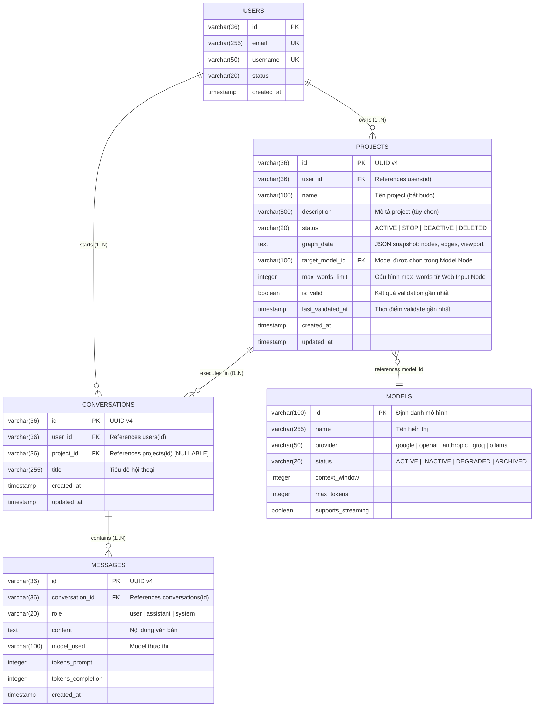
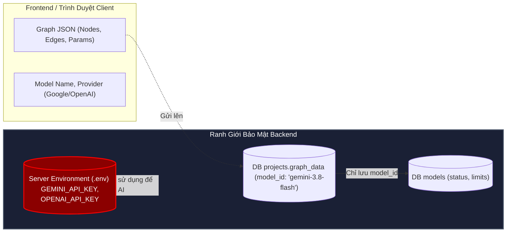

# 03. THIẾT KẾ MÔ HÌNH MIỀN VÀ CƠ SỞ DỮ LIỆU (DOMAIN & DATA MODEL SPECIFICATION)
## Nhánh Tính Năng: Quản Lý Project (Project Management MVP)
### Hệ Thống: AI-Chan Virtual Assistant Platform

---

| Thông Tin Tài Liệu | Chi Tiết |
| :--- | :--- |
| **Mã Tài Liệu** | `DOC-PRJ-03` |
| **Trạng Thái** | `PROPOSED (Chờ Duyệt Từ Product Owner)` |
| **Vai Trò Phụ Trách** | Solution Architect & Database Architect |
| **Phiên Bản** | `1.0.0-MVP` |
| **Ngày Lập** | `2026-10-11` |

---

> [!IMPORTANT]
> **Tuyên Bố Ranh Giới Kỹ Thuật (Specification Boundary Notice)**:
> Tài liệu này là **bản đặc tả thiết kế kiến trúc dữ liệu đề xuất (Proposed Specification)**. Các thực thể và bảng dữ liệu mới dưới đây **CHƯA ĐƯỢC TẠO HOẶC MIGRATION** vào cơ sở dữ liệu `app.db` thực tế của dự án. Không tự ý thực thi script SQL vào database sản phẩm khi chưa qua cổng phê duyệt Architecture Gate.

---

## 1. Phân Loại Thực Thể: Hiện Có vs Đề Xuất (Entity Inventory)

| Tên Thực Thể | Bounded Context | Trạng Thái Hiện Tại | Vai Trò & Trách Nhiệm Trong Hệ Thống |
| :--- | :--- | :--- | :--- |
| **`User`** (`users`) | Identity & Access | **FACT (Đã tồn tại trong DB)** | Đại diện cho chủ sở hữu tài khoản người dùng, liên kết khóa ngoại với các project do họ tạo. |
| **`Model`** (`models`) | Model Catalog | **FACT (Đã tồn tại trong DB)** | Danh mục các mô hình LLM từ các nhà cung cấp (Gemini, OpenAI, Claude, Groq, Ollama), cung cấp metadata về giới hạn token, streaming và trạng thái khả dụng. |
| **`Conversation`** (`conversations`)| Chat & Conversation | **FACT (Đã tồn tại trong DB)** | Phiên trò chuyện giữa người dùng và AI Assistant. Trong đề xuất này, sẽ được mở rộng liên kết với Project đang thực thi. |
| **`Message`** (`messages`) | Chat & Conversation | **FACT (Đã tồn tại trong DB)** | Lượt phát ngôn (User / Assistant) trong phiên hội thoại. |
| **`Project`** (`projects`) | Project Management | **PROPOSED (Đề xuất mới)** | **Aggregate Root** của phân hệ Project, lưu thông tin định danh, chủ sở hữu, trạng thái nghiệp vụ (`active`, `stop`, `deactive`), hạn ngạch và cấu trúc đồ thị luồng xử lý. |
| **`ProjectGraph`** (Embedded JSON) | Project Management | **PROPOSED (Đề xuất mới)** | Giá trị đối tượng (Value Object) chứa snapshot toàn bộ danh sách Nodes, Edges và Viewport trên Canvas. |
| **`NodeConfig`** (Embedded JSON) | Project Management | **PROPOSED (Đề xuất mới)** | Giá trị đối tượng cấu hình chi tiết cho từng loại Node (`Web Input`, `Model`, `Output`). |

---

## 2. Sơ Đồ Thực Thể Quan Hệ ERD & Class Diagram (`PRJ-DIAG-ERD-001`)



---

## 3. Cấu Trúc Chi Tiết Bảng Dữ Liệu Đề Xuất (Proposed Database Schema)

### 3.1. Bảng `projects` (Đề Xuất Mới - Aggregate Root)

```sql
-- ĐỀ XUẤT MỚI: BẢNG QUẢN LÝ DỰ ÁN (PROJECTS)
-- Bounded Context: Project Management
-- Invariants:
--   1. user_id là khóa ngoại bắt buộc tham chiếu users(id) ON DELETE CASCADE
--   2. status chỉ nhận 1 trong 4 giá trị: 'ACTIVE', 'STOP', 'DEACTIVE', 'DELETED'
--   3. name có độ dài từ 1 đến 100 ký tự, không rỗng
CREATE TABLE IF NOT EXISTS projects (
    id VARCHAR(36) PRIMARY KEY, -- Định danh duy nhất UUID v4
    user_id VARCHAR(36) NOT NULL, -- Chủ sở hữu project (Anti-IDOR)
    name VARCHAR(100) NOT NULL, -- Tên hiển thị của project
    description VARCHAR(500), -- Mô tả mục đích sử dụng
    status VARCHAR(20) NOT NULL DEFAULT 'STOP' CHECK (status IN ('ACTIVE', 'STOP', 'DEACTIVE', 'DELETED')),
    graph_data TEXT, -- Cấu trúc đồ thị lưu trữ dưới dạng JSON chuẩn
    target_model_id VARCHAR(100), -- Denormalized: ID mô hình chọn trong Model Node để query nhanh
    max_words_limit INTEGER DEFAULT 500, -- Denormalized: Giới hạn từ từ Web Input Node
    is_valid BOOLEAN NOT NULL DEFAULT 0 CHECK (is_valid IN (0, 1)), -- Cờ đánh dấu tính hợp lệ của graph
    last_validated_at TIMESTAMP, -- Thời điểm kiểm tra tính hợp lệ gần nhất
    created_at TIMESTAMP NOT NULL DEFAULT CURRENT_TIMESTAMP,
    updated_at TIMESTAMP NOT NULL DEFAULT CURRENT_TIMESTAMP,
    FOREIGN KEY (user_id) REFERENCES users(id) ON DELETE CASCADE,
    FOREIGN KEY (target_model_id) REFERENCES models(id) ON DELETE SET NULL
);

-- Chỉ mục tối ưu hóa truy vấn danh sách project theo người dùng (Sidebar / Project List)
CREATE INDEX IF NOT EXISTS idx_projects_user_updated ON projects(user_id, updated_at DESC);

-- Chỉ mục tối ưu hóa truy vấn các project ACTIVE của người dùng (Trang Chủ & Quota Check)
CREATE INDEX IF NOT EXISTS idx_projects_user_status ON projects(user_id, status);

-- Chỉ mục lọc theo model được gán
CREATE INDEX IF NOT EXISTS idx_projects_target_model ON projects(target_model_id);

-- Trigger tự động cập nhật updated_at khi có chỉnh sửa bản ghi project
CREATE TRIGGER IF NOT EXISTS trg_projects_updated_at
AFTER UPDATE ON projects
FOR EACH ROW
BEGIN
    UPDATE projects SET updated_at = CURRENT_TIMESTAMP WHERE id = OLD.id;
END;
```

---

### 3.2. Cập Nhật Bảng Hiện Hữu: Bổ Sung Khóa Ngoại Vào `conversations` (Đề Xuất Migration)

```sql
-- ĐỀ XUẤT CẬP NHẬT: Thêm cột project_id vào bảng conversations hiện hữu
-- Mục đích: Cho biết cuộc trò chuyện này được tạo và thực thi thông qua Project nào
ALTER TABLE conversations ADD COLUMN project_id VARCHAR(36) REFERENCES projects(id) ON DELETE SET NULL;

-- Chỉ mục tối ưu hóa truy vấn lịch sử chat theo từng project
CREATE INDEX IF NOT EXISTS idx_conversations_project_id ON conversations(project_id);
```

---

## 4. Đặc Tả Chuẩn Cấu Trúc Graph JSON (`graph_data` Schema Specification)

Để đảm bảo hiệu năng và khả năng mở rộng (Extensibility), cấu trúc đồ thị canvas được tuần tự hóa (Serialize) thành chuỗi JSON theo chuẩn của React Flow (`@xyflow/react`) và lưu trong cột `projects.graph_data`.

### 4.1. Cấu Trúc JSON Hoàn Chỉnh Mẫu (Valid MVP Graph)

```json
{
  "version": "1.0",
  "viewport": {
    "x": 120.5,
    "y": 80.0,
    "zoom": 1.0
  },
  "nodes": [
    {
      "id": "node_input_1",
      "type": "web_input",
      "position": { "x": 100, "y": 200 },
      "data": {
        "label": "Web Input",
        "description": "Tiếp nhận nội dung người dùng nhập từ giao diện chat web",
        "config": {
          "max_words": 500,
          "placeholder": "Nhập yêu cầu của bạn tại đây...",
          "allow_empty": false
        }
      }
    },
    {
      "id": "node_model_1",
      "type": "model",
      "position": { "x": 450, "y": 200 },
      "data": {
        "label": "Model LLM",
        "description": "Xử lý trí tuệ nhân tạo thông qua cổng AI Provider",
        "config": {
          "model_id": "gemini-3.8-flash",
          "provider": "google",
          "temperature": 0.7,
          "max_tokens": 2048,
          "system_instruction": "Bạn là một trợ lý chuyên nghiệp, thân thiện và chính xác."
        }
      }
    },
    {
      "id": "node_output_1",
      "type": "output",
      "position": { "x": 800, "y": 200 },
      "data": {
        "label": "Web Output",
        "description": "Định dạng và phản hồi văn bản về giao diện chat",
        "config": {
          "streaming": true,
          "render_markdown": true,
          "show_copy_button": true
        }
      }
    }
  ],
  "edges": [
    {
      "id": "edge_input_to_model",
      "source": "node_input_1",
      "target": "node_model_1",
      "sourceHandle": "output_handle",
      "targetHandle": "input_handle",
      "type": "smoothstep",
      "animated": true
    },
    {
      "id": "edge_model_to_output",
      "source": "node_model_1",
      "target": "node_output_1",
      "sourceHandle": "output_handle",
      "targetHandle": "input_handle",
      "type": "smoothstep",
      "animated": true
    }
  ]
}
```

---

## 5. Ràng Buộc & Tính Bất Biến Của Dữ Liệu (Invariants & Integrity Constraints)

1. **Ràng buộc Quyền Sở Hữu (Ownership Invariant)**:
   - Bản ghi `projects` phải có `user_id` hợp lệ và tồn tại trong `users`.
   - Mọi thao tác truy vấn dữ liệu từ API bắt buộc phải kèm mệnh đề `WHERE user_id = :current_user_id`.
2. **Ràng buộc Tính Hợp Lệ Của Cấu Trúc Graph (Graph Topology Invariants)**:
   - `nodes` phải là một mảng gồm **chính xác 3 phần tử**.
   - Mảng `nodes` phải chứa đúng 1 node có `type = 'web_input'`, đúng 1 node có `type = 'model'`, và đúng 1 node có `type = 'output'`.
   - `edges` phải là một mảng gồm **chính xác 2 phần tử**.
   - Cạnh thứ nhất: `source` phải là ID của node `web_input`, `target` phải là ID của node `model`.
   - Cạnh thứ hai: `source` phải là ID của node `model`, `target` phải là ID của node `output`.
3. **Ràng buộc Cấu Hình Tham Số (Parameter Boundary Invariants)**:
   - Trong `web_input`: $10 \le \text{max\_words} \le 4000$.
   - Trong `model`: `model_id` phải tồn tại trong bảng `models` với `status = 'ACTIVE'`; $0.0 \le \text{temperature} \le 2.0$; $256 \le \text{max\_tokens} \le \text{models.max\_tokens}$.
4. **Ràng buộc Hạn Ngạch Dự Án Hoạt Động (Active Quota Invariant)**:
   $$\sum_{p \in \text{Projects}(u)} \mathbb{I}(p.\text{status} = \text{'ACTIVE'}) \le \text{MAX\_ACTIVE\_PROJECTS}$$
   với mọi người dùng $u$ tại bất kỳ thời điểm nào.

---

## 6. Phân Định Ranh Giới Dữ Liệu Nhạy Cảm (Sensitive Data Boundary)



> [!CAUTION]
> **Quy Tắc Bảo Vệ API Key Tuyệt Đối**:
> Bảng `projects`, cột `graph_data`, và các response API của phân hệ Project **TUYỆT ĐỐI KHÔNG BAO GIỜ** được chứa chuỗi khóa bí mật `API_KEY`. Khóa bí mật chỉ được lưu trên Server Environment của Backend và được nạp vào lúc thực thi gọi cổng AI Gateway.
