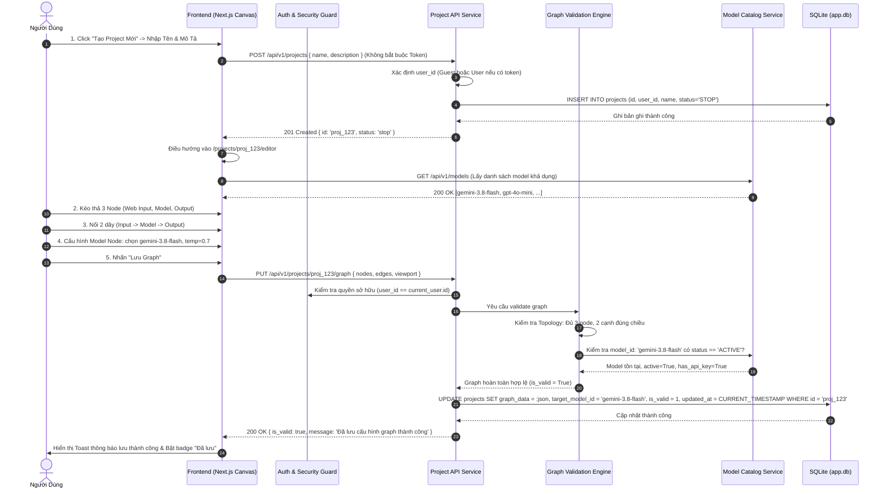
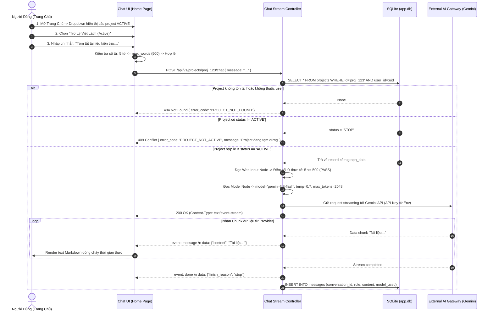
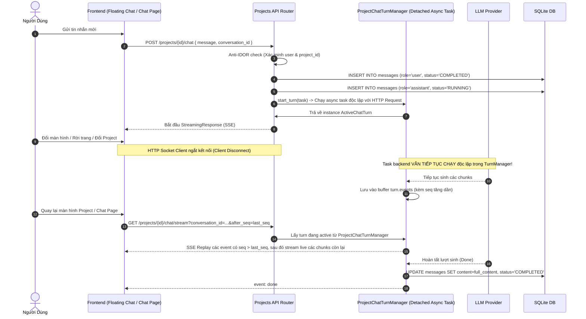
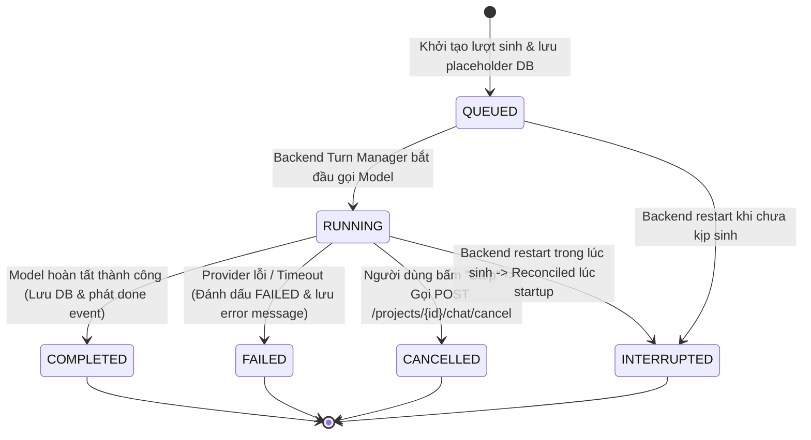

# 04. KIẾN TRÚC HỆ THỐNG VÀ HỢP ĐỒNG GIAO TIẾP API (ARCHITECTURE & API CONTRACTS)
## Nhánh Tính Năng: Quản Lý Project (Project Management MVP)
### Hệ Thống: AI-Chan Virtual Assistant Platform

---

| Thông Tin Tài Liệu | Chi Tiết |
| :--- | :--- |
| **Mã Tài Liệu** | `DOC-PRJ-04` |
| **Trạng Thái** | `PROPOSED (Chờ Duyệt Từ Product Owner & Architecture Gate)` |
| **Vai Trò Phụ Trách** | Solution Architect & Senior Fullstack Engineer |
| **Phiên Bản** | `1.0.0-MVP` |
| **Ngày Lập** | `2026-10-11` |

---

> [!IMPORTANT]
> **Tuyên Bố Hợp Đồng API Đề Xuất (Proposed API Contract Notice)**:
> Toàn bộ các endpoints có tiền tố `/api/v1/projects/*` dưới đây là **hợp đồng giao tiếp kỹ thuật đề xuất (PROPOSED CONTRACT)**. Chúng chưa được lập trình vào mã nguồn backend `ai-backend/src/api/v1/`. Tài liệu này đóng vai trò là căn cứ thiết kế để đội ngũ lập trình viên hiện thực hóa mã nguồn sau khi được phê duyệt.

---

## 1. Sơ Đồ Ngữ Cảnh Hệ Thống (System Context Diagram - `PRJ-DIAG-CTX-001`)

```mermaid
flowchart TD
    User["Người Dùng (Registered User) \n [Trình duyệt Web / Client]"]

    subgraph AIChanPlatform["Nền Tảng AI-Chan (System Boundary)"]
        Frontend["Next.js Web Frontend (SPA) \n - Trang Chủ (/)\n - Danh Sách Project (/projects)\n - Visual Canvas Editor (/projects/:id/editor)"]
        Backend["FastAPI Backend Service \n - Auth & Security Middleware\n - Project Domain Service\n - Graph Validation Engine\n - Quota & Concurrency Controller\n - LLM Gateway Orchestrator"]
        Database[("SQLite Database (app.db) \n - users\n - projects (MỚI)\n - models\n - conversations\n - messages")]
    end

    subgraph ExternalProviders["Nhà Cung Cấp Mô Hình Ngoài (AI Providers)"]
        GeminiAPI["Google Gemini API (Cloud)"]
        OpenAIAPI["OpenAI API (Cloud)"]
        AnthropicAPI["Anthropic Claude API (Cloud)"]
        GroqAPI["Groq Cloud API (Fast Inference)"]
        OllamaServer["Ollama Local Server (On-Premise)"]
    end

    User -->|1. Tương tác Canvas, Đổi trạng thái, Chat| Frontend
    Frontend -->|2. REST API & SSE Streaming (JWT Auth)| Backend
    Backend -->|3. Đọc/Ghi dữ liệu (SQL Transactions)| Database
    Backend -->|4. Gọi suy luận LLM (API Key bí mật)| ExternalProviders
```

---

## 2. Phân Tách Trách Nhiệm Thành Phần (Component Boundaries & Responsibilities)

| Tầng Hệ Thống | Thành Phần Cụ Thể | Trách Nhiệm Kỹ Thuật (Responsibilities) |
| :--- | :--- | :--- |
| **Frontend (Next.js)** | `ProjectListPage` | Hiển thị danh sách project của người dùng, thanh trạng thái Quota (`X/MAX_ACTIVE`), nút tạo mới, nút bật/tắt trạng thái. |
| **Frontend (Next.js)** | `VisualCanvasEditor` (`@xyflow/react`) | Render đồ thị node-based, quản lý viewport (pan/zoom), tương tác kéo-thả, bắt lỗi kết nối sai chiều trực quan, mở Drawer cấu hình node. |
| **Frontend (Next.js)** | `HomeProjectSelector` | Tải danh sách project đang `active` trên Trang Chủ, hiển thị dropdown chọn project và kiểm tra số từ của tin nhắn trước khi gửi. |
| **Backend (FastAPI)** | `ProjectRouter` (`/api/v1/projects`) | Tiếp nhận các request HTTP REST, xác thực JWT, ủy quyền kiểm tra quyền sở hữu project (`Anti-IDOR Guard`). |
| **Backend (FastAPI)** | `GraphValidationEngine` | Kiểm tra tính hợp lệ của graph: đủ 3 node (`web_input`, `model`, `output`), đúng 2 edge có hướng, model được chọn đang `ACTIVE` và có API key. |
| **Backend (FastAPI)** | `ProjectQuotaManager` | Kiểm tra và quản lý hạn ngạch `MAX_ACTIVE_PROJECTS`, thực thi Atomic Transaction khi chuyển trạng thái sang `ACTIVE` để chống Race Condition. |
| **Backend (FastAPI)** | `ProjectChatExecutor` | Đọc cấu hình graph đã lưu, trích xuất tham số `max_words`, `model_id`, `temperature`, gọi `LLM Gateway` và phản hồi SSE chunks về client. |
| **Persistence (SQLite)** | Bảng `projects` | Lưu trữ metadata, trạng thái (`active`, `stop`, `deactive`), và snapshot cấu trúc `graph_data` dạng JSON. |

---

## 3. Sơ Đồ Tuần Tự (Sequence Diagrams)

### 3.1. Sơ Đồ Tuần Tự: Tạo Mới, Chỉnh Sửa & Lưu Graph (`PRJ-DIAG-SEQ-001`)



---

### 3.2. Sơ Đồ Tuần Tự: Thực Thi Chat Qua Project Đang Active (`PRJ-DIAG-SEQ-003`)



---

## 4. Đặc Tả Hợp Đồng API REST Chi Tiết (Proposed REST API Contracts)

### Danh Sách Endpoints Thuộc Nhánh Project:
1. `GET /api/v1/projects` - Lấy danh sách project của người dùng.
2. `POST /api/v1/projects` - Tạo mới project cơ bản.
3. `GET /api/v1/projects/{id}` - Lấy chi tiết thông tin và graph của project.
4. `PATCH /api/v1/projects/{id}` - Cập nhật Tên và Mô tả project.
5. `PUT /api/v1/projects/{id}/graph` - Lưu cấu trúc graph và cấu hình node.
6. `POST /api/v1/projects/{id}/validate` - Kiểm tra tính hợp lệ của graph mà không lưu.
7. `POST /api/v1/projects/{id}/activate` - Kích hoạt project sang trạng thái `active`.
8. `POST /api/v1/projects/{id}/stop` - Tạm dừng project (về `stop`).
9. `POST /api/v1/projects/{id}/deactivate` - Vô hiệu hóa project (về `deactive`).
10. `DELETE /api/v1/projects/{id}` - Xóa project (Soft delete).
11. `GET /api/v1/projects/active` - Lấy danh sách project `active` phục vụ Trang Chủ.
12. `GET /api/v1/projects/quota` - Lấy thông tin hạn ngạch `MAX_ACTIVE_PROJECTS`.
13. `POST /api/v1/projects/{id}/chat` - Thực thi phiên chat qua project bằng luồng SSE.

---

### 4.1. `POST /api/v1/projects` - Tạo Mới Project
- **Phương thức**: `POST`
- **Đường dẫn**: `/api/v1/projects`
- **Xác thực**: **Không bắt buộc** (Hỗ trợ cả Khách Vãng Lai và Người Dùng Đã Đăng Ký; nếu không có token, hệ thống tự động gán tài khoản khách `guest_user`)
- **Request Body**:
```json
{
  "name": "Trợ Lý Kỹ Thuật",
  "description": "Project hỗ trợ phân tích tài liệu và viết mã nguồn Python"
}
```
- **Validation**:
  - `name`: String, 1 - 100 ký tự (bắt buộc, không toàn khoảng trắng).
  - `description`: String, tối đa 500 ký tự (tùy chọn, nullable).
- **Phản hồi Thành Công (201 Created)**:
```json
{
  "id": "proj_a1b2c3d4-e5f6-7890-abcd-ef1234567890",
  "user_id": "usr_98765432-10ab-cdef-0123-456789abcdef",
  "name": "Trợ Lý Kỹ Thuật",
  "description": "Project hỗ trợ phân tích tài liệu và viết mã nguồn Python",
  "status": "STOP",
  "is_valid": false,
  "node_count": 0,
  "created_at": "2026-10-11T15:30:00Z",
  "updated_at": "2026-10-11T15:30:00Z"
}
```

---

### 4.2. `PUT /api/v1/projects/{id}/graph` - Lưu Cấu Trúc Graph
- **Phương thức**: `PUT`
- **Đường dẫn**: `/api/v1/projects/{id}/graph`
- **Xác thực**: Bắt buộc (`Authorization: Bearer <jwt_token>`)
- **Request Body**: Cấu trúc JSON chuẩn chứa `viewport`, `nodes`, `edges` (Xem đặc tả tại tài liệu `03-domain-data-model.md`).
- **Phản hồi Thành Công (200 OK)**:
```json
{
  "project_id": "proj_a1b2c3d4-e5f6-7890-abcd-ef1234567890",
  "is_valid": true,
  "validation_details": {
    "has_web_input": true,
    "has_model": true,
    "has_output": true,
    "edges_connected_properly": true,
    "selected_model": "gemini-3.8-flash",
    "model_status": "ACTIVE"
  },
  "updated_at": "2026-10-11T15:35:00Z",
  "message": "Lưu cấu trúc graph thành công"
}
```
- **Phản hồi Thất Bại (422 Unprocessable Entity - Graph Không Hợp Lệ)**:
```json
{
  "error_code": "INVALID_GRAPH_STRUCTURE",
  "message": "Cấu trúc đồ thị không hợp lệ",
  "errors": [
    "Thiếu kết nối từ Model Node sang Output Node",
    "Mô hình AI 'claude-unknown' không tồn tại trong danh mục hệ thống"
  ]
}
```

---

### 4.3. `POST /api/v1/projects/{id}/activate` - Kích Hoạt Project Sang `ACTIVE`
- **Phương thức**: `POST`
- **Đường dẫn**: `/api/v1/projects/{id}/activate`
- **Xác thực**: Bắt buộc (`Authorization: Bearer <jwt_token>`)
- **Phản hồi Thành Công (200 OK)**:
```json
{
  "id": "proj_a1b2c3d4-e5f6-7890-abcd-ef1234567890",
  "status": "ACTIVE",
  "active_quota": {
    "active_count": 2,
    "max_limit": 3,
    "remaining_slots": 1
  },
  "message": "Project đã được kích hoạt thành công"
}
```
- **Phản hồi Thất Bại Khi Hết Hạn Ngạch (409 Conflict)**:
```json
{
  "error_code": "QUOTA_EXCEEDED",
  "message": "Không thể kích hoạt project: Bạn đã đạt giới hạn tối đa 3 project hoạt động đồng thời",
  "active_quota": {
    "active_count": 3,
    "max_limit": 3,
    "remaining_slots": 0
  }
}
```
- **Phản hồi Thất Bại Khi Graph Chưa Hợp Lệ (400 Bad Request)**:
```json
{
  "error_code": "GRAPH_NOT_VALID",
  "message": "Không thể kích hoạt project vì cấu hình graph chưa hoàn thiện hoặc chưa hợp lệ. Vui lòng kiểm tra lại trên Canvas."
}
```

---

### 4.4. `POST /api/v1/projects/{id}/chat` - Thực Thi Chat Qua Project (SSE)
- **Phương thức**: `POST`
- **Đường dẫn**: `/api/v1/projects/{id}/chat`
- **Header**:
  - `Authorization: Bearer <jwt_token>`
  - `Accept: text/event-stream`
- **Request Body**:
```json
{
  "message": "Viết giúp tôi hàm tính số Fibonacci bằng Python với đệ quy có nhớ (Memoization)",
  "conversation_id": "conv_99887766-5544-3322-1100-aabbccddeeff"
}
```
- **Phản hồi Dòng Chảy SSE (200 OK - `Content-Type: text/event-stream`)**:
```
event: start
data: {"project_id": "proj_a1b2c3d4", "model": "gemini-3.8-flash"}

event: message
data: {"content": "Chào bạn! "}

event: message
data: {"content": "Dưới đây là hàm tính Fibonacci bằng Python:\n\n```python\n"}

event: message
data: {"content": "def fib(n, memo={}):\n    if n in memo: return memo[n]\n    if n <= 1: return n\n    memo[n] = fib(n-1, memo) + fib(n-2, memo)\n    return memo[n]\n```"}

event: done
data: {"finish_reason": "stop", "prompt_words": 15, "tokens_used": 128}
```
- **Phản hồi Thất Bại Do Vượt Quá Số Từ (400 Bad Request)**:
```json
{
  "error_code": "WORD_LIMIT_EXCEEDED",
  "message": "Tin nhắn của bạn có 650 từ, vượt quá giới hạn tối đa 500 từ của Project này",
  "actual_words": 650,
  "max_words": 500
}
```

---

### 4.5. `GET /api/v1/projects/{id}/conversation` - Lấy hoặc Khởi Tạo Idempotent Conversation Chính của Project
- **Phương thức**: `GET`
- **Đường dẫn**: `/api/v1/projects/{id}/conversation`
- **Header**:
  - `Authorization: Bearer <jwt_token>`
- **Mô tả**: Trả về cuộc hội thoại đang tiếp diễn của người dùng cho Project này. Nếu chưa có, tạo mới và gắn `project_id`. Đảm bảo tính Idempotent khi mở lại trang hoặc từ 2 tab cùng lúc.
- **Phản hồi Thành Công (200 OK)**:
```json
{
  "conversation": {
    "id": "conv_99887766-5544-3322-1100-aabbccddeeff",
    "user_id": "user_123",
    "project_id": "proj_a1b2c3d4",
    "title": "Project Chat - Trợ Lý Kỹ Thuật",
    "created_at": "2026-10-17T03:30:00Z",
    "updated_at": "2026-10-17T03:45:00Z"
  }
}
```
- **Phản hồi Thất Bại (404 Not Found)**:
```json
{
  "detail": "Project không tồn tại hoặc bạn không có quyền truy cập."
}
```

---

### 4.6. `GET /api/v1/projects/{id}/chat/stream` - Nối Lại Luồng SSE và Replay Event Cho Lượt Đang Sinh
- **Phương thức**: `GET`
- **Đường dẫn**: `/api/v1/projects/{id}/chat/stream?conversation_id={conv_id}&after_seq={seq}`
- **Header**:
  - `Authorization: Bearer <jwt_token>`
  - `Accept: text/event-stream`
- **Tham số Query**:
  - `conversation_id`: Bắt buộc. Định danh cuộc trò chuyện.
  - `after_seq`: Tùy chọn (mặc định -1). Sequence number của event cuối cùng mà client đã nhận trước khi ngắt kết nối.
- **Mô tả**: Cho phép client khi rời màn hình hoặc tải lại trang kết nối lại với tác vụ sinh chạy ngầm ở backend (`ProjectChatTurnManager`). Backend sẽ phát lại các chunk/event có sequence > `after_seq` và tiếp tục streaming trực tiếp.
- **Phản hồi SSE (200 OK - `Content-Type: text/event-stream`)**:
```
event: chunk
data: {"token": " và tiếp tục xử lý", "seq": 12}

event: done
data: {"status": "done", "finish_reason": "stop", "turn_id": "turn_123", "message_id": "msg_456", "model": "gemini-3.8-flash", "tokens_prompt": 25, "conversation_id": "conv_99887766"}
```
- **Phản hồi Không Có Turn Hoạt Động (404 Not Found)**: Nếu lượt đã hoàn tất hoặc không tồn tại.

---

### 4.7. `POST /api/v1/projects/{id}/chat/cancel` - Hủy Lượt Sinh Theo Yêu Cầu Người Dùng (Stop Button)
- **Phương thức**: `POST`
- **Đường dẫn**: `/api/v1/projects/{id}/chat/cancel`
- **Header**:
  - `Authorization: Bearer <jwt_token>`
  - `Content-Type: application/json`
- **Request Body**:
```json
{
  "conversation_id": "conv_99887766-5544-3322-1100-aabbccddeeff"
}
```
- **Phản hồi Thành Công (200 OK)**:
```json
{
  "success": true,
  "message": "Đã hủy lượt sinh thành công."
}
```

---

## 5. Sơ Đồ Tuần Tự: Luồng Chạy Ngầm Bền Vững & Nối Lại Luồng (Turn Lifecycle & Stream Reconnect)



---

## 6. Sơ Đồ Trạng Thái: Vòng Đời Lượt Sinh Chat (Turn Lifecycle State Diagram)



