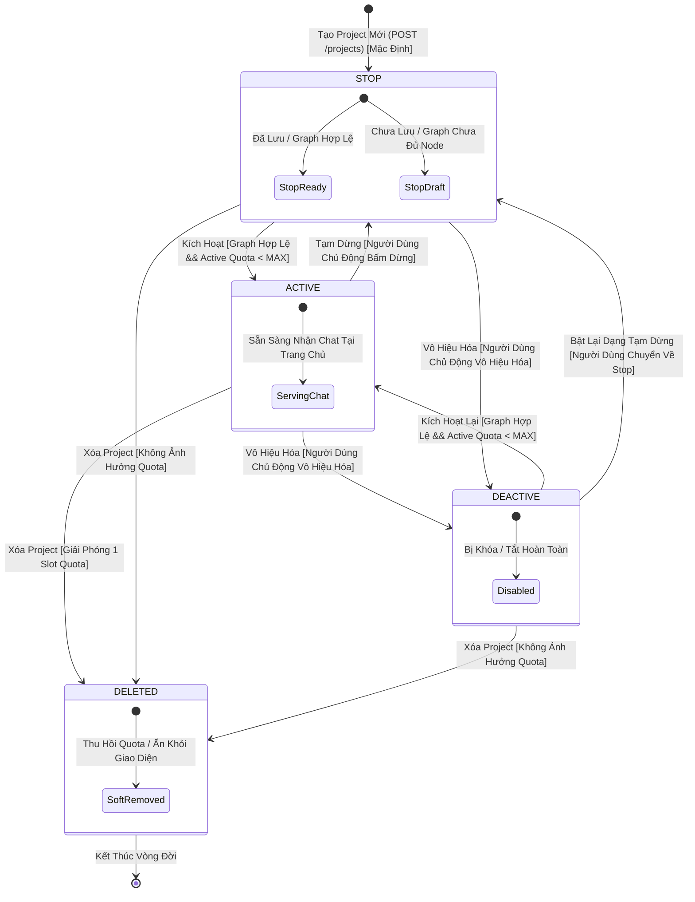
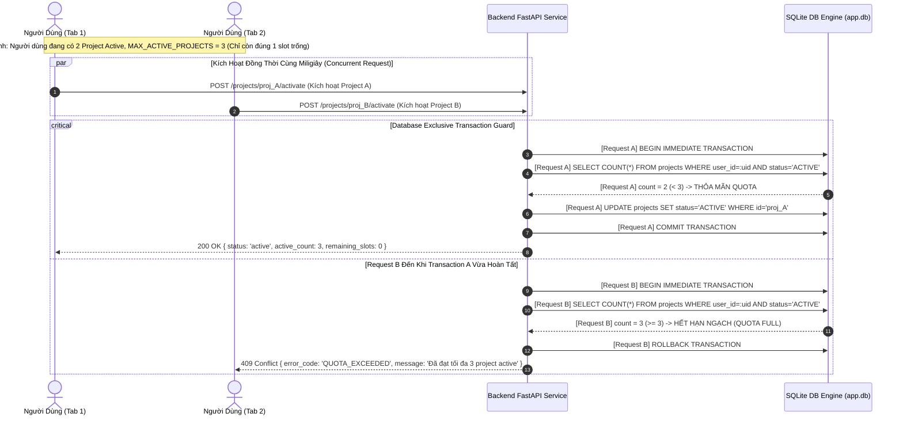
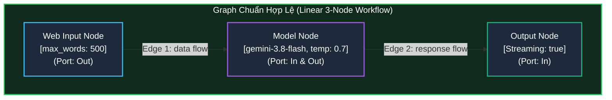
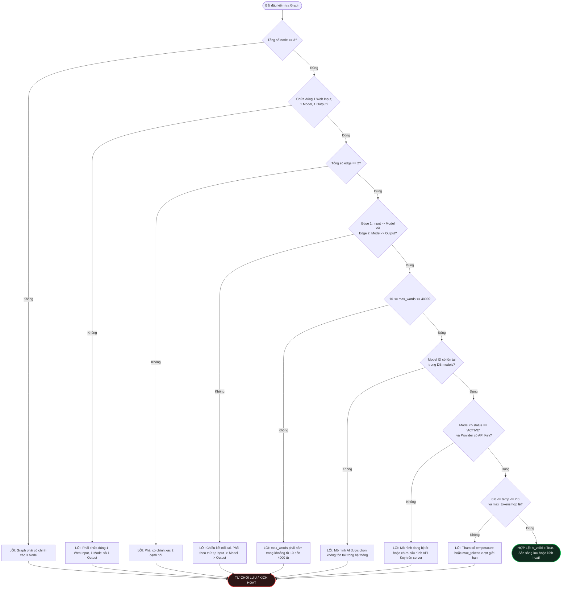

# 05. MÁY TRẠNG THÁI VÀ BỘ QUY TẮC KIỂM TRA HỢP LỆ GRAPH (STATE MACHINE & GRAPH VALIDATION)
## Nhánh Tính Năng: Quản Lý Project (Project Management MVP)
### Hệ Thống: AI-Chan Virtual Assistant Platform

---

| Thông Tin Tài Liệu | Chi Tiết |
| :--- | :--- |
| **Mã Tài Liệu** | `DOC-PRJ-05` |
| **Trạng Thái** | `PROPOSED (Chờ Duyệt Từ Product Owner)` |
| **Vai Trò Phụ Trách** | Solution Architect & Senior QA Engineer |
| **Phiên Bản** | `1.0.0-MVP` |
| **Ngày Lập** | `2026-10-11` |

---

## 1. Sơ Đồ Máy Trạng Thái Vòng Đời Project (State Diagram - `PRJ-DIAG-STATE-001`)

Hệ thống quản lý vòng đời của một Project thông qua 3 trạng thái nghiệp vụ chính thức (`STOP`, `ACTIVE`, `DEACTIVE`) và 1 trạng thái xóa mềm nội bộ (`DELETED`).

---

## 2. Bảng Chuyển Đổi Trạng Thái & Tác Dụng Phụ (State Transition Table)

| Trạng Thái Nguồn | Sự Kiện Kích Hoạt (Trigger Event) | Điều Kiện Ràng Buộc (Guard Conditions) | Trạng Thái Đích | Tác Dụng Phụ / Hành Động Kèm Theo (Side Effects) |
| :--- | :--- | :--- | :--- | :--- |
| `[*]` (Chưa có) | `CREATE_PROJECT` | Tên project hợp lệ (1-100 ký tự) | `STOP` | Khởi tạo bản ghi với `status = 'STOP'`, `is_valid = 0`. Không chiếm slot quota active. |
| `STOP` | `ACTIVATE_PROJECT` | Graph hợp lệ (`is_valid == 1`) **VÀ** `active_count < MAX_ACTIVE_PROJECTS` | `ACTIVE` | Tăng số lượng active project của user lên 1. Project xuất hiện trong dropdown chọn chat tại Trang Chủ. |
| `ACTIVE` | `STOP_PROJECT` | Người dùng chủ động gửi lệnh tạm dừng | `STOP` | Giảm số lượng active project của user đi 1 (giải phóng 1 slot quota). Project bị ẩn khỏi Trang Chủ; các request chat đang chạy tiếp tục hoàn tất. |
| `ACTIVE` | `DEACTIVATE_PROJECT` | Người dùng chủ động gửi lệnh vô hiệu hóa | `DEACTIVE` | Giảm số lượng active project đi 1. Project bị ẩn khỏi Trang Chủ; chuyển sang nhóm "Đã vô hiệu hóa". |
| `STOP` | `DEACTIVATE_PROJECT` | Người dùng chủ động gửi lệnh vô hiệu hóa | `DEACTIVE` | Chuyển trạng thái sang `DEACTIVE`. Không ảnh hưởng quota (vì trước đó đang ở `STOP`). |
| `DEACTIVE` | `ACTIVATE_PROJECT` | Graph hợp lệ (`is_valid == 1`) **VÀ** `active_count < MAX_ACTIVE_PROJECTS` | `ACTIVE` | Tăng số lượng active project lên 1. Project xuất hiện trở lại trên Trang Chủ. |
| `DEACTIVE` | `STOP_PROJECT` | Người dùng muốn đưa về trạng thái chờ chỉnh sửa | `STOP` | Chuyển trạng thái sang `STOP`. Sẵn sàng để mở editor và kích hoạt sau. |
| `ACTIVE` | `DELETE_PROJECT` | Người dùng xác nhận xóa | `DELETED` | Tự động giải phóng 1 slot quota active. Đánh dấu xóa mềm, ẩn khỏi danh sách. |
| `STOP` / `DEACTIVE` | `DELETE_PROJECT` | Người dùng xác nhận xóa | `DELETED` | Đánh dấu xóa mềm, ẩn khỏi danh sách. Quota không đổi. |

---

## 3. Sơ Đồ Kích Hoạt An Toàn Hạn Ngạch & Chống Race Condition (`PRJ-DIAG-SEQ-002`)

---

## 4. Cấu Trúc Graph Chuẩn & Các Trường Hợp Không Hợp Lệ (`PRJ-DIAG-WF-001`)

### 4.1. Cấu Trúc Graph Hợp Lệ Tuyệt Đối Trong MVP (Golden Standard)

---

### 4.2. Các Trường Hợp Graph Bị Từ Chối (Invalid Graph Scenarios)

```mermaid
flowchart TD
    subgraph Case1["Trường Hợp Lỗi 1: Nối Tắt Bỏ Qua Model"]
        C1_In["Web Input"] -->|Sai: Nối trực tiếp| C1_Out["Output"]
        C1_Model["Model Node (Bị cô lập)"]
    end

    subgraph Case2["Trường Hợp Lỗi 2: Thừa Node Trùng Loại"]
        C2_In["Web Input"] --> C2_M1["Model Node 1"]
        C2_M1 --> C2_M2["Model Node 2 (Thừa)"]
        C2_M2 --> C2_Out["Output"]
    end

    subgraph Case3["Trường Hợp Lỗi 3: Nối Vòng / Chu Trình (Cycle)"]
        C3_In["Web Input"] --> C3_Model["Model Node"]
        C3_Model --> C3_Out["Output"]
        C3_Out -.->|Sai: Nối ngược tạo vòng| C3_Model
    end

    subgraph Case4["Trường Hợp Lỗi 4: Thiếu Cạnh Kết Nối"]
        C4_In["Web Input"] --> C4_Model["Model Node"]
        C4_Out["Output (Chưa nối)"]
    end

    style Case1 fill:#2d1515,stroke:#ef4444,stroke-width:1px
    style Case2 fill:#2d1515,stroke:#ef4444,stroke-width:1px
    style Case3 fill:#2d1515,stroke:#ef4444,stroke-width:1px
    style Case4 fill:#2d1515,stroke:#ef4444,stroke-width:1px
```

---

## 5. Quy Trình Quyết Định Kiểm Tra Tính Hợp Lệ (Validation Decision Flow - `PRJ-DIAG-FLOW-001`)

---

## 6. Ma Trận Kiểm Tra Tính Hợp Lệ Chi Tiết (Validation Rule Matrix)

| Cấp Độ Kiểm Tra | Hạng Mục Kiểm Tra | Điều Kiện Kiểm Tra Thành Công (Pass Rule) | Mã Lỗi Khi Thất Bại | Thông Báo Lỗi Trả Về Người Dùng |
| :--- | :--- | :--- | :--- | :--- |
| **Topology** | Số lượng Node | `len(nodes) == 3` | `ERR_NODE_COUNT` | *"Graph phải chứa chính xác 3 Node: Web Input, Model và Output"* |
| **Topology** | Thành phần loại Node | Chứa đúng 1 `web_input`, 1 `model`, 1 `output` | `ERR_NODE_COMPOSITION` | *"Graph phải có đúng 1 Web Input Node, 1 Model Node và 1 Output Node"* |
| **Topology** | Số lượng Edge | `len(edges) == 2` | `ERR_EDGE_COUNT` | *"Graph phải chứa chính xác 2 cạnh nối liền mạch"* |
| **Topology** | Hướng cạnh 1 | `edge1.source == input.id` VÀ `edge1.target == model.id` | `ERR_EDGE_INPUT_MODEL` | *"Cổng xuất của Web Input phải nối vào Cổng nhập của Model Node"* |
| **Topology** | Hướng cạnh 2 | `edge2.source == model.id` VÀ `edge2.target == output.id` | `ERR_EDGE_MODEL_OUTPUT`| *"Cổng xuất của Model Node phải nối vào Cổng nhập của Output Node"* |
| **Node Config** | Tham số `max_words` | $10 \le \text{max\_words} \le 4000$ | `ERR_PARAM_MAX_WORDS` | *"Giới hạn số từ đầu vào phải từ 10 đến 4000 từ"* |
| **Node Config** | Tham chiếu `model_id` | `model_id` tồn tại trong bảng `models` | `ERR_MODEL_NOT_FOUND` | *"Mô hình AI được chọn không tồn tại trong danh mục hệ thống"* |
| **Node Config** | Trạng thái Model | `models.status == 'ACTIVE'` | `ERR_MODEL_INACTIVE` | *"Mô hình AI đã chọn hiện đang tạm ngừng hoạt động"* |
| **Node Config** | Trạng thái API Key | `check_provider_api_key(model.provider) == True` | `ERR_PROVIDER_KEY_MISSING` | *"Nhà cung cấp của mô hình này chưa được cấu hình API Key trên server"* |
| **Node Config** | Tham số `temperature` | $0.0 \le \text{temperature} \le 2.0$ | `ERR_PARAM_TEMPERATURE` | *"Tham số nhiệt độ sáng tạo (temperature) phải từ 0.0 đến 2.0"* |
| **Node Config** | Tham số `max_tokens` | $256 \le \text{max\_tokens} \le \text{models.max\_tokens}$ | `ERR_PARAM_MAX_TOKENS` | *"Số lượng token tối đa vượt quá ngưỡng cho phép của mô hình"* |
