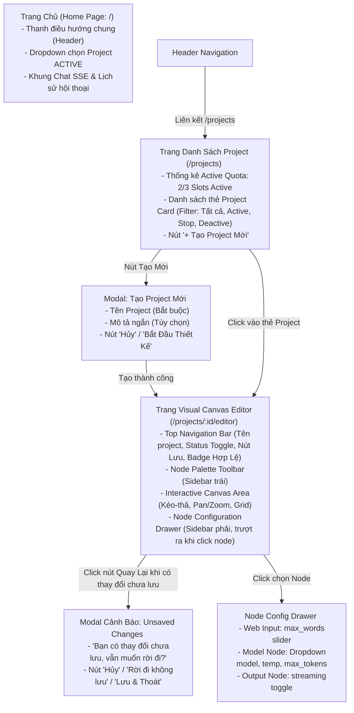

# 06. KIẾN TRÚC THÔNG TIN VÀ THIẾT KẾ TRẢI NGHIỆM NGƯỜI DÙNG (UX & INFORMATION ARCHITECTURE)
## Nhánh Tính Năng: Quản Lý Project (Project Management MVP)
### Hệ Thống: AI-Chan Virtual Assistant Platform

---

| Thông Tin Tài Liệu | Chi Tiết |
| :--- | :--- |
| **Mã Tài Liệu** | `DOC-PRJ-06` |
| **Trạng Thái** | `PROPOSED (Chờ Duyệt Từ Product Owner & UX Designer)` |
| **Vai Trò Phụ Trách** | Senior UX/System Designer & Frontend Architect |
| **Phiên Bản** | `1.0.0-MVP` |
| **Ngày Lập** | `2026-10-11` |

---

## 1. Bản Đồ Kiến Trúc Thông Tin & Điều Hướng (Information Architecture Map)



---

## 2. Thiết Kế Bản Sắc Giao Diện Đặc Thù (Custom Visual Identity & Aesthetic Direction)

> [!NOTE]
> **Định Hướng Phong Cách Thiết Kế Riêng Của AI-Chan**:
> Không sao chép nguyên mẫu giao diện sáng của n8n, Langflow hay Flowise. Phân hệ Project Management của AI-Chan kế thừa ngôn ngữ thiết kế **Dark Glassmorphism / Cyberpunk Neo-Minimalism** hiện có của dự án:
> - **Bảng màu chủ đạo**: Nền tối sâu thẳm (`#0a0f1d`), hiệu ứng làm mờ kính (`backdrop-filter: blur(16px)`), viền mờ tinh tế (`border: 1px solid rgba(255, 255, 255, 0.08)`).
> - **Màu sắc điểm nhấn (Accent Gradients)**: Dải màu tím - hồng neon (`linear-gradient(135deg, #6366f1, #a855f7, #ec4899)`) đặc trưng của AI-Chan.
> - **Dấu hiệu nhận biết đa chiều (Multi-dimensional Node Identification)**: Không chỉ dựa vào màu sắc (đảm bảo chuẩn Accessibility WCAG 2.1 AA), mà mỗi Node còn có **Icon đại diện riêng biệt**, **Badge phân loại văn bản**, **Vòng phát sáng viền khi được chọn (Neon Glow)**, và **Chấm trạng thái động**.

### Bảng Nhận Diện Trực Quan 3 Loại Node Trong Canvas MVP:
| Loại Node | Icon Nhận Diện | Nhóm Màu Phản Quang | Cổng Xuất / Cổng Nhập (Handles) | Thông Điệp Trực Quan |
| :--- | :---: | :--- | :--- | :--- |
| **Web Input Node** | 📥 | Cyan Neon (`#06b6d4` / `#38bdf8`) | Chỉ có **1 Cổng Xuất (Source Handle)** ở cạnh phải | Điểm tiếp nhận văn bản người dùng nhập từ giao diện chat |
| **Model Node** | 🧠 | Purple Neon (`#8b5cf6` / `#c084fc`) | **1 Cổng Nhập (Target)** ở cạnh trái, **1 Cổng Xuất (Source)** ở cạnh phải | Trái tim xử lý AI, kết nối tới LLM Gateway |
| **Output Node** | 💬 | Emerald Neon (`#10b981` / `#34d399`) | Chỉ có **1 Cổng Nhập (Target Handle)** ở cạnh trái | Đích đến hiển thị kết quả chat cho người dùng |

---

## 3. Bản Vẽ Bố Cục Giao Diện Dạng Khung Dây (Wireframe Layouts)

### 3.1. Bố Cục Trang Danh Sách Project (`/projects`)

```
+---------------------------------------------------------------------------------------------------+
|  ✨ AI-Chan        Trang Chủ    [ Projects ]    Mô Hình    Cài Đặt             [ Avatar ]  (Đăng xuất)|
+---------------------------------------------------------------------------------------------------+
|                                                                                                   |
|  QUẢN LÝ PROJECT                                                  [ + Tạo Project Mới ]           |
|  Xây dựng và điều phối các trợ lý AI theo luồng đồ họa                                            |
|                                                                                                   |
|  +---------------------------------------------------------------------------------------------+  |
|  |  Hạn Ngạch Project Đang Hoạt Động:  [ 2 / 3 Slots Active ]   [====== 67% ======--------]    |  |
|  +---------------------------------------------------------------------------------------------+  |
|                                                                                                   |
|  Bộ lọc: [ Tất cả (4) ]   [ Đang Hoạt Động (2) ]   [ Tạm Dừng (1) ]   [ Vô Hiệu Hóa (1) ]         |
|                                                                                                   |
|  +-------------------------+  +-------------------------+  +-------------------------+            |
|  | [🟢 ACTIVE]             |  | [🟢 ACTIVE]             |  | [🟡 STOP]               |            |
|  | Trợ Lý Lập Trình Python |  | Chuyên Gia Viết Báo Cáo |  | Bot Dịch Thuật Tiếng Nhật|          |
|  | Model: Gemini 3.8 Flash |  | Model: GPT-4o Mini      |  | Model: Claude 3.7 Sonnet |            |
|  | Giới hạn: 500 từ        |  | Giới hạn: 1000 từ       |  | Giới hạn: 300 từ         |            |
|  | Cập nhật: 10 phút trước |  | Cập nhật: 2 giờ trước   |  | Cập nhật: 1 ngày trước   |            |
|  | ----------------------- |  | ----------------------- |  | ----------------------- |            |
|  | [ Chỉnh Sửa ]  [ Dừng ] |  | [ Chỉnh Sửa ]  [ Dừng ] |  | [ Chỉnh Sửa ]  [ Bật ]  |            |
|  +-------------------------+  +-------------------------+  +-------------------------+            |
|                                                                                                   |
+---------------------------------------------------------------------------------------------------+
```

---

### 3.2. Bố Cục Màn Hình Visual Canvas Editor (`/projects/:id/editor`)

```
+---------------------------------------------------------------------------------------------------+
| [<- Quay lại]  Tên Project: [ Trợ Lý Lập Trình Python (✎) ]    [Trạng thái: 🟢 ACTIVE (v)]         |
|                                     [✓ Graph Hợp Lệ]    [ Lưu Graph ]   [ Kích Hoạt / Tạm Dừng ]  |
+---------------+-------------------------------------------------------------------+---------------+
| NODE PALETTE  |  CANVAS WORKFLOW AREA (Pan & Zoom, Grid Dots)                    | CONFIG PANEL  |
| (Kéo thả vào) |                                                                   | (Click node)  |
|               |       +--------------------+                                      |               |
| [📥 Web Input]|       | 📥 WEB INPUT       |                                      | CẤU HÌNH NODE |
| Nhận tin chat |       | max_words: 500 từ  |                                      | ------------- |
|               |       |               (Out)o--------+                             | 🧠 Model Node |
| [🧠 Model LLM]|       +--------------------+        |                             |               |
| Xử lý AI      |                                     |                             | Chọn Model:   |
|               |                     +---------------+----+                        | [Gemini 3.8 v]|
| [💬 Output]   |                     | 🧠 MODEL LLM       |                        |               |
| Kết quả chat  |                     | gemini-3.8-flash   |                        | Nhiệt độ:     |
|               |                     | temp: 0.7          |                        | [---o----] 0.7|
|               |                     o(In)           (Out)o--------+               |               |
|               |                     +--------------------+        |               | Max Tokens:   |
|               |                                                   |               | [ 2048      ] |
|               |                                  +----------------+----+          |               |
|               |                                  | 💬 OUTPUT           |          | Status Model: |
|               |                                  | Streaming: BẬT      |          | 🟢 Sẵn sàng   |
|               |                                  o(In)                 |          | (Key hợp lệ)  |
|               |                                  +---------------------+          |               |
|               |                                                                   | [ Đóng Panel ]|
+---------------+-------------------------------------------------------------------+---------------+
| Điều khiển Zoom: [ + ] [ - ] [ 100% ] [ Fit View ]                  Phím tắt: [Delete] [Ctrl+S]    |
+---------------------------------------------------------------------------------------------------+
```

---

### 3.3. Bố Cục Điểm Vào Chat Tại Trang Chủ (`/`)

```
+---------------------------------------------------------------------------------------------------+
|  ✨ AI-Chan        Trang Chủ    Projects    Mô Hình    Cài Đặt                 [ Avatar ]  (Đăng xuất)|
+---------------------------------------------------------------------------------------------------+
|                                                                                                   |
|                                        CHÀO MỪNG TRỞ LẠI!                                         |
|                                                                                                   |
|  Chọn Project Trợ Lý Đang Hoạt Động:                                                             |
|  +---------------------------------------------------------------------------------------------+  |
|  |  [ 🟢 Trợ Lý Lập Trình Python (Gemini 3.8 Flash - Tối đa 500 từ)                        (v)] |  |
|  +---------------------------------------------------------------------------------------------+  |
|                                                                                                   |
|  +---------------------------------------------------------------------------------------------+  |
|  |  LỊCH SỬ CHAT TRÊN PROJECT                                                                  |  |
|  |                                                                                             |  |
|  |  👤 Người dùng: Viết giúp tôi thuật toán Dijkstra bằng Python...                            |  |
|  |  🤖 Trợ Lý Lập Trình: Chào bạn! Dưới đây là mã nguồn thuật toán Dijkstra hoàn chỉnh:        |  |
|  |     ```python                                                                               |  |
|  |     import heapq                                                                            |  |
|  |     ...                                                                                     |  |
|  |     ```                                                                                     |  |
|  +---------------------------------------------------------------------------------------------+  |
|                                                                                                   |
|  +-------------------------------------------------------------------------------+ +-----------+  |
|  | Nhập câu hỏi của bạn... (Đã nhập: 45 / 500 từ)                                | | Gửi (Enter|  |
|  +-------------------------------------------------------------------------------+ +-----------+  |
|                                                                                                   |
+---------------------------------------------------------------------------------------------------+
```

---

## 4. Đặc Tả Các Trạng Thái Giao Diện (Comprehensive UI States)

| Trạng Thái | Màn Hình Áp Dụng | Mô Tả Trải Nghiệm Người Dùng (UX Feedback) |
| :--- | :--- | :--- |
| **Empty State** | Danh Sách Project | Hiển thị hình minh họa vector rỗng, dòng chữ: *"Bạn chưa tạo Project nào. Hãy xây dựng trợ lý AI đầu tiên của bạn chỉ trong 1 phút!"*, cùng nút bấm nổi bật `+ Tạo Project Đầu Tiên`. |
| **Loading State** | Danh Sách & Editor | Hiển thị Skeleton Loader mờ dần (Shimmer effect) theo đúng hình dạng các thẻ card và các khối node trên canvas; ngăn chặn click ảo trong lúc fetch API. |
| **Validation Error State** | Editor Canvas | Viền các node hoặc cạnh bị lỗi sẽ đổi sang màu đỏ cam rung nhẹ (shake animation). Thanh tiêu đề hiển thị badge đỏ: `⚠ Graph Chưa Hợp Lệ` kèm tooltip giải thích chi tiết lỗi (ví dụ: *"Thiếu dây nối sang Output"*). Nút Kích Hoạt bị vô hiệu hóa (disabled). |
| **Success State** | Toàn bộ hệ thống | Khi Lưu hoặc Đổi trạng thái thành công, hiển thị Toast thông báo màu xanh ngọc bích góc trên bên phải với icon checkmark; badge trạng thái chuyển màu mượt mà (Fade transition 200ms). |
| **Unsaved Changes State** | Editor Canvas | Nút "Lưu Graph" sáng đèn viền neon kèm dấu chấm tròn cam nhắc nhở; tiêu đề trang hiển thị `* Trợ Lý Lập Trình (Chưa lưu)`. Khi người dùng điều hướng rời trang hoặc refresh tab, hộp thoại xác nhận lập tức ngăn chặn. |
| **Quota Full Warning** | Danh Sách & Editor | Khi người dùng đạt giới hạn 3/3 project active, thanh tiến trình hiển thị màu đỏ cam cảnh báo. Nút chuyển sang Active của các project khác hiển thị tooltip: *"Đã hết hạn ngạch active (3/3). Hãy tạm dừng một project khác trước khi bật"*. |

---

## 5. Tiêu Chuẩn Trợ Năng & Thao Tác Bàn Phím (Accessibility & Keyboard Shortcuts)

1. **Phím Tắt Trên Canvas**:
   - `Ctrl + S` / `Cmd + S`: Lưu nhanh cấu hình graph.
   - `Delete` / `Backspace`: Xóa Node hoặc Cạnh (Edge) đang được chọn.
   - `Space + Drag Chuột`: Di chuyển toàn bộ vùng làm việc (Canvas Panning).
   - `Ctrl + 0`: Đưa Canvas về góc nhìn chuẩn vừa khít màn hình (Fit View 100%).
2. **Chuẩn Trợ Năng (Accessibility - WCAG 2.1 AA)**:
   - Toàn bộ các nút bấm và ô nhập liệu đều có thuộc tính `aria-label` và `title` mô tả hành động rõ ràng.
   - Các cổng kết nối (Handles) trên Node hỗ trợ tiêu điểm (Focus ring) khi duyệt bằng phím `Tab`.
   - Độ tương phản chữ (Contrast Ratio) giữa văn bản và nền đạt tối thiểu **4.5:1** cho văn bản thông thường và **3:1** cho văn bản lớn.
