# 07. ĐÁNH GIÁ AN NINH VÀ MÔ HÌNH RỦI RO (SECURITY & THREAT MODEL REVIEW)
## Nhánh Tính Năng: Quản Lý Project (Project Management MVP)
### Hệ Thống: AI-Chan Virtual Assistant Platform

---

| Thông Tin Tài Liệu | Chi Tiết |
| :--- | :--- |
| **Mã Tài Liệu** | `DOC-PRJ-07` |
| **Trạng Thái** | `PROPOSED (Chờ Duyệt Từ Security Reviewer)` |
| **Vai Trò Phụ Trách** | Application Security Reviewer & Solution Architect |
| **Phiên Bản** | `1.0.0-MVP` |
| **Ngày Lập** | `2026-10-11` |

---

## 1. Ranh Giới Tin Cậy & Phân Vùng Tài Sản (Trust Boundaries & Assets)

```mermaid
flowchart TD
    subgraph UntrustedZone["VÙNG KHÔNG TIN CẬY (Untrusted Client Environment)"]
        Attacker["Kẻ Tấn Công / Người Dùng Bên Ngoài"]
        Browser["Trình Duyệt Web Client (Next.js SPA)"]
    end

    subgraph TrustBoundary1["Ranh Giới Tin Cậy 1 (Network Boundary: HTTPS / WAF)"]
        RateLimiter["Rate Limiter & Ingress Defense"]
        JWTAuth["JWT Authentication & Anti-IDOR Middleware"]
    end

    subgraph TrustedBackend["VÙNG TIN CẬY NỘI BỘ (Trusted Application Core)"]
        FastAPI["FastAPI Project Service & Graph Validator"]
        DBEngine[("SQLite Database (app.db) \n projects, users, models")]
        EnvSecrets["Environment Variables (.env) \n GEMINI_API_KEY, OPENAI_API_KEY"]
    end

    subgraph TrustBoundary2["Ranh Giới Tin Cậy 2 (Egress Boundary: TLS / External APIs)"]
        AIGateway["AI Gateway Client (Multi-Provider)"]
    end

    subgraph ExternalZone["VÙNG DỊCH VỤ BÊN NGOÀI (External Cloud Providers)"]
        GoogleAI["Google Gemini Cloud"]
        OpenAICloud["OpenAI API Cloud"]
    end

    Browser -->|Gửi Token & Request HTTP| TrustBoundary1
    TrustBoundary1 --> FastAPI
    FastAPI --> DBEngine
    FastAPI --> EnvSecrets
    FastAPI --> TrustBoundary2
    TrustBoundary2 --> ExternalZone

    style UntrustedZone fill:#331111,stroke:#ef4444,stroke-width:1px
    style TrustedBackend fill:#112233,stroke:#3b82f6,stroke-width:2px
    style EnvSecrets fill:#441122,stroke:#f43f5e,stroke-width:2px
```

### Bảng Phân Loại Tài Sản Cần Bảo Vệ (Critical Assets):
1. **API Key của các Nhà Cung Cấp Mô Hình (Provider Secrets)**: Mức độ nhạy cảm: `CRITICAL`. Rò rỉ sẽ gây thất thoát tài chính và lộ quyền truy cập tài khoản cloud.
2. **Cấu Hình Graph & Dữ Liệu Project Của Người Dùng**: Mức độ nhạy cảm: `HIGH`. Rò rỉ sẽ làm lộ ý tưởng prompt, cấu trúc workflow riêng tư (IDOR).
3. **Nội Dung Hội Thoại & Dữ Liệu Chat (Chat Messages)**: Mức độ nhạy cảm: `HIGH`. Chứa thông tin cá nhân hoặc nghiệp vụ của người dùng.
4. **Hạn Ngạch Tài Nguyên Hệ Thống (Active Quotas & LLM Tokens)**: Mức độ nhạy cảm: `MEDIUM`. Lạm dụng sẽ gây cạn kiệt tài nguyên máy chủ (DoS) hoặc hóa đơn API tăng đột biến.

---

## 2. Mô Hình Đe Dọa STRIDE Chi Tiết Cho Nhánh Project

| Mã Đe Dọa | Phân Loại STRIDE | Mục Tiêu Tấn Công | Mô Tả Kịch Bản Tấn Công | Mức Độ Rủi Ro | Biện Pháp Kiểm Soát & Phòng Thủ (`PRJ-CTRL-xxx`) |
| :--- | :--- | :--- | :--- | :---: | :--- |
| **PRJ-THR-001** | **Spoofing (Giả Mạo)** | Danh tính chủ sở hữu project | Kẻ tấn công giả mạo token JWT của người dùng khác để can thiệp project đã lưu. | **TRUNG BÌNH (Medium)** | **PRJ-CTRL-001**: Cho phép tạo project mới mở không cần token (Guest mode); đối với thao tác có token xác thực thì kiểm tra chữ ký HS256 và bảo vệ chống IDOR qua `user_id`. |
| **PRJ-THR-002** | **Tampering (Sửa Đổi Trái Phép)** | Cấu trúc Graph & Tham số Node | Kẻ tấn công can thiệp HTTP payload để gửi graph chứa 100 node, tham số `max_tokens = 999999`, hoặc model ID không có thật để gây lỗi backend. | **CAO (High)** | **PRJ-CTRL-002**: Kiểm tra tính hợp lệ toàn diện ở tầng Server-side (`GraphValidationEngine`) trước khi ghi DB; ép kiểu nghiêm ngặt bằng Pydantic schema v2; giới hạn cứng `max_words` và `max_tokens`. |
| **PRJ-THR-003** | **Repudiation (Chối Bỏ)** | Thao tác kích hoạt / xóa project | Người dùng chối bỏ việc kích hoạt project gây tốn chi phí hoặc xóa nhầm project. | **THẤP (Low)** | **PRJ-CTRL-003**: Ghi log kiểm toán (Audit Trail) chi tiết mỗi lần thay đổi trạng thái project (`timestamp`, `user_id`, `project_id`, `old_status`, `new_status`). |
| **PRJ-THR-004** | **Information Disclosure (Lộ Lọt Thông Tin / IDOR)** | Đọc trộm cấu hình project của người khác | Kẻ tấn công dò quét UUID của project khác (`GET /api/v1/projects/{other_user_proj_id}`) để xem cấu hình prompt và graph. | **NGHIÊM TRỌNG (Critical)** | **PRJ-CTRL-004**: Kiểm soát truy cập chặt chẽ (Anti-IDOR Enforcement). Mọi câu truy vấn SQL đều bắt buộc phải kèm điều kiện: `WHERE id = :proj_id AND user_id = :current_user_id`. Trả về `404 Not Found` để không làm lộ sự tồn tại của ID. |
| **PRJ-THR-005** | **Information Disclosure (Lộ API Key)** | Lộ khóa bí mật Provider | Cấu hình Model Node hoặc response API vô tình đính kèm `GEMINI_API_KEY` hoặc `OPENAI_API_KEY`. | **NGHIÊM TRỌNG (Critical)** | **PRJ-CTRL-005**: Cơ chế cô lập bí mật tuyệt đối. Bảng `projects` và `graph_data` chỉ lưu chuỗi `model_id` (ví dụ: `gemini-3.8-flash`). API response không bao giờ chứa key. Key chỉ được nạp từ Server Environment Variables khi gọi LLM. |
| **PRJ-THR-006** | **Denial of Service (Từ Chối Dịch Vụ / Lạm Dụng Quota)** | Hạn ngạch `MAX_ACTIVE_PROJECTS` | Kẻ tấn công gửi hàng chục request đồng thời (Race Condition) để kích hoạt vượt quá giới hạn 3 project active nhằm chiếm dụng tài nguyên. | **TRUNG BÌNH (Medium)** | **PRJ-CTRL-006**: Cưỡng chế hạn ngạch bằng Database Transaction độc quyền (`BEGIN IMMEDIATE` trong SQLite) hoặc câu lệnh Atomic Update có điều kiện, đảm bảo không thể vượt quá giới hạn ngay cả khi có xung đột đồng thời. |
| **PRJ-THR-007** | **Denial of Service (Spam Input Chat)** | Gửi tin nhắn cực dài | Người dùng cố tình gửi tin nhắn văn bản dài 100.000 từ để làm cạn kiệt token và bộ nhớ máy chủ. | **CAO (High)** | **PRJ-CTRL-007**: Kiểm tra độ dài văn bản và số lượng từ (`max_words`) tại Backend trước khi thực hiện bất kỳ lệnh gọi suy luận AI nào. Nếu vượt quá, lập tức ngắt kết nối với mã lỗi HTTP 400. |
| **PRJ-THR-008** | **Information Disclosure / Elevation (IDOR trên Conversation ID)** | Đánh cắp hoặc tiêm tin nhắn vào conversation của người khác / project khác | Kẻ tấn công gửi `conversation_id` của User khác hoặc Project khác vào `POST /projects/{id}/chat` hoặc `GET /projects/{id}/chat/stream`. | **NGHIÊM TRỌNG (Critical)** | **PRJ-CTRL-008**: Bắt buộc xác thực hai lớp tại Backend: (1) `conversation.user_id == current_user.id` (hoặc guest), và (2) `conversation.project_id == project_id`. Trả về `404 Not Found` hoặc `400 Bad Request` nhất quán; không bao giờ thực thi hoặc phát luồng nếu vi phạm sở hữu. |

---

## 3. Phân Tích Rủi Ro SSRF: Tuyên Bố Không Khả Dụng (SSRF Non-Applicability Statement)

> [!IMPORTANT]
> **Khẳng Định An Ninh Về Nguy Cơ Server-Side Request Forgery (SSRF)**:
> Trong một số hệ thống tự động hóa (như n8n, Zapier), "Web Node" có thể là HTTP Request Node dùng để gọi đến các URL bên ngoài, tiềm ẩn nguy cơ SSRF (tấn công dịch vụ nội bộ mạng LAN / AWS Metadata `169.254.169.254`).
> 
> **Tuy nhiên, trong AI-Chan Project Management MVP**:
> - `Web Input Node` là một **Text Input Handler thuần túy**, có nhiệm vụ tiếp nhận chuỗi ký tự văn bản do người dùng gõ từ ô chat trên trình duyệt web.
> - `Web Input Node` **HOÀN TOÀN KHÔNG CÓ** tính năng gọi URL, không fetch dữ liệu từ Internet, không tải file từ webhook, và không thực hiện bất kỳ yêu cầu mạng outbound nào.
> - **Kết luận**: Nguy cơ tấn công **SSRF là KHÔNG KHẢ DỤNG (NOT APPLICABLE)** đối với Web Input Node trong phạm vi MVP. Mọi đề xuất bảo vệ mạng nội bộ đối với node này là không cần thiết và gây lãng phí phạm vi thiết kế.

---

## 4. Xử Lý Che Dấu Lỗi Của Nhà Cung Cấp Ngoài (Provider Error Leakage & Log Redaction)

Khi các nhà cung cấp bên ngoài (Google, OpenAI, Groq) trả về lỗi (ví dụ: `401 Invalid API Key`, `429 Rate Limit Exceeded`, hoặc chứa stack trace nội bộ):
1. **Quy Tắc Che Dấu Ra Giao Diện (Client Error Masking)**:
   - Backend bắt toàn bộ ngoại lệ từ HTTP Client gọi sang Provider.
   - Tuyệt đối **KHÔNG** chuyển tiếp nguyên văn thông báo lỗi của Provider về cho Client.
   - Chuẩn hóa thành mã lỗi thân thiện và an toàn:
     - Lỗi API key hoặc Provider hỏng: Trả về `{"error_code": "AI_SERVICE_UNAVAILABLE", "message": "Dịch vụ AI tạm thời gián đoạn. Vui lòng thử lại sau"}`.
     - Lỗi Rate Limit: Trả về `{"error_code": "AI_RATE_LIMITED", "message": "Hệ thống AI đang quá tải. Vui lòng chờ 30 giây trước khi thử lại"}`.
2. **Quy Tắc Làm Sạch Nhật Ký (Log Redaction)**:
   - Trong log máy chủ, các trường nhạy cảm (`Authorization`, `key`, `password`, `prompt` chứa dữ liệu riêng tư) phải được tự động cắt gọt hoặc thay thế bằng `[REDACTED]`.

---

## 5. Bảng Đăng Ký Rủi Ro Toàn Diện (Risk Register)

| Mã Rủi Ro | Mô Tả Rủi Ro Kỹ Thuật / Nghiệp Vụ | Xác Suất Xảy Ra (Likelihood) | Mức Độ Tác Động (Impact) | Mức Độ Rủi Ro Tổng Hợp | Biện Pháp Giảm Thiểu Cụ Thể | Trách Nhiệm Phụ Trách |
| :--- | :--- | :---: | :---: | :---: | :--- | :--- |
| **RSK-PRJ-01** | Người dùng xem hoặc sửa trộm project của người khác qua IDOR | Thấp (Low) | Rất Cao (Critical) | **TRUNG BÌNH** | Cưỡng chế bộ lọc `user_id` ở tầng Repository và API Middleware; viết Integration Test kiểm tra IDOR tự động. | Backend Lead |
| **RSK-PRJ-02** | Xung đột Race Condition kích hoạt vượt quá `MAX_ACTIVE_PROJECTS` | Trung Bình (Med) | Trung Bình (Med) | **TRUNG BÌNH** | Sử dụng Database Transaction khóa độc quyền (`BEGIN IMMEDIATE`) trong SQLite; viết Stress Test kiểm tra 20 request đồng thời. | Solution Architect |
| **RSK-PRJ-03** | Khóa API Key của Provider bị rò rỉ trong response JSON | Rất Thấp (Low) | Rất Cao (Critical) | **TRUNG BÌNH** | Tuyệt đối không lưu key trong bảng `projects` hay `graph_data`; dùng Pydantic `exclude` các trường nhạy cảm. | Security Reviewer |
| **RSK-PRJ-04** | Người dùng gửi văn bản dài làm cạn kiệt quota token LLM | Cao (High) | Trung Bình (Med) | **CAO** | Cưỡng chế `max_words` nghiêm ngặt tại Backend; tích hợp Quota Telemetry Middleware (`src/core/telemetry.py`). | Backend & QA |
| **RSK-PRJ-05** | Model AI đã chọn bị Admin xóa hoặc vô hiệu hóa trong lúc project đang active | Trung Bình (Med) | Thấp (Low) | **THẤP** | Bổ sung cơ chế Fallback an toàn: Khi chat phát hiện model không còn active, trả về lỗi `MODEL_UNAVAILABLE` có hướng dẫn, không crash. | Backend Lead |
